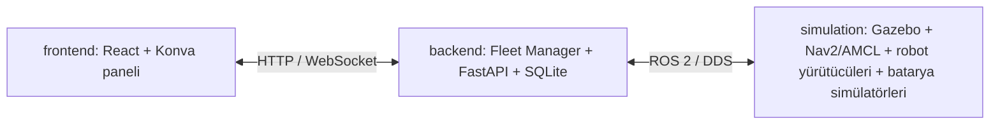

# ROS 2 Fleet Manager

ROS 2 simülasyonunda çok robotlu pickup/dropoff görevlerini yönetmek ve web üzerinden izlemek için geliştirilen filo yönetim projesi.

## Mimari özeti

Üç servisli hedef **ONAYLANDI**; nihai uygulamanın uçtan uca çalışması **HENÜZ TEST EDİLMEDİ**.



`simulation` robot başına düğümleri, `backend` görev ve kaynak yönetimini, `frontend` kullanıcı arayüzünü barındıracaktır. Taşıma akışı: Fleet Manager → ExecuteTask → Robot Executor → Nav2. Ayrıntı ve kaynak önceliği [dokümantasyon haritasındadır](docs/README.md).

24 Ekim 2026 depo kontrolünde mevcut uygulama, DDS ve simülasyon doğrulama altyapısıdır. Fleet Manager, Robot Executor, Battery Simulator, FastAPI ve React uygulamaları henüz yoktur. Testlerdeki `backend` servisi bir doğrulama istemcisidir.

## Gereksinimler

Docker ve Docker Compose gerekir. Kayıtlı deney ortamı linux/arm64, ROS 2 Humble ve Gazebo Fortress kullanır; headless yazılım render ayrıntıları ve sürümler [doğrulama kayıtlarındadır](docs/validation/README.md). Başka platformlarda çalışma doğrulanmadı.

## Hızlı başlangıç

Henüz nihai uygulama Compose dosyası ve açılabilecek web paneli yoktur. Depo kökünde aşağıdaki komut yalnız DDS yapılandırmasını doğrular; container başlatmaz. 24 Ekim 2026 tarihinde çıkış kodu 0 ile kontrol edildi:

```sh
DDS_TEST_PAYLOAD=organization-audit docker compose -f docker/compose/docker-compose.dds.yml config --quiet
```

Diğer test birleşimleri ve mevcut image bağımlılıkları için [Compose kılavuzuna](docker/compose/README.md) bakın. Canlı test komutları tarihsel kanıtlarda bulunur; bu organizasyon çalışmasında yeniden çalıştırılmadı.

## Konfigürasyon

[config/](config/) mevcut test JSON dosyalarını, şemalarını, Nav2 parametrelerini, haritayı ve C1 çıktısı olan tek filo tanım kaynağını içerir:
- [config/fleet.yaml](config/fleet.yaml): Filo, harita, batarya modelleri, istasyonlar ve operasyon politikalarının tek tanım kaynağı.
- [config/fleet.schema.json](config/fleet.schema.json): Draft 2020-12 uyumlu JSON şeması.
- Doğrulayıcı paket: [fleet_config/](fleet_config/) (Pydantic veri sözleşmesi ve varlık kontrolü). Ayrıntılar [C1 dokümanında](docs/configuration-c1.md).

DDS ortam ayarları [dds.env](config/dds.env) ve [dds-action.env](config/dds-action.env) içindedir. Yeni robot ekleme yalnız YAML konfigürasyonu ile doğrulanmıştır; ancak 3+ robotun canlı simülasyon performansı henüz test edilmemiştir.

## Proje yapısı

| Dizin | İçerik |
|---|---|
| [docker/compose/](docker/compose/) | Sekiz doğrulama Compose dosyası |
| [docker/](docker/) | Dockerfile, doğrulama kodları ve bunların testleri |
| [config/](config/) | Test ayarları, şemalar, filo tanımı (`fleet.yaml`) ve harita |
| [fleet_config/](fleet_config/) | C1 konfigürasyon veri modelleri, yükleyici ve CLI doğrulayıcı |
| [interfaces/](interfaces/) | Geçici DDS TransportProbe arayüzü; ExecuteTask değildir |
| [scripts/](scripts/) | B3 Retry çalıştırma ve kaynak ölçüm betiği |
| [tests/](tests/) | C1 sözleşme, şema ve sınır testleri (`test_config.py`) |
| [docs/](docs/README.md) | Mimari, karar geçmişi, konfigürasyon ve doğrulama kayıtları |

Yerel `backend/`, `frontend/` ve `ros2_ws/src/` dizinleri henüz boştur; Git boş dizinleri taşımaz.

## Geliştirme

- **C1 Konfigürasyon Testleri (74 test):**
  ```sh
  PYTHONPATH=. uv run --with-requirements requirements-c1.txt pytest tests/test_config.py
  ```
- **CLI Konfigürasyon Doğrulama:**
  ```sh
  PYTHONPATH=. uv run --with-requirements requirements-c1.txt python -m fleet_config config/fleet.yaml
  ```
- **Simülasyon testleri:** Altı `test_config.py` dosyası ilgili `docker/` alt dizinlerinde bulunur; container içindeki `/config` ve `/opt` yollarını kullanır. Çalıştırma kayıtları [aşama raporlarının komut eklerindedir](docs/validation/README.md).

## Sorun giderme

Compose dosyaları tek başına uygulama kurulumu değildir; [belirtilen sırayla](docker/compose/README.md) birleştirilir. B2 ve sonraki testler önceden hazırlanmış Nav2 image'ına dayanır; miras alınan build tarifi nedeniyle gelişigüzel yeniden derleme yapılmamalıdır. DDS keşfi ve render sorunları başarısız koşularıyla birlikte korunmuştur.

## Dokümantasyon bağlantıları

- [Dokümantasyon haritası](docs/README.md)
- [C1 Konfigürasyon Belgesi](docs/configuration-c1.md)
- [C1 Doğrulama Raporu](docs/validation/c1/c1-validation-2026-10-24.md)
- [Birincil nihai mimari PDF](docs/ROS2_Fleet_Manager_Nihai_Mimari_Kararlar_2026-10-23.pdf)
- [Kalıcı proje bağlamı](docs/project-context.md) ve [çalışma kuralları](AGENTS.md)
- [Doğrulama kayıtları](docs/validation/README.md)
- [Önceki README arşivi](docs/archive/readme-v2.x.md)

## Yol haritası

- [x] **C1 — Konfigürasyon:** `fleet.yaml`, şema, Pydantic doğrulayıcı, 1-2-3 robot desteği (**DOĞRULANDI**)
- [ ] **C2 — Robot Executor:** `ExecuteTask.action`, `RobotStatus.msg`, `fleet_robot_executor` (Planlanan)
- [ ] **C3 — Fleet Manager:** Öncelik/FIFO, preemption, SQLite Outbox (Planlanan)
- [ ] **C4 — Batarya ve Enerji:** Wh modeli, Battery Simulator, şarj/park yöneticisi (Planlanan)
- [ ] **C5 — API ve Panel:** FastAPI, WebSocket, React + Konva 2D arayüz (Planlanan)

Kabul ölçütleri [nihai mimari belgede](docs/ROS2_Fleet_Manager_Nihai_Mimari_Kararlar_2026-10-23.md#14-c-aşaması-c1c5-geliştirme-yol-haritası) tanımlıdır.

## Lisans ve katkı

[Apache-2.0](LICENSE). Değişikliklerde [AGENTS.md](AGENTS.md) kuralları ve mevcut kanıtların korunması esastır.
