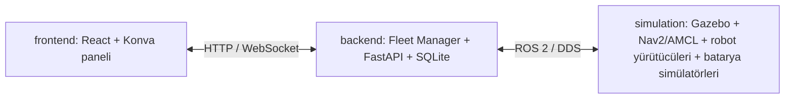

# ROS 2 Fleet Manager

ROS 2 simülasyonunda çok robotlu pickup/dropoff görevlerini yönetmek ve web üzerinden izlemek için geliştirilen filo yönetim projesi.

## Mimari özeti

Üç servisli hedef **ONAYLANDI**; nihai uygulamanın uçtan uca çalışması **HENÜZ TEST EDİLMEDİ**.



`simulation` robot başına düğümleri, `backend` görev ve kaynak yönetimini, `frontend` kullanıcı arayüzünü barındıracaktır. Taşıma akışı: Fleet Manager → ExecuteTask → Robot Executor → Nav2. Ayrıntı ve kaynak önceliği [dokümantasyon haritasındadır](docs/README.md).

24 Ekim 2026 depo kontrolünde mevcut uygulama, DDS ve simülasyon doğrulama altyapısıdır. Fleet Manager, Robot Executor, Battery Simulator, FastAPI ve React uygulamaları henüz yoktur. Testlerdeki `backend` servisi bir doğrulama istemcisidir.

## Gereksinimler

Docker ve Docker Compose gerekir. Kayıtlı deney ortamı linux/arm64, ROS 2 Humble ve Gazebo Fortress kullanır; headless yazılım render ayrıntıları ve sürümler [doğrulama kayıtlarındadır](docs/validation/README.md). Başka platformlarda çalışma doğrulanmadı.

## Hızlı başlangıç

Henüz nihai uygulama Compose dosyası ve açılabilecek web paneli yoktur. Depo kökünde aşağıdaki komut yalnız DDS yapılandırmasını doğrular; container başlatmaz. 24 Ekim 2026 tarihinde çıkış kodu 0 ile kontrol edildi:

```sh
DDS_TEST_PAYLOAD=organization-audit docker compose -f docker/compose/docker-compose.dds.yml config --quiet
```

Diğer test birleşimleri ve mevcut image bağımlılıkları için [Compose kılavuzuna](docker/compose/README.md) bakın. Canlı test komutları tarihsel kanıtlarda bulunur; bu organizasyon çalışmasında yeniden çalıştırılmadı.

## Konfigürasyon

[config/](config/) mevcut test JSON dosyalarını, şemalarını, Nav2 parametrelerini ve haritayı içerir. DDS ortam ayarları [dds.env](config/dds.env) ve [dds-action.env](config/dds-action.env) içindedir.

Hedef tek filo kaynağı `config/fleet.yaml` ve şeması C1'de oluşturulacaktır. Yeni robotun yalnız filo konfigürasyonuyla tanımlanması hedef karardır; henüz uygulanmış değildir. İstasyonların YAML içindeki yerleşim çelişkisi C1 öncesinde karara bağlanmalıdır.

## Proje yapısı

| Dizin | İçerik |
|---|---|
| [docker/compose/](docker/compose/) | Sekiz doğrulama Compose dosyası |
| [docker/](docker/) | Dockerfile, doğrulama kodları ve bunların testleri |
| [config/](config/) | Test ayarları, şemalar ve harita |
| [interfaces/](interfaces/) | Geçici DDS TransportProbe arayüzü; ExecuteTask değildir |
| [scripts/](scripts/) | B3 Retry çalıştırma ve kaynak ölçüm betiği |
| [docs/](docs/README.md) | Mimari, karar geçmişi ve doğrulama kayıtları |

Yerel `backend/`, `frontend/`, `ros2_ws/src/` ve `tests/` dizinleri henüz boştur; Git boş dizinleri taşımaz.

## Geliştirme

Altı `test_config.py` dosyası ilgili `docker/` alt dizinlerinde bulunur; container içindeki `/config` ve `/opt` yollarını kullanır. Çalıştırma kayıtları [aşama raporlarının komut eklerindedir](docs/validation/README.md). Kökten genel bir test komutu veya uygulama lint/derleme düzeni henüz tanımlı değildir.

## Sorun giderme

Compose dosyaları tek başına uygulama kurulumu değildir; [belirtilen sırayla](docker/compose/README.md) birleştirilir. B2 ve sonraki testler önceden hazırlanmış Nav2 image'ına dayanır; miras alınan build tarifi nedeniyle gelişigüzel yeniden derleme yapılmamalıdır. DDS keşfi ve render sorunları başarısız koşularıyla birlikte korunmuştur.

## Dokümantasyon bağlantıları

- [Dokümantasyon haritası](docs/README.md)
- [Birincil nihai mimari PDF](docs/ROS2_Fleet_Manager_Nihai_Mimari_Kararlar_2026-10-23.pdf)
- [Kalıcı proje bağlamı](docs/project-context.md) ve [çalışma kuralları](AGENTS.md)
- [Doğrulama kayıtları](docs/validation/README.md)
- [Önceki README arşivi](docs/archive/readme-v2.x.md)

## Yol haritası

C1 konfigürasyon → C2 Robot Executor → C3 Fleet Manager → C4 batarya/enerji → C5 API/panel. Kabul ölçütleri [nihai mimari belgede](docs/ROS2_Fleet_Manager_Nihai_Mimari_Kararlar_2026-10-23.md#14-c-aşaması-c1c5-geliştirme-yol-haritası) tanımlıdır. Geçmiş B3 Retry başarısı C1–C5'in tamamlandığını göstermez.

## Lisans ve katkı

[Apache-2.0](LICENSE). Değişikliklerde [AGENTS.md](AGENTS.md) kuralları ve mevcut kanıtların korunması esastır.
