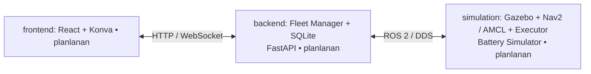

# ROS 2 Fleet Manager

Headless ROS 2 simülasyonunda çok robotlu pickup/dropoff görevlerini öncelik, rota ve enerji uygunluğuna göre yöneten; web üzerinden izleme ve kontrol hedefleyen filo yönetim projesi.

## Temel özellikler

- **Mevcut:** Tek `fleet.yaml`, şema/Pydantic doğrulaması; robot başına Executor; HIGH/MEDIUM/LOW ve atanabilir FIFO; güvenli preemption; SQLite Outbox ve ROS 2 adaptörleri.
- **Kısmi:** Enerji uygunluğu ve istasyon rezervasyonu kodu mevcut; fiziksel batarya, otomatik şarj/park orkestrasyonu tamamlanmadı.
- **Planlanan:** Bağımsız Battery Simulator, FastAPI, WebSocket ve React + Konva 2D panel. Video akışı aktarılmayacak.

## Mimari genel bakış

Üç servisli hedef **ONAYLANDI**; nihai üç servis dağıtımı **HENÜZ TEST EDİLMEDİ**.



`simulation`, robot başına bağımsız düğümleri barındırır. `backend`, görev/sahiplik kararlarını ve kalıcılığı yönetir. `frontend`, backend üzerinden telemetri ve görevleri gösterir; DDS ağına bağlanmaz.

### Mimari ve algoritmalar

[18 akışlık diyagram kataloğu](docs/diagrams/README.md), düzenlenebilir Mermaid ve SVG çıktılarıyla görev seçimi, iptal, epoch/session, Outbox, enerji, şarj/park ve panel akışlarını açıklar. Her akışın uygulama durumu ve kaynakları belirtilmiştir; [kod/karar farkları](docs/validation/organization/organization-validation-2026-10-26.md) ayrıca raporlanır.

## Kullanılan teknolojiler

Mevcut altyapı: Python, Pydantic, JSON Schema, SQLite, ROS 2 Humble/rclpy, Cyclone DDS, Nav2/AMCL, Gazebo Fortress ve Docker Compose. Python bağımlılıkları [requirements-c1.txt](requirements-c1.txt), image/build tanımları [docker/](docker/) altında tutulur. FastAPI, React ve Konva C5 hedefidir.

Kayıtlı canlı deney ortamı Apple Silicon / linux-arm64 container'lardır. Diğer platformlar ayrıca doğrulama gerektirir. Headless yazılım render ve Nav2 image bağımlılıkları için [Compose kılavuzuna](docker/compose/README.md) bakın.

## Klasör yapısı

```text
backend/fleet_manager/   Domain, tek consumer, SQLite ve ROS adaptörleri
fleet_config/           Paylaşılan filo doğrulayıcı ve CLI
frontend/               Planlanan arayüz; henüz uygulama yok, boş dizin Git'te taşınmaz
ros2_ws/src/             Robot Executor ROS 2 paketi
interfaces/             Ürün IDL ve ayrı DDS probe test arayüzü
config/                 fleet.yaml, şema, harita ve test yapılandırmaları
docker/compose/         Doğrulama Compose katmanları
docker/                 Dockerfile ve container test araçları
scripts/                Canlı test çalıştırıcıları
tests/                  Host/ROS otomatik testleri
docs/architecture/      Mimari kayıtlar ve kaynak dizini
docs/decisions/         C2–C3.3.3 onaylı karar kayıtları
docs/design/            Ayrıntılı tasarımlar ve Outbox sözleşmesi
docs/diagrams/          Mermaid kaynakları, SVG ve kapsam kataloğu
docs/validation/        Tarihli test raporları ve komut ekleri
```

PDF'ler, kişisel notlar ve tarihsel bağlantılar korunur. Ayrıntılı belge dizini [docs/README.md](docs/README.md) altındadır.

## Kurulum ve çalıştırma

Nihai uygulama Compose'u ve açılabilecek web paneli henüz yoktur. Depo kökünde `uv` ve Python ile aşağıdaki kontroller 26 Ekim 2026'da çalıştırıldı:

```sh
PYTHONPATH=. uv run --with-requirements requirements-c1.txt python -m fleet_config config/fleet.yaml
PYTHONPATH=.:backend:ros2_ws/src/fleet_robot_executor uv run --with-requirements requirements-c1.txt pytest tests/ ros2_ws/src/fleet_robot_executor/test/ --import-mode=importlib -q
```

Docker/Compose kuruluysa yalnız yapılandırmayı kontrol eden, container başlatmayan komut:

```sh
DDS_TEST_PAYLOAD=organization-audit docker compose -f docker/compose/docker-compose.dds.yml config --quiet
```

Canlı simülasyon için [katman sırası ve image önkoşullarını](docker/compose/README.md) izleyin. B2 ve sonraki katmanlarda `up --build` doğru Nav2 image'ını üretme garantisi vermez. Geçmiş canlı komutlar [doğrulama kayıtlarında](docs/validation/README.md) bulunur; bu düzenlemede yeniden koşulmadı.

Tek filo kaynağı [fleet.yaml](config/fleet.yaml); alanlar ve birimler [C1 belgesinde](docs/configuration-c1.md) açıklanır. 1/2/3 robot config doğrulaması canlı hot-add veya üç robot performans kanıtı değildir.

## Görev yürütme akışı

1. Fleet Manager görevi öncelik/FIFO sırasına alır; rota ve Wh uygunluğuna göre en yakın uygun robotu seçer.
2. Atama ve Outbox atomik kaydedilir. `ExecuteTask` robotun Executor'ına gönderilir.
3. Executor, Nav2 ile pickup → yükleme → dropoff → boşaltma adımlarını yürütür.
4. `RobotStatus` fiziksel durumu bildirir; eşleşen epoch/UUID ile terminal result görevi kapatır. İptal kabulü terminal `PREEMPTED` yerine geçmez.

## Mevcut geliştirme durumu

| Aşama | Kod / uygulama | Kanıt ve sınır |
|---|---|---|
| C1 | Konfigürasyon doğrulayıcı mevcut | 1, 2, 3 robot sözleşme testleri; Apply API yok |
| C2 | Executor ve ürün IDL mevcut | Tek robot canlı simülasyon tarihsel kanıtı |
| C3–C3.3.3 | Domain, Outbox, adaptör ve iki robot test altyapısı mevcut | Tarihsel canlı rapor var; statik incelemede açık güvenlik/entegrasyon farkları bulundu |
| C4 | Kısmi enerji/rezervasyon altyapısı | Battery Simulator ve otomatik şarj/park yönetimi yok; test bataryası kalibrasyon değildir |
| C5 | Planlanan | API, WebSocket ve frontend yok |

## Testler ve doğrulama sonuçları

26 Ekim host koşusunda **224 geçti, 19 atlandı**; atlanan ROS bağımlı testler başarı sayılmaz. Filo CLI ve on Compose birleşiminin yapılandırması doğrulandı. [Bu çalışmanın raporu](docs/validation/organization/organization-validation-2026-10-26.md) komutları ve sınırları içerir.

Tarihsel kanıtlar: C2.3 tek robotta 7/7 senaryo; C3.3.3 raporunda 10/10 senaryo; B3 Retry'da 2/2 temiz koşu. AMCL kasıtlı ofset testi **1 geçti / 1 kaldı**. Bunlar küresel çarpışmasız trafik, dar koridor deadlock, 3+ robot ölçeği veya nihai üç servis dağıtımı kanıtı değildir. [Tüm kayıtlar](docs/validation/README.md).

## Yol haritası

C1 → C2 → C3 temel uygulamaları mevcut. Sonraki aşamalar: belgelenen uygulama farklarının ayrı görevlerde ele alınması; C4 bağımsız batarya ve şarj/park yönetimi; C5 API/panel ve nihai üç servis doğrulaması. Üçüncü robotun dinamik eklenmesi ve iki robotlu takas genişletilmiş kapsamdır; MVP'de takas kapalıdır.

## Dokümantasyon bağlantıları

- [Dokümantasyon haritası](docs/README.md) ve [diyagram kataloğu](docs/diagrams/README.md)
- [Nihai mimari PDF](docs/ROS2_Fleet_Manager_Nihai_Mimari_Kararlar_2026-10-23.pdf), [sonraki kararlar](docs/decisions/README.md) ve [mimari kaynaklar](docs/architecture/README.md)
- [Kalıcı proje bağlamı](docs/project-context.md), [AGENTS.md](AGENTS.md) ve [doğrulama kayıtları](docs/validation/README.md)

Lisans: [Apache-2.0](LICENSE).
