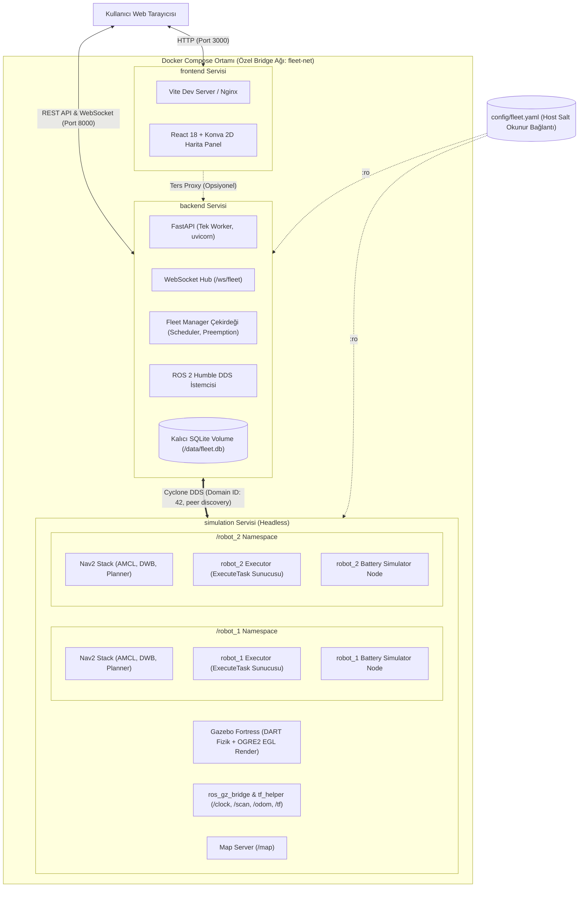
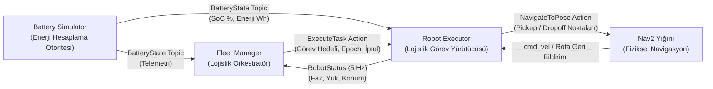
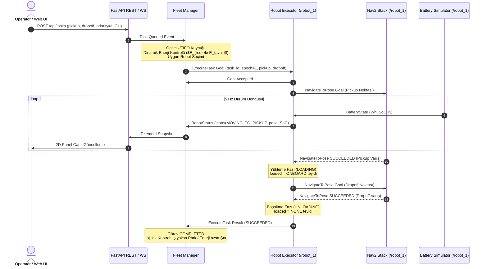
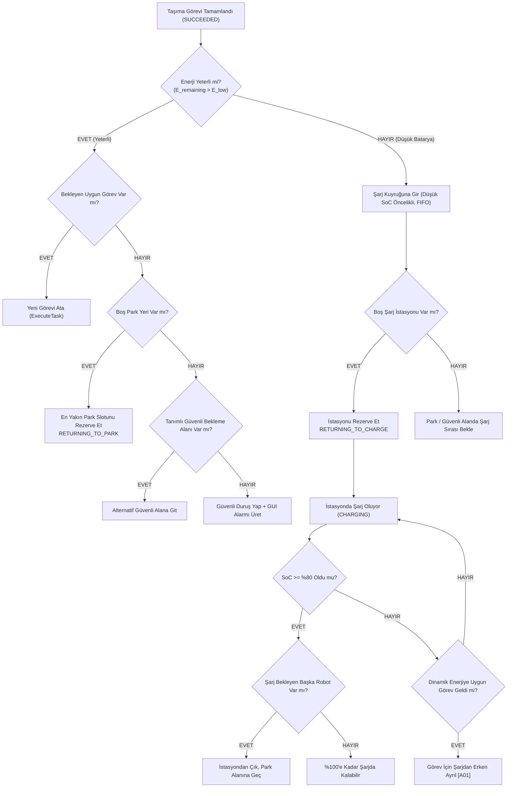
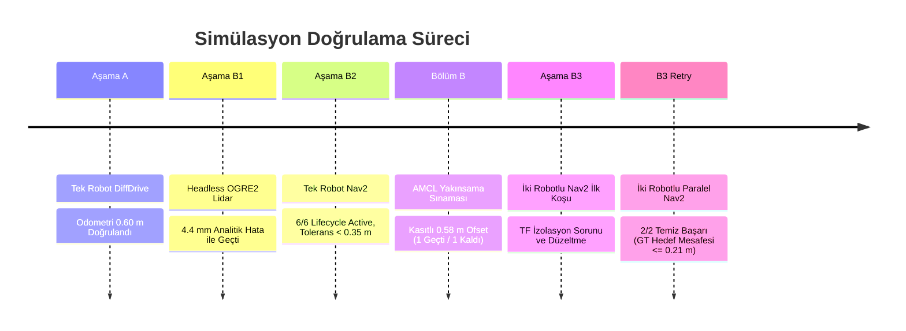
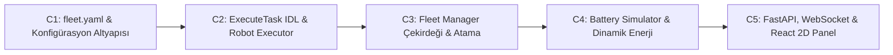

# ROS 2 Fleet Manager — Nihai Mimari Kararlar ve C Aşamasına Geçiş Referansı

**Belge Tanımı:** Nihai Mimari Referans Belgesi ve C Aşaması Geçiş Şartnamesi  
**Tarih:** 23 Ekim 2026  
**Sürüm:** v1.0 (Nihai Onaylı Mimari Konsolidasyonu)  
**Hedef Depo:** `ros2-fleet-manager`  
**Referans Doküman Kodu:** `DOC-ARCH-2026-10-23-FINAL`

---

## İçindekiler

1. [Yönetici Özeti](#1-yönetici-özeti)
2. [Projenin Amacı ve Kapsamı](#2-projenin-amacı-ve-kapsamı)
3. [Mimari Kaynak Önceliği ve Çelişki Çözümleri](#3-mimari-kaynak-önceliği-ve-çelişki-çözümleri)
4. [Üç Servisli Docker Compose Mimarisi](#4-üç-servisli-docker-compose-mimarisi)
5. [ROS 2 ve Nav2 Sorumluluk Sınırları](#5-ros-2-ve-nav2-sorumluluk-sınırları)
6. [Fleet Manager – Robot Executor Görev Akışı ve Preemption Protokolü](#6-fleet-manager--robot-executor-görev-akışı-ve-preemption-protokolü)
7. [Wh Tabanlı Enerji Modeli ve Matematiksel Formülasyon](#7-wh-tabanlı-enerji-modeli-ve-matematiksel-formülasyon)
8. [Battery Simulator Mimarisi ve Hesaplama Kuralları](#8-battery-simulator-mimarisi-ve-hesaplama-kuralları)
9. [Şarj, Park ve Güvenli Bekleme Politikaları](#9-şarj-park-ve-güvenli-bekleme-politikaları)
10. [Fleet YAML Yapılandırma İlkeleri ve Revizyon Yaşam Döngüsü](#10-fleet-yaml-yapılandırma-ilkeleri-ve-revizyon-yaşam-döngüsü)
11. [Modüller Arası Veri Sözleşmeleri ve İletişim Arayüzleri](#11-modüller-arası-veri-sözleşmeleri-ve-iletişim-arayüzleri)
12. [Tamamlanan Simülasyon Testleri ve Doğrulama Kanıtları](#12-tamamlanan-simülasyon-testleri-ve-doğrulama-kanıtları)
13. [Test Edilmemiş Alanlar ve Teknik Risk Değerlendirmesi](#13-test-edilmemiş-alanlar-ve-teknik-risk-değerlendirmesi)
14. [C Aşaması (C1–C5) Geliştirme Yol Haritası](#14-c-aşaması-c1c5-geliştirme-yol-haritası)
15. [Açık Mimari Kararlar ve Öneriler](#15-açık-mimari-kararlar-ve-öneriler)
16. [Nihai Onaylı Kararlar Matrisi](#16-nihai-onaylı-kararlar-matrisi)
17. [Kaynak Belgeler ve Referanslar](#17-kaynak-belgeler-ve-referanslar)

---

## 1. Yönetici Özeti

Bu belge, `ros2-fleet-manager` projesinde simülasyon ve haberleşme altyapısının doğrulandığı A, B1, B2, AMCL Yakınsama, B3 ve B3 Retry aşamaları ile B4 Mimari Denetim Aşaması'nın tamamlanmasının ardından hazırlanmıştır. Temel amacı, bugüne kadar dağınık PDF, not ve analiz dosyalarında yer alan, zaman içinde revize edilen veya çelişki barındıran tüm mimari kararları **tek bir güvenilir teknik referansta** birleştirmektir.

Projede bugüne kadar elde edilen temel teknik başarılar şunlardır:
1. **Robotik ve Simülasyon Temeli Doğrulandı:** ROS 2 Humble, Cyclone DDS (Domain ID: 42), Gazebo Fortress headless yazılım render'ı (OGRE2 + EGL), 2D Lidar sensör entegrasyonu, harita sunumu ve AMCL lokalizasyonu eksiksiz çalışmaktadır.
2. **Çok Robotlu Nav2 İzolasyonu Başarıldı:** Ayrık isim alanları (`/robot_1`, `/robot_2`) altında bağımsız Nav2 ve AMCL yığınlarının paralel sürüşü B3 Retry oturumunda **2/2 temiz başarılı koşu** ile, Gazebo Ground Truth $\le 0.35\text{ m}$ katı toleransı dahilinde kanıtlanmıştır.
3. **Uygulama Kodu Başlama Eşiğinde:** Depodaki `backend/`, `frontend/`, `ros2_ws/src/` dizinleri henüz boştur. Kodlama başlamadan önce görev akışı, enerji hesabı, Docker yerleşimi ve sorumluluk sınırları tam olarak netleştirilmiştir.
4. **Yeni Kararlar Kilitlendi:**
   - Hedef mimarinin **üç servisli Docker Compose** (`simulation`, `backend`, `frontend`) yapısında olması kullanıcı tarafından onaylanmıştır.
   - Enerji modelinde temel fiziksel hesaplama biriminin **Wh (Watt-saat)** olması kilitlenmiştir.
   - Sorumluluk zinciri `Fleet Manager -> ExecuteTask -> Robot Executor -> NavigateToPose -> Nav2` olarak kesinleştirilmiştir.
   - Konfigürasyonun tek kaynağı `config/fleet.yaml` olarak belirlenmiştir.

Bu referans belgesi, C1 geliştirme aşamasına (yapılandırma ve şema altyapısı) geçiş için gerekli tüm mimari zemini sağlar; doğrulanmış başarılarla henüz test edilmemiş tasarım alanlarını dürüstçe ayrıştırır.

---

## 2. Projenin Amacı ve Kapsamı

### 2.1 Temel Hedef
Sistem, depo benzeri iç mekan lojistik tesislerinde görev yapan birden fazla tekerlekli mobil robotun (TurtleBot3 Burger kinematik modeli temel alınarak) tek bir merkezden izlenmesini, koordine edilmesini ve yönetilmesini sağlar. Kullanıcı, web arayüzü veya API üzerinden **Alım (Pickup) $\rightarrow$ Teslim (Dropoff)** lojistik taşıma görevleri tanımlar. Sistem; görev önceliğine, zaman damgasına (FIFO), robotların konumuna, operasyonel durumuna ve dinamik enerji yeterliliğine göre görevleri sıralar, en uygun robota atar ve görev yaşam döngüsünü uçtan uca yürütür.

### 2.2 Sistem Kapsam Seviyeleri

#### MVP Kapsamı (Minimum Viable Product):
- **Tek Yapılandırma Dosyası:** Tüm filo, harita, istasyon ve batarya parametrelerini yöneten `config/fleet.yaml`.
- **Filo Ölçeği:** Minimum 2 adet diferansiyel sürüşlü mobil robot (`/robot_1`, `/robot_2`).
- **Simülasyon:** Gazebo Fortress headless (ekran kartı gerektirmeyen CPU yazılım render'ı). Web'e video veya 3D sahne akışı aktarılmaz; yalnızca telemetri ve koordinatlar sunulur.
- **Navigasyon ve Lokalizasyon:** Robot başına ayrık isim alanında bağımsız Nav2 yığını (Navfn global planner, DWB local controller) ve AMCL parçacık filtresi.
- **Batarya Simülasyonu:** Robot başına bağımsız çalışan `battery_simulator` ROS 2 düğümü.
- **Görev Yürütücüsü (Robot Executor):** Robot başına çalışan ve `ExecuteTask` action arayüzünü sunan lojistik adaptör.
- **Fleet Manager Çekirdeği:** Tek olay tüketim döngüsü (single consumer event loop), öncelik (HIGH, MEDIUM, LOW) ve atanabilir görevler arasında FIFO kuyruğu, güvenli kesme (preemption, $N=2$ koruması), şarj ve park yöneticisi, SQLite tabanlı görev ve olay günlüğü (Outbox pattern).
- **Haberleşme ve Sunum:** FastAPI tabanlı REST API ve WebSocket telemetri/olay akışı; React + Konva tabanlı 2D harita ve filo takip arayüzü.

#### Stretch (Genişletilmiş) Kapsam:
- 3. robot desteğinin dinamik olarak eklenmesi.
- Web arayüzünden test senaryolarının tetiklenmesi.
- İki robotlu dinamik görev takası (%15 Nav2 rota tasarrufu kuralı).

#### Kesin Kapsam Dışı (Out of Scope):
- Gerçek robot donanımı entegrasyonu (fiziksel TurtleBot, motor sürücüleri vb.).
- Küresel çarpışmasız çoklu robot ortak rota planlaması (dar koridorlarda karşılıklı kilitlenme yönetimi yerel costmap katmanına bırakılmıştır; merkezi rezervasyonlu trafik kontrolü yoktur).
- Manipülatör, konveyör veya otomatik palet yükleme/boşaltma donanım protokolleri (yükleme süreleri simüle edilmiş zamanlayıcılarla yönetilir).
- Şarj istasyonu elektriksel veya mekanik arıza simülasyonu.
- Çoklu aktif Fleet Manager yüksek erişilebilirlik (High Availability / Active-Active) mimarisi.
- Canlı Fleet Manager çökmesi/yeniden başlatılması durumunda yarım kalan görevlerin otomatik kurtarılması (MVP'de senaryo reset politikası uygulanır).

---

## 3. Mimari Kaynak Önceliği ve Çelişki Çözümleri

### 3.1 Öncelik Hiyerarşisi
Projede farklı zamanlarda üretilmiş belgeler arasındaki tutarsızlıkları gidermek için aşağıdaki bağlayıcı öncelik sırası uygulanır:

$$\text{project-context.md / AGENTS.md} > \text{Revize Karar 08} > \text{v2.3 Geçiş Kaydı} > \text{23 Ekim 2026 Yeni Kararları} > \text{B4 Denetim Raporu} > \text{Eski Belgeler}$$

1. **`docs/project-context.md` ve `AGENTS.md`:** Değişmez proje bağlamı ve kullanıcı kuralları.
2. **`docs/ROS2_Fleet_Manager_Karar_08_Revize_v1_0.pdf`:** Görev önceliklendirme, preemption, enerji yönetimi, şarj ve park politikalarının ana referansı.
3. **`docs/architecture-v2.3-transition.md`:** `ExecuteTask` görev yürütücüsü yönü ve durum otoritesi sınırları.
4. **Bu Belgede Tanımlanan Yeni Kullanıcı Kararları (23 Ekim 2026):** Üç servisli Docker hedef mimarisi, Wh tabanlı kesin enerji modeli ve Battery Simulator sorumlulukları.
5. **`docs/project-architecture-readiness-review-2026-10-23.md` (B4 Denetim Raporu):** Simülasyon kanıtları ve risk envanteri.
6. **Eski Tasarım PDF'leri ve Notlar (`docs/design/*`, `hand_notes_1.pdf`, eski README):** Yalnızca güncel belgelerle çelişmediği ölçüde tarihsel bağlam olarak kullanılır.

### 3.2 Eski Belgelerdeki Çelişkilerin Çözüm Tablosu

| Konu | Eski Belge ve Hüküm | Güncel Onaylı Karar (Otorite) | Çözüm ve Gerekçe |
|---|---|---|---|
| **Görev Atama Algoritması** | `fleet_manager_v2.2_fix.pdf` (S5): Karmaşık ağırlıklı maliyet formülü ($J = w_d D + w_e S + \dots$). | **Revize Karar 08 (S3, 8):** Öncelik (HIGH/MED/LOW) + Atanabilir FIFO + En yakın uygun aday seçimi. | CostBased ağırlık optimizasyonu iptal edilmiştir. Öncelik ve FIFO deterministik sıralama sağlar. |
| **Taşıma Hedefi Sahipliği** | `fleet_manager_v2.2_fix.pdf` (S1) ve `architecture.md`: Fleet Manager doğrudan Nav2 `NavigateToPose` çağırır. | **v2.3 Geçiş Kaydı (S1) ve Karar 08 (S17):** FM $\rightarrow$ `ExecuteTask` $\rightarrow$ Robot Executor $\rightarrow$ `NavigateToPose` $\rightarrow$ Nav2. | FM taşıma adımlarını yürütmez; lojistik adımlar robot başına Robot Executor tarafından yönetilir. |
| **Enerji Hesap Birimi** | `battery_simulator_v1.2_fix.pdf` (S1): 0..1 SoC kesri üzerinden birimsiz tüketim ($S_{required}$). | **23 Ekim 2026 Yeni Kararı ve Karar 08 (S13):** Temel fiziksel birim **Wh (Watt-saat)**; kullanıcıya % SoC gösterimi. | Yüzde tabanlı model fiziksel kapasite farklarını ve gerçek güç tüketimini modelleyemez. Wh kesinleştirilmiştir. |
| **Yapılandırma Dosyası** | `docs/architecture.md` (Satır 10): İstasyonlar `config/stations.yaml` dosyasındadır. | **Config-Driven v1.3 (S1-2):** Tek düzenlenebilir kaynak `config/fleet.yaml` dosyasıdır. | İstasyonlar `fleet.yaml` içinde `fleet.stations` altında toplanmıştır; ikinci bir yapılandırma dosyası yasaktır. |
| **Preemption Yetkisi** | `hand_notes_1.pdf` (S7): MEDIUM görevleri LOW görevlerini kesebilir. | **Revize Karar 08 (S3, Politika P02):** Yalnızca HIGH görevleri güvenli kesme (preemption) yapabilir. | Lojistik verimlilik ve kararsızlığı önlemek için MEDIUM işlerinin kesme yapması yasaklanmıştır. |
| **İki Robotlu Takas (%15)** | `hand_notes_1.pdf` (S8-9): Tüm HIGH görevlerinde %15 takas formülü hesaplanır. | **Revize Karar 08 (S3, 11, 27):** MVP'de takas kapalıdır (`extra_swap_enabled = False`); Aşama 5'e ertelenmiştir. | Boş robot yokken %15 aranmaz; takas karmaşıklığı MVP sonrasına bırakılmıştır. |
| **Docker Servis Dağıtımı** | `docker-placement-decision.md`: Üç servisli yapı taslaktır; yalnız 2 container DDS mesaj alımı önerilir. | **23 Ekim 2026 Yeni Kararı:** Üç servisli Compose mimarisi (`simulation`, `backend`, `frontend`) **hedef mimari olarak ONAYLANMIŞTIR**. | Hedef mimari kilitlenmiştir; ancak nihai üç servisli yapı henüz canlı doğrulanmamıştır (HENÜZ TEST EDİLMEDİ). |

---

## 4. Üç Servisli Docker Compose Mimarisi

Kullanıcı tarafından 23 Ekim 2026 tarihinde onaylanan nihai hedef dağıtım mimarisi üç bağımsız Docker Compose servisinden oluşur.



### 4.1 Servis Bileşenleri ve İçerikleri

#### 1. `simulation` Servisi
- **İçerik:** ROS 2 Humble Desktop, Gazebo Fortress (headless), DART fizik motoru, OGRE2 yazılım render paketi (`libignition-rendering6-ogre2-dev`), EGL surfaceless, Nav2 Humble yığını, Map Server, `ros_gz_bridge`.
- **Robot Başına Düğümler:** Her robot (`/robot_1`, `/robot_2`) için bağımsız Nav2/AMCL yığını, Robot Executor düğümü ve Battery Simulator düğümü.
- **Sorumluluk Ayrımı:** Robot Executor ve Battery Simulator düğümlerinin aynı container içinde bulunması mantıksal sorumluluklarını birleştirmez. Her biri bağımsız ROS 2 paketleri/düğümleridir.
- **Kaynak Tüketimi:** B3 Retry testlerinde iki robot için tepe CPU $\approx \%262.6$, tepe bellek $\approx 612.4\text{ MB}$ ölçülmüştür.

#### 2. `backend` Servisi
- **İçerik:** Python 3.10+, ROS 2 Humble Base (yalnızca DDS ve istemci kütüphaneleri), FastAPI, uvicorn (tek worker), Fleet Manager domain çekirdeği, komut/olay kuyruğu, zamanlayıcı, şarj ve park yöneticisi, SQLite ORM/veritabanı motoru.
- **Haberleşme:** `simulation` servisi ile ROS 2 DDS üzerinden konuşur; `frontend` servisine HTTP REST ve WebSocket sunar.
- **Kalıcılık:** SQLite veritabanı dosyası kalıcı bir adlandırılmış volume (`fleet_data:/data`) üzerinde saklanır.

#### 3. `frontend` Servisi
- **İçerik:** Node.js / Vite geliştirme sunucusu (veya üretimde Nginx), React 18, HTML5 Konva Canvas kütüphanesi, TailwindCSS.
- **Ağ İzolasyonu:** Frontend servisi ve kullanıcının tarayıcısı **kesinlikle doğrudan ROS 2 DDS ağına bağlanmaz**. Tüm iletişim backend üzerinden REST ve WebSocket aracılığıyla yürütülür.

### 4.2 Docker İlkeleri ve Kısıtları
- **Özel Ağ:** Tüm servisler `fleet-net` adında kullanıcı tanımlı bir bridge ağı üzerinde çalışır.
- **DDS Uyumluluğu:** `simulation` ve `backend` arasındaki DDS haberleşmesi, daha önce doğrulanmış Cyclone DDS yapılandırması (`ROS_DOMAIN_ID=42`, `CYCLONEDDS_URI`) ile tam uyumlu olmalıdır.
- **Salt Okunur Yapılandırma:** `config/fleet.yaml` dosyası ilgili container'lara salt okunur (`:ro`) olarak bağlanır; çalışma zamanında üzerine yazılamaz.
- **Servis Hazırlık Bekleme:** `backend`, `simulation` servisindeki Robot Executor action sunucuları hazır olmadan görev atamasına başlamaz (sağlık kontrolü ve retry mekanizması).
- **macOS VM Sınırları:** Docker Desktop macOS ortamında varsayılan 4-6 CPU çekirdeği ve 8 GB RAM sınırları göz önünde bulundurulmalıdır.

### 4.3 Eski Docker Taslağının Geçersiz Kılınan Hükümleri
Eski `docs/docker-placement-decision.md` belgesinde yer alan *"Tam Docker mimarisini onaylamak mevcut kanıtla desteklenmez... üç servisli yerleşim hâlâ öneridir"* hükmü, kullanıcının 23 Ekim 2026 tarihli açık talimatıyla **hedef mimari düzleminde geçersiz kılınmıştır**. Üç servisli yerleşim onaylanmış hedef mimaridir. Ancak bu mimarinin uçtan uca canlı çalışması henüz test edilmediği için statüsü **HENÜZ TEST EDİLMEDİ** olarak kalacaktır. C1 aşamasında Docker altyapısı değil, yalnızca konfigürasyon altyapısı geliştirilecektir.

---

## 5. ROS 2 ve Nav2 Sorumluluk Sınırları

Sistemdeki yazılım katmanlarının sorumluluk sınırları kesin olarak ayrılmıştır:



### 5.1 Bileşen Sorumluluk Matrisi

| Sorumluluk Alanı | Nav2 | Robot Executor | Fleet Manager | Battery Simulator |
|---|:---:|:---:|:---:|:---:|
| Küresel Rota Planlama (Global Path) | **YETKİLİ** | İstemci | İstemci (Mesafe sorgusu) | İlgisiz |
| Yerel Engelden Kaçınma ve Hız Kontrolü (`cmd_vel`) | **YETKİLİ** | İlgisiz | İlgisiz | İlgisiz |
| Taşıma Görevi Lojistik Adımları (Pickup $\rightarrow$ Yük $\rightarrow$ Dropoff $\rightarrow$ Boşalt) | İlgisiz | **YETKİLİ** | Tetikleyici | İlgisiz |
| Güvenli İptal ve Fiziksel Faz Denetimi (`PICKING_UP` kilidi) | İlgisiz | **YETKİLİ** | Talep Eden | İlgisiz |
| Robotun Fiziksel Durum Otoritesi (`RobotStatus`) | İlgisiz | **YETKİLİ** | Abone / Tüketici | İlgisiz |
| Görev Kabulü, Kuyruk, Öncelik ve FIFO Sıralaması | İlgisiz | İlgisiz | **YETKİLİ** | İlgisiz |
| Robot Seçimi ve Dinamik Enerji Yeterlilik Kontrolü | İlgisiz | İlgisiz | **YETKİLİ** | İlgisiz |
| Şarj İstasyonu ve Park Slotu Rezervasyon Yönetimi | İlgisiz | İlgisiz | **YETKİLİ** | İlgisiz |
| Güvenli Kesme (Preemption) Kararı ve N=2 Koruma Sayacı | İlgisiz | İptal Yürütücü | **YETKİLİ** | İlgisiz |
| Batarya Enerji Tüketimi ve Şarj Artışı Hesaplama Otoritesi | İlgisiz | İlgisiz | İlgisiz | **YETKİLİ** |

---

## 6. Fleet Manager–Robot Executor Görev Akışı ve Preemption Protokolü

### 6.1 Uçtan Uca Görev Yaşam Döngüsü



### 6.2 Güvenli Kesme (Preemption) ve N=2 Koruması Protokolü
1. **Yalnızca HIGH Görevi Kesebilir:** LOW veya MEDIUM öncelikli yeni bir görev, çalışmakta olan hiçbir görevi kesemez. Yalnızca HIGH öncelikli bir görev preemption tetikleyebilir (Revize Karar 08 Politika P02).
2. **Boş Robot Varsa Kesme Yapılmaz:** Filoda boş (IDLE) ve enerjisi yeterli bir robot varsa, HIGH görevi doğrudan bu robota atanır; çalışan robot kesilmez.
3. **Kesilebilirlik Koşulları:**
   - Robotun taşıdığı görev LOW veya MEDIUM olmalıdır.
   - Robot henüz `PICKING_UP` fazına girmemiş olmalıdır (yani henüz pickup noktasına doğru seyir halinde olmalı, yükleme başlamamış olmalıdır).
   - Robotun yük durumu `loaded == NONE` (yüksüz) olmalıdır.
   - Kesilecek görev daha önce $N=2$ kez kesilmiş olmamalıdır ($N=2$ koruması).
4. **Kesilme Sayacı ($N=2$) ve Öncelik Koruması:**
   - Bir görev kesildiğinde `preemption_count` sayacı 1 artırılır.
   - Kesilen görev kuyruğa **orijinal `created_at` zaman damgasıyla** geri döner (kesintiye uğrayan iş öncelik kaybetmez).
   - $N=2$ kez kesilen bir görev üçüncü kez çalışmaya başladığında, pickup öncesinde olsa dahi **kesilemez (korumalı)** statüye geçer (Revize Karar 08 Sayfa 3, 27).
5. **İptal Yarışı ve Fiziksel Duruş Teyidi:**
   - Fleet Manager iptal istediğinde Robot Executor yerel faz kilidini kontrol eder. Eğer tam o anda robot pickup noktasına varmış ve yükleme başlamışsa (`PICKING_UP`), robot iptal talebini reddeder.
   - İptal kabul edilirse, robot Nav2 hedefini durdurur ve sıfır hız teyit edilene kadar bekler.
   - Fleet Manager, Robot Executor'dan `PREEMPTED` terminal action sonucunu almadan robota asla yeni HIGH görevini atamaz (çift atama ve yarış koşulu engellenir).

### 6.3 Hata Yönetimi ve `ClearRobotError` Politikası
- **Otomatik Retry/Reassignment Yasağı:** Etkin bir taşıma görevi sırasında Nav2 seyrüsefer hatası, aşırı gecikme veya planlama başarısızlığı oluşursa, görev anında **FAILED**, robot ise **ERROR** durumuna geçer. Fleet Manager **asla otomatik yeniden deneme (retry) veya görevi başka robota devretme (reassignment) yapmaz** (Revize Karar 08 Politika P14).
- **Kaynak Bloklama:** Hata anında robotun işgal ettiği harita alanı veya hedef istasyon `BLOCKED` olarak kilitlenir; diğer robotların erişimine kapatılır.
- **Koşullu Manuel Kurtarma (`ClearRobotError`):**
  - Hatanın temizlenmesi operatörün açık servis çağrısıyla (`ClearRobotError.srv`) yapılır.
  - Servis isteği robotun `expected_epoch` değerini içermelidir.
  - Robot üzerinde yük varsa (`loaded == ONBOARD`) veya yük durumu bilinmiyorsa (`UNKNOWN`), hata temizleme isteği **reddedilir**.
  - Hata temizlendiğinde FAILED olan eski görev yeniden başlatılmaz; operatörün yeni bir görev oluşturması gerekir.

---

## 7. Wh Tabanlı Enerji Modeli ve Matematiksel Formülasyon

Kullanıcının 23 Ekim 2026 tarihli açık kararı uyarınca sistemin temel enerji birimi **Watt-saat (Wh)** olarak kilitlenmiştir. Yüzde (%) cinsinden SoC değeri yalnızca operatöre kullanıcı arayüzünde gösterim amacıyla kullanılır.

### 7.1 Temel Enerji Birimleri ve Değişkenler

| Parametre | Simge | Birim | Tanım ve Açıklama |
|---|:---:|:---:|---|
| Kullanılabilir Batarya Kapasitesi | $C_{\text{usable}}$ | $\text{Wh}$ | Bataryanın güvenle kullanılabilecek toplam enerji kapasitesi |
| Kalan Enerji | $E_{\text{remaining}}$ | $\text{Wh}$ | Bataryada anlık olarak mevcut fiziksel enerji |
| Batarya Şarj Seviyesi | $\text{SoC}$ | $\%$ | Bataryanın yüzde olarak doluluk oranı ($0 - 100\%$) |
| Hareket Tüketim Katsayısı | $k$ | $\text{Wh/m}$ | Robotun birim mesafe ilerlemek için harcadığı ortalama enerji |
| Bekleme Tüketim Gücü | $P_{\text{idle}}$ | $\text{W}$ | Robotun hareketsiz dururken elektroniğinin çektiği temel güç |
| Şarj Gücü | $P_{\text{charge}}$ | $\text{W}$ | Şarj istasyonunun bataryaya aktardığı net elektriksel güç |
| Toplam Görev Mesafesi | $d_{\text{total}}$ | $\text{m}$ | Pickup ve Dropoff dahil planlanan toplam yol uzunluğu |
| Güvenli Kaçış Enerjisi | $E_{\text{escape}}$ | $\text{Wh}$ | Görev bitiminde teslimat noktasından şarja erişim enerjisi |
| Güvenlik / Belirsizlik Marjı | $E_{\text{margin}}$ | $\text{Wh}$ | Manevra, bekleme ve model belirsizlikleri için ayrılan tampon enerji |
| Görev Enerji Gereksinimi | $E_{\text{required}}$ | $\text{Wh}$ | Bir görevi güvenle tamamlamak için gereken toplam enerji |
| Atanabilir Kullanılabilir Enerji | $E_{\text{available}}$ | $\text{Wh}$ | Robotun görev için harcayabileceği net kullanılabilir enerji |

### 7.2 Matematiksel Formüller

#### 1. Kalan Enerji Hesabı:
$$E_{\text{remaining}} = C_{\text{usable}} \times \frac{\text{SoC}}{100}$$

#### 2. Toplam Planlanan Yol Mesafesi:
$$d_{\text{total}} = L(\mathbf{p}_{\text{current}}, \mathbf{p}_{\text{pickup}}) + L(\mathbf{p}_{\text{pickup}}, \mathbf{p}_{\text{dropoff}})$$
Burada $L(\mathbf{a}, \mathbf{b})$, Nav2 planner sunucusu tarafından harita ve maliyet haritası (costmap) dikkate alınarak hesaplanan küresel yol uzunluğudur ($\text{metre}$). Düz çizgi (Öklid) mesafesi kullanılmaz.

#### 3. Güvenli Kaçış Enerjisi:
$$E_{\text{escape}} = k \times L(\mathbf{p}_{\text{dropoff}}, \mathbf{p}_{\text{charge\_station}})$$

#### 4. Görev Enerji Gereksinimi:
$$E_{\text{required}} = (k \times d_{\text{total}}) + E_{\text{escape}} + E_{\text{margin}}$$

#### 5. Görev Atanabilirlik Koşulu:
$$E_{\text{required}} \le E_{\text{remaining}} - (C_{\text{usable}} \times \frac{\text{SoC}_{\text{emergency}}}{100})$$
Burada $\text{SoC}_{\text{emergency}}$, bataryanın hiçbir koşulda altına inmemesi gereken kritik acil durum rezerv eşiğidir (örneğin $\%8$).

> **Önemli Kural (Çift Sayım Yasağı):** Güvenlik marjı ($E_{\text{margin}}$) veya kaçış enerjisi ($E_{\text{escape}}$), yol uzunluğu hesabı içinde ikinci kez mesafe olarak eklenmemelidir. Enerji denkleminde terimler ayrık ve tekil tutulmalıdır.

### 7.3 Rota Mesafesi ve Nav2 Güvenlik Davranışı
- Enerji yeterlilik değerlendirmesinde düz çizgi (kuş uçuşu) mesafesi kullanılamaz; Nav2'nin engelleri dolaşan yol uzunluğu ($L$) esas alınır.
- Eğer Nav2 global planner geçici bir arıza, engel blokajı veya harita hatası nedeniyle pickup veya dropoff yolunu hesaplayamazsa, **enerji kontrolü otomatik olarak BAŞARISIZ sayılır**. Görev robota atanmaz; güvenli biçimde kuyrukta bekletilir.

### 7.4 Kalibrasyon Durumu ve Temsilî Parametreler
Aşağıdaki tabloda yer alan değerler **yalnızca mimari tasarım ve şema doğrulama amaçlı örneklerdir**. Bu parametreler gerçek robot üzerinde veya simülasyonda henüz deneysel olarak ölçülmemiştir. Kesin kalibre edilmiş değerler olarak sunulamaz.

| Parametre | Örnek Temsilî Değer | Gerçek Durum |
|---|:---:|---|
| Batarya Kapasitesi ($C_{\text{usable}}$) | $100.0\text{ Wh}$ | Henüz kalibre edilmedi (Örnek) |
| Hareket Katsayısı ($k$) | $0.20\text{ Wh/m}$ | Henüz kalibre edilmedi (Örnek) |
| Bekleme Gücü ($P_{\text{idle}}$) | $2.0\text{ W}$ | Henüz kalibre edilmedi (Örnek) |
| Şarj Gücü ($P_{\text{charge}}$) | $20.0\text{ W}$ | Henüz kalibre edilmedi (Örnek) |
| Güvenlik Marjı ($E_{\text{margin}}$) | $10.0\text{ Wh}$ | Henüz kalibre edilmedi (Örnek) |
| Acil Durum Rezerv Eşiği ($\text{SoC}_{\text{emergency}}$) | $\%8.0$ | Henüz kalibre edilmedi (Örnek) |

---

## 8. Battery Simulator Mimarisi ve Hesaplama Kuralları

Her robot için bağımsız bir `battery_simulator` ROS 2 düğümü çalıştırılır. Simülatör, robotun enerji durumunun sistemdeki **tek hesaplama otoritesidir**.

### 8.1 Temel Sorumluluklar
1. **Hareket Tüketimi:** Odometri mesafesindeki değişime ($\Delta s$) bağlı olarak mesafeye dayalı enerji tüketimini ($k \times \Delta s$) hesaplamak.
2. **Bekleme Gücü Tüketimi:** Simülasyon saatindeki değişime ($\Delta t$) bağlı olarak sürekli bekleme gücünü ($P_{\text{idle}} \times \Delta t$) düşmek.
3. **Yükleme / Boşaltma Tüketimi:** Robot yükleme veya boşaltma istasyonunda dururken geçen sürede bekleme gücü tüketimini sürdürmek.
4. **Şarj Simülasyonu:** Robot istasyonda geçerli şarj koşullarını sağladığında enerji eklemek ($P_{\text{charge}} \times \Delta t$).
5. **Durum Yayını:** Anlık batarya durumunu `BatteryState` mesajı ile periyodik olarak yayımlamak.
6. **Fiziksel Sınır Koruma:** Enerjiyi $[0, C_{\text{usable}}]$ ve SoC değerini $[0.0, 100.0]$ aralığında tutmak (clamping).

### 8.2 Zaman ve Fizik Kaynağı
- **Zaman Kaynağı:** Simülatör kesinlikle işletim sistemi saatini (`wall clock`) kullanmaz; Gazebo `/clock` simülasyon saatini kullanır (`use_sim_time: true`). Simülasyon duraklatıldığında batarya deşarjı da durur.
- **Tüketimlerin Ayrışması:** Harekete bağlı tüketim $\Delta s$ üzerinden, zamana bağlı temel tüketim $\Delta t$ üzerinden hesaplanır. Böylece aynı tüketim iki kez sayılmaz.

### 8.3 Şarj Başlama ve Sürdürme Koşulları
Bir robotun bataryasının şarj olabilmesi için aşağıdaki üç koşulun **aynı anda** sağlanması zorunludur:
1. Robotun konumu tanımlı bir şarj istasyonunun tolerans yarıçapı içinde olmalıdır ($\|\mathbf{p}_{\text{robot}} - \mathbf{p}_{\text{station}}\| \le r_{\text{dock}}$).
2. Robot tamamen hareketsiz olmalıdır ($\|\mathbf{v}\| \le 0.001\text{ m/s}$, $\omega \le 0.001\text{ rad/s}$).
3. İstasyon temas sinyali doğrulanmış olmalıdır (`dock_contact == True`).

### 8.4 Durum Değişkenleri ve Arayüz
Battery Simulator düğümü `/<robot_id>/battery_state` topic'i üzerinden aşağıdaki alanları içeren durumu yayımlar:
- `battery_energy_wh` (float64): Kalan net enerji (Wh).
- `battery_soc_percent` (float32): Yüzde şarj seviyesi (%).
- `battery_capacity_wh` (float64): Kullanılabilir toplam kapasite (Wh).
- `is_charging` (bool): Şarj olma durumu.
- `battery_stamp` (builtin_interfaces/Time): Ölçümün alındığı simülasyon zaman damgası.

> **Sorumluluk İlkesi:** Fleet Manager veya Web Paneli batarya seviyesini doğrudan değiştiremez, set edemez veya üzerine yazamaz. Batarya durumu yalnızca Battery Simulator düğümü tarafından hesaplanır ve okunur.

---

## 9. Şarj, Park ve Güvenli Bekleme Politikaları

Şarj ve park yönetiminde Revize Karar 08 hükümlerine tam olarak sadık kalınmıştır:



### 9.1 Temel Şarj Kuralları
1. **Normal Şarj Hedefi %80 SoC:** Bataryanın hızlı ve verimli dolumu için şarj hedefi $\%80$ olarak kabul edilir (Revize Karar 08 Politika P11).
2. **Şarj Kuyruğu Önceliği (Düşük SoC + FIFO):** Şarj istasyonu bekleyen robotlar arasında öncelik **en düşük SoC seviyesine** verilir. SoC eşitliği durumunda şarj talep zaman damgasına göre **FIFO** uygulanır (Politika P10).
3. **%80 Öncesi Ayrılmama Kuralı:** Şarj olmakta olan bir robot, başka bir robota şarj istasyonunu devretmek veya yer açmak amacıyla **asla %80 doluluğa ulaşmadan istasyondan çıkarılamaz** (Politika P12).
4. **Görev İçin Erken Ayrılma İstisnası (Karar 08 A01 Netleşen Kuralı):** Şarj istasyonundaki bir robot, bekleyen bir görev için dinamik enerji yeterliliğine sahipse ($E_{\text{available}} \ge E_{\text{required}}$), **%80 doluluğa ulaşmadan görev almak üzere şarjdan ayrılabilir**. Ancak bu ayrılma yalnızca görev icrası içindir; boş beklemek veya yer vermek için çıkış yapılamaz.
5. **%80 Sonrası Kalabilme:** Eğer şarj istasyonunu bekleyen başka bir robot yoksa, bataryası $\%80$'e ulaşan robot istasyonu boşaltmak zorunda değildir; $\%100$'e kadar istasyonda kalıp şarjını tamamlayabilir.
6. **Fiziksel Ayrılma Teyidi:** İstasyon çıkışında, ayrılan robotun şarj alanını fiziksel olarak terk ettiği doğrulanmadan (odometri ve pose teyidi), istasyon `FREE` ilan edilemez ve arkadaki robot içeri alınamaz.

### 9.2 Park ve Güvenli Bekleme Politikası
- **Park Rezervasyonu:** Görevini tamamlayan ve acil şarj ihtiyacı olmayan robot, tanımlı en yakın boş park slotunu rezerve ederek `RETURNING_TO_PARK` durumuna geçer.
- **Park Dönüşünün Kesilebilirliği:** `RETURNING_TO_PARK` durumundaki bir robot, LOW dahil her türlü yeni görev için kesilebilir. Bu bir lojistik hedef iptalidir; taşıma preemption'ı sayılmaz ve preemption sayacını artırmaz.
- **Kademeli Güvenli Bekleme:** Bütün park alanları doluysa, haritada önceden tanımlanmış alternatif güvenli bekleme alanına gidilir. Alternatif alan da yoksa robot mevcut koridorda trafiği engellemeyecek şekilde güvenli duruş yapar ve operatöre alarm üretir.

---

## 10. Fleet YAML Yapılandırma İlkeleri ve Revizyon Yaşam Döngüsü

Sistemin tüm operasyonel, robotsal ve geometrik tanımları tek bir merkezi dosyada toplanır:

$$\text{config/fleet.yaml}$$

İkinci bir yapılandırma dosyası (`stations.yaml`, `robots.yaml` vb.) kesinlikle oluşturulamaz.

### 10.1 Konfigürasyon İlkeleri
- **Config-Driven Kuralı (AGENTS.md):** Robot sayısı, isimleri, namespace'leri, başlangıç pozları, harita yolu, batarya kapasiteleri, tüketim katsayıları ve Nav2 parametreleri koda gömülemez. Tamamı `fleet.yaml` dosyasından okunmalıdır.
- **Yeni Robot Ekleme Sınırı:** Yeni bir robot eklemek yalnızca `fleet.yaml` dosyasına yeni bir robot girdisi eklemekten ibaret olmalıdır; kaynak kodu veya Compose dosyasını değiştirmeyi gerektirmemelidir.
- **Tek Doğrulama Şeması:** `fleet.yaml` dosyası için katı bir JSON Schema (`config/fleet.schema.json`) veya Pydantic modeli bulunmalıdır. Sistem açılışta dosyayı doğrular, hata varsa net mesajla çöker (fail-fast).
- **Salt Okunur Bağlantı:** Simülasyon container'ında `fleet.yaml` salt okunur (`:ro`) bağlanır.

### 10.2 Yeni Wh Enerji Modeli ile Güncellenen YAML Yapısı
Wh enerji modeline geçişle birlikte `fleet.yaml` dosyasında yer alacak batarya alanları şu şekilde kilitlenmiştir:

```yaml
fleet:
  name: "warehouse_fleet_v1"
  map_path: "config/map/map.yaml"

battery:
  models:
    turtlebot3_burger:
      usable_capacity_wh: 100.0          # Kullanılabilir kapasite (Wh)
      consumption_wh_per_meter: 0.20     # Hareket tüketim katsayısı k (Wh/m)
      idle_power_w: 2.0                  # Bekleme gücü (W)
      charge_power_w: 20.0               # Şarj gücü (W)
  policy:
    emergency_soc_percent: 8.0           # Kritik acil rezerv eşiği (%)
    low_soc_percent: 25.0                # Şarj kuyruğuna giriş eşiği (%)
    charge_target_soc_percent: 80.0      # Normal şarj hedef eşiği (%)
    safety_margin_wh: 10.0               # Enerji hesaplama marjı (Wh)

stations:
  charging_stations:
    - id: "charge_dock_1"
      pose: {x: 0.5, y: -2.0, yaw: 0.0}
      tolerance_radius: 0.30
    - id: "charge_dock_2"
      pose: {x: 1.5, y: -2.0, yaw: 0.0}
      tolerance_radius: 0.30
  parking_stations:
    - id: "park_slot_1"
      pose: {x: -2.0, y: 1.0, yaw: 1.57}
    - id: "park_slot_2"
      pose: {x: -2.0, y: 2.0, yaw: 1.57}

robots:
  - id: "robot_1"
    namespace: "/robot_1"
    battery_model: "turtlebot3_burger"
    initial_pose: {x: -2.0, y: -0.5, yaw: 0.0}
    nav2_action_name: "/robot_1/navigate_to_pose"
  - id: "robot_2"
    namespace: "/robot_2"
    battery_model: "turtlebot3_burger"
    initial_pose: {x: 1.0, y: 2.5, yaw: 3.1415}
    nav2_action_name: "/robot_2/navigate_to_pose"
```

### 10.3 Üç Revizyon ve Apply Yaşam Döngüsü (Config-Driven v1.3)
Sistem çalışma anında yapılandırma değişikliklerini yönetmek için üç revizyon seviyesi kullanır:
1. `running_revision`: Simülasyonda ve filoda o an aktif çalışan onaylı sürüm.
2. `desired_revision`: Operatörün web panelinden hazırladığı yeni taslak yapılandırma.
3. `pending_revision`: Doğrulanmış, uygulanmayı bekleyen sürüm.

`POST /api/config/apply` çağrıldığında sistem:
- Aktif görevde robot olup olmadığını ve yük durumunu (`loaded == ONBOARD`) denetler. Yüklü robot varsa apply reddedilir.
- Robotların güvenli duruşunu sağlar.
- Yeni `fleet.yaml` dosyasını doğrular ve simülasyon/filo yönetim süreçlerini kontrollü olarak yeniden başlatır.

> **Önemli Not:** Bu yapılandırma dosyasının ve şemasının fiziksel olarak üretilmesi **Aşama C1**'in görevidir. Bu aşamada henüz dosya oluşturulmamıştır.

---

## 11. Modüller Arası Veri Sözleşmeleri ve İletişim Arayüzleri

### 11.1 ROS 2 Arayüzleri

#### 1. `ExecuteTask.action` (Robot Executor Sunucusu)
```action
# Goal
string task_id
uint64 assignment_epoch
geometry_msgs/PoseStamped pickup_pose
geometry_msgs/PoseStamped dropoff_pose
uint8 priority
---
# Result
uint8 status
uint64 completed_epoch
builtin_interfaces/Time completion_stamp
string error_reason
uint8 STATUS_SUCCEEDED = 1
uint8 STATUS_FAILED = 2
uint8 STATUS_PREEMPTED = 3
---
# Feedback
uint8 current_phase
geometry_msgs/PoseStamped current_pose
float32 distance_to_goal
float32 battery_soc
uint8 PHASE_MOVING_TO_PICKUP = 1
uint8 PHASE_LOADING = 2
uint8 PHASE_MOVING_TO_DROPOFF = 3
uint8 PHASE_UNLOADING = 4
```

#### 2. `RobotStatus.msg` (Robot Executor Yayını, 5 Hz)
```msg
std_msgs/Header header
string robot_id
uint64 current_epoch
uint8 state
bool is_loaded
geometry_msgs/PoseStamped pose
float32 battery_soc_percent
float64 battery_energy_wh
string current_task_id
uint8 STATE_IDLE = 1
uint8 STATE_EXECUTING_TASK = 2
uint8 STATE_CHARGING = 3
uint8 STATE_RETURNING_TO_CHARGE = 4
uint8 STATE_RETURNING_TO_PARK = 5
uint8 STATE_ERROR = 6
```

#### 3. `ClearRobotError.srv` (Manuel Hata Kurtarma)
```srv
string robot_id
uint64 expected_epoch
---
bool accepted
string reason
uint8 resulting_state
```

### 11.2 Web Backend Uç Noktaları (REST & WebSocket)
- `POST /api/tasks`: Yeni lojistik görev oluşturma (JSON: `{pickup, dropoff, priority}`).
- `GET /api/tasks`: Görev kuyruğu ve geçmiş listesi.
- `DELETE /api/tasks/{task_id}`: Bekleyen veya çalışan görevi iptal etme.
- `GET /api/fleet/status`: Anlık filo durum özeti (robotlar, bataryalar, istasyonlar).
- `POST /api/fleet/robots/{robot_id}/clear_error`: Operatör hata temizleme çağrısı.
- `GET /api/config`: Aktif yapılandırma ve revizyon durumları.
- `POST /api/config/apply`: Yeni yapılandırmayı uygulama.
- `WS /ws/fleet`: 10 Hz telemetri akışı ve son 1000 olay tamponundan oluşan replay protokolü.

---

## 12. Tamamlanan Simülasyon Testleri ve Doğrulama Kanıtları

Projede simülasyon, fizik, sensör ve navigasyon temeli aşamalı olarak test edilmiş ve kayıt altına alınmıştır.



### 12.1 Tamamlanan Testlerin Özeti

| Test Aşaması | Test Edilen Bileşen | Başarı Kriteri | Ölçülen Sonuç | Durum |
|---|---|---|---|:---:|
| **DDS Topic Doğrulama** | İki container arası Cyclone DDS | Mesaj içeriğinin eksiksiz alınması | `std_msgs/String` mesajı alındı, çıkış kodu 0 | **GEÇTİ** |
| **DDS Action Doğrulama** | İki container arası action iletişimi | Goal, Feedback, Succeeded, Cancel | `TransportProbe` action döngüsü başarıyla tamamlandı | **GEÇTİ** |
| **Aşama A (Temel Fizik)** | Gazebo DART DiffDrive hareketi | 4 sn sürüşte $0.55 - 0.65\text{ m}$ odometri | Tam **0.6000 m** yer değiştirme ölçüldü | **GEÇTİ** |
| **Aşama B1 (Lidar & Render)** | OGRE2 headless EGL yazılım render | 10 geçerli tarama, duvar mesafesi toleransı | 10/10 scan alındı, duvar hatası **4.4 mm** | **GEÇTİ** |
| **Aşama B2 (Tek Robot Nav2)** | Nav2 Humble, AMCL, Map Server | 6/6 lifecycle active, hedef hata $\le 0.35\text{ m}$ | `STATUS_SUCCEEDED`, AMCL hatası **0.214 m** | **GEÇTİ** |
| **Bölüm B (AMCL Yakınsama)** | Kasıtlı 0.58 m ofsette AMCL yakınsaması | Final hata $< 0.4000\text{ m}$ | Koşu 1: **0.3845 m** (Geçti) / Koşu 2: **0.4019 m** (Kaldı) | **1 GEÇTİ / 1 KALDI** |
| **Aşama B3 Retry (2 Robot Nav2)** | İki robot paralel bağımsız Nav2 sürüşü | 2/2 temiz koşu, Ground Truth $\le 0.35\text{ m}$ | Koşu 1: 0.171 m & 0.200 m / Koşu 2: 0.216 m & 0.205 m | **2/2 TEMİZ GEÇTİ** |

### 12.2 B3 Retry Sayısal Doğrulama ve Kaynak Tüketim Kanıtları
B3 Retry oturumunda iki bağımsız robot (`/robot_1`, `/robot_2`) aynı Gazebo dünyasında eşzamanlı olarak hedeflerine sürülmüş ve aşağıdaki kesin sonuçlar alınmıştır:
- **Sonuç Durumu:** Her iki robot için de `GoalStatus.STATUS_SUCCEEDED` (4).
- **Ground Truth Mesafe Sapmaları (Kriter $\le 0.35\text{ m}$):**
  - Koşu 1: Robot 1: **0.1715 m**, Robot 2: **0.2002 m**.
  - Koşu 2: Robot 1: **0.2167 m**, Robot 2: **0.2054 m**.
- **Doğrulanan Host Kaynak Tüketimi (`simulation` Container):**
  - Tepe Bellek: **612.4 MB**
  - Tepe CPU: **%262.6**
  - Ortalama CPU: **%128 - %154** (Navigasyon penceresinde %138 - %143).
- **Backend Test Container Kaynak Tüketimi:**
  - Tepe Bellek: **48.25 MB**, Ortalama CPU: **%38 - %55**.

> **Metodolojik Uyarı:** Bu kaynak ölçümleri 0.5 saniyelik CLI anlık örneklemesine dayanmaktadır; mikrosaniyelik ani tepe yükleri kaçırmış olabilir. Kısa süreli test koşularından uzun vadeli bellek sızıntısı veya 3+ robotlu ölçeklenebilirlik sonucu çıkarılamaz. Ayrıca Bölüm B AMCL yakınsama testinde Koşu 2'nin 1.9 mm farkla başarısız olduğu dürüstçe belgelenmiştir.

---

## 13. Test Edilmemiş Alanlar ve Teknik Riskler

Aşağıdaki alanlar henüz test edilmemiştir ve projede açık teknik riskler olarak takip edilmelidir:

1. **Robotlar Arası Dinamik Çarpışma Önleme (DOĞRULANMADI):** B3 Retry testinde iki robot birbirinden 3.6 metre uzakta başlatılmış ve zıt yönlere hareket etmiştir. Robotların yollarının kesiştiği, birbirini dinamik engel olarak algılayıp beklediği bir senaryo henüz canlı simülasyonda doğrulanmamıştır.
2. **Dar Koridorda Karşılıklı Kilitlenme (Deadlock) (DOĞRULANMADI):** İki robotun tek bir dar koridorda kafa kafaya gelmesi durumunda merkezi trafik yöneticisi bulunmadığından kilitlenme riski vardır. Bu durum Nav2 kurtarma timeout'ları sonrasında görevin `FAILED` yapılması ile sınırlandırılmıştır; küresel koordinasyon test edilmemiştir.
3. **Nihai Üç Servisli Docker Entegrasyonu (DOĞRULANMADI):** Üç servisin (`simulation`, `backend`, `frontend`) aynı anda ayağa kalktığı, tam Compose bridge ağı üzerinde WebSocket ve REST ile robotların izlendiği uçtan uca dağıtım henüz test edilmemiştir.
4. **Yazılım Paketleri Boşluğu (GELİŞTİRİLMEDİ):** Fleet Manager, Robot Executor, Battery Simulator, FastAPI sunucusu ve React frontend henüz kodlanmamıştır; klasörler boştur.
5. **Üç veya Daha Fazla Robot Performansı (TEST EDİLMEDİ):** 3 veya daha fazla robotun aynı Gazebo ortamında çalıştırılmasının macOS VM CPU sınırlarını aşıp aşmayacağı test edilmemiştir.
6. **Enerji Katsayılarının Fiziksel Kalibrasyonu (KALİBRE EDİLMEDİ):** Wh/m ve bekleme gücü katsayıları deneysel olarak ölçülmemiştir; temsilîdir.

---

## 14. C Aşaması (C1–C5) Geliştirme Yol Haritası

C aşaması, yazılım mimarisinin sağlam bir temel üzerinde modüler olarak inşa edilmesini sağlar. Sıralama mimari bağımlılıklara göre optimize edilmiştir ve **değiştirilmemelidir**.



### 14.1 Aşama Detayları ve Kabul Kriterleri

#### Aşama C1: `fleet.yaml`, Yapılandırma Şeması ve Doğrulama
- **Giriş Koşulu:** B3 Retry simülasyon testlerinin ve nihai mimari kararların tamamlanmış olması.
- **Beklenen Çıktılar:**
  - `config/fleet.yaml` ana konfigürasyon dosyası.
  - `config/fleet.schema.json` katı şema dosyası.
  - Pydantic tabanlı Python yapılandırma yükleyicisi ve doğrulayıcısı.
  - Hatalı spawn pozları, çakışan ID'ler ve geçersiz sınır değerleri yakalayan birim testleri (`tests/test_config.py`).
  - Dinamik ROS 2 launch argümanı üreticisi.
- **Tamamlanma Kriteri:** Kod değiştirilmeden yalnızca `fleet.yaml` üzerinden robot sayısı (1, 2, 3) ve parametrelerin değiştirilip birim testlerinin sıfır hatayla geçmesi.

#### Aşama C2: `ExecuteTask` Action ve Robot Executor
- **Giriş Koşulu:** C1 konfigürasyon altyapısının hazır olması; ROS 2 Humble geliştirme ortamı.
- **Beklenen Çıktılar:**
  - `interfaces/fleet_interfaces/action/ExecuteTask.action` ve `msg/RobotStatus.msg` IDL tanımları.
  - `ros2_ws/src/fleet_robot_executor` Python paketi.
  - Robot Executor düğümü: `ExecuteTask` action sunucusu, Nav2 `NavigateToPose` istemcisi, 5 Hz `RobotStatus` yayıncısı, `PICKING_UP` iptal engelleme kilidi.
- **Tamamlanma Kriteri:** Simülasyonda tek robota CLI veya test istemcisinden gönderilen `ExecuteTask` hedefinin pickup $\rightarrow$ yükleme $\rightarrow$ dropoff $\rightarrow$ boşaltma adımlarını başarıyla tamamlayıp `STATUS_SUCCEEDED` result dönmesi.

#### Aşama C3: Fleet Manager Çekirdeği, Görev Kuyruğu ve Robot Atama
- **Giriş Koşulu:** C1 config sistemi ve C2 Robot Executor arayüzleri.
- **Beklenen Çıktılar:**
  - `backend/fleet_manager/domain/` katmanı (saf Python domain modelleri).
  - Tek consumer olay döngüsü (Command/Event queue).
  - Öncelik (HIGH/MED/LOW) ve atanabilir FIFO zamanlayıcısı.
  - Güvenli kesme (Preemption) ve $N=2$ koruma mantığı.
  - SQLite görev ve olay günlüğü.
  - `ClearRobotError` servis yöneticisi.
- **Geliştirme Notu:** C4 tamamlanana kadar enerji kontrolü için kontrollü sahte (mock) batarya verisi kullanılabilir.
- **Tamamlanma Kriteri:** Simülasyonsuz `pytest` birim ve senaryo testlerinde (Karar 08 T01-T09) sıfır çift atama, sıfır hatalı kesme ve $N=2$ korumasının doğrulanması.

#### Aşama C4: Battery Simulator, Enerji Kontrolü ve Şarj/Park Entegrasyonu
- **Giriş Koşulu:** C3 Fleet Manager çekirdeği.
- **Beklenen Çıktılar:**
  - `ros2_ws/src/battery_simulator` bağımsız ROS 2 düğümü.
  - Wh tabanlı dinamik enerji hesaplayıcısı ($E_{\text{required}} \le E_{\text{available}}$).
  - Şarj istasyonu ve park slotu rezervasyon yöneticisi.
  - Şarj kuyruğu (düşük SoC öncelikli, FIFO) ve %80 kuralı kontrolü.
- **Tamamlanma Kriteri:** Canlı simülasyonda bataryası azalan robotun şarja yönelmesi, %80 dolmadan başkasına yer vermemesi, görevi olan robotun yeterli enerjiyle %80 altı da olsa görev alabilmesi.

#### Aşama C5: FastAPI, WebSocket ve 2D Gösterge Paneli
- **Giriş Koşulu:** C3 ve C4 servis katmanlarının entegre çalışması.
- **Beklenen Çıktılar:**
  - FastAPI REST API (`/api/tasks`, `/api/fleet/status`, `/api/config/*`).
  - WebSocket `/ws/fleet` canlı telemetri ve replay akışı.
  - React + Konva 2D web gösterge paneli (harita, robot konumları, canlı batarya göstergeleri, görev ekleme ve iptal modalı).
- **Tamamlanma Kriteri:** Kullanıcının web tarayıcısından görev tanımlaması, robotun 2D haritada hareketinin izlenmesi ve görev bitiminde arayüzün anlık güncellenmesi.

---

## 15. Açık Mimari Kararlar ve Öneriler

Aşağıdaki konular henüz kilitlenmemiş olup, geliştirme sürecinde netleştirilmesi gereken açık kararlardır. Karar gerektiren hususlar kullanıcı onayına sunulmak üzere **ÖNERİ** olarak yapılandırılmıştır; kesin karar olarak kilitlenmemiştir.

### 15.1 Açık Kararlar Listesi

| Karar ID | Konu | Mevcut Durum | Teknik Öneri |
|---|---|---|---|
| **A-DEC-01** | **RobotStatus Stale Timeout** | Açık Karar | RobotStatus yayını **2.0 saniye** boyunca kesilen robot `STALE` kabul edilmeli ve yeni görev atamalarına derhal kapatılmalıdır. |
| **A-DEC-02** | **Aktif Görevde İletişim Kaybı Timeout** | Açık Karar | Aktif taşıma görevi icra eden robot ile iletişim **5.0 saniye** kesilirse görev askıya alınmalı; **10.0 saniye** içinde durum alınamazsa görev `FAILED`, robot `ERROR` yapılmalıdır. |
| **A-DEC-03** | **Batarya Katsayılarının Kalibrasyonu** | Açık Karar | C4 aşamasında bilinen rota mesafelerinde boş ve yüklü 3'er deneme sürüşü yapılarak gerçek Wh/m ve bekleme gücü katsayıları ölçülmelidir. |
| **A-DEC-04** | **Nihai Docker Canlı Entegrasyon Testi** | Açık Karar | C5 sonunda üç servisli Compose yapısı tam olarak ayağa kaldırılarak macOS Docker VM altında 1 saatlik kesintisiz çalışma testi yapılmalıdır. |
| **A-DEC-05** | **Daha Fazla Robot İçin Kaynak Sınırları** | Açık Karar | 3. robot eklendiğinde `simulation` container CPU limitinin host çekirdek sayısına göre (`cpus: 4.0`) sınırlandırılması önerilir. |

---

## 16. Nihai Onaylı Kararlar Matrisi

Aşağıdaki tablo, sistemdeki tüm mimari bileşen ve kuralların bağlayıcı sınıflandırmasını sunar:

| No | Mimari Konu | Alınan / Geçerli Karar | İlgili Bileşen | Sınıflandırma |
|:---:|---|---|---|:---:|
| 1 | **Docker Hedef Mimarisi** | Üç servisli yapı (`simulation`, `backend`, `frontend`) | Docker Dağıtımı | **ONAYLANDI** |
| 2 | **Docker Çalışma Doğrulaması** | Üç servisin uçtan uca canlı çalışması | Docker Dağıtımı | **HENÜZ TEST EDİLMEDİ** |
| 3 | **Görev Yürütme Akışı** | FM $\rightarrow$ `ExecuteTask` $\rightarrow$ Robot Executor $\rightarrow$ Nav2 | FM, Robot Executor | **ONAYLANDI** |
| 4 | **Enerji Hesaplama Birimi** | Temel fiziksel birim **Wh (Watt-saat)**; gösterim % SoC | Battery Sim, FM | **ONAYLANDI** |
| 5 | **Batarya Hesap Otoritesi** | Tek hesap otoritesi bağımsız `battery_simulator` düğümü | Battery Simulator | **ONAYLANDI** |
| 6 | **Görev Zamanlayıcı Modeli** | HIGH/MED/LOW Öncelik + Atanabilir Görevler Arası FIFO | Fleet Manager Core | **ONAYLANDI** |
| 7 | **Preemption Kuralı** | Yalnızca HIGH kesebilir; N=2 koruması; PICKING_UP kesilemez | Fleet Manager Core | **ONAYLANDI** |
| 8 | **Şarj Çıkış Politikası** | Normal hedef %80; bekleyen yoksa kalabilir; görev için çıkabilir | Şarj Yöneticisi | **ONAYLANDI** |
| 9 | **Terminal Nav2 Hatası** | Görev FAILED, robot ERROR; otomatik retry/reassign YOK | FM, Robot Executor | **ONAYLANDI** |
| 10 | **Hata Kurtarma** | `ClearRobotError.srv` ile yüksüz ve güvenli duruşta manuel kurtarma | FM, Operatör API | **ONAYLANDI** |
| 11 | **Konfigürasyon Kaynağı** | Tek düzenlenebilir kaynak `config/fleet.yaml` | Konfigürasyon | **ONAYLANDI** |
| 12 | **Çok Robotlu Bağımsız Nav2** | Ayrık namespace (`/robot_1`, `/robot_2`) paralel Nav2 sürüşü | Simülasyon, Nav2 | **DOĞRULANDI** |
| 13 | **Headless Sensör & Fizik** | Gazebo DART, OGRE2 EGL yazılım render, 2D Lidar entegrasyonu | Simülasyon Temeli | **DOĞRULANDI** |
| 14 | **DDS Topic & Action Ağı** | Cyclone DDS Domain 42, Compose bridge ağı üzerinde iletişim | DDS Altyapısı | **DOĞRULANDI** |
| 15 | **Robot Çarpışma Önleme** | Robotların birbirini yerel engel görüp dinamik yol vermesi | Nav2 Yerel Costmap | **HENÜZ TEST EDİLMEDİ** |
| 16 | **Dar Koridor Kilitlenmesi** | Karşılıklı karşılaşmada küresel rezervasyon ve trafik yönetimi | Trafik Kontrolü | **HENÜZ TEST EDİLMEDİ** |
| 17 | **Batarya Katsayıları** | $C_{\text{usable}}=100\text{ Wh}$, $k=0.20\text{ Wh/m}$ değerleri | Battery Simulator | **ÖNERİ** |
| 18 | **Robot Stale Timeout** | RobotStatus 2.0 saniye gelmeyince atama dışı bırakma | Fleet Manager Core | **ÖNERİ** |
| 19 | **İletişim Kaybı Timeout** | Görevde 5.0 sn uyarı, 10.0 sn sonra görevi FAILED yapma | Fleet Manager Core | **ÖNERİ** |
| 20 | **C Aşaması Sıralaması** | C1 (Config) $\rightarrow$ C2 (Executor) $\rightarrow$ C3 (FM) $\rightarrow$ C4 (Batarya) $\rightarrow$ C5 (UI) | Proje Yönetimi | **ONAYLANDI** |

---

## 17. Kaynak Belgeler ve Referanslar

1. **`docs/project-context.md`:** Kalıcı proje bağlamı, değişmez kullanıcı kuralları ve kaynak öncelik hiyerarşisi (23 Ekim 2026).
2. **`AGENTS.md`:** Config-driven multi-robot kuralları, dokümantasyon ve README standartları.
3. **`docs/ROS2_Fleet_Manager_Karar_08_Revize_v1_0.pdf`:** Görev önceliklendirme, preemption, enerji yönetimi, şarj ve park politikaları mimari karar belgesi (22 Ekim 2026, 29 Sayfa).
4. **`docs/architecture-v2.3-transition.md`:** ExecuteTask / Robot Yürütücüsü yönü ve durum otoritesi sınırları onaylı geçiş kaydı (22 Ekim 2026).
5. **`docs/project-architecture-readiness-review-2026-10-23.md`:** Aşama B4 Kapsamlı Dokümantasyon ve Mimari Hazırlık Denetim Raporu (23 Ekim 2026).
6. **`docs/docker-placement-decision.md`:** Docker yerleşimi karar taslağı (23 Ekim 2026).
7. **`docs/simulation-stage-b3-retry-2026-10-23.md`:** İki robotlu Nav2 ve host kaynak ölçümü doğrulama raporu (B3 Retry, 23 Ekim 2026).
8. **`docs/simulation-stage-amcl-test-2026-10-23.md`:** AMCL kasıtlı ofset yakınsama sınaması test raporu (23 Ekim 2026).
9. **`docs/dds-validation-2026-10-22.md`:** İki container arası Cyclone DDS topic iletişim testi kanıtı (23 Ekim 2026).
10. **`docs/dds-action-validation-2026-10-23.md`:** İki container arası Cyclone DDS action iletişim testi kanıtı (23 Ekim 2026).
11. **`docs/design/config_driven_multi_robot_ros2_nav2_architecture_tr_v1_3_fix.pdf`:** Config-driven multi-robot altyapısı, revizyonlar ve Apply protokolü (09 Ekim 2026).
12. **`docs/design/battery_simulator_node_architecture_v1_2_fix.pdf`:** Battery simulator düğümü ve tüketim mimarisi (09 Ekim 2026).
13. **`docs/design/fleet_manager_mimarisi_ve_algoritmalar_v2_2_fix.pdf`:** Fleet manager çekirdeği ve durum makineleri teknik tasarımı (09 Ekim 2026).
14. **`docs/design/fastapi_websocket_web_panel_mimarisi_v1_2_fix.pdf`:** Web backend REST, WebSocket ve UI panel sözleşmesi (09 Ekim 2026).
