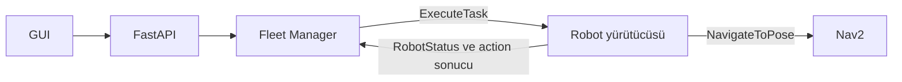

# v2.3 mimari geçiş kaydı: görev yürütücüsü ve Docker taslağı

> **Güncellik notu (24 Ekim 2026):** Aşağıdaki tarihsel hükümler korunur. [Nihai mimari kararların](../ROS2_Fleet_Manager_Nihai_Mimari_Kararlar_2026-10-23.md#3-mimari-kaynak-önceliği-ve-çelişki-çözümleri) açık çözümleri geçerlidir: üç servisli hedef onaylıdır; canlı uçtan uca doğrulama ayrı durumdur. Wh enerji modeli, ExecuteTask yürütücüsü ve tek filo dosyası kararları eski çelişen hükümleri değiştirir. Bu not kaynak önceliğini veya eski kaydın onay kapsamını değiştirmez.

Tarih: 22 Ekim 2026.

Durum: Mimari geçiş kaydı kullanıcı tarafından 22 Ekim 2026 tarihinde onaylandı. Onay, ExecuteTask/yürütücü yönünü ve burada açıkça belirtilen kapsam sınırlarını kapsar; aşağıdaki açık kararları kapatmaz. v2.3 belge setinin tamamının veya Docker dağıtımının onayı değildir. Kaynak PDF'ler ve kişisel notlar değiştirilmez; çelişen eski hükümler aşağıdaki kapsamda uygulanmaz.

## Kaynak ve öncelik

[Proje bağlamı](../project-context.md) kaynak önceliğini tanımlar.
[Revize Karar 08](../ROS2_Fleet_Manager_Karar_08_Revize_v1_0.pdf), sayfa 5, 16–20 ve 27 esas alınır. Sayfa 17, ExecuteTask kullanımını [K] olarak işaretler; mesaj alanları ve ayrıntılı protokol hâlâ taslaktır. Eski README ve docs/design altındaki v2.x belgelerinin Fleet Manager üzerinden doğrudan taşıma NavigateToPose akışı bu konudaki güncel referans değildir.

## Taşıma hedeflerini kim yürütür?

Akış: GUI → FastAPI → Fleet Manager → ExecuteTask → robot yürütücüsü → NavigateToPose → Nav2.

Fleet Manager robot seçimini, görev sahipliğini, öncelik/FIFO ve kaynak rezervasyonlarını yönetir. Robot yürütücüsü pickup, yükleme, dropoff ve bırakma adımlarını yönetir; taşımanın Nav2 hareket hedeflerini gönderir. Fleet Manager aynı taşıma için ikinci bir NavigateToPose istemcisi olarak hareket hedefi göndermez. Rota uygunluğu için planlama sorgusu yapmak, hareket hedefini yürütmekten farklıdır.

Şarj/park komutlarının arayüzü henüz seçilmemiştir (Karar 08 A08). Bu kayıt onların yeni action şemasını veya ayrı bir hareket komutu sahibini onaylamaz.

## Durum sahipliği ve hata sınırı

| Bilgi / karar | Yetkili bileşen veya kanal |
| --- | --- |
| Görev kuyruğu, atama, FIFO, rezervasyon | Tek Fleet Manager yazarı |
| Robotun fiziksel fazı, yük bilgisi, güvenli iptal kontrolü | Robot yürütücüsü |
| Manager'ın robot durumunu öğrenmesi | RobotStatus |
| İşin terminal sonucu | ExecuteTask result |
| İlerleme bilgisi | Action feedback |

Manager'daki robot görünümü, RobotStatus verisinin bir kopyasıdır; ikinci bağımsız robot durum makinesi değildir. Uygulama ayrıntılarında task_id, assignment_epoch ve goal UUID eşleştirmesi korunmalı; eski sonuç yeni atamayı değiştirmemelidir.

İptal kabulü fiziksel duruş değildir. Pickup girişindeki yerel kilit ve yük kontrolü yürütücüde yapılır; terminal iptal sonucu ve duruş doğrulanmadan yeni iş verilmez. Etkin taşımanın terminal Nav2 hatası işi FAILED, robotu ERROR yapar; Fleet Manager otomatik retry veya reassignment yapmaz. Result ve status farklı sırada gelirse robotun uygunluğu ayrıca doğrulanır. Canlı manager restart sonrası otomatik devam MVP kapsamında değildir.

## Açık hata yolları: henüz seçilmedi

Bu kayıt aşağıdaki hata yollarının ayrıntılı durum geçişlerini onaylamaz. Terminal Nav2 hatasıyla aynı davranışa otomatik bağlanamazlar.

| Durum | Korunacak ayrım ve henüz seçilmemiş davranış |
| --- | --- |
| ExecuteTask goal reddi | Kabul öncesi ret, aktif taşımanın terminal hatası değildir (Karar 08, sayfa 6). Kuyruktaki işin ve geçici atama sahipliğinin güncellenmesi, ret nedenleri ve yeniden değerlendirme zamanı henüz seçilmedi. |
| Robotun yanıt vermemesi / timeout | Goal kabul yanıtı, yürütme sonucu ve iptal yanıtı timeout'ları ayrı tanımlanmalı. Süreler, görev/robot görünümü ve uzlaştırma adımları henüz seçilmedi. Yanıt yokluğu goal'ın reddedildiğini veya robotun durduğunu kanıtlamaz; belirsiz sahiplikle ikinci atama yapılmaz. |
| RobotStatus akışının kesilmesi | Güncellik eşiği, aktif görevin gösterimi, bağlantı geri geldiğinde doğrulama ve normale dönüş geçişleri henüz seçilmedi. Eski v2.x TEMP_UNAVAILABLE kavramının yeni modelde kullanımı ayrıca kararlaştırılacak; bu ad RobotStatus yerine ikinci bir fiziksel durum otoritesi oluşturmaz. Güncel durumu bilinmeyen robot yeni atamaya açılmaz; yalnız iletişim kaybından görev başarısı veya fiziksel kaynak boşluğu çıkarılmaz. |

TEMP_UNAVAILABLE için tarihsel referans: [Fleet Manager v2.2](../design/fleet_manager_mimarisi_ve_algoritmalar_v2_2_fix.pdf). Bu bağlantı eski otomatik retry/reassignment davranışını yeniden yürürlüğe koymaz.

## Docker yerleşimi: öneri, doğrulanmadı

| Servis | İçerik |
| --- | --- |
| simulation | Headless Gazebo, ROS köprüsü, robot başına namespace altında Nav2/AMCL, yürütücü ve batarya simülatörü |
| backend | FastAPI (tek worker), komut/olay kuyruğu, tek Fleet Manager, ROS adaptörü ve geçmiş kaydı |
| frontend | Geliştirme için Vite; React/Konva dosyalarını sunar, API/WS proxy sağlar |

React/Konva tarayıcıda çalışır ve ROS kaynaklı veriyi gösterir. Production/demo sunum düzeni henüz kararlaştırılmadı. SQLite geçmiş dosyasının volume'da korunması canlı işlerin restart sonrası devamını sağlamaz.

DDS doğrulama durumu: ÇALIŞTIRILMADI. Henüz Dockerfile/Compose uygulaması yoktur. İlk kabul kontrolü aynı Compose ağı üzerinde simulation'dan yayımlanan bilinen bir test topic mesajının backend'de gerçekten alınmasıdır; yalnız topic listesinin görünmesi yeterli değildir. Image/sürüm, platform, RMW, ROS_DOMAIN_ID, komutlar ve alınan mesaj test kaydına yazılmalıdır. Ardından action goal/result/cancel iletişimi ve Nav2 hazırlığı ayrıca doğrulanmalıdır. Bu kontrollerden önce dağıtım doğrulanmış veya onaylı sayılmaz.

Docker onayı bu geçiş kaydından ayrıdır. Başarılı DDS mesaj alma testi gerekli ön koşuldur. Test kanıtları ve onay kapsamı gelecekte ayrı bir karar kaydına yazılacak; yalnız testin geçmesi tüm uygulamanın doğrulandığı anlamına gelmeyecektir. Bu geçiş kaydının Docker bölümü sonradan onaylı dağıtım kaydına dönüştürülmeyecektir.

## Apply Configuration ve yaşam döngüsü

[Config-driven v1.3 belgesi](../design/config_driven_multi_robot_ros2_nav2_architecture_tr_v1_3_fix.pdf), sayfa 4–6, robot seti değişikliklerini kontrollü Restart/Apply olarak tarif eder. Bu bağlantı eski belgenin tamamını yeniden onaylamaz: SQLite üzerinden QUEUED görevleri koruma ve manager_epoch ile restart uzlaştırması iddiaları güncel MVP sınırıyla yeniden eşitlenmelidir.

Docker uygulamasında hâlâ seçilecek konular:

- Apply sırasında simulation içindeki launch süreçlerini mi, container'ı mı yeniden başlatacağımız ve bunu hangi bileşenin yöneteceği.
- Aktif taşıma veya ONBOARD/UNKNOWN yük varken restartı engelleyen kontrol; duruş doğrulaması ve başarısız Apply davranışı.
- Yeni konfigürasyonla robotları başlatma, Nav2/AMCL ve telemetri hazırlığını doğrulama, ardından running_revision ve panel snapshot'ını güncelleme.
- Bekleyen işlerin kontrollü Apply sırasında korunma kapsamı; bunun canlı manager restart desteğiyle karıştırılmaması.

Bu yaşam döngüsü uygulanıp sınanmadan web üzerinden robot ekle/sil ve Apply desteği tamamlanmış sayılmaz.
