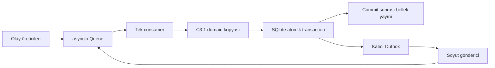

# C3.2 SQLite Outbox ve Tek Consumer

**Tarih:** 24 Ekim 2026. Bu kayıt [C3 kararlarının](c3-fleet-manager-decisions-2026-10-24.md#23-sqlite-outbox-tek-consumer-ve-idempotency-sınırları) uygulama sözleşmesidir. Yeni mimari politika tanımlamaz. [Doğrulama raporu](validation/c3/c3-2-validation-2026-10-24.md) test kapsamını ayrı tutar.

## Uygulama sınırı

`backend/fleet_manager/event_loop.py`, C3.1 `FleetManagerCore` çekirdeğini kullanır. `FleetEventLoop` yalnız bir `asyncio.Queue` consumer çalıştırır. Üreticiler `Event` değerlerini `submit` ile verir. İkinci consumer başlatılması reddedilir. Kuyruğa giriş sırası korunur; bu sıra ağın üretim sırası garantisi değildir. Görev önceliği/FIFO kararı yine domain zamanlayıcısındadır.

Her olay için domain durumu ayrı kopyada hesaplanır. `BEGIN IMMEDIATE` içinde görev, robot, rezervasyon, Outbox ve işlenen olay birlikte yazılır. Başarılı `COMMIT` sonrasında kopya canlı bellek olur. Yazma veya COMMIT hatası hem kalıcı hem bellek durumunu korur; olay kimliği tüketilmez ve çağıran hatayı alır. Hatalı bir olay consumer döngüsünü kapatmaz. Dış gönderim transaction içinde yapılmaz.

C3.1 zamanlayıcısında aktif görev sahipliği ayrıca denetlenir. Terminal sonuçtan önce gelen IDLE telemetrisi ikinci atama yaptıramaz. PREEMPTED ile çekirdeğin ürettiği yeni HIGH ataması da aynı transaction içinde Outbox'a girer. İptal kabulü tek başına atama başlatmaz. İptal reddi veya iptal beklerken doğal tamamlanma/hata, bekleyen HIGH görevi kuyruğa döndürür.

## SQLite şeması

Şema `backend/fleet_manager/persistence/schema.sql` içindedir. SQLite yabancı anahtarları açık, kalıcı yazma ayarı `synchronous=FULL` kullanılır. Bu ilk şema sürümüdür; eski bir ürün şemasından geçiş desteği yoktur.

| Tablo | İçerik ve kısıt |
|---|---|
| `tasks` | Görev kimliği, durum, robot, epoch, UUID ve JSON domain görüntüsü. Robot başına en fazla bir ASSIGNED/EXECUTING görev için unique index. |
| `robots` | Robot kimliği ve C3.1 kaydının JSON görüntüsü. Yeni fiziksel durum makinesi değildir. |
| `reservations` | İstasyon kimliği, durum, rezerve/işgal eden robot ve JSON görüntüsü. Robot yabancı anahtarları, tek sahiplik ve FREE sahiplik kontrolü. |
| `outbox_events` | Artan sıra, benzersiz komut kimliği, tür, görev/epoch/UUID, JSON yük, durum, deneme sayısı, sonraki deneme zamanı ve son hata. |
| `processed_events` | Artan işleme sırası, benzersiz olay kimliği, sonuç, akış ve sıra numarası, görev/epoch/UUID. Reddedilen eski olaylar da kaydedilir. |

JSON görüntüleri domain alanlarını korur; çalıştırılabilir nesne serileştirmesi kullanılmaz. Görev zamanları saniye, pozlar metre/radyan, batarya alanları Wh ve yüzde olarak C3.1 sözleşmesini izler. Görüntüler geçmiş incelemesi içindir; otomatik yeniden yükleme yapılmaz.

## Olay sözleşmesi

`Event(kind, payload, event_id)` iç kullanım sözleşmesidir. `event_id` verilmezse UUID üretilir. Aynı olay yeniden sunulurken aynı kimlik korunmalıdır. Aynı kimlik ikinci kez iş mantığına girmez. Aynı görev kimliği aktif veya terminal geçmişte varsa yeni görev kabul edilmez.

| Tür | Yük |
|---|---|
| `SUBMIT_TASK` | `FleetManagerCore.submit_task` parametreleri; pozlar `Pose2D`. |
| `TICK` | `current_time`: domain saatinde saniye. Aktif görev iletişim kaybında `COMMUNICATION_WARNING` logu üretir; FAILED/ERROR üretmez. |
| `ROBOT_STATUS` | `handle_robot_status` parametreleri ve monoton, negatif olmayan `status_seq`. |
| `ACTION_FEEDBACK` | Robot kimliği, görev/epoch/UUID, faz ve `status_seq`. |
| `ACTION_RESULT` | Robot kimliği, görev/`assignment_epoch`/UUID, geçerli terminal `result_status`, isteğe bağlı `error_reason`. |
| `CANCEL_RESPONSE` | Robot kimliği, görev/epoch/UUID, `accepted`, ilgili Outbox kaydının `cancel_command_id` değeri. |
| `RESERVE`, `OCCUPIED`, `RELEASE` | `station_id`, `robot_id`. OCCUPIED mevcut sahipliği ve bilinen robot pozunu kontrol eder. Fiziksel ayrılma ROBOT_STATUS üzerinden domain tarafından doğrulanır. |
| `OUTBOX_CLAIM`, `OUTBOX_FINISH` | Göndericinin iç komutları; claim zamanı veya komut kimliği/deneme numarası/hata/tekrar zamanı. |

Sonuçlar `APPLIED`, `DUPLICATE`, `STALE` veya `REJECTED` olur. Geçersiz alanlar/komutlar exception üretir ve transaction geri alınır. Olay API'si bir REST giriş doğrulayıcısı değildir.

Action olaylarında üçlü kimlik aktif atamayla eşleşmelidir. Telemetri sırası robot başına, feedback sırası robot/goal başına kontrol edilir. Terminal sonuç feedback sıra numarasına bağımlı değildir. Eski epoch, eski sıra veya geriye giden telemetri zamanı uygulanmaz. İptal yanıtı ayrıca en son iptal komutuyla eşleşir; önceki iptal isteğinin geç yanıtı yeni isteği kapatamaz.

**Entegrasyon sınırı:** Mevcut `RobotStatus.msg` içinde `status_seq` yoktur. C3.2 bunu yalnız iç olay zarfında zorunlu tutar. Kaynak sırasını koruyan ROS eşlemesi sonraki adaptör işidir; geliş sırasına yeni numara vermek ağda sırasız teslimi çözmez. Bu değişiklik ROS IDL veya adaptör eklemez. `timestamp_sec`, `current_time` ve rota verisi çağıran tarafından tutarlı sağlanmalıdır; rota sağlayıcı senkron ve yan etkisiz bir mesafe sorgusu olmalıdır.

## Outbox gönderim ve tekrar deneme

Normal akış `PENDING → SENDING → SENT`; hata veya gönderim iptalinde `SENDING → RETRY → SENDING` olur. Göndericiye verilecek kayıt claim transaction'ında SENDING yapılır ve deneme sayısı artırılır. `OUTBOX_FINISH` yalnız aynı komutun aynı SENDING denemesini kapatır. SENT, soyut göndericinin başarıyla dönmesidir; görev tamamlandı veya Executor kesin kabul etti anlamına gelmez.

`EXECUTE_TASK` komut kimliği goal UUID'den türetilir. Her yeni iptal isteğinin ayrı komut kimliği vardır. Tekrar deneme aynı komut kimliği, epoch, goal UUID ve yükle yapılır. Terminal sonuç veya iptal isteğinin kapanması sonrası geçersiz bekleyen kayıtlar SUPERSEDED olur. Gönderim sırasında sonuç geldiyse geç gönderim yanıtı eski komutu yeniden RETRY yapamaz.

`OutboxDispatcher` gönderici fonksiyonunu, monoton saati ve pozitif `retry_delay` değerini dışarıdan alır. Tekrar gecikmesi saniyedir; ürün varsayılanı veya yeni kalibre edilmiş politika belirlenmemiştir. En eski bekleyen komut önce gider; RETRY zamanı gelmemiş veya SENDING olan kayıt sonraki kayıtları bekletir. Bu basit sıra koruması, bir gönderim hatasının diğer robotların gönderimlerini geciktirebilmesi karşılığında sağlanır. Sonraki adaptör çağrı zaman aşımını da sağlamalıdır.

Teslim gerçekleşip onay kaybolursa komut yeniden gönderilebilir. Ağda **exactly-once teslim garantisi yoktur**. Uç adaptörü/Executor sınırında komut kimliği ve goal UUID idempotency kontrolü gerekir; bu aşama ağ davranışını doğrulamaz. Tekrar deneme görev hatası veya otomatik reassignment değildir.

## Yaşam döngüsü ve sınırlar

Veritabanı yolu çağıran tarafından verilir; kaynak koda host yolu veya filo tanımı gömülmez. Başlangıçta hazırlanmış C3.1 çekirdeği kopyalanır. Dışarı verilen `core` görüntüsü de kopyadır. Başlatmadan önce `start`, çalışırken `submit`, kapanırken önce gönderici işlerini sonlandırma, sonra `close`, ardından `store.close` sırası kullanılır. `close` yeni olay kabulünü kapatır ve kabul edilmiş kuyruğu tüketir. Çağıranın submit bekleyişini iptal etmesi kabul edilmiş olayı geri çekmez. Kuyruk kalıcı değildir; commit edilmemiş olayların süreç çökmesinde korunması iddia edilmez.

İçinde senaryo kaydı bulunan veritabanıyla yeni runtime kurulması `ScenarioResetRequired` üretir. PENDING, SENDING, RETRY veya SENT kayıtları otomatik gönderilmez; aktif görev otomatik sürdürülmez. Operatör simülasyon senaryosunu gerçekten reset ettikten sonra eski veritabanını kanıt olarak saklayıp yeni boş veritabanıyla başlatmalıdır. Kod fiziksel reset yapmaz veya eski kayıtları silmez. Çoklu aktif manager desteklenmez.

ROS 2 adaptörleri, API, frontend, Battery Simulator, canlı restart uzlaştırması, otomatik iletişim kaybı kurtarması ve nihai üç servis dağıtımı bu değişiklikte uygulanmamıştır.
