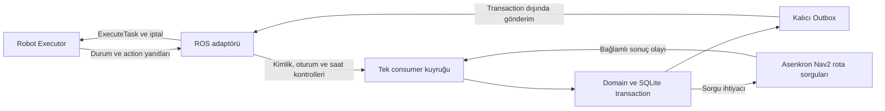

# C3.3 ROS 2 Entegrasyonu Teknik Karar Kaydı

> **24 Ekim 2026 C3.3.1 ek kaydı:** [Executor güvenliği kararları](c3-3-1-executor-safety-decisions-2026-10-24.md), sonraki yedi kullanıcı onayını ve önceki açık seçeneklere etkisini kaydeder. İlgili konularda bu ek kayıt esas alınır; uygulama ve test başarısı iddia edilmez.

**Tarih:** 24 Ekim 2026
**Durum:** Bölüm 2'deki dört kullanıcı kararı **ONAYLANDI**. Uygulama ve C3.3 entegrasyonu **HENÜZ TEST EDİLMEDİ**. Açık ayrıntılar onaylanmış sayılmaz.
**Kapsam:** Fleet Manager ROS adaptörleri, RobotStatus sıralaması, ExecuteTask teslimi, saat ayrımı ve entegrasyon önkoşulları. Bu değişiklik yalnız dokümantasyondur.

## 1. Dayanak ve mevcut durum

- [AGENTS.md](../AGENTS.md) ve [proje bağlamı](project-context.md): çalışma kuralları, kaynak önceliği ve kişisel notların korunması.
- [Nihai mimari PDF](ROS2_Fleet_Manager_Nihai_Mimari_Kararlar_2026-10-23.pdf), DOC-ARCH-2026-10-23-FINAL v1.0, bölüm 5–8 ve 11: durum otoritesi, kimlik eşleştirme, güvenli preemption, enerji ve arayüzler.
- [C2 kararları](c2-executor-decisions-2026-10-24.md), özellikle bölüm 2 ve 3.2; [C3 kararları](c3-fleet-manager-decisions-2026-10-24.md); [C3.2 sözleşmesi](c3-2-sqlite-outbox.md).
- Mevcut plan: 24 Ekim 2026 tarihli [C3.3 entegrasyon planı hazırla](codex://threads/01a16e5b-7059-7122-bf4b-195be9737824) sohbetindeki teknik plan. Plan depoda ayrı dosya değildir. Modül isimleri ve bu kayıtla seçilmeyen seçenekleri **ÖNERİ** olarak kalır.

İncelenen depo tabanı `d61e304` commit'idir. C1–C3.2 kodu vardır; eski belgelerdeki boş uygulama dizini ifadeleri bu tabanın güncel durumu değildir. [C3.2 doğrulama raporu](validation/c3/c3-2-validation-2026-10-24.md) 174 geçen ve ROS gerektirdiği için 10 atlanan testi bildirir. Bunlar tarihsel kanıttır; bu dokümantasyon çalışmasında yeniden çalıştırılmadı ve C3.3 başarısı sayılmaz.

Mevcut `RobotStatus.msg` kaynak sıra/oturum alanlarını içermez. Consumer sıra denetimini iç zarf üzerinden yapar; ROS adaptörü henüz yoktur. Outbox `SENT` soyut göndericinin döndüğünü bildirir; Executor kabulü veya görev sonucu değildir. Bu sınırlar aşağıdaki kararlarla uygulamada giderilecek, bu kayıtla giderilmiş sayılmayacaktır.

## 2. Onaylanan kararlar

### C3.3-DEC-01: Kaynak sırası ve yayın oturumu

**Bağlam ve seçenekler:** Plan, IDL korunarak kaynak timestamp filtresi ile IDL'ye kaynak sıra/oturum alanları eklenmesini karşılaştırdı. Alıcıda geliş sırasına numara vermek DDS'deki sırasız teslimi çözmez; `/clock` damgası da yayın oturumunu ayırt etmez.

**Seçilen yol:** `RobotStatus` sıralamasında `status_seq` ve `publisher_session_id` kullanılacak. Sıra yayıncıda üretilecek; robot ve yayın oturumu bağlamında değerlendirilecek. Aynı oturumdaki eski ve yinelenen sıra numaraları yeni fiziksel durum olarak uygulanmayacak. `current_epoch` görev kimliğidir; yayın sıra numarasının yerine kullanılmayacak.

Yeni yayın oturumunda **güvenli yeniden eşleştirme zorunludur**. İlk mesajın gelmesi veya IDLE bildirmesi tek başına robotu atamaya açmaz. Mevcut görev/epoch/UUID sahipliği ve fiziksel durum uzlaştırılmadan yeni atama yapılmaz; eski oturumdan gecikmiş mesajlar yeni oturumun yerine geçemez. Bu, C3-DEC-01'deki telemetri geri gelince uygunluğa dönüşün oturum değişimindeki ek güvenlik koşuludur.

**Gerekçe:** Yayıncı restart'ı, sıra sıfırlanması ve gecikmiş eski yayın yeni fiziksel durumla karışmamalıdır.

**Açık ayrıntılar:** IDL tipleri, oturum kimliği üretimi, sayaç başlangıcı/taşması, eşzamanlı iki yayıncı davranışı ve eski oturumların takibi; yeniden eşleştirmenin hangi kanıtlarla ve hangi operatör/reset adımlarıyla tamamlanacağı. `RobotStatus` goal UUID taşımadığı için üçlü kimliği doğrulayacak ek sorgu/kanıt kanalı da belirlenmelidir. Feedback'in ayrı goal akışındaki sıralama sözleşmesi ayrıca netleştirilecektir.

### C3.3-DEC-02: Belirsiz teslim ve Executor duplicate kayıtları

**Bağlam ve seçenekler:** Yalnız adaptörde future/goal kaydı ve atama engeli tutmak ile bunlara Executor'da aktif ve terminal duplicate kayıtlarını eklemek değerlendirildi.

**Seçilen yol:** Belirsiz `ExecuteTask` tesliminde aynı `task_id`, `assignment_epoch` ve goal UUID korunacak; Outbox komut kimliği ve yükü de değişmeyecek. Executor aktif ve terminal duplicate kayıtlarıyla aynı atamanın ikinci yürütmesini engelleyecek. Aktif duplicate yeni pickup/dropoff akışı başlatmayacak; terminal duplicate tamamlanmış görevi yeniden başlatmayacak. Yalnız DDS UUID reddine güvenilmeyecek.

**Gerekçe:** Goal ulaşmışken kabul yanıtının kaybolması yeni görev yaratmamalıdır. Aynı komutun teslim denemesi, terminal FAILED görevin otomatik retry/reassignment edilmesi değildir. Ağda exactly-once teslim garantisi verilmez.

**Açık ayrıntılar:** Kayıtların yaşam süresi, boyut sınırı ve temizleme koşulları; bellek veya kalıcı depolama seçimi; Executor restart'ında aktif/terminal kayıtların korunması veya güvenli blokaj/reset davranışı; aktif kayda yeniden bağlanma ve terminal sonucu geri sunma protokolü. Aynı kimlikle farklı yük veya farklı kimliklerle çakışan task/epoch durumlarının ret sözleşmesi belirlenmelidir. Planın “senaryo boyunca kayıt” seçeneği kesin saklama süresi olarak onaylanmamıştır. Bu ayrıntılar çözülmeden kayıt kaybından sonra güvenli tekrar yürütme iddiası yapılamaz. Manager çökmesinde senaryo reset ilkesi ve otomatik devam yasağı korunur.

### C3.3-DEC-03: İletişim ve fiziksel zamanın ayrılması

**Bağlam ve seçenekler:** DDS iletişim sürelerini simülasyon saati veya monotonic saatle ölçmek değerlendirildi. Simülasyon duraklatıldığında iletişim bekleyişi durmamalı; sistem saati değişimi süre ölçümünü bozmamalıdır.

**Seçilen yol:** DDS iletişim timeout'ları yerel monotonic saatle; fiziksel simülasyon zaman damgaları Gazebo `/clock` ile izlenecek. Alım zamanı ile mesajın kaynak damgası ayrı tutulacak; birbirinden çıkarılmayacak. C3-DEC-01'in 2.0 saniye STALE ve C3-DEC-02'nin aktif görevde 5.0 saniye uyarı eşikleri korunur. İletişim kesintisi otomatik FAILED/ERROR üretmez.

**Gerekçe:** Ağ canlılığı ve fiziksel simülasyon ilerlemesi farklı ölçümlerdir. Bu ayrım enerji hesabının `/clock` otoritesini değiştirmez; duvar saati fiziksel tüketim hesabına taşınmaz.

**Açık ayrıntılar:** Goal/cancel/servis/rota çağrıları için timeout değerleri; `/clock` durması ve geri sıçramasında fiziksel veri geçerliliği; stale/duplicate paketlerin alım kaydı ile geçerli telemetri tazeliğinin ayrımı; IDLE süresi ve FIFO zaman alanlarının saat sözleşmesi. Monotonic değerler farklı süreç/host veya restart arasında ortak zaman damgası sayılmayacak. Bu kayıt watchdog, PAUSED/Resume veya otomatik kurtarma politikası onaylamaz.

### C3.3-DEC-04: Açık goal reddinde güvenli bekletme

**Bağlam ve seçenekler:** Açık reddi otomatik kuyruğa dönüştürmek ile ret nedenini kaydedip güvenli bekletme/inceleme uygulamak karşılaştırıldı.

**Seçilen yol:** Açık `ExecuteTask` goal reddinde görev kontrolsüz yeniden atanmayacak. Ret nedeni ve ilgili robot/task/epoch/UUID kaydedilecek; güvenli bekletme ve inceleme uygulanacak. Ret, belirsiz teslimden ve kabul edilmiş görevin terminal başarısızlığından ayrılacak. Ret tek başına robotun fiziksel ERROR/IDLE durumuna veya işgal edilen kaynağın FREE olmasına kanıt değildir.

**Gerekçe:** Kör yeniden atama, eski yürütme veya sahiplik belirsizliği çözülmeden ikinci yürütmeye yol açabilir.

**Açık ayrıntılar:** Bekletmenin domain/Outbox durum adları, operatörün inceleme sonrası izin verdiği geçişler, tekrar gönderimin açılma koşulları ve ret nedeni taşıma kanalı. Mevcut Executor ret nedenini loglar; adaptörün gerekçeyi güvenilir biçimde alacağı arayüz henüz tanımlı değildir. Gerekçe alınamadığında neden uydurulmayacak; bilinmeyen neden ve gözlenen ret ayrı kaydedilecek. Ek servis veya olay kanalı seçimi bu kayıtla kilitlenmez.

## 3. Entegrasyon önkoşulları

Aşağıdaki işler C3.3 entegrasyon kabulünden önce tamamlanıp doğrulanmalıdır. Bunlar mevcut kodun başarı iddiası değildir.

| Önkoşul | Mevcut boşluk ve gereken doğrulama | Açık ayrıntı |
|---|---|---|
| `completed_epoch` | Executor'ın bazı hata dönüşleri alanı doldurmuyor. Tüm terminal sonuçlar gerçek görev epoch'unu taşımalı. Consumer bugün `assignment_epoch` değerini `completed_epoch` olarak aktarıyor; adaptör sonuçtaki gerçek değeri ayrıca doğrulamalı, beklenen değeri kopyalayarak uyuşmazlığı gizlememeli. Robot/task/UUID bağlamı ile payload epoch'u birlikte eşleşmeli. | Hatalı/eksik sonuç için olay kaydı ve inceleme akışı; kabul edilmiş goal sonrası abort ile açık goal reddinin ayrı eşlenmesi. |
| Nav2 terminal cancel | Executor `_execute_safe_cancel` bugün cancel yanıtının `return_code` değerini kullanıyor. Bu, Nav2 terminal `STATUS_CANCELED` sonucu değildir. İlgili Nav2 goal'un terminal iptali, güncel `/clock` odometrisi ve hız eşikleri birlikte doğrulanmadan PREEMPTED/IDLE ve yeni HIGH ataması açılamaz. | Terminal başarı/abort ile cancel yarışının eşlenmesi; iletişim bekleme ve fiziksel duruş sürelerinin ayrımı. C2'de açık kalan timeout hata davranışı ve kalibrasyonsuz hız eşikleri burada onaylanmaz. |
| Outbox goal kabul/ret olayları | Mevcut consumer goal kabul/ret olayı tanımıyor. Gönderim denemesi, belirsiz teslim, açık kabul/ret ve terminal sonuç ayrı izlenmeli; ROS callback'leri tek consumer üzerinden işlenmeli. Geç kabul/ret sonucu kapanmış atamayı tekrar açmamalı. | Olay isimleri ve yükleri, command/attempt/UUID eşleştirmesi, atomik durum geçişleri, SENT ilişkisinin kesin tanımı, ret nedeninin taşınması ve duplicate yanıtları. |
| Asenkron rota sorguları | Mevcut `RouteDistanceProvider` senkron ve yan etkisizdir. İçine ROS future bekleme konulmamalı; Nav2 sorguları consumer/SQLite transaction dışında asenkron yürümeli, sonuçlar consumer'a dönmeli. Robot/namespace/frame ve sorgu bağlamı korunmalı; atamada veri geçerliliği yeniden kontrol edilmeli. Rota yoksa görev kuyrukta kalır; Euclidean fallback yoktur. | Sorgu kimliği, poz/harita/config revizyonu, önbellek ve geçerlilik süresi, geç sonuçların elenmesi, eşzamanlı sorgu sınırı, timeout ve yeniden sorgulama koşulları. |

Hedef veri akışı aşağıdadır; uygulanmış modül diyagramı değildir:

Planın config'den üretilen robot uçları, thread-safe callback aktarımı ve en az iki robotlu namespace izolasyonu kapsamı korunur. `ClearRobotError` yalnız açık operatör isteğiyle ve `expected_epoch` korunarak çağrılacak; servis yanıtı FM'in fiziksel IDLE üretmesine, FAILED görevi yeniden başlatmasına veya BLOCKED kaynağı açmasına izin vermez. Yanıt olayının şeması henüz tanımlanmadı. C4 Battery Simulator, C5 API/panel ve nihai üç servis dağıtımı bu kaydın uygulama kapsamı değildir.

## 4. Planlanan doğrulama ve karar kapıları

Aşağıdaki testler **HENÜZ TEST EDİLMEDİ**; yeni başarı veya sayısal kabul eşiği değildir:

- Kaynak sıra tersliği ve duplicate; aynı timestamp'li farklı sıralar; oturum değişimi/sayaç sıfırlanması; eski oturumun geç mesajları; uzlaştırılmadan atama açılmaması.
- Kaybolan kabul yanıtı sonrası aynı task/epoch/UUID; aktif ve terminal duplicate ile tek yürütme; kayıt temizliği ve restart senaryoları (yaşam süresi/restart kararı sonrası).
- Yanlış `completed_epoch`, eski UUID ve eski task sonuçları; cancel kabulü sonrası terminal sonuç gelmeden yeni atama yapılmaması; terminal cancel/doğal tamamlanma yarışları ve stale odometri.
- Açık goal reddi, nedeni eksik ret, geç/duplicate kabul-ret ve Outbox gönderim yanıtı yarışları; kontrolsüz yeniden atama olmaması.
- `/clock` durması/geri sıçraması ve duvar saati değişiminde monotonic iletişim süreleri; iletişim kaybında sahipliğin korunması ve otomatik FAILED/ERROR olmaması.
- Yavaş/başarısız rota sorgusunda consumer'ın ilerlemesi; eski poz/frame/config bağlamındaki sonucun atama üretmemesi; rota ve enerji önkoşullarının korunması.
- C1–C3.2 regresyonu; gerçek ROS 2 Humble/DDS üzerinde en az iki Executor ve kontrollü Nav2 sunucusu; ardından iki robotlu Gazebo/Nav2. Namespace izolasyonu, eşzamanlı görev, preemption ve ClearRobotError sınanmalı. Atlanan ROS testi başarı sayılmaz.

Uygulama öncesinde bölüm 2 ve 3'teki açık sözleşmeler seçenekleriyle kullanıcıya sunulmalıdır. Bu kayıt bu seçeneklerden birini örtük olarak seçmez. Yeni test komutları ve sonuçları [C3 doğrulama dizinine](validation/README.md) ayrı kanıt olarak eklenecektir.

## 5. Bu kayıt için dokümantasyon kontrolü

24 Ekim 2026: `git diff --check` çıkış 0 verdi. `python3` ile beş değişen Markdown dosyasındaki bağlantıların yerel hedefleri `pathlib.Path.exists()` kullanılarak denetlendi: **47/47 hedef mevcut**. URL ve başlık anchor doğrulaması bu sayıya dahil değildir. Kapsam yalnız bu kayıt ve bağlantılarıdır. Ürün testleri veya canlı ROS/simülasyon koşuları yeniden çalıştırılmamıştır; C3.3 davranışı **HENÜZ TEST EDİLMEDİ**.
