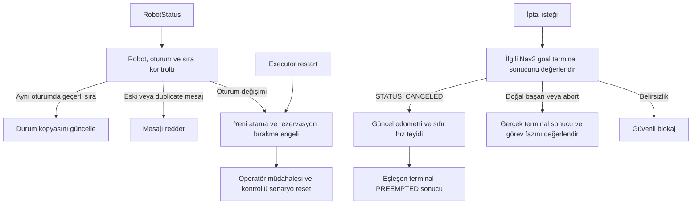

# C3.3.1 Executor Güvenliği Resmî Karar Kaydı

**Tarih:** 24 Ekim 2026
**Durum:** Aşağıdaki yedi kullanıcı kararı **ONAYLANDI**. C3.3.1 uygulaması ve davranışları **HENÜZ TEST EDİLMEDİ**.
**Kapsam:** RobotStatus kaynak sırası ve oturumu, Executor duplicate kayıtları, restart sınırı, terminal sonuç eşleştirmesi ve güvenli iptal. Bu kayıt yalnız dokümantasyondur.

## 1. Dayanak ve kararın sınırı

Karar kaynağı, kullanıcının 24 Ekim 2026 tarihli C3.3.1 için yedi maddelik açık onayıdır. [AGENTS.md](../../AGENTS.md), [proje bağlamı](../project-context.md), [nihai mimari PDF](../ROS2_Fleet_Manager_Nihai_Mimari_Kararlar_2026-10-23.pdf) (DOC-ARCH-2026-10-23-FINAL v1.0, bölüm 5–6 ve 11), [C2 kararları](c2-executor-decisions-2026-10-24.md), [C3 kararları](c3-fleet-manager-decisions-2026-10-24.md), [C3.2 sözleşmesi](../design/c3-2-sqlite-outbox.md) ve [C3.3 kararları](c3-3-integration-decisions-2026-10-24.md) incelenmiştir.

İncelenen depo tabanı `7634d0f` commit'idir. C1–C3.2 uygulaması mevcuttur; `RobotStatus.msg` henüz kaynak sıra/oturum alanlarını içermez. C3.3 kaydındaki gerçek `completed_epoch` aktarımı ve Nav2 terminal iptal doğrulaması boşlukları bu belgeyle giderilmiş sayılmaz. Önceki [C3.2 test kanıtı](../validation/c3/c3-2-validation-2026-10-24.md) C3.3.1 doğrulaması değildir; ürün testleri bu çalışmada yeniden çalıştırılmamıştır.

## 2. Onaylanan kararlar

### C3.3.1-DEC-01: RobotStatus sıra ve oturum sözleşmesi

**Bağlam ve seçenekler:** C3.3-DEC-01 kaynak sıra/oturum kullanımını onayladı; alan tipleri, başlangıç ve taşma davranışını açık bıraktı.

**Seçilen yol:** `RobotStatus` için `uint64 status_seq` ve `unique_identifier_msgs/UUID publisher_session_id` kullanılacak. Her yeni yayın oturumunda sayaç 1'den başlayacak. Robot ve yayın oturumu bağlamında eski veya duplicate mesajlar reddedilecek; eski oturumdan gelen mesajlar yeni oturumun durumunu değiştiremeyecek. Sayaç taşmasında güvenli blokaj uygulanacak; taşma normal sıra başlangıcı gibi işlenmeyecek. Yeni oturumun kabul sınırı DEC-07'ye tabidir.

**Gerekçe:** Gecikmiş yayın, tekrar teslim ve sayaç sıfırlanması yeni fiziksel durumla karışmamalıdır. `current_epoch`, yayın sırasının yerine geçmez.

### C3.3.1-DEC-02: Senaryo boyunca bellekte duplicate kayıtları

**Bağlam ve seçenekler:** C3.3-DEC-02 aktif/terminal duplicate korumasını onayladı; bellek veya kalıcı saklama, yaşam süresi ve kapasite davranışı açıktı.

**Seçilen yol:** Executor, `(task_id, assignment_epoch, goal_uuid)` ve değişmez yük özetiyle aktif ve terminal duplicate kayıtları tutacak. Aynı atama ikinci kez yürütülmeyecek. Kayıtlar senaryo boyunca bellekte korunacak. Kapasite dolarsa yeni görev kabul edilmeyecek; yer açmak için senaryo içindeki duplicate koruma kayıtları kaybedilmeyecek.

**Gerekçe:** Kabul yanıtı kaybolduğunda aynı atamanın yeniden teslimi ikinci pickup/dropoff yürütmesi üretmemelidir. Ağda exactly-once teslim garantisi verilmez. Bellek kayıtları restart sonrası korunmuş sayılmaz; DEC-03 uygulanır.

### C3.3.1-DEC-03: Executor restart sonrası kontrollü reset

**Bağlam ve seçenekler:** Kayıt kaybından sonra otomatik replay/continue ile güvenli blokaj ve senaryo reset seçenekleri açıktı.

**Seçilen yol:** Executor restart sonrası otomatik replay/continue yapılmayacak. Kontrollü senaryo reset tamamlanana kadar yeni atama ve rezervasyon serbest bırakma engellenecek.

**Gerekçe:** Bellekteki duplicate geçmişinin kaybı, eski görevin yürütülmediğine veya kaynağın fiziksel olarak boşaldığına kanıt değildir. Restart tek başına sahipliği kaldırmaz.

### C3.3.1-DEC-04: Gerçek completed_epoch ve sahipliğin korunması

**Bağlam ve seçenekler:** C3.3 bölüm 3, bazı hata sonuçlarında eksik epoch ve consumer'ın beklenen atama epoch'unu sonuç yerine kullanması boşluklarını kaydeder.

**Seçilen yol:** Bütün `ExecuteTask` terminal sonuçları gerçek `completed_epoch` taşıyacak. Sonuç, ilgili `(task_id, assignment_epoch, goal_uuid)` bağlamıyla ve sonuçtaki gerçek epoch ile eşleştirilecek. Hatalı veya eksik eşleşmede sahiplik korunacak ve inceleme gerekecek. Beklenen epoch'u kopyalayarak uyuşmazlık gizlenmeyecek.

**Gerekçe:** Eski veya yanlış eşlenmiş sonuç yeni atamayı kapatmamalı; robot veya kaynak sahipliğini serbest bırakamamalıdır.

### C3.3.1-DEC-05: Terminal Nav2 iptali ve fiziksel duruş teyidi

**Bağlam ve seçenekler:** İptal isteğinin kabul yanıtı ile ilgili Nav2 goal'un terminal sonucu farklı kanıtlardır. C2 bölüm 3.2 ve C3.3 bölüm 3 bu ayrımı gerektirir.

**Seçilen yol:** Güvenli iptal ancak ilgili Nav2 goal'un terminal `STATUS_CANCELED` sonucu, güncel odometri ve sıfır hız teyidi birlikte elde edildiğinde tamamlanacak. İptal kabulü tek başına `PREEMPTED` değildir. Fleet Manager, eşleşen terminal `PREEMPTED` ExecuteTask sonucunu almadan aynı robota bekleyen HIGH görevi atamayacak.

**Gerekçe:** İptal yanıtı robotun durduğunu veya Nav2 goal'un sona erdiğini kanıtlamaz. Bu kayıt sayısal odometri tazelik süresi veya hız toleransı seçmez.

### C3.3.1-DEC-06: İptal ve doğal terminal sonuç yarışı

**Bağlam ve seçenekler:** İptal talebi sürerken ilgili Nav2 goal doğal başarı veya abort ile bitebilir. İptal talebini sonuç yerine kullanmak gerçek yürütme sonucunu örter.

**Seçilen yol:** İptal ile doğal başarı/abort yarışında gerçek terminal sonuç değerlendirilecek; belirsizlikte güvenli blokaj uygulanacak. İptal istendi diye başarı veya abort `PREEMPTED` sayılmayacak.

**Gerekçe:** Sonuç, ilgili goal'un gerçek terminal kanıtına dayanmalıdır. Bir Nav2 adımının başarısı tek başına tüm taşıma görevinin tamamlandığı anlamına gelmez. Kesin terminal seyrüsefer hatasına ilişkin mevcut FAILED/ERROR politikası korunur; belirsizlik için yeni kesin hata geçişi bu kayıtla seçilmez.

### C3.3.1-DEC-07: Oturum değişiminde otomatik uzlaştırma yok

**Bağlam ve seçenekler:** C3.3-DEC-01 güvenli yeniden eşleştirmeyi zorunlu tuttu; otomatik uzlaştırma ile operatör/reset yolunu kesinleştirmedi.

**Seçilen yol:** Oturum değişiminde MVP kapsamında otomatik uzlaştırma yapılmayacak. Kontrollü senaryo reset ve operatör müdahalesi gerekecek. Yeni oturumdan mesaj veya IDLE durumu gelmesi tek başına atamayı açmayacak; DEC-03'teki atama ve rezervasyon serbest bırakma engeli korunacak.

**Gerekçe:** Yeni yayın oturumu eski atama, duplicate geçmişi ve fiziksel kaynak sahipliği için devam kanıtı değildir.

## 3. Önceki kayıtlarla ilişki

Eski kayıtlar tarihsel içerikleriyle korunur. Aşağıdaki açık seçenekler, sonraki açık kullanıcı onayı nedeniyle bu kayıtla daraltılmıştır:

| Önceki kayıt | Bu kaydın etkisi |
|---|---|
| C2 bölüm 2.2; C3.3-DEC-01 | RobotStatus'a eklenecek tipler, sayaç başlangıcı ve taşma ilkesi DEC-01 ile onaylandı. Eski IDL örneği C3.3.1 hedefinin tamamı değildir. |
| C3.3-DEC-02 | Bellekte senaryo boyunca saklama ve kapasite dolunca yeni görev kabul etmeme DEC-02 ile onaylandı. Restart davranışı DEC-03 ile kesinleşti. |
| C3.3-DEC-01; C3-DEC-01 | Güvenli yeniden eşleştirme MVP'de DEC-07'nin operatör/reset yoludur. Telemetri dönüşü, oturum değişimindeki engeli kendiliğinden kaldırmaz. |
| C2 bölüm 3.2–3.3; C3.3 bölüm 3 | Terminal iptal kanıtı ve gerçek epoch gereği DEC-04–05 ile teyit edildi; yarış davranışı DEC-06 ile daraltıldı. Önerilen timeout hata geçişleri onaylanmadı. |
| C3.2 yaşam döngüsü | Manager için otomatik devam yasağı korunur. Executor restart sınırı DEC-03 ile ayrıca onaylandı; mevcut manager başlangıç davranışı tam bir operasyonel reset prosedürü sayılmaz. |

Hedef güvenlik akışı aşağıdadır; uygulanmış veya test edilmiş akış değildir:

## 4. Açık kalan ayrıntılar

Aşağıdakiler **AÇIK / ONAY BEKLİYOR**; bu kayıtla kesin değer, varsayılan veya hata durumu atanmaz:

- C3.3.1 için sayısal timeout'lar; goal/cancel/servis/rota bekleme ve odometri tazelik süreleri. Önceden C3-DEC-01/02 ile onaylanan 2.0 saniye STALE ve 5.0 saniye iletişim uyarısı geri açılmaz; C3.3-DEC-03 saat ayrımı korunur.
- Duplicate kayıt kapasitesinin sayısal değeri.
- Kontrollü senaryo reset prosedürünün operasyonel adımları ve tamamlandığını doğrulayacak kanıtlar.
- Belirsizlik, taşma, eksik eşleşme veya duruş teyidi yokluğunda kesin domain/Outbox hata durumları ve geçişleri. Güvenli blokaj, kendiliğinden FAILED/ERROR ataması anlamına gelmez.

Önceki kayıtlardaki bu yedi kararla çözülmeyen ayrıntılar da açık kalır: oturum kimliği üretimi ve eşzamanlı yayıncılar, eski oturum takibi, değişmez yük özetinin biçimi, aynı kimlikle farklı yük/çakışan kimlik ret protokolü, duplicate yanıt protokolü, feedback sıralaması ve kalibrasyonsuz hız eşikleri. Yeni arayüz, servis, hata kodu veya sayısal eşik bu kayıtla örtük olarak seçilmez.

## 5. Dokümantasyon doğrulaması

24 Ekim 2026: `git diff --check` ile boşluk/hatalı diff kontrolü ve `python3` içindeki `pathlib.Path.exists()` ile bu kayıt ve bağlantı eklenen Markdown dosyalarının yerel bağlantı hedefleri kontrol edildi; altı Markdown dosyasında 60/60 yerel hedef mevcuttur; diff kontrolü çıkış 0 vermiştir. URL ve başlık anchor doğrulaması kapsam dışıdır. Değişiklik kapsamı yalnız bu tarihli karar kaydı ve dokümantasyon bağlantılarıdır. Kod, PDF, kişisel notlar ve testler değiştirilmedi; ürün veya canlı ROS testleri çalıştırılmadı. C3.3.1 davranışları **HENÜZ TEST EDİLMEDİ**.
