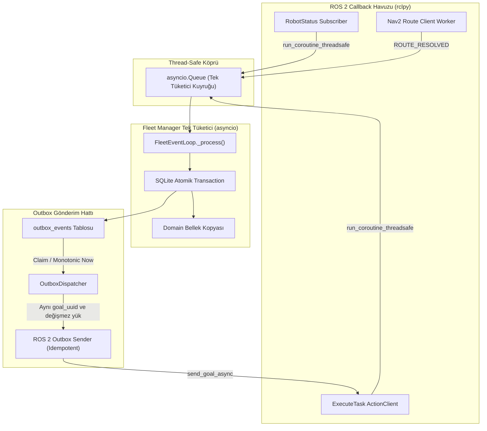

# C3.3.2 ROS 2 Adaptör Entegrasyonu ve Uygulama Kararları

**Tarih:** 24 Ekim 2026\
**Durum:** Aşağıdaki kararlar kullanıcı tarafından **ONAYLANDI**. C3.3.2 kod uygulaması **HENÜZ TEST EDİLMEDİ**.\
**Kapsam:** ROS 2 adaptörleri sayısal timeout'ları, Nav2 rota önbellek sözleşmesi, açık goal reddinde güvenli bekletme mekanizması, FM restart davranışı, oturum değişimi mülkiyet koruması, gerçek `completed_epoch` doğrulaması ve Outbox teslim sınırları. Bu değişiklik yalnız dokümantasyon ve karar kaydıdır.

---

## 1. Dayanak ve Mevcut Durum

- [AGENTS.md](../../AGENTS.md) ve [proje bağlamı](../project-context.md): çalışma kuralları, kaynak önceliği ve kişisel notların korunması.
- [Nihai mimari PDF](../ROS2_Fleet_Manager_Nihai_Mimari_Kararlar_2026-10-23.pdf), DOC-ARCH-2026-10-23-FINAL v1.0, bölüm 5–8 ve 11: durum otoritesi, kimlik eşleştirme, güvenli preemption, enerji ve arayüzler.
- [C2 kararları](c2-executor-decisions-2026-10-24.md), [C3 kararları](c3-fleet-manager-decisions-2026-10-24.md), [C3.2 sözleşmesi](../design/c3-2-sqlite-outbox.md), [C3.3 entegrasyon kararları](c3-3-integration-decisions-2026-10-24.md) ve [C3.3.1 güvenlik kararları](c3-3-1-executor-safety-decisions-2026-10-24.md).
- İncelenen depo tabanı `1eb4c36` commit'idir. C1–C3.3.1 uygulaması tamamlanmış ve Executor tarafı [C3.3.1 doğrulama raporu](../validation/c3/c3-3-1-validation-2026-10-24.md) ile test edilmiştir.

Bu belge, C3.3.2 adaptör entegrasyonu öncesinde açık bırakılan sayısal değerleri, veri yapılarını ve güvenlik kontrol noktalarını resmileştirir.

---

## 2. Onaylanan Kararlar

### C3.3.2-DEC-01: Sayısal Zaman Aşımı (Timeout) Sözleşmeleri
- **Goal Kabul Timeout:** `5.0s` yerel monotonik saat (`time.monotonic()`). `send_goal_async` çağrısından sonra bu süre içinde ACCEPT/REJECT yanıtı gelmezse teslim belirsiz (ambiguous) sayılır; Outbox komutu `RETRY` durumuna alınır.
- **Cancel Yanıt Timeout:** `3.0s` yerel monotonik saat. Preemption iptal isteği (`cancel_goal_async`) yanıtı bu süre içinde gelmezse iptal komutu `RETRY` olarak işaretlenir.
- **Nav2 Rota Timeout:** `2.0s` yerel monotonik saat. Planner eylemi veya servis çağrısı `2.0s` içinde tamamlanmazsa sorgu iptal edilir ve sonuç çöpe atılır.
- **Saat Ayrımı Kuralı:** Bütün iletişim zaman aşımları strictly `time.monotonic()` ile ölçülür; Gazebo `/clock` simülasyon zaman damgaları fiziksel hareket/odometri hesapları içindir ve ağ canlılığı ile karıştırılmaz.

### C3.3.2-DEC-02: Nav2 Rota Önbellekleme ve Geçersiz Kılma
- **Izgara Çözünürlüğü:** Rota sorgularında koordinatlar `0.20m` hücrelere yuvarlanır:
  $$\text{cell}_x = \text{round}(x / 0.20) \times 0.20, \quad \text{cell}_y = \text{round}(y / 0.20) \times 0.20$$
- **Önbellek Anahtarı:** `(robot_id, cell_start_x, cell_start_y, cell_goal_x, cell_goal_y, map_revision)`
- **Yaşam Süresi (TTL):** En fazla `30.0s` monotonik süre.
- **Geçersiz Kılma Tetikleyicileri:**
  1. Robotun güncel pozu önbellek başlangıç hücresinden `> 0.20m` uzaklaştığında,
  2. Hedef poz veya harita revizyonu değiştiğinde,
  3. İlgili görev atandığında, iptal edildiğinde veya kuyruktan çıktığında,
  4. Monotonik TTL (30.0s) dolduğunda.
- **Euclidean Yasağı:** Önbellekte rota bulunamadığında veya sorgu başarısız olduğunda `get_path_distance` strictly `None` döner; asla kuş uçuşu (Euclidean) mesafe kullanılmaz, görev kuyrukta bekletilir.

### C3.3.2-DEC-03: Açık Goal Reddinde Güvenli Bekletme ve İnceleme
- **Sözleşme Koruması:** `TaskStatus` enum sözleşmesi (`SUBMITTED`, `ASSIGNED`, `EXECUTING`, `COMPLETED`, `PREEMPTED`, `FAILED`) gereksiz yere genişletilmeyecek; mevcut durum modeli bozulmayacaktır.
- **Güvenli Bekletme Mekanizması:**
  - Executor tarafından açıkça reddedilen (`GoalResponse.REJECT`) eylem hedefleri için Outbox komutu `HELD_FOR_REVIEW` durumuna geçirilir.
  - Veritabanında ayrı bir inceleme tablosu (`task_review_holds`) tutulur: `(task_id, robot_id, assignment_epoch, goal_uuid, reason, held_at)`.
  - Zamanlayıcı (`Scheduler`), aktif inceleme kaydı (`task_review_holds`) bulunan görevleri atama için uygunsuz (`ineligible`) kabul eder.
  - Görev körlemesine kuyruğa dönmez veya başka bir robota kontrolsüz atanmaz. Operatör açık inceleme/temizleme yapmadan kilit açılmaz.

### C3.3.2-DEC-04: Fleet Manager Başlangıç/Yeniden Başlama ve Oturum Güvenliği
- **Kalıcı Senaryo İzolasyonu:** C3.2 gereği içinde veri bulunan veritabanıyla FM başlatıldığında `ScenarioResetRequired` fırlatılır; otomatik devam kesinlikle yasaktır.
- **Temiz Başlangıçta İlk Mesaj:** FM sıfır veritabanıyla başlatıldığında, bir robottan gelen ilk `RobotStatus` telemetrisi oturum UUID'sini ve sıra sayacını kaydeder; ancak robot doğrulanmış `STATE_IDLE`, yüksüz (`loaded == NONE`) ve aktif atamasız teyit edilene kadar anında kör atama açmaz.
- **Oturum Değişiminde Mülkiyetin Korunması:** `publisher_session_id` değiştiğinde (Executor restart / yeni süreç):
  - Mevcut görev `FAILED` yapılmaz,
  - Rezerve/işgal edilen istasyon `FREE` yapılmaz,
  - Robot `SESSION_BLOCKED` durumuna alınır; yeni görev ataması ve kaynak bırakma kilitlenir. Mülkiyet, kontrollü senaryo reset tamamlanana kadar askıda tutulur.

### C3.3.2-DEC-05: Gerçek `completed_epoch` Doğrulaması
- **Mevcut Boşluğun Kapatılması:** `backend/fleet_manager/event_loop.py` içindeki yapay `p["completed_epoch"] = p.pop("assignment_epoch")` kopyalaması iptal edilir.
- **Kesin Doğrulama:** `ACTION_RESULT` olayında Executor'ın döndürdüğü gerçek `completed_epoch` değeri aranır:
  $$\text{result.completed\_epoch} == \text{active\_task.assignment\_epoch}$$
- Uyuşmazlık durumunda olay `STALE` olarak reddedilir; robot ve kaynak mülkiyeti kapatılmaz, alarm üretilir.

### C3.3.2-DEC-06: Asenkron Callback ve Tek Tüketici (Single-Consumer) Sınırı
- ROS 2 callback'leri `rclpy` thread havuzunda çalışır; asla SQLite veritabanına veya domain bellek kopyasına doğrudan erişemez.
- İletişim strictly thread-safe `asyncio.run_coroutine_threadsafe(consumer.submit(event), loop)` köprüsü üzerinden tek tüketici kuyruğuna (`asyncio.Queue`) aktarılır.
- Bütün durum geçişleri ve SQLite yazmaları yalnızca `FleetEventLoop._process()` içinde atomik transaction ile gerçekleşir.

### C3.3.2-DEC-07: Outbox İdempotent Yeniden Gönderim ve Timeout Hata Yasağı
- Ağda `exactly-once` teslim garantisi yoktur; teslim onayının kaybolduğu belirsiz durumlarda Outbox tekrar gönderimi yapar.
- Tekrar denemelerinde **aynı `command_id`**, **aynı `task_id`**, **aynı `assignment_epoch`**, **aynı `goal_uuid`** ve değişmez yük kullanılır. Asla yeni bir eylem UUID'si türetilmez.
- **Zaman Aşımı Hata Yasağı:** Goal kabulü veya iletişim zaman aşımı, kesinlikle görevi `FAILED`, robotu `ERROR` yapmaz. İletişim uyarısı loglanır ve Outbox `RETRY` gecikmesiyle tekrar dener. Görev hatası yalnızca eylemin kesin `STATUS_FAILED` terminal sonucuyla mümkündür.

---

## 3. Önceden Alınan Kararlarla Uyumluluk ve Çelişki Denetimi

| Kural / Karar | İncelenen Durum | Uyumluluk Sonucu |
|---|---|---|
| **A-DEC-01 / A-DEC-02 Önerileri** | 10.0s iletişim kaybında otomatik `FAILED` yapılması eski öneridir. | **Çelişki Yok (Korundu):** C3.3-DEC-03 ve C3.3.2-DEC-07 ile teyit edildi; ağ timeout'u otomatik görev hatası üretmez. |
| **`TaskStatus` Sözleşmesi** | Açık ret durumunda yeni bir enum değeri ekleme riski vardı. | **Çelişki Yok (Korundu):** C3.3.2-DEC-03 uyarınca enum değiştirilmez; ayrı `task_review_holds` tablosu kullanılır. |
| **Tek Düzenlenebilir Config** | `config/fleet.yaml` tek kaynak ilkesi. | **Çelişki Yok (Korundu):** Adaptör robotları koda gömmeyecek; konfigürasyondan dinamik başlatacaktır. |
| **Fiziksel Durum Otoritesi** | FM'in ClearRobotError sonrası robotu IDLE yapması riski. | **Çelişki Yok (Korundu):** C3.3.2 adaptörü servis başarılı olsa dahi robot durumunu değiştirmez; Executor'ın yeni `RobotStatus` yayınını bekler. |
| **Wh Enerji Modeli & Saat Ayrımı** | Enerji hesabında Gazebo `/clock`, ağda monotonik saat. | **Çelişki Yok (Korundu):** C3.3.2-DEC-01 ve DEC-02 saatleri kesin olarak ayırır. |

---

## 4. Uygulama Veri Akışı Şeması

---

## 5. Doğrulama ve Sınırlar

- Bu karar kaydı C3.3.2 kod uygulamasının tamamlandığı veya test edildiği anlamına gelmez; uygulama **HENÜZ TEST EDİLMEDİ** olarak kalacaktır.
- Uygulama tamamlandığında `tests/test_ros2_status_subscriber.py`, `tests/test_ros2_action_client.py`, `tests/test_ros2_outbox_sender.py`, `tests/test_ros2_route_resolver.py` ve çoklu robot entegrasyon testleriyle doğrulanacaktır.
