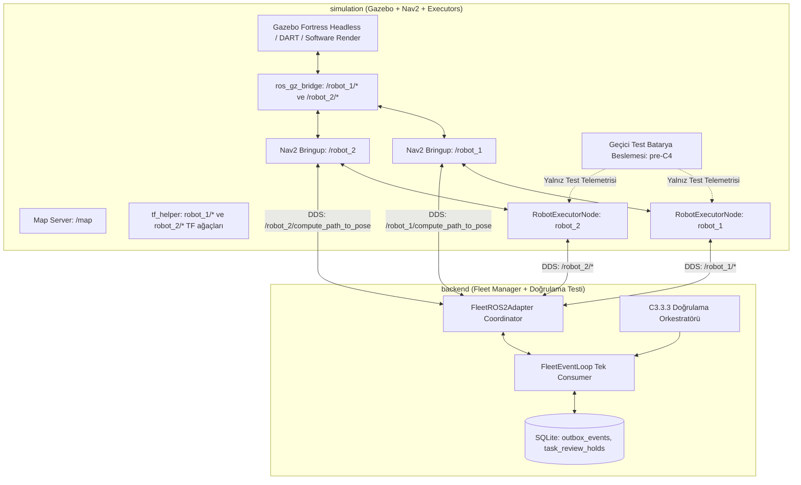

# C3.3.3 İki Robotlu Uçtan Uca Entegrasyon Karar Kaydı

**Tarih:** 24 Ekim 2026\
**Durum:** Aşağıdaki sekiz mimari karar kullanıcı tarafından **ONAYLANDI**. C3.3.3 kod uygulaması ve iki robotlu canlı simülasyonu **HENÜZ TEST EDİLMEDİ**.\
**Kapsam:** İki gerçek Executor + Nav2 + Gazebo headless çalıştırma düzeni, topic ve servis isim standardı hizalaması, `fleet.yaml` başlangıç pozları ve koordinat dönüşümleri, C4 öncesi geçici batarya beslemesi sınırları, temiz SQLite ilk durum ve oturum güvenliği ayrımı, harita/TF/namespace izolasyonu, eşzamanlı lojistik görevler, tekil istasyon sahipliği ve ayrılma teyidi, güvenli HIGH preemption, regresyon koruması ve kapsam dışı sınırların kaydı. Bu değişiklik yalnız dokümantasyon ve karar kaydıdır.

---

## 1. Dayanak ve Mevcut Durum

- [AGENTS.md](../../AGENTS.md) ve [proje bağlamı](../project-context.md): çalışma kuralları, kaynak önceliği ve kişisel notların korunması.
- [Nihai mimari PDF](../ROS2_Fleet_Manager_Nihai_Mimari_Kararlar_2026-10-23.pdf), DOC-ARCH-2026-10-23-FINAL v1.0, bölüm 3–8 ve 11: üç servisli hedef mimari, durum otoritesi, tek düzenlenebilir `config/fleet.yaml` kaynağı, Wh enerji modeli, güvenli preemption ve IDL arayüzleri.
- [C2 kararları](c2-executor-decisions-2026-10-24.md), [C3 kararları](c3-fleet-manager-decisions-2026-10-24.md), [C3.2 SQLite Outbox sözleşmesi](../design/c3-2-sqlite-outbox.md), [C3.3 entegrasyon kararları](c3-3-integration-decisions-2026-10-24.md), [C3.3.1 Executor güvenliği kararları](c3-3-1-executor-safety-decisions-2026-10-24.md) ve [C3.3.2 ROS 2 adaptör kararları](c3-3-2-ros2-adapter-decisions-2026-10-24.md).
- İncelenen depo tabanı `76d8fef` commit'idir. C1 konfigürasyon altyapısı, C2 Robot Executor durum makinesi/canlı simülasyonu (C2.3: 7/7 senaryo), C3.1 saf Python domain çekirdeği, C3.2 Outbox katmanı ve C3.3.2 ROS 2 adaptörleri mevcuttur ve [C3.3.2 doğrulama raporu](../validation/c3/c3-3-2-validation-2026-10-24.md) ile belgelenmiştir.

Bu karar kaydı, iki robotlu uçtan uca canlı entegrasyon (C3.3.3) öncesinde netleştirilen kullanıcı kararlarını, teknik sözleşmeleri ve güvenlik sınırlarını resmileştirir.

---

## 2. Onaylanan Kararlar

### C3.3.3-DEC-01: Topic ve Servis İsim Standardı (Seçenek A)
- **Hizalama Kuralı:** `backend/fleet_manager/adapters/ros2_adapter_node.py` içindeki uç nokta isimleri, mevcut `fleet_robot_executor/node.py` varsayılanlarıyla ve doğrulanmış C2.3 canlı test sözleşmesiyle birebir hizalanacaktır.
- **Uç Nokta Sözleşmesi:**
  - Robot durum konusu: `/{robot_id}/robot_status` (Tip: `fleet_interfaces/msg/RobotStatus`)
  - Hata temizleme servisi: `/{robot_id}/clear_robot_error` (Tip: `fleet_interfaces/srv/ClearRobotError`)
  - Görev yürütme eylemi: `/{robot_id}/execute_task` (Tip: `fleet_interfaces/action/ExecuteTask`)
  - Nav2 rota planlama eylemi: `/{robot_id}/compute_path_to_pose` (Tip: `nav2_msgs/action/ComputePathToPose`)
  - Nav2 sürüş eylemi: `/{robot_id}/navigate_to_pose` (Tip: `nav2_msgs/action/NavigateToPose`)
- **Gerekçe:** C2.3 canlı simülasyon testlerinde (`tests/test_c2_3_config.py`, `docker/simulation-c2-3/check.py`) doğrulanmış sözleşme korunur; geriye dönük uyumsuzluk ve topic adı kopukluğu önlenir. Kök isim alanına (`/robot_status`, `/clear_robot_error`) sızıntı kesinlikle yasaktır.

### C3.3.3-DEC-02: `fleet.yaml` Tek Düzenlenebilir Kaynak ve Poz Doğrulaması (Seçenek A)
- **Tek Düzenlenebilir Kaynak Kuralı:** Gazebo model spawn pozları, dünya ortamı, harita koordinatları ve Nav2 başlangıç pozları (`initial_pose`) doğrudan `config/fleet.yaml` dosyasından dinamik olarak üretilecektir. Kod içine, Compose dosyasına veya harici JSON dosyalarına bağımsız pozlar gömülmeyecektir.
- **Onaylı Başlangıç Değerleri:**
  - `robot_1`: $x = -2.0\,\text{m}, y = -0.5\,\text{m}, \text{yaw} = 0.0\,\text{rad}$
  - `robot_2`: $x = 1.0\,\text{m}, y = 2.5\,\text{m}, \text{yaw} = 3.1415\,\text{rad}$
  - `dock_1`: $x = 0.5\,\text{m}, y = -2.0\,\text{m}, \text{yaw} = 0.0\,\text{rad}$, tolerans yarıçapı: $0.30\,\text{m}$
  - `park_1`: $x = -2.0\,\text{m}, y = 1.0\,\text{m}, \text{yaw} = 1.57\,\text{rad}$
- **Koordinat Doğrulaması:** Gazebo dünya koordinat sistemi ile `config/map/map.yaml` harita orijini/çözünürlüğü ve Nav2/AMCL koordinat dönüşümleri doğrulanacak; TF ağacında frame uyuşmazlığı yaşanmayacaktır.

### C3.3.3-DEC-03: C4 Öncesi Geçici Test Batarya Beslemesi (Seçenek B)
- **İzole Test Beslemesi Kuralı:** C4 Battery Simulator henüz geliştirilmediğinden, Wh enerji hesaplamaları ve atama algoritmalarının test edilebilmesi için yalnızca C3.3.3 simülasyon test ortamına (`simulation` container test harness) ait izole, geçici bir batarya telemetri besleyicisi kullanılacaktır.
- **Fiziksel Otorite Yasağı:** Bu geçici test beslemesi **kesinlikle gerçek Battery Simulator veya Robot Executor'ın fiziksel batarya otoritesi olarak gösterilmeyecek veya sunulmayacaktır**.
- **Gerekçe:** DOC-ARCH-2026-10-23-FINAL bölüm 7 uyarınca enerji hesabının tek nihai otoritesi C4'te geliştirilecek bağımsız `battery_simulator` düğümüdür. FM ve Executor ikinci bir tüketim/şarj hesabı yürütmez; geçici test aparatları ürün bileşeni sayılamaz.

### C3.3.3-DEC-04: Temiz SQLite Başlangıcı ve C3.3.1 Oturum Güvenliği Ayrımı
- **Temiz Başlangıç Kapısı:** FM sıfır/temiz veritabanıyla başlatıldığında, robottan gelen ilk `RobotStatus` telemetrisi oturum UUID'sini ve sayaç sırasını (`status_seq = 1`) kaydeder.
- **Kritik Güvenlik Kuralı:** Temiz SQLite + ilk `RobotStatus`, kontrollü senaryo reset prosedürünün veya fiziksel durum doğrulamasının yerine kesinlikle geçemez!
- **Atama Açılma Koşulu:** İlk mesaj gelse dahi, robotun doğrulanmış `STATE_IDLE`, yüksüz (`loaded == NONE`) ve aktif atamasız olduğu teyit edilene kadar robot atamaya açılmaz (`initial_status_verified = False -> True`).
- **Oturum Değişimi Güvenliği:** C3.3.1-DEC-07 kuralı korunur: Çalışma anında `publisher_session_id` değiştiğinde (Executor restart / yeni süreç), robot anında `SESSION_BLOCKED` durumuna geçirilir. Mülkiyet askıya alınır; yeni atama ve istasyon rezervasyonu serbest bırakma kesinlikle kilitlenir. Temiz başlangıç kuralı yalnızca sıfır DB ile ilk açılışta geçerlidir.

### C3.3.3-DEC-05: Harita, TF ve İsim Alanı (Namespace) İzolasyonu
- **İzolasyon Kuralı:** İki robotun TF ağaçları, sensör verileri, hız komutları ve durum yayınları tamamen izole isim alanlarında çalışacaktır:
  - `map -> robot_1/odom -> robot_1/base_link`
  - `map -> robot_2/odom -> robot_2/base_link`
- **Ortak ve İzole Varlıklar:** Harita (`/map`) ortaktır ve Map Server tarafından tek kopya yayınlanır. Nav2 costmap'leri, yerel engel haritaları, global planlayıcılar (`ComputePathToPose`) ve eylemler robot başına bağımsız namespace içinde barındırılır.
- **Sızıntı Denetimi:** Kök seviyede `/execute_task`, `/robot_status`, `/cmd_vel`, `/odom`, `/scan` gibi öneksiz topic/eylemler bulunmayacaktır. Test koşularında kök topic sızıntısı denetimi zorunludur.

### C3.3.3-DEC-06: Eşzamanlı Yürütme, Tekil İstasyon Sahipliği ve Ayrılma Teyidi
- **Eşzamanlı Lojistik:** `robot_1` ve `robot_2` iki bağımsız lojistik görevi eşzamanlı olarak yürütebilir.
- **Tekil Sahiplik (`Single Ownership`):** `ReservationManager`, her park ve şarj istasyonu için strictly tekil sahiplik uygular. Bir istasyon `RESERVED` veya `OCCUPIED` iken başka bir robotun o istasyonu rezerve etmesi kesinlikle engellenir.
- **Fiziksel Ayrılma Teyidi:** İstasyon alanı, robotun güncel odometri/pose verisiyle istasyon merkezinden `tolerance_radius + departure_margin` kadar uzaklaştığı teyit edilmeden kaynak `FREE` ilan edilmeyecektir.
- **Hata Durumu Kilidi:** Nav2 seyrüsefer veya planlama hatasında robot `STATE_ERROR`, kaynak `BLOCKED` olur. Operatör `ClearRobotError` ile temizleme yapıp robot fiziksel olarak alanı terk etmeden kaynak serbest bırakılamaz.

### C3.3.3-DEC-07: Güvenli HIGH Preemption, $N=2$ Koruması ve Terminal PREEMPTED Şartı
- **HIGH-Only Kuralı:** Çalışan bir görevi yalnızca yeni bir HIGH öncelikli görev kesebilir. LOW veya MEDIUM görevler preemption başlatamaz.
- **IDLE Önceliği:** Filoda IDLE ve enerji açısından uygun robot varsa, HIGH görev ona atanır; çalışan görev kesilmez.
- **Kesilme Koşulları:** Kesilecek görev LOW/MED olmalı, pickup öncesinde (`PHASE_MOVING_TO_PICKUP`), yüksüz (`loaded == NONE`) ve daha önce $N < 2$ kez kesilmiş olmalıdır.
- **Durma ve Terminal Sonuç Şartı:** Executor iptali kabul edince Nav2 hedefini durdurur, aktif fren uygular ve sıfır hızı teyit eder (`linear <= 0.005 m/s`, `angular <= 0.01 rad/s`). Fleet Manager, eşleşen terminal `STATUS_PREEMPTED` eylem sonucunu almadan aynı robota bekleyen HIGH görevi atayamaz; yalnız iptal kabulü yeterli değildir.
- **$N=2$ Dokunulmazlığı:** Kesilen görev orijinal `created_at` ile kuyruğa döner ve `preemption_count` 1 artırılır. $N=2$ kez kesilmiş olan bir görev, 3. kez yürütülmeye başladığında pickup öncesinde dahi kesilemez.

### C3.3.3-DEC-08: Regresyon Koruması ve Açık Kapsam Dışı Sınırlar
- **Regresyon Koruması:**
  - C1 konfigürasyon ve şema testleri (74 test),
  - C2 Executor durum makinesi testleri (76 test),
  - C2.3 tek robotlu canlı simülasyon testleri (7 senaryo),
  - C3.1 Fleet Manager domain testleri (27 test),
  - C3.2 SQLite Outbox testleri (23 test),
  - C3.3.1 Executor güvenlik testleri,
  - C3.3.2 ROS 2 adaptör testleri (host 212 test, docker 102 test) eksiksiz korunacaktır.
- **Açık Kapsam Dışı Sınırlar (Deadlock ve Dinamik Çarpışma):**
  - **Dar koridor deadlock çözümü:** Dar koridorlarda iki robotun burun buruna gelmesinden kaynaklanan kilitlenmeler ve küresel trafik koordinasyonu bu aşamanın ve MVP'nin **kesinlikle kapsamı dışındadır**.
  - **Dinamik çarpışma önleme:** İki robotun yollarının çakışmaması senaryo rotalarıyla veya standart Nav2 costmap yerel engel kaçınmasıyla yönetilir; filo düzeyinde küresel çarpışmasız yörünge optimizasyonu yapılmaz.

---

## 3. Çalıştırma Mimarisi ve Doğrulama Planı

### 3.1. Hedef Docker Compose Mimarisi

### 3.2. C3.3.3 Test Matrisi (T01 – T10)

| No | Test / Senaryo Adı | Koşullar ve Adımlar | Beklenen Kabul Kriteri |
|---|---|---|---|
| **T01** | **Filo Keşfi ve C3.3.1 Oturum Güvenliği Doğrulaması** | Sıfır DB ile FM başlatılır; `fleet.yaml` okunur; iki Executor telemetri yayınlar. | `robot_1` ve `robot_2` keşfedilir; ilk `status_seq = 1` ile oturumlar kaydedilir; robotların doğrulanmış IDLE/yüksüz olduğu teyit edilince `initial_status_verified = True` olur; atamaya açılır. |
| **T02** | **Eşzamanlı İki Bağımsız Lojistik Görev** | Task_A (`robot_1` için) ve Task_B (`robot_2` için) aynı anda kuyruğa verilir. | Her iki robot bağımsız olarak pickup -> yükleme (1.5s) -> dropoff -> boşaltma (1.5s) adımlarını eşzamanlı tamamlar; gerçek `completed_epoch` ve `goal_uuid` doğrulanır; iki görev de `COMPLETED` olur. |
| **T03** | **Dinamik Nav2 Rota ve Wh Enerji Ataması** | Robotlar farklı konumlardayken görev kuyruğa verilir. | Nav2 `ComputePathToPose` üzerinden $L(p_r, p_{pick})$, $L(p_{pick}, p_{drop})$, $L(p_{drop}, p_{dock})$ mesafeleri alınır; `RouteCache`'e işlenir; Wh modeli hesaplanır; en yakın uygun robota atanır; Euclidean fallback yapılmaz. |
| **T04** | **Güvenli Preemption ve Sıfır Hız Teyidi** | `robot_1` LOW görevle pickup'a giderken HIGH görev verilir (`robot_2` meşgul). | `robot_1`'e iptal gönderilir; Nav2 durdurulur; aktif frenle sıfır hız (`odometry`) teyit edilir; terminal `STATUS_PREEMPTED` gelmeden robota HIGH görev atanmaz; kesilen görev kuyruğa döner. |
| **T05** | **Preemption Koruma Sınırı ($N=2$)** | $N=2$ kez kesilmiş görev yürütülürken yeni HIGH görev gelir. | Pickup öncesinde olsa dahi görev kesilmez; dokunulmazlık korunur; HIGH görev diğer robota atanır veya kuyrukta bekletilir. |
| **T06** | **İstasyon Tekil Sahipliği ve Fiziksel Ayrılma Teyidi** | İki robot sırayla aynı park/şarj istasyonunu talep eder. | İlk robot istasyondayken kaynak `OCCUPIED` olur; ikinci robotun rezervasyonu reddedilir; ilk robot `tolerance_radius + departure_margin` kadar uzaklaşmadan kaynak `FREE` yapılmaz. |
| **T07** | **Telemetri Kesintisi ve Geri Dönüş** | `robot_1` aktif görevdeyken 2.5s telemetri yayını durdurulur, sonra açılır. | 2.0s'de robot STALE olur, atama dışı kalır; görev FAILED yapılmaz; aynı oturumda telemetri dönünce robot uygunluğa geçer; görev başarıyla tamamlanır. |
| **T08** | **Executor Restart ve `SESSION_BLOCKED` Güvenliği** | `robot_2` aktif görevdeyken Executor süreci yeniden başlatılır (yeni oturum ID). | Görev kontrolsüz iptal edilmez; istasyon rezervasyonu serbest bırakılmaz; robot `SESSION_BLOCKED` olur; yeni atama kilitlenir; senaryo reset prosedürü gerektirir. |
| **T09** | **Nav2 Abort ve `ClearRobotError` Operatör Kurtarması** | `robot_1` ulaşılamaz bir hedefe gönderilir; Nav2 abort eder. | Görev `FAILED`, robot `STATE_ERROR`, istasyon `BLOCKED` olur; otomatik retry yapılmaz; operatör `ClearRobotError` çağırır; robot fiziksel telemetriyle IDLE olur. |
| **T10** | **Harita, TF ve İsim Alanı (Namespace) İzolasyonu** | Tüm ROS topic ve eylemleri taranır. | `/robot_1/*` ve `/robot_2/*` uçları doğrulanır; kök seviyede `/execute_task`, `/robot_status`, `/cmd_vel` sızıntısı olmadığı ve TF frame karışması yaşanmadığı kanıtlanır. |

---

## 4. Doğrulama Sınırları ve Açık Kalan Hususlar

- Ağ üzerinde `exactly-once` garantisi yoktur; Outbox ve Executor seviyesinde `(task_id, assignment_epoch, goal_uuid)` üçlüsü ile mükerrer yürütme engellenir.
- FM yeniden başlatılmasında kalıcı senaryo reset kuralı geçerlidir; mevcut veritabanı korunur, otomatik devam yapılmaz.
- C4 öncesi geçici batarya beslemesi kalibre edilmiş fiziksel batarya modeli değildir; C4 aşamasında bağımsız Battery Simulator ile değiştirilecektir.
- Dar koridor deadlock çözümü ve filo seviyesi küresel çarpışmasız trafik planlaması MVP ve bu aşama kapsamı dışındadır.
- Canlı simülasyon başarısı yalnız bu karar kaydının uygulanması ve testlerin eksiksiz çalıştırılması sonrasında yayınlanacak doğrulama raporuyla iddia edilebilir; bu karar kaydı tek başına test kanıtı değildir.

---

## 5. Dokümantasyon Doğrulaması

24 Ekim 2026: Bu karar kaydı oluşturulduktan sonra yerel Markdown bağlantı bütünlüğü ve diff kontrolleri gerçekleştirilecek; `docs/README.md` ve ana `README.md` haritalarına bağlantılanacaktır. Kod ve test dosyalarında değişiklik yapılmamıştır.
