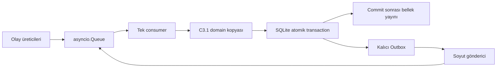

# C3.2 SQLite Outbox ve Tek Consumer

> **24 Ekim 2026 C3.3.1 ek kaydı:** [Executor güvenliği kararları](../decisions/c3-3-1-executor-safety-decisions-2026-10-24.md), sonraki yedi kullanıcı onayını ve önceki açık seçeneklere etkisini kaydeder. İlgili konularda bu ek kayıt esas alınır; uygulama ve test başarısı iddia edilmez.

> **24 Ekim 2026 ek kaydı:** [C3.3 teknik kararları](../decisions/c3-3-integration-decisions-2026-10-24.md), kaynak sıra/oturum, belirsiz teslim, saat ayrımı ve açık goal reddi için sonraki kullanıcı kararlarını kaydeder. İlgili eski seçenekler ve uygulama sınırları bu kayıtta gerekçeleriyle açıklanır; C3.3 uygulaması veya entegrasyon başarısı iddia edilmez.

**Tarih:** 24 Ekim 2026. Bu kayıt [C3 kararlarının](../decisions/c3-fleet-manager-decisions-2026-10-24.md#23-sqlite-outbox-tek-consumer-ve-idempotency-sınırları) uygulama sözleşmesidir. Yeni mimari politika tanımlamaz. [Doğrulama raporu](../validation/c3/c3-2-validation-2026-10-24.md) test kapsamını ayrı tutar.

## Uygulama sınırı

`backend/fleet_manager/event_loop.py`, C3.1 `FleetManagerCore` çekirdeğini kullanır. `FleetEventLoop` yalnız bir `asyncio.Queue` consumer çalıştırır. Üreticiler `Event` değerlerini `submit` ile verir. İkinci consumer başlatılması reddedilir. Kuyruğa giriş sırası korunur; bu sıra ağın üretim sırası garantisi değildir. Görev önceliği/FIFO kararı yine domain zamanlayıcısındadır.

Her olay için domain durumu ayrı kopyada hesaplanır. `BEGIN IMMEDIATE` içinde görev, robot, rezervasyon, Outbox ve işlenen olay birlikte yazılır. Başarılı `COMMIT` sonrasında kopya canlı bellek olur. Yazma veya COMMIT hatası hem kalıcı hem bellek durumunu korur; olay kimliği tüketilmez ve çağıran hatayı alır. Hatalı bir olay consumer döngüsünü kapatmaz. Dış gönderim transaction içinde yapılmaz.

Zamanlayıcı aktif görev sahipliğini denetler. Terminal sonuçtan önce gelen IDLE telemetrisi ikinci atama yaptıramaz. Eşleşen `PREEMPTED` işlemi kurbanın sayacını artırır, eski sahipliği kapatır, bekleyen HIGH ile kurbanı orijinal `created_at` değerleriyle kuyruğa alır ve gönderilmemiş eski komutları geçersiz kılar. Sonraki zamanlama geçişi güncel RobotStatus, sahiplik, üç rota ayağı ve Wh yeterliliği üzerinden normal atama kurallarını uygular. Yeni epoch, UUID ve `EXECUTE_TASK` kaydı başarılı atamanın transaction'ında oluşturulur. İptal kabulü tek başına atama başlatmaz. İptal reddi veya iptal beklerken doğal tamamlanma/hata, bekleyen HIGH görevi kuyruğa döndürür.

## SQLite şeması

Şema `backend/fleet_manager/persistence/schema.sql` içindedir. SQLite yabancı anahtarları açık, kalıcı yazma ayarı `synchronous=FULL` kullanılır. Bu ilk şema sürümüdür; eski bir ürün şemasından geçiş desteği yoktur.

| Tablo | İçerik ve kısıt |
|---|---|
| `tasks` | Görev kimliği, durum, robot, epoch, UUID ve JSON domain görüntüsü. Robot başına en fazla bir ASSIGNED/EXECUTING görev için unique index. |
| `robots` | Robot kimliği ve C3.1 kaydının JSON görüntüsü. Yeni fiziksel durum makinesi değildir. |
| `reservations` | İstasyon kimliği, durum, rezerve/işgal eden robot ve JSON görüntüsü. Robot yabancı anahtarları, tek sahiplik ve FREE sahiplik kontrolü. |
| `outbox_events` | Artan sıra, benzersiz komut kimliği, tür, görev/epoch/UUID, JSON yük, durum, deneme sayısı, sonraki deneme zamanı ve son hata. |
| `processed_events` | Artan işleme sırası, benzersiz olay kimliği, sonuç, akış ve sıra numarası, görev/epoch/UUID. Reddedilen eski olaylar da kaydedilir. |

JSON görüntüleri domain alanlarını korur; çalıştırılabilir nesne serileştirmesi kullanılmaz. Görev zamanları saniye, pozlar metre/radyan, batarya alanları Wh ve yüzde olarak C3.1 sözleşmesini izler. Görüntüler geçmiş incelemesi içindir; otomatik yeniden yükleme yapılmaz.

## Olay sözleşmesi

`Event(kind, payload, event_id)` iç kullanım sözleşmesidir. `event_id` verilmezse UUID üretilir. Aynı olay yeniden sunulurken aynı kimlik korunmalıdır. Aynı kimlik ikinci kez iş mantığına girmez. Aynı görev kimliği aktif veya terminal geçmişte varsa yeni görev kabul edilmez.

| Tür | Yük |
|---|---|
| `SUBMIT_TASK` | `FleetManagerCore.submit_task` parametreleri; pozlar `Pose2D`. |
| `TICK` | `current_time`: domain saatinde saniye. Aktif görev iletişim kaybında `COMMUNICATION_WARNING` logu üretir; FAILED/ERROR üretmez. |
| `ROBOT_STATUS` | `handle_robot_status` parametreleri ve monoton, negatif olmayan `status_seq`. |
| `ACTION_FEEDBACK` | Robot kimliği, görev/epoch/UUID, faz ve `status_seq`. |
| `ACTION_RESULT` | Robot kimliği, görev/`assignment_epoch`/UUID, Executor'ın ilettiği `completed_epoch`, geçerli terminal `result_status`, isteğe bağlı `error_reason`. |
| `CANCEL_RESPONSE` | Robot kimliği, görev/epoch/UUID, `accepted`, ilgili Outbox kaydının `cancel_command_id` değeri. |
| `RESERVE`, `OCCUPIED`, `RELEASE` | `station_id`, `robot_id`. Consumer, `SESSION_BLOCKED` robot için `processed_events` tablosuna `REJECTED` yazar ve mevcut sahipliği korur. OCCUPIED mevcut sahipliği ve bilinen robot pozunu kontrol eder. Domain fiziksel ayrılmayı kabul edilen ROBOT_STATUS ile doğrular. |
| `UNBLOCK` | `station_id`, `robot_id`. Açık operatör isteğini temsil eden iç olay. Consumer kanıtı robotun kabul edilmiş telemetrisinden alır ve kendi monotonik saatiyle denetler. |
| `ROUTE_RESOLVED` | Robot kimliği, mesafe veya rota yok sonucu, monotonik sonuç zamanı. Olay kimliği başlatılan sorgunun UUID'sidir. |
| `OUTBOX_CLAIM`, `OUTBOX_FINISH` | Göndericinin iç komutları; claim zamanı veya komut kimliği/deneme numarası/hata/tekrar zamanı. |

Domain olayları `APPLIED`, `DUPLICATE`, `STALE`, `SESSION_BLOCKED` veya `REJECTED` döndürür. Eşleşen planner sonucu `ROUTE_APPLIED` olarak kaydedilir. Geçersiz alanlar/komutlar exception üretir ve transaction geri alınır. Olay API'si bir REST giriş doğrulayıcısı değildir.

Action olaylarında üçlü kimlik aktif atamayla eşleşmelidir. Telemetri sırası robot başına, feedback sırası robot/goal başına kontrol edilir. Terminal sonuç feedback sıra numarasına bağımlı değildir. Eski epoch, eski sıra veya geriye giden telemetri zamanı uygulanmaz. İptal yanıtı ayrıca en son iptal komutuyla eşleşir; önceki iptal isteğinin geç yanıtı yeni isteği kapatamaz.

`SUCCEEDED`, `FAILED` ve `PREEMPTED` için `completed_epoch` gerçek bir tam sayı olmalı ve aktif atamanın epoch'u ile eşleşmelidir. Eksik, geçersiz veya uyuşmayan değer uyarı logu ve `processed_events` kaydında `STALE` üretir. Görev, robot, rezervasyon ve Outbox kayıtları ile bekleyen preemption korunur. [C3.3.2-DEC-05](../decisions/c3-3-2-ros2-adapter-decisions-2026-10-24.md#c332-dec-05-gerçek-completed_epoch-doğrulaması)

**Saatler ve sıra:** C3.3 ile `status_seq` ve `publisher_session_id` doğrudan `RobotStatus.msg` alanlarından alınır. ROS adaptörü olayın `timestamp_sec` değerini monotonik alım saatinden üretir. Zamanlayıcının `current_time` değeri aynı saati kullanır. Rota sağlayıcı senkron ve yan etkisiz bir mesafe sorgusu olmalıdır.

### Canlı Nav2 rota çözümü

Fleet YAML kurucusu varsayılan olarak robot bazlı önbellek sağlar. ROS adaptörü aynı önbelleği kullanır. Filo konfigürasyonundaki robot kimliği ve namespace eşlemesi adaptöre verilir. Her planner istemcisi ilgili namespace altında `compute_path_to_pose` çağırır. Geçerli sonuçlar robot kimliği, `map` koordinat çerçevesindeki başlangıç ve hedef hücreleri ve harita revizyonuyla ayrılır. Hücre 0,20 m, monotonik TTL 30 saniye ve planner zaman aşımı 2 saniyedir. Harita revizyonu değişikliği önceki revizyonu ve bekleyen sonuçlarını geçersiz kılar. Canlı harita değişikliği bildirimi mevcut çalışma ortamına bağlıdır.

Scheduler güncel RobotStatus ve görev sahipliğiyle adayları filtreler. İlk ayak robotun güncel pozundan pickup'a, ikinci ayak pickup'tan dropoff'a, üçüncü ayak dropoff'tan güvenli şarj istasyonuna gider. Hareketli başlangıç ayağı için pozun aynı hücrede olması gerekir. Kaynak RobotStatus poz damgası geçersizse rota değerlendirmesi yapılmaz. Bir adayın gerekli rotası çözülürken o görev için diğer adayların daha erken gelen yanıtları seçim sırasını değiştirmez. Planner başarısızlığı ilgili adayı o geçişte eler. Wh modeli güncel SoC, üç mesafe, acil rezerv ve mevcut marjı kullanır.

Consumer transaction içinde önbelleği okur ve eksik rota isteklerini toplar. COMMIT sonrasında robot başına bir sorgu yürütülür. Aynı robot ve hücre anahtarı için birden fazla görev aynı sorguyu bekleyebilir. Sonuç, istek kimliği, harita nesli ve hâlâ geçerli görev/robot bağlamı üzerinden consumer kuyruğunda doğrulanır. Önbellek sonucu ancak olayın COMMIT işlemi başarılı olunca yayımlanır. Sonraki `TICK` normal zamanlama kurallarını uygular. Atama, epoch/UUID ve Outbox ile atomik olarak kaydedilir. Görev kuyruktan çıktığında ilgili önbellek kayıtları atılır. Başarısız sorgudan sonra aynı anahtar, iki saniye dolmadan yeniden istenmez. Daha sonraki zamanlama geçişi yeniden sorgulayabilir. Ayrı bir arka plan retry döngüsü kurulmaz. Ayrıntılı kanıt [Görev 5+6 raporundadır](../validation/c3/c3-3-4-task-5-6-validation-2026-11-05.md).

### İstasyon bırakma ve BLOCKED kurtarma

Normal `RELEASE`, mevcut sahibin kaynağını `RELEASING` yapar. `OCCUPIED` veya `RELEASING` kaynak, sahibinin kabul edilmiş geçerli pozuyla istasyondan uzaklığı `tolerance_radius + departure_margin` değerini aştığında `FREE` olur. Eşiğe eşit mesafede sahiplik korunur. `BLOCKED` kaynak hem normal `RELEASE` isteğine hem otomatik fiziksel bırakmaya kapalıdır.

Operatör önce Executor üzerinden `ClearRobotError` yürütür. Ardından, robot alanı terk ettiğinde `UNBLOCK` iç olayı tek tüketicide işlenebilir. İstasyonun blokajdaki sahibi ile istekteki robot eşleşmeli. FM aynı yayıncı oturumunda geçerli bir `STATE_ERROR` yayını ve ardından hata dışı RobotStatus içinde o ERROR yayınından daha yeni bir konum ölçümü görmüş olmalı. Olay yükündeki kimlikler yalnızca kayıt seçer. Kanıt, tüketicinin tuttuğu RobotStatus kaydından gelir.

ROS tarafında `RobotStatus.header.stamp` yayın zamanıdır. `RobotStatus.pose.header.stamp` Executor'ın kullandığı odometri ölçüm zamanıdır. Sıfır damga ölçümün bulunmadığını gösterir. Adaptör robot kimliğini abonelikle eşler, ROS saatinde poz ve yayın damgalarını sıralar, ölçüm yaşını 2 saniyelik pencereye göre sınar. Consumer poz için kalan pencereyi monotonik saatle uygular. Sıra, epoch ve oturum filtreleri geçerlidir. Aynı veya geriye giden ölçüm damgası kanıtı yenilemez. Poz sonlu olmalı, istasyonla aynı boş olmayan koordinat çerçevesinde bulunmalı ve mesafe kesin olarak eşikten büyük olmalı.

Değişen veya blokaj anında bilinmeyen oturumda kaynak sahipliği korunur. Operatör olayı için ret nedeni loglanır ve `processed_events` tablosuna `REJECTED` yazılır. Başarılı olay, sahiplik temizliğiyle aynı transaction'da kaydedilir. Kayıt ancak COMMIT sonrası belleğe yansır. Eski Executor sürümleri ölçüm yerine yayın zamanını yazdığı için bu kanıt sözleşmesi Executor ile FM adaptörünün birlikte güncellenmesini gerektirir.

## Outbox gönderim ve tekrar deneme

Normal akış `PENDING → SENDING → SENT`; hata veya gönderim iptalinde `SENDING → RETRY → SENDING` olur. Göndericiye verilecek kayıt claim transaction'ında SENDING yapılır ve deneme sayısı artırılır. `OUTBOX_FINISH` yalnız aynı komutun aynı SENDING denemesini kapatır. SENT, soyut göndericinin başarıyla dönmesidir; görev tamamlandı veya Executor kesin kabul etti anlamına gelmez.

`EXECUTE_TASK` komut kimliği goal UUID'den türetilir. Her yeni iptal isteğinin ayrı komut kimliği vardır. Tekrar deneme aynı komut kimliği, epoch, goal UUID ve yükle yapılır. Terminal sonuç veya iptal isteğinin kapanması sonrası geçersiz bekleyen kayıtlar SUPERSEDED olur. Gönderim sırasında sonuç geldiyse geç gönderim yanıtı eski komutu yeniden RETRY yapamaz.

`OutboxDispatcher` gönderici fonksiyonunu, monoton saati ve pozitif `retry_delay` değerini dışarıdan alır. Tekrar gecikmesi saniyedir; ürün varsayılanı veya yeni kalibre edilmiş politika belirlenmemiştir. En eski bekleyen komut önce gider; RETRY zamanı gelmemiş veya SENDING olan kayıt sonraki kayıtları bekletir. Bu basit sıra koruması, bir gönderim hatasının diğer robotların gönderimlerini geciktirebilmesi karşılığında sağlanır. Sonraki adaptör çağrı zaman aşımını da sağlamalıdır.

Teslim gerçekleşip onay kaybolursa komut yeniden gönderilebilir. Ağda **exactly-once teslim garantisi yoktur**. Uç adaptörü/Executor sınırında komut kimliği ve goal UUID idempotency kontrolü gerekir; bu aşama ağ davranışını doğrulamaz. Tekrar deneme görev hatası veya otomatik reassignment değildir.

## Yaşam döngüsü ve sınırlar

Veritabanı yolu çağıran tarafından verilir; kaynak koda host yolu veya filo tanımı gömülmez. Başlangıçta hazırlanmış C3.1 çekirdeği kopyalanır. Dışarı verilen `core` görüntüsü de kopyadır. Başlatmadan önce `start`, çalışırken `submit`, kapanırken önce gönderici işlerini sonlandırma, sonra `close`, ardından `store.close` sırası kullanılır. `close` yeni olay kabulünü kapatır ve kabul edilmiş kuyruğu tüketir. Çağıranın submit bekleyişini iptal etmesi kabul edilmiş olayı geri çekmez. Kuyruk kalıcı değildir; commit edilmemiş olayların süreç çökmesinde korunması iddia edilmez.

İçinde senaryo kaydı bulunan veritabanıyla yeni runtime kurulması `ScenarioResetRequired` üretir. PENDING, SENDING, RETRY veya SENT kayıtları otomatik gönderilmez; aktif görev otomatik sürdürülmez. Operatör simülasyon senaryosunu gerçekten reset ettikten sonra eski veritabanını kanıt olarak saklayıp yeni boş veritabanıyla başlatmalıdır. Kod fiziksel reset yapmaz veya eski kayıtları silmez. Çoklu aktif manager desteklenmez.

ROS 2 adaptörleri, API, frontend, Battery Simulator, canlı restart uzlaştırması, otomatik iletişim kaybı kurtarması ve nihai üç servis dağıtımı bu değişiklikte uygulanmamıştır.
