# Mimari ve algoritma diyagramları

26 Ekim 2026 kaynak incelemesi. Bu katalog mevcut kararların görsel anlatımıdır; yeni mimari karar değildir. [İnceleme ve fark raporu](../validation/organization/organization-validation-2026-10-26.md) hedef ile kodun ayrıldığı yolları kaydeder.

## Durum ve görsel dil

- **IMPLEMENTED:** Belirtilen akışın kodu vardır; bütün ürünün veya her hata yolunun canlı doğrulandığı anlamına gelmez.
- **PARTIAL:** Kodun bir kısmı vardır; eksik bağlantı veya karar/kod farkı aşağıda belirtilir.
- **PLANNED:** Hedef akış; ürün uygulaması yoktur. Öneri ayrıntıları onaylı politika sayılmaz.
- **UNVERIFIED:** Uygulaması/kanıtı bu incelemede belirlenemeyen akış için ayrılmıştır; bu katalogda böyle etiketlenmiş akış yoktur.

Mavi: Fleet Manager; mor: Executor; turkuaz: Nav2/simülasyon; sarı: batarya; gri silindir: veritabanı; pembe: UI/API. Yeşil yuvarlatılmış düğüm başlangıç/bitiş, beyaz baklava karar, kırmızı hata/blokaj, kesik turuncu bekleme anlamına gelir. Durum ve metin de anlamı taşır; yalnız renge bağlı değildir.

Her akış için `.mmd` düzenlenebilir kaynak, `.svg` türetilmiş çıktıdır. GitHub'da bölüm altındaki SVG doğrudan görünür; aynı kaynak Mermaid kod bloğu olarak da sunulur. Kaynak ve katalog kopyası birlikte güncellenmelidir.

## Kapsam tablosu

| No | Kategori / algoritma | Durum | Kaynak / SVG |
|---|---|---|---|
| 1 | Sistem — [Sistem ve Docker mimarisi](#01-system-architecture) | PARTIAL | [Mermaid](src/system-architecture.mmd) · [SVG](svg/system-architecture.svg) |
| 2 | Görev — [Görev kabulü ve atanabilir FIFO](#02-task-admission-fifo) | IMPLEMENTED | [Mermaid](src/task-admission-fifo.mmd) · [SVG](svg/task-admission-fifo.svg) |
| 3 | Görev — [Robot seçimi ve Wh uygunluğu](#03-robot-selection-energy) | PARTIAL | [Mermaid](src/robot-selection-energy.mmd) · [SVG](svg/robot-selection-energy.svg) |
| 4 | Yürütme — [Robot Executor görev yaşam döngüsü](#04-executor-lifecycle) | IMPLEMENTED | [Mermaid](src/executor-lifecycle.mmd) · [SVG](svg/executor-lifecycle.svg) |
| 5 | Yürütme — [Güvenli preemption ve N=2](#05-safe-preemption) | IMPLEMENTED | [Mermaid](src/safe-preemption.mmd) · [SVG](svg/safe-preemption.svg) |
| 6 | Güvenlik — [RobotStatus sıra ve oturum yönetimi](#06-status-session-order) | PARTIAL | [Mermaid](src/status-session-order.mmd) · [SVG](svg/status-session-order.svg) |
| 7 | Güvenlik — [DDS goal ve cancel protokolü](#07-dds-goal-cancel) | IMPLEMENTED | [Mermaid](src/dds-goal-cancel.mmd) · [SVG](svg/dds-goal-cancel.svg) |
| 8 | Güvenlik — [Assignment epoch ve UUID uzlaştırması](#08-assignment-reconciliation) | PARTIAL | [Mermaid](src/assignment-reconciliation.mmd) · [SVG](svg/assignment-reconciliation.svg) |
| 9 | Kalıcılık — [SQLite Outbox ve tek consumer](#09-sqlite-outbox-consumer) | IMPLEMENTED | [Mermaid](src/sqlite-outbox-consumer.mmd) · [SVG](svg/sqlite-outbox-consumer.svg) |
| 10 | Enerji — [Wh batarya hesabı](#10-battery-wh-integration) | PLANNED | [Mermaid](src/battery-wh-integration.mmd) · [SVG](svg/battery-wh-integration.svg) |
| 11 | Enerji — [Şarj sırası ve istasyon seçimi](#11-charging-queue-selection) | PLANNED | [Mermaid](src/charging-queue-selection.mmd) · [SVG](svg/charging-queue-selection.svg) |
| 12 | Enerji — [Şarjdan ayrılma ve yüzde 80](#12-charging-exit-policy) | PLANNED | [Mermaid](src/charging-exit-policy.mmd) · [SVG](svg/charging-exit-policy.svg) |
| 13 | Kaynak — [Park rezervasyonu ve güvenli bekleme](#13-parking-reservations) | PARTIAL | [Mermaid](src/parking-reservations.mmd) · [SVG](svg/parking-reservations.svg) |
| 14 | Kurtarma — [FAILED / ERROR ve operatör kurtarma](#14-failure-operator-recovery) | PARTIAL | [Mermaid](src/failure-operator-recovery.mmd) · [SVG](svg/failure-operator-recovery.svg) |
| 15 | Konfigürasyon — [fleet.yaml yaşam döngüsü](#15-fleet-config-lifecycle) | PARTIAL | [Mermaid](src/fleet-config-lifecycle.mmd) · [SVG](svg/fleet-config-lifecycle.svg) |
| 16 | Panel — [REST / WebSocket ve 2D panel](#16-rest-websocket-gui) | PLANNED | [Mermaid](src/rest-websocket-gui.mmd) · [SVG](svg/rest-websocket-gui.svg) |
| 17 | Rota — [Asenkron rota ve önbellek](#17-route-cache) | PARTIAL | [Mermaid](src/route-cache.mmd) · [SVG](svg/route-cache.svg) |
| 18 | Güvenlik — [Duplicate kayıtları ve restart engeli](#18-duplicate-restart-guard) | PARTIAL | [Mermaid](src/duplicate-restart-guard.mmd) · [SVG](svg/duplicate-restart-guard.svg) |

## 01. Sistem ve Docker mimarisi

**Durum:** PARTIAL. **Amaç:** Üç servisli hedefte bileşen sahipliğini göstermek.

| Girdiler | Çıktılar | Karar koşulları |
|---|---|---|
| Filo config, görev isteği, ROS telemetrisi | Görev komutları ve hedef panel görünümü | Frontend yalnız HTTP/WS; robot düğümleri config ile çoğalır. |

**Kaynak belge:** [ROS2_Fleet_Manager_Nihai_Mimari_Kararlar_2026-10-23.md](../ROS2_Fleet_Manager_Nihai_Mimari_Kararlar_2026-10-23.md) · [c3-3-3-dual-robot-integration-decisions-2026-10-24.md](../decisions/c3-3-3-dual-robot-integration-decisions-2026-10-24.md)

**Kaynak kod:** [builder.py](../../backend/fleet_manager/builder.py) · [README.md](../../docker/compose/README.md)

**Test / kanıt:** [c3-3-3-validation-2026-10-24.md](../validation/c3/c3-3-3-validation-2026-10-24.md)

**Sınır / fark:** Kök üç servis Compose yoktur. C3.3.3 iki servis testinde geçici batarya besleyicisi kullanılır; gerçek Battery Simulator değildir.


Düzenlenebilir Mermaid görünümü

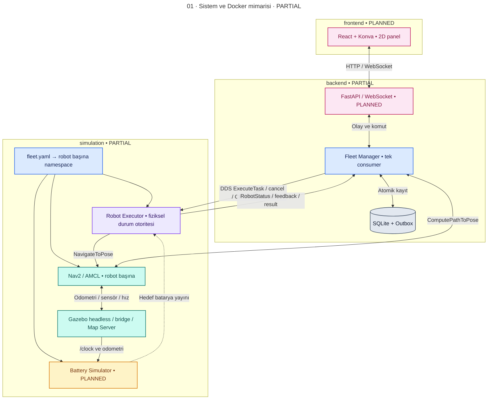

## 02. Görev kabulü ve atanabilir FIFO

**Durum:** IMPLEMENTED. **Amaç:** Kuyruğun uygun olmayan görev yüzünden durmamasını açıklamak.

| Girdiler | Çıktılar | Karar koşulları |
|---|---|---|
| SUBMIT_TASK, task_id, priority, created_at; TICK | Atama, kesme talebi veya kuyrukta bekleme | HIGH→MEDIUM→LOW; aynı sınıfta created_at; aging yok. |

**Kaynak belge:** [c3-fleet-manager-decisions-2026-10-24.md](../decisions/c3-fleet-manager-decisions-2026-10-24.md)

**Kaynak kod:** [task_queue.py](../../backend/fleet_manager/domain/task_queue.py) · [fleet_manager_core.py](../../backend/fleet_manager/domain/fleet_manager_core.py) · [event_loop.py](../../backend/fleet_manager/event_loop.py)

**Test / kanıt:** [test_fleet_manager_domain.py](../../tests/test_fleet_manager_domain.py)


Düzenlenebilir Mermaid görünümü

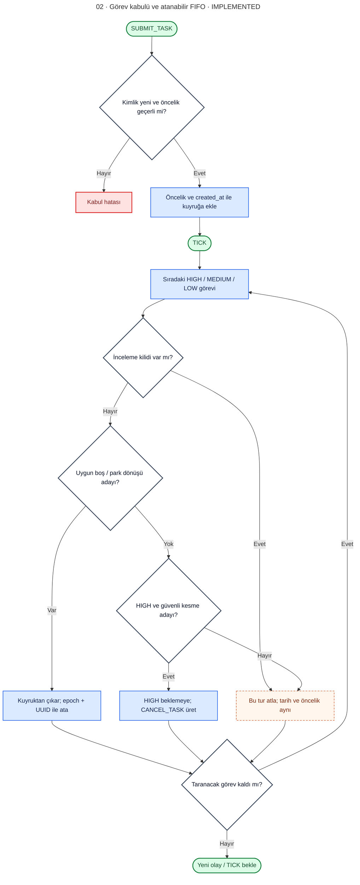

## 03. Robot seçimi ve Wh uygunluğu

**Durum:** PARTIAL. **Amaç:** Mesafe sıralamasından önce enerji ve durum filtresini göstermek.

| Girdiler | Çıktılar | Karar koşulları |
|---|---|---|
| RobotStatus, görev pozları, rota mesafeleri, batarya modeli | En yakın uygun aday veya aday yok | Güncel, oturum engeli yok, yüksüz, aktif atamasız; rota ve enerji zorunlu. |

**Kaynak belge:** [ROS2_Fleet_Manager_Nihai_Mimari_Kararlar_2026-10-23.md](../ROS2_Fleet_Manager_Nihai_Mimari_Kararlar_2026-10-23.md) · [c3-fleet-manager-decisions-2026-10-24.md](../decisions/c3-fleet-manager-decisions-2026-10-24.md)

**Kaynak kod:** [scheduler.py](../../backend/fleet_manager/domain/scheduler.py) · [energy.py](../../backend/fleet_manager/domain/energy.py) · [builder.py](../../backend/fleet_manager/builder.py)

**Test / kanıt:** [test_fleet_manager_domain.py](../../tests/test_fleet_manager_domain.py) · [test_fleet_builder.py](../../tests/test_fleet_builder.py)

**Sınır / fark:** Fark: builder ilk şarj istasyonunu safe_charge seçer; çoklu istasyon erişim seçimi tamamlanmış değildir. Scheduler enerji kontrolüne fleet policies marj/rezervini geçirmez; fonksiyon varsayılanları kullanılır. Hedef formül ile kod arasındaki bu yapılandırma boşluğu korunarak raporlandı.


Düzenlenebilir Mermaid görünümü

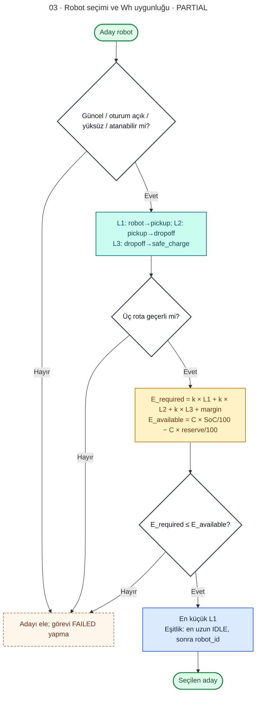

## 04. Robot Executor görev yaşam döngüsü

**Durum:** IMPLEMENTED. **Amaç:** Pickup/dropoff adımlarının tek yürütücüsünü göstermek.

| Girdiler | Çıktılar | Karar koşulları |
|---|---|---|
| ExecuteTask goal, Nav2 sonucu, simülasyon zamanı | Terminal sonuç ve RobotStatus | Kabul güvenliği, yerel faz kilidi, ilgili goal UUID. |

**Kaynak belge:** [ROS2_Fleet_Manager_Nihai_Mimari_Kararlar_2026-10-23.md](../ROS2_Fleet_Manager_Nihai_Mimari_Kararlar_2026-10-23.md) · [c2-executor-decisions-2026-10-24.md](../decisions/c2-executor-decisions-2026-10-24.md) · [c3-3-1-executor-safety-decisions-2026-10-24.md](../decisions/c3-3-1-executor-safety-decisions-2026-10-24.md)

**Kaynak kod:** [node.py](../../ros2_ws/src/fleet_robot_executor/fleet_robot_executor/node.py) · [state_machine.py](../../ros2_ws/src/fleet_robot_executor/fleet_robot_executor/state_machine.py)

**Test / kanıt:** [test_executor_state_machine.py](../../tests/test_executor_state_machine.py) · [test_executor_lifecycle_integration.py](../../tests/test_executor_lifecycle_integration.py)

**Sınır / fark:** Şarj/park sürüş orkestrasyonu bu taşıma yaşam döngüsünün tamamlanmış parçası değildir.


Düzenlenebilir Mermaid görünümü

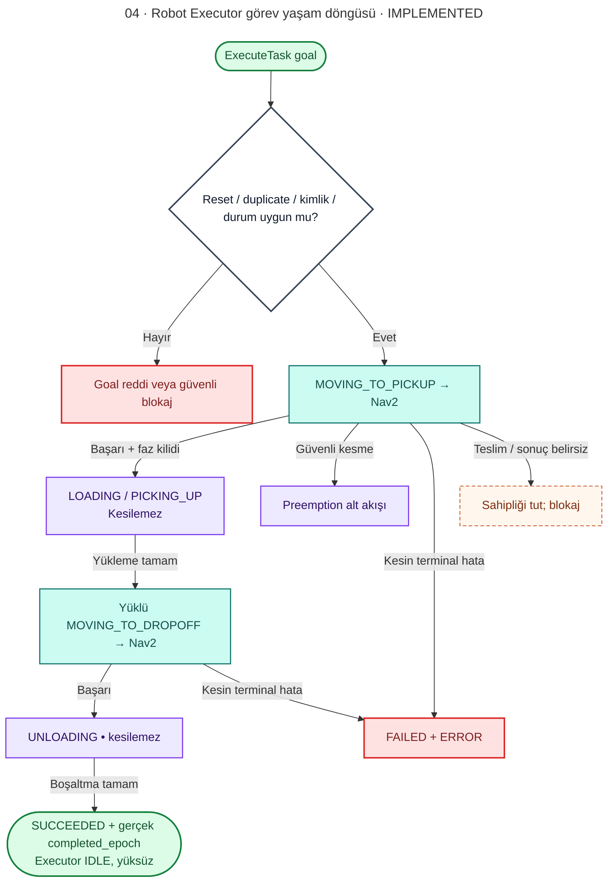

## 05. Güvenli preemption ve N=2

**Durum:** IMPLEMENTED. **Amaç:** HIGH atamasından önce terminal duruş el sıkışmasını göstermek.

| Girdiler | Çıktılar | Karar koşulları |
|---|---|---|
| Yeni HIGH, çalışan görev/faz/yük, sayaç, Nav2 ve odometri | PREEMPTED sonrası yeniden kuyruklama ve HIGH ataması | Boş uygun robot önce; kurban LOW/MED, pickup öncesi, yüksüz, sayaç < 2. |

**Kaynak belge:** [ROS2_Fleet_Manager_Nihai_Mimari_Kararlar_2026-10-23.md](../ROS2_Fleet_Manager_Nihai_Mimari_Kararlar_2026-10-23.md) · [c3-3-1-executor-safety-decisions-2026-10-24.md](../decisions/c3-3-1-executor-safety-decisions-2026-10-24.md) · [c3-3-3-dual-robot-integration-decisions-2026-10-24.md](../decisions/c3-3-3-dual-robot-integration-decisions-2026-10-24.md)

**Kaynak kod:** [scheduler.py](../../backend/fleet_manager/domain/scheduler.py) · [event_loop.py](../../backend/fleet_manager/event_loop.py) · [node.py](../../ros2_ws/src/fleet_robot_executor/fleet_robot_executor/node.py) · [stop_detector.py](../../ros2_ws/src/fleet_robot_executor/fleet_robot_executor/stop_detector.py)

**Test / kanıt:** [test_fleet_manager_domain.py](../../tests/test_fleet_manager_domain.py) · [test_executor_safety.py](../../tests/test_executor_safety.py)

**Sınır / fark:** İptal reddi ve timeout kesilme sayacını artırmaz. %15 takas kullanılmaz. Park dönüşünü kesme ayrı lojistik kuralıdır.


Düzenlenebilir Mermaid görünümü

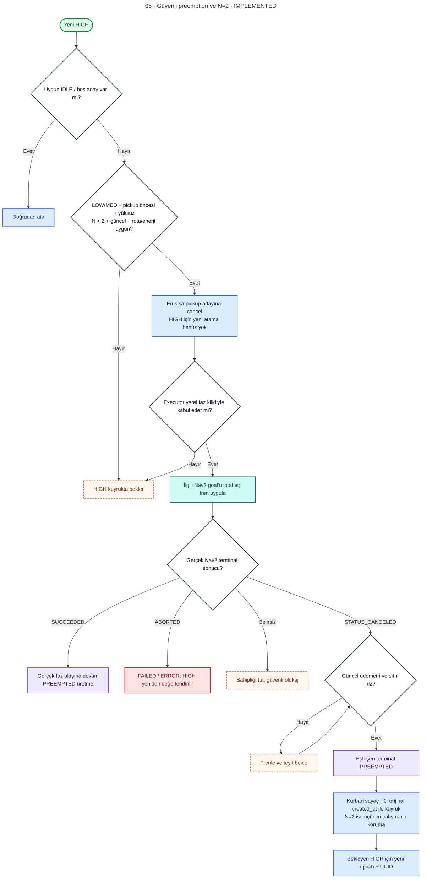

## 06. RobotStatus sıra ve oturum yönetimi

**Durum:** PARTIAL. **Amaç:** Fiziksel durum, iletişim tazeliği ve oturum engelini ayırmak.

| Girdiler | Çıktılar | Karar koşulları |
|---|---|---|
| RobotStatus, status_seq, publisher_session_id, monotonik alım zamanı | Durum kopyası veya STALE / SESSION_BLOCKED | Aynı oturumda artan sıra; ilk durumda IDLE/yüksüz/atamasız doğrulaması. |

**Kaynak belge:** [c3-fleet-manager-decisions-2026-10-24.md](../decisions/c3-fleet-manager-decisions-2026-10-24.md) · [c3-3-1-executor-safety-decisions-2026-10-24.md](../decisions/c3-3-1-executor-safety-decisions-2026-10-24.md) · [c3-3-2-ros2-adapter-decisions-2026-10-24.md](../decisions/c3-3-2-ros2-adapter-decisions-2026-10-24.md) · [c3-3-3-dual-robot-integration-decisions-2026-10-24.md](../decisions/c3-3-3-dual-robot-integration-decisions-2026-10-24.md)

**Kaynak kod:** [event_loop.py](../../backend/fleet_manager/event_loop.py) · [fleet_tracker.py](../../backend/fleet_manager/domain/fleet_tracker.py) · [status_subscriber.py](../../backend/fleet_manager/adapters/status_subscriber.py) · [safety.py](../../ros2_ws/src/fleet_robot_executor/fleet_robot_executor/safety.py)

**Test / kanıt:** [test_ros2_status_subscriber.py](../../tests/test_ros2_status_subscriber.py)

**Sınır / fark:** Consumer, yayıncıdaki uint64 guard ile aynı sınır doğrulamasını yapmaz: negatif olmayan int kabul eder; 0 ve üst sınır kontrolü eksiktir. Yayıncı guard ile consumer aynı bileşen değildir.


Düzenlenebilir Mermaid görünümü

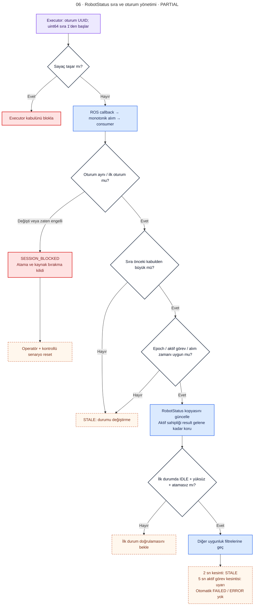

## 07. DDS goal ve cancel protokolü

**Durum:** IMPLEMENTED. **Amaç:** Kabul, ret, belirsiz teslim ve terminal sonucu ayırmak.

| Girdiler | Çıktılar | Karar koşulları |
|---|---|---|
| Kalıcı Outbox komutu; goal/cancel yanıtı | SENT, RETRY, HELD_FOR_REVIEW veya terminal olay | Goal yanıtı 5 sn, cancel yanıtı 3 sn monotonik; kabul duruş değildir. |

**Kaynak belge:** [c3-3-2-ros2-adapter-decisions-2026-10-24.md](../decisions/c3-3-2-ros2-adapter-decisions-2026-10-24.md) · [c3-3-1-executor-safety-decisions-2026-10-24.md](../decisions/c3-3-1-executor-safety-decisions-2026-10-24.md)

**Kaynak kod:** [action_client.py](../../backend/fleet_manager/adapters/action_client.py) · [outbox_sender.py](../../backend/fleet_manager/adapters/outbox_sender.py) · [event_loop.py](../../backend/fleet_manager/event_loop.py)

**Test / kanıt:** [test_ros2_action_client.py](../../tests/test_ros2_action_client.py) · [test_ros2_outbox_sender.py](../../tests/test_ros2_outbox_sender.py)

**Sınır / fark:** Yeniden teslim ikinci yürütme değildir; terminal duplicate için tekrar sonuç sunma protokolü tamamlanmış sayılmaz.


Düzenlenebilir Mermaid görünümü

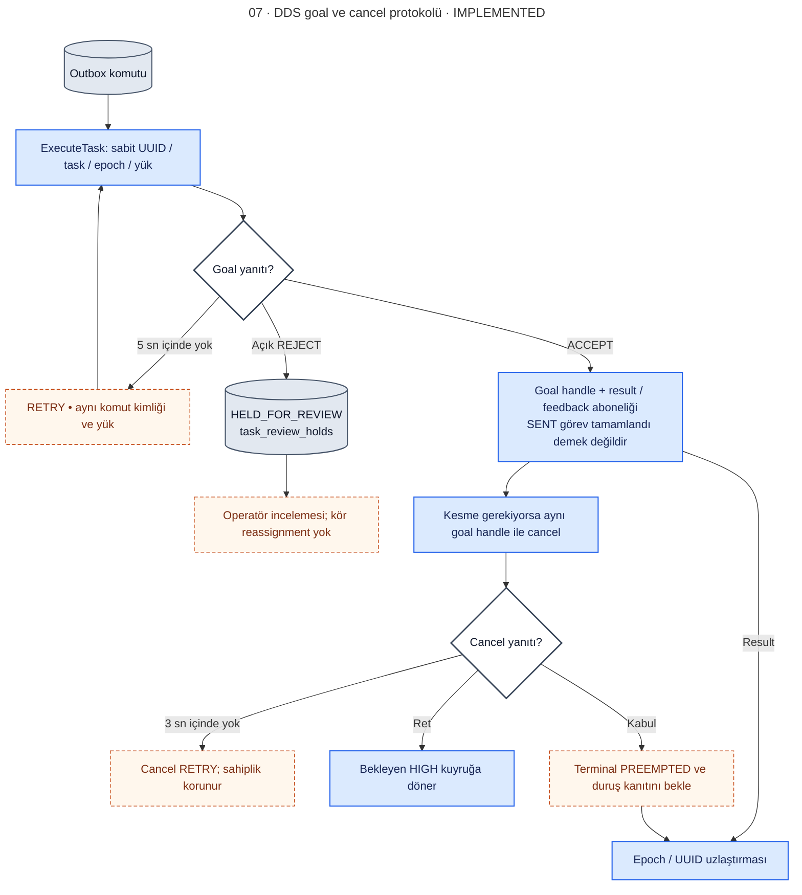

## 08. Assignment epoch ve UUID uzlaştırması

**Durum:** PARTIAL. **Amaç:** Gecikmiş sonuçların yeni atamayı kapatmamasını açıklamak.

| Girdiler | Çıktılar | Karar koşulları |
|---|---|---|
| Action feedback/result/cancel, aktif atama | Uygulanan olay veya STALE | robot/task/assignment_epoch/goal_uuid ve gerçek completed_epoch. |

**Kaynak belge:** [c3-3-1-executor-safety-decisions-2026-10-24.md](../decisions/c3-3-1-executor-safety-decisions-2026-10-24.md) · [c3-3-2-ros2-adapter-decisions-2026-10-24.md](../decisions/c3-3-2-ros2-adapter-decisions-2026-10-24.md)

**Kaynak kod:** [event_loop.py](../../backend/fleet_manager/event_loop.py) · [fleet_manager_core.py](../../backend/fleet_manager/domain/fleet_manager_core.py) · [action_client.py](../../backend/fleet_manager/adapters/action_client.py)

**Test / kanıt:** [test_fleet_manager_outbox.py](../../tests/test_fleet_manager_outbox.py) · [test_ros2_action_client.py](../../tests/test_ros2_action_client.py)

**Sınır / fark:** Eksik epoch dalı hedef davranış değildir; mevcut event_loop fallback’i açıkça gösterilir. Adaptör gerçek epoch gönderir, ancak consumer sınırı eksik alanı bağımsız reddetmez.


Düzenlenebilir Mermaid görünümü

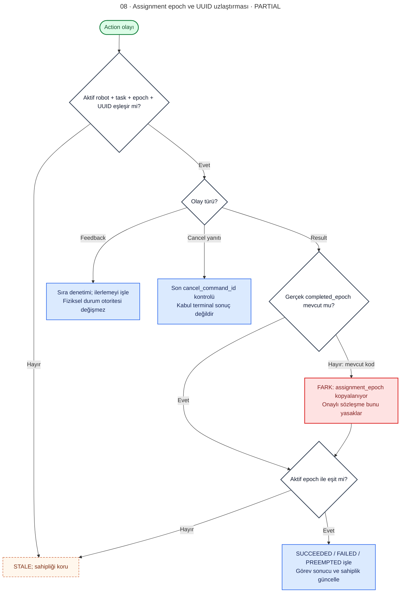

## 09. SQLite Outbox ve tek consumer

**Durum:** IMPLEMENTED. **Amaç:** Bellek ve veritabanının atomik geçişini açıklamak.

| Girdiler | Çıktılar | Karar koşulları |
|---|---|---|
| Thread-safe olaylar ve Outbox gönderim sonuçları | Commit edilmiş durum / kalıcı komut veya rollback | event_id duplicate; transaction dışında ağ; restartta boş DB zorunlu. |

**Kaynak belge:** [c3-2-sqlite-outbox.md](../design/c3-2-sqlite-outbox.md) · [c3-3-2-ros2-adapter-decisions-2026-10-24.md](../decisions/c3-3-2-ros2-adapter-decisions-2026-10-24.md)

**Kaynak kod:** [event_loop.py](../../backend/fleet_manager/event_loop.py) · [store.py](../../backend/fleet_manager/persistence/store.py)

**Test / kanıt:** [test_fleet_manager_outbox.py](../../tests/test_fleet_manager_outbox.py)

**Sınır / fark:** Kuyruk bellektedir; commit öncesi olaylar süreç çökmesinde kalıcı değildir. SENT ağda exactly-once veya görev başarısı garantisi vermez.


Düzenlenebilir Mermaid görünümü

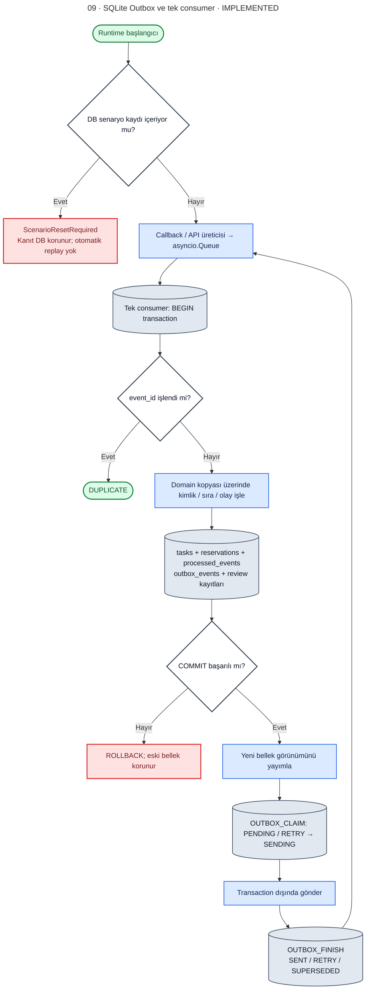

## 10. Wh batarya hesabı

**Durum:** PLANNED. **Amaç:** C4 fiziksel tüketim ve şarj hesabının birimlerini açıklamak.

| Girdiler | Çıktılar | Karar koşulları |
|---|---|---|
| /clock, odometri mesafesi, k Wh/m, güç W, kapasite Wh, temas | Wh, yüzde SoC ve batarya yayın alanları | Şarj için yarıçap + tam duruş + dock_contact; tüketim sürekli. |

**Kaynak belge:** [ROS2_Fleet_Manager_Nihai_Mimari_Kararlar_2026-10-23.md](../ROS2_Fleet_Manager_Nihai_Mimari_Kararlar_2026-10-23.md) · [configuration-c1.md](../configuration-c1.md)

**Kaynak kod:** Ürün uygulaması / bu akışa ait doğrulama henüz yok.

**Test / kanıt:** Ürün uygulaması / bu akışa ait doğrulama henüz yok.

**Sınır / fark:** Bağımsız Battery Simulator yoktur. /clock geri sıçrama ve kesinti ayrıntıları açık kalır; diyagram yeni timeout politikası seçmez. C3 enerji uygunluğu bu fiziksel integratör değildir.


Düzenlenebilir Mermaid görünümü

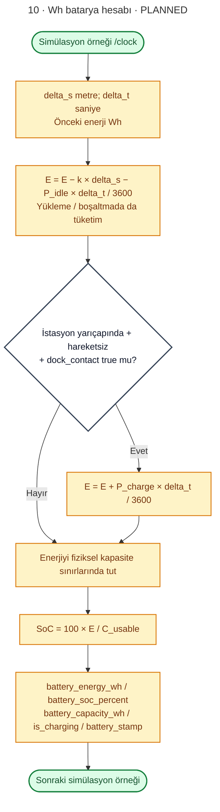

## 11. Şarj sırası ve istasyon seçimi

**Durum:** PLANNED. **Amaç:** Şarj talep sırasını kaynak sahipliğinden ayırmak.

| Girdiler | Çıktılar | Karar koşulları |
|---|---|---|
| Düşük enerji isteği, SoC, talep zamanı, istasyonlar | Rezervasyon veya güvenli bekleme | Düşük SoC önce, eşitlikte FIFO; tek sahiplik. |

**Kaynak belge:** [ROS2_Fleet_Manager_Nihai_Mimari_Kararlar_2026-10-23.md](../ROS2_Fleet_Manager_Nihai_Mimari_Kararlar_2026-10-23.md) · [ROS2_Fleet_Manager_Karar_08_Revize_v1_0.pdf](../ROS2_Fleet_Manager_Karar_08_Revize_v1_0.pdf)

**Kaynak kod:** [reservations.py](../../backend/fleet_manager/domain/reservations.py)

**Test / kanıt:** [test_fleet_manager_domain.py](../../tests/test_fleet_manager_domain.py)

**Sınır / fark:** Rezervasyon primitive’leri mevcut olsa da otomatik şarj kuyruğu/yürütücüsü yoktur. Çoklu istasyon seçimi için yeni eşitlik veya maliyet politikası belirlenmedi.


Düzenlenebilir Mermaid görünümü

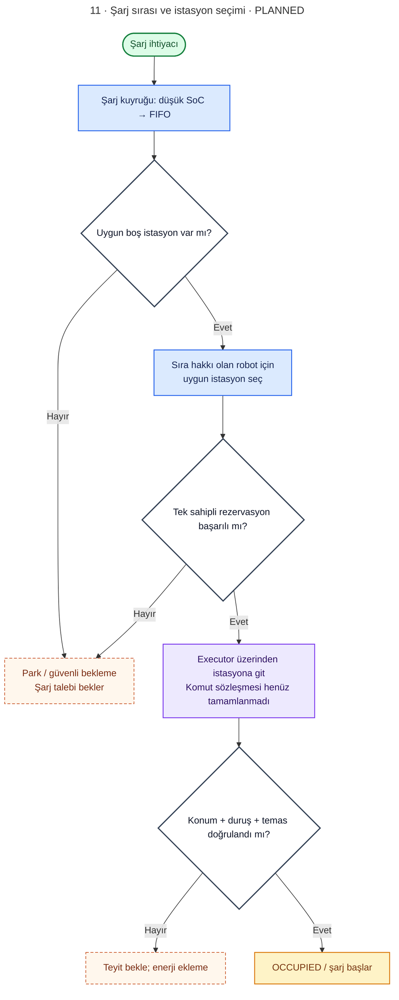

## 12. Şarjdan ayrılma ve yüzde 80

**Durum:** PLANNED. **Amaç:** Görev için erken ayrılma ile yer verme politikasını ayırmak.

| Girdiler | Çıktılar | Karar koşulları |
|---|---|---|
| Şarjdaki robot, görev uygunluğu, SoC, bekleyen robotlar | Görev için çıkış, yer verme veya şarjda kalma | Dinamik enerji uygunluğu %80 öncesi görev çıkışına izin verir. |

**Kaynak belge:** [ROS2_Fleet_Manager_Nihai_Mimari_Kararlar_2026-10-23.md](../ROS2_Fleet_Manager_Nihai_Mimari_Kararlar_2026-10-23.md) · [ROS2_Fleet_Manager_Karar_08_Revize_v1_0.pdf](../ROS2_Fleet_Manager_Karar_08_Revize_v1_0.pdf)

**Kaynak kod:** [state_machine.py](../../ros2_ws/src/fleet_robot_executor/fleet_robot_executor/state_machine.py)

**Test / kanıt:** Ürün uygulaması / bu akışa ait doğrulama henüz yok.

**Sınır / fark:** Mevcut Executor CHARGING durumunda taşıma goal kabul etmez; erken ayrılma orkestrasyonu uygulanmamıştır. Diyagram hedef politikadır.


Düzenlenebilir Mermaid görünümü

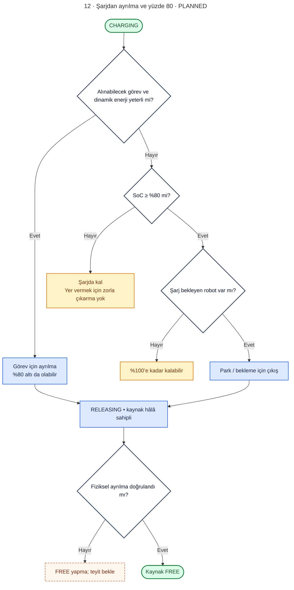

## 13. Park rezervasyonu ve güvenli bekleme

**Durum:** PARTIAL. **Amaç:** Görev sonrası hedef politikayı ve mevcut kaynak yaşam döngüsünü göstermek.

| Girdiler | Çıktılar | Karar koşulları |
|---|---|---|
| Görev sonucu, enerji, boş park/bekleme alanı, pose | Park/şarj yönlendirmesi veya güvenli duruş; kaynak sahipliği | Fiziksel ayrılmadan FREE yok; hata BLOCKED. |

**Kaynak belge:** [ROS2_Fleet_Manager_Nihai_Mimari_Kararlar_2026-10-23.md](../ROS2_Fleet_Manager_Nihai_Mimari_Kararlar_2026-10-23.md) · [c3-fleet-manager-decisions-2026-10-24.md](../decisions/c3-fleet-manager-decisions-2026-10-24.md) · [c3-3-3-dual-robot-integration-decisions-2026-10-24.md](../decisions/c3-3-3-dual-robot-integration-decisions-2026-10-24.md)

**Kaynak kod:** [reservations.py](../../backend/fleet_manager/domain/reservations.py) · [event_loop.py](../../backend/fleet_manager/event_loop.py)

**Test / kanıt:** [test_fleet_manager_domain.py](../../tests/test_fleet_manager_domain.py) · [test_fleet_manager_outbox.py](../../tests/test_fleet_manager_outbox.py)

**Sınır / fark:** Otomatik görev sonrası park/şarj yöneticisi yoktur. Mevcut nearest-free primitive Öklid mesafesi kullanır. `unblock()` doğrudan FREE yapar; hedef ayrılma teyidini sağlamaz ve consumer üzerinden tamamlanmış kurtarma akışı değildir.


Düzenlenebilir Mermaid görünümü

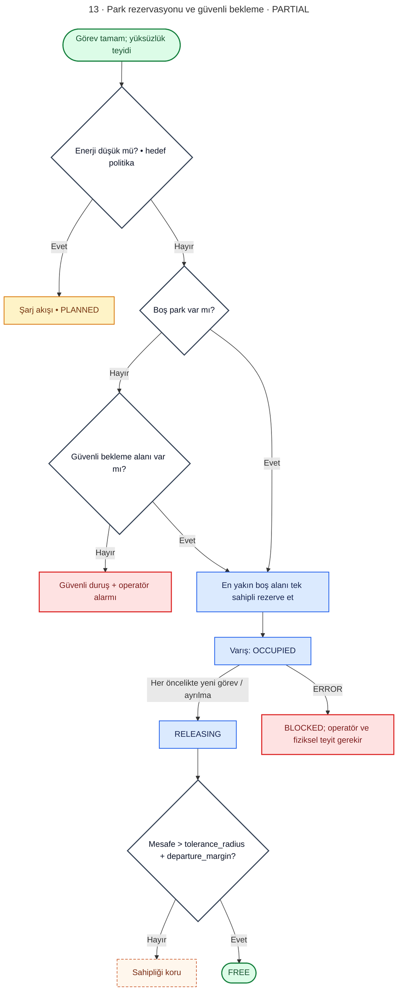

## 14. FAILED / ERROR ve operatör kurtarma

**Durum:** PARTIAL. **Amaç:** Kesin hata, planlama uygunsuzluğu ve iletişim belirsizliğini ayırmak.

| Girdiler | Çıktılar | Karar koşulları |
|---|---|---|
| Nav2 terminal sonuç, iletişim, ClearRobotError ve odometri | FAILED/ERROR, reddedilmiş veya kabul edilmiş manuel kurtarma | expected_epoch eşit; robot ERROR; yüksüz ve güvenli duruş. |

**Kaynak belge:** [ROS2_Fleet_Manager_Nihai_Mimari_Kararlar_2026-10-23.md](../ROS2_Fleet_Manager_Nihai_Mimari_Kararlar_2026-10-23.md) · [c3-3-1-executor-safety-decisions-2026-10-24.md](../decisions/c3-3-1-executor-safety-decisions-2026-10-24.md) · [c3-3-2-ros2-adapter-decisions-2026-10-24.md](../decisions/c3-3-2-ros2-adapter-decisions-2026-10-24.md)

**Kaynak kod:** [node.py](../../ros2_ws/src/fleet_robot_executor/fleet_robot_executor/node.py) · [state_machine.py](../../ros2_ws/src/fleet_robot_executor/fleet_robot_executor/state_machine.py) · [service_client.py](../../backend/fleet_manager/adapters/service_client.py) · [reservations.py](../../backend/fleet_manager/domain/reservations.py)

**Test / kanıt:** [test_clear_robot_error_client.py](../../tests/test_clear_robot_error_client.py) · [test_executor_state_machine.py](../../tests/test_executor_state_machine.py)

**Sınır / fark:** Node odometriyle denetler; saf state_machine.clear_robot_error çağrısında odometri verilmezse duruş kontrolü atlanabilir. Kaynak unblock primitive’i ayrıca fiziksel kontrol yapmaz. Bu farklar düzeltilmedi.


Düzenlenebilir Mermaid görünümü

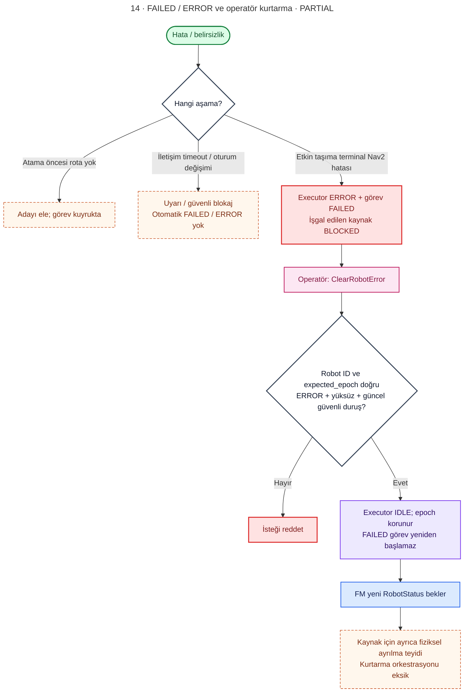

## 15. fleet.yaml yaşam döngüsü

**Durum:** PARTIAL. **Amaç:** Mevcut doğrulama ile planlanan Apply sürecini ayırmak.

| Girdiler | Çıktılar | Karar koşulları |
|---|---|---|
| Tek fleet.yaml, şema, varlık dosyaları; hedef desired_revision | Doğrulanmış config veya açık hata; planlanan running_revision | Duplicate anahtar, tip, birim, benzersizlik, dosya yolu kontrolleri. |

**Kaynak belge:** [configuration-c1.md](../configuration-c1.md) · [ROS2_Fleet_Manager_Nihai_Mimari_Kararlar_2026-10-23.md](../ROS2_Fleet_Manager_Nihai_Mimari_Kararlar_2026-10-23.md) · [architecture-v2.3-transition.md](../architecture/architecture-v2.3-transition.md)

**Kaynak kod:** [loader.py](../../fleet_config/loader.py) · [models.py](../../fleet_config/models.py) · [builder.py](../../backend/fleet_manager/builder.py)

**Test / kanıt:** [test_config.py](../../tests/test_config.py) · [test_fleet_builder.py](../../tests/test_fleet_builder.py)

**Sınır / fark:** C1 kök stations kullanır; onay belirsizliği raporda tutulur. Builder ImportError halinde ham YAML fallback kullanır: doğrulama zinciri bütün başlangıç yollarında zorunlu değildir. Apply API ve revision runtime yoktur.


Düzenlenebilir Mermaid görünümü

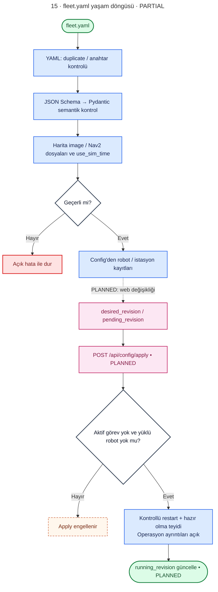

## 16. REST / WebSocket ve 2D panel

**Durum:** PLANNED. **Amaç:** UI ile ROS arasındaki sorumluluk ve veri yönünü açıklamak.

| Girdiler | Çıktılar | Karar koşulları |
|---|---|---|
| Kullanıcı görevi, RobotStatus, harita/rota, kalıcı olaylar | Görev yanıtı, snapshot/stream/replay ve 2D görünüm | UI DDS kullanmaz; kabul yanıtı görev tamamlanması değildir. |

**Kaynak belge:** [ROS2_Fleet_Manager_Nihai_Mimari_Kararlar_2026-10-23.md](../ROS2_Fleet_Manager_Nihai_Mimari_Kararlar_2026-10-23.md) · [architecture-v2.3-transition.md](../architecture/architecture-v2.3-transition.md)

**Kaynak kod:** Ürün uygulaması / bu akışa ait doğrulama henüz yok.

**Test / kanıt:** Ürün uygulaması / bu akışa ait doğrulama henüz yok.

**Sınır / fark:** FastAPI, WebSocket ve React/Konva uygulaması yoktur. REST şema, replay cursor, bağlantı kopması ve backpressure ayrıntıları burada yeni karar olarak seçilmez. Video akışı aktarılmaz.


Düzenlenebilir Mermaid görünümü

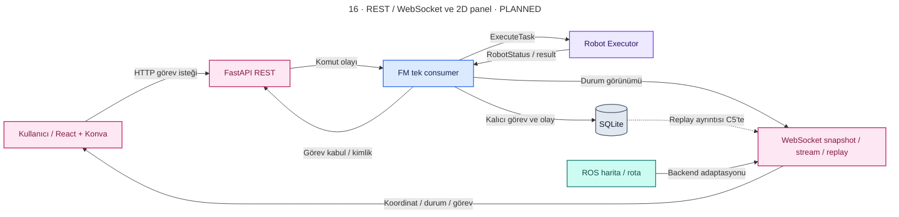

## 17. Asenkron rota ve önbellek

**Durum:** PARTIAL. **Amaç:** Ağ sorgusunun consumer transaction dışında kalmasını göstermek.

| Girdiler | Çıktılar | Karar koşulları |
|---|---|---|
| Robot, start/goal, map_revision, monotonik zaman | Nav2 yol uzunluğu veya None | 0.20 m hücre, 30 sn TTL, 2 sn sorgu timeout; Euclidean fallback yok. |

**Kaynak belge:** [c3-3-2-ros2-adapter-decisions-2026-10-24.md](../decisions/c3-3-2-ros2-adapter-decisions-2026-10-24.md)

**Kaynak kod:** [route_cache.py](../../backend/fleet_manager/adapters/route_cache.py) · [route_resolver.py](../../backend/fleet_manager/adapters/route_resolver.py) · [ros2_adapter_node.py](../../backend/fleet_manager/adapters/ros2_adapter_node.py)

**Test / kanıt:** [test_ros2_route_resolver.py](../../tests/test_ros2_route_resolver.py)

**Sınır / fark:** Resolver önce cache’e doğrudan yazar, ardından consumer’a olay gönderir; diyagramdaki olay yolu tek yazma yolu değildir. Cache API ve sorgu kodu mevcut; görev atama/iptal/çıkışındaki tüm invalidation tetikleyicilerinin canlı bağlantısı kanıtlanmış değildir. Boş robot_id sorgusu başka robot kaydıyla eşleşebilir; tam robot izolasyonu diye sunulmaz.


Düzenlenebilir Mermaid görünümü

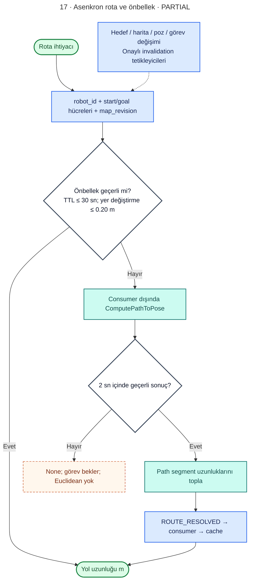

## 18. Duplicate kayıtları ve restart engeli

**Durum:** PARTIAL. **Amaç:** Tekrar teslimin ikinci yürütme üretmemesini açıklamak.

| Girdiler | Çıktılar | Karar koşulları |
|---|---|---|
| task_id, epoch, goal UUID, değişmez yük, reset kanıtı | Tek yürütme kaydı veya ret/blokaj | Senaryo boyunca kayıt; kapasitede tahliye yok; restart otomatik replay değil. |

**Kaynak belge:** [c3-3-1-executor-safety-decisions-2026-10-24.md](../decisions/c3-3-1-executor-safety-decisions-2026-10-24.md) · [c3-3-2-ros2-adapter-decisions-2026-10-24.md](../decisions/c3-3-2-ros2-adapter-decisions-2026-10-24.md)

**Kaynak kod:** [safety.py](../../ros2_ws/src/fleet_robot_executor/fleet_robot_executor/safety.py) · [node.py](../../ros2_ws/src/fleet_robot_executor/fleet_robot_executor/node.py)

**Test / kanıt:** [test_executor_safety.py](../../tests/test_executor_safety.py) · [test_executor_safety_ros2.py](../../tests/test_executor_safety_ros2.py)

**Sınır / fark:** Ürün düzeyinde operatör reset prosedürü ve terminal duplicate sonucunu yeniden sunma protokolü tamamlanmamıştır; test harness kabul açılması ürün reset API’si değildir.


Düzenlenebilir Mermaid görünümü

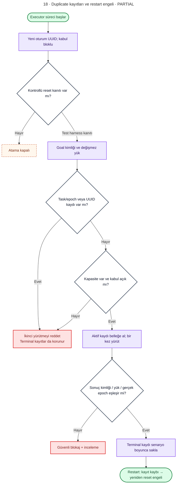

## Üretim ve doğrulama

Mermaid CLI 11.12.0 ile kaynaklar SVG'ye çevrilir; bu araç ürün bağımlılığı değildir. Komutlar, görüntü denetimi ve sınırlar [doğrulama komut ekinde](../validation/organization/organization-commands-2026-10-26.md) bulunur. GitHub sunucusunda render testi yapılmadı; yerel Mermaid render ve SVG gömme kontrolü bununla karıştırılmaz.

## Eksik akışlar

C4 fiziksel batarya, şarj kuyruğu, erken ayrılma ve otomatik park orkestrasyonu; C5 REST/WS/panel; kontrollü Apply ve ürün reset prosedürü tamamlanmamıştır. Genişletilmiş iki robotlu takas MVP'de kapalıdır; onaysız yürütme algoritması çizilmedi. Küresel trafik/deadlock çözücüsü kapsam dışıdır.
