# Mimari ve algoritma diyagramları

26 Ekim 2026 kaynak incelemesi. Bu katalog mevcut kararların görsel anlatımıdır; yeni mimari karar değildir. [İnceleme ve fark raporu](../validation/organization/organization-validation-2026-10-26.md) hedef ile kodun ayrıldığı yolları kaydeder.

## Durum ve görsel dil

- **IMPLEMENTED:** Belirtilen akışın kodu vardır; bütün ürünün veya her hata yolunun canlı doğrulandığı anlamına gelmez.
- **PARTIAL:** Kodun bir kısmı vardır; eksik bağlantı veya karar/kod farkı aşağıda belirtilir.
- **PLANNED:** Hedef akış; ürün uygulaması yoktur. Öneri ayrıntıları onaylı politika sayılmaz.
- **UNVERIFIED:** Uygulaması/kanıtı bu incelemede belirlenemeyen akış için ayrılmıştır; bu katalogda böyle etiketlenmiş akış yoktur.

Mavi: Fleet Manager; mor: Executor; turkuaz: Nav2/simülasyon; sarı: batarya; gri silindir: veritabanı; pembe: UI/API. Yeşil yuvarlatılmış düğüm başlangıç/bitiş, beyaz baklava karar, kırmızı hata/blokaj, kesik turuncu bekleme anlamına gelir. Durum ve metin de anlamı taşır; yalnız renge bağlı değildir.

Her akış için `.mmd` düzenlenebilir kaynak, `.svg` türetilmiş çıktıdır. GitHub'da bölüm altındaki SVG doğrudan görünür; aynı kaynak Mermaid kod bloğu olarak da sunulur. Kaynak ve katalog kopyası birlikte güncellenmelidir.

## Kapsam tablosu

| No | Kategori / algoritma | Durum | Kaynak / SVG |
|---|---|---|---|
| 1 | Sistem — [Sistem ve Docker mimarisi](#01-system-architecture) | PARTIAL | [Mermaid](src/system-architecture.mmd) · [SVG](svg/system-architecture.svg) |
| 2 | Görev — [Görev kabulü ve atanabilir FIFO](#02-task-admission-fifo) | IMPLEMENTED | [Mermaid](src/task-admission-fifo.mmd) · [SVG](svg/task-admission-fifo.svg) |
| 3 | Görev — [Robot seçimi ve Wh uygunluğu](#03-robot-selection-energy) | PARTIAL | [Mermaid](src/robot-selection-energy.mmd) · [SVG](svg/robot-selection-energy.svg) |
| 4 | Yürütme — [Robot Executor görev yaşam döngüsü](#04-executor-lifecycle) | IMPLEMENTED | [Mermaid](src/executor-lifecycle.mmd) · [SVG](svg/executor-lifecycle.svg) |
| 5 | Yürütme — [Güvenli preemption ve N=2](#05-safe-preemption) | IMPLEMENTED | [Mermaid](src/safe-preemption.mmd) · [SVG](svg/safe-preemption.svg) |
| 6 | Güvenlik — [RobotStatus sıra ve oturum yönetimi](#06-status-session-order) | PARTIAL | [Mermaid](src/status-session-order.mmd) · [SVG](svg/status-session-order.svg) |
| 7 | Güvenlik — [DDS goal ve cancel protokolü](#07-dds-goal-cancel) | IMPLEMENTED | [Mermaid](src/dds-goal-cancel.mmd) · [SVG](svg/dds-goal-cancel.svg) |
| 8 | Güvenlik — [Assignment epoch ve UUID uzlaştırması](#08-assignment-reconciliation) | IMPLEMENTED | [Mermaid](src/assignment-reconciliation.mmd) · [SVG](svg/assignment-reconciliation.svg) |
| 9 | Kalıcılık — [SQLite Outbox ve tek consumer](#09-sqlite-outbox-consumer) | IMPLEMENTED | [Mermaid](src/sqlite-outbox-consumer.mmd) · [SVG](svg/sqlite-outbox-consumer.svg) |
| 10 | Enerji — [Wh batarya hesabı ve telemetri](#10-battery-wh-integration) | IMPLEMENTED | [Mermaid](src/battery-wh-integration.mmd) · [SVG](svg/battery-wh-integration.svg) |
| 11 | Enerji — [Şarj sırası ve istasyon seçimi](#11-charging-queue-selection) | IMPLEMENTED | [Mermaid](src/charging-queue-selection.mmd) · [SVG](svg/charging-queue-selection.svg) |
| 12 | Enerji — [Şarjdan ayrılma ve yüzde 80](#12-charging-exit-policy) | IMPLEMENTED | [Mermaid](src/charging-exit-policy.mmd) · [SVG](svg/charging-exit-policy.svg) |
| 13 | Kaynak — [Park rezervasyonu ve güvenli bekleme](#13-parking-reservations) | IMPLEMENTED | [Mermaid](src/parking-reservations.mmd) · [SVG](svg/parking-reservations.svg) |
| 14 | Kurtarma — [FAILED / ERROR ve operatör kurtarma](#14-failure-operator-recovery) | PARTIAL | [Mermaid](src/failure-operator-recovery.mmd) · [SVG](svg/failure-operator-recovery.svg) |
| 15 | Konfigürasyon — [fleet.yaml yaşam döngüsü](#15-fleet-config-lifecycle) | PARTIAL | [Mermaid](src/fleet-config-lifecycle.mmd) · [SVG](svg/fleet-config-lifecycle.svg) |
| 16 | Panel — [REST / WebSocket ve 3D panel](#16-rest-websocket-gui) | PARTIAL | [Mermaid](src/rest-websocket-gui.mmd) · [SVG](svg/rest-websocket-gui.svg) |
| 17 | Rota — [Asenkron rota ve önbellek](#17-route-cache) | IMPLEMENTED | [Mermaid](src/route-cache.mmd) · [SVG](svg/route-cache.svg) |
| 18 | Güvenlik — [Duplicate kayıtları ve restart engeli](#18-duplicate-restart-guard) | PARTIAL | [Mermaid](src/duplicate-restart-guard.mmd) · [SVG](svg/duplicate-restart-guard.svg) |

## 01. Sistem ve Docker mimarisi

**Durum:** PARTIAL. **Amaç:** Üç servisli hedefte bileşen sahipliğini göstermek.

| Girdiler | Çıktılar | Karar koşulları |
|---|---|---|
| Filo config, görev isteği, ROS telemetrisi | Görev komutları ve hedef panel görünümü | Frontend yalnız HTTP/WS; robot düğümleri config ile çoğalır. |

**Kaynak belge:** [ROS2_Fleet_Manager_Nihai_Mimari_Kararlar_2026-10-23.md](../ROS2_Fleet_Manager_Nihai_Mimari_Kararlar_2026-10-23.md) · [c3-3-3-dual-robot-integration-decisions-2026-10-24.md](../decisions/c3-3-3-dual-robot-integration-decisions-2026-10-24.md)

**Kaynak kod:** [builder.py](../../backend/fleet_manager/builder.py) · [README.md](../../docker/compose/README.md)

**Test / kanıt:** [c3-3-3-validation-2026-10-24.md](../validation/c3/c3-3-3-validation-2026-10-24.md)

**Sınır / fark:** Kök üç servis Compose henüz planlanandır. C3.3.3 geçici test besleyicisini kullanır. Robot başına Battery Simulator, Executor ve Fleet Manager ürün akışı [C4.5 Fortress kabulünde](../validation/c4/c4-5-validation-2026-11-06.md) çalıştırıldı. C5 salt okunur 3D yüzü [iki robotlu Chrome kabulünde](../validation/c5/c5-stage1-5-validation-2026-11-06.md) bu akışı izler.


Düzenlenebilir Mermaid görünümü

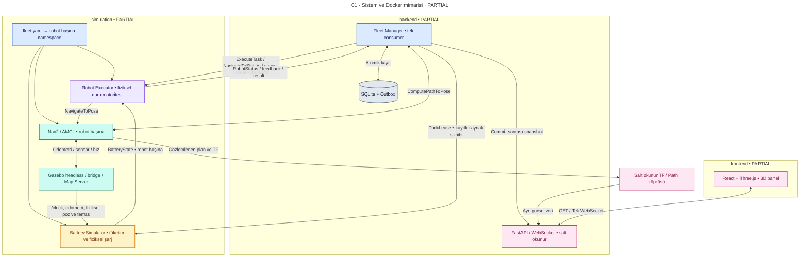

## 02. Görev kabulü ve atanabilir FIFO

**Durum:** IMPLEMENTED. **Amaç:** Kuyruğun uygun olmayan görev yüzünden durmamasını açıklamak.

| Girdiler | Çıktılar | Karar koşulları |
|---|---|---|
| SUBMIT_TASK, task_id, priority, created_at; TICK | Atama, kesme talebi veya kuyrukta bekleme | HIGH→MEDIUM→LOW; aynı sınıfta created_at; aging yok. |

**Kaynak belge:** [c3-fleet-manager-decisions-2026-10-24.md](../decisions/c3-fleet-manager-decisions-2026-10-24.md)

**Kaynak kod:** [task_queue.py](../../backend/fleet_manager/domain/task_queue.py) · [fleet_manager_core.py](../../backend/fleet_manager/domain/fleet_manager_core.py) · [event_loop.py](../../backend/fleet_manager/event_loop.py)

**Test / kanıt:** [test_fleet_manager_domain.py](../../tests/test_fleet_manager_domain.py)


Düzenlenebilir Mermaid görünümü

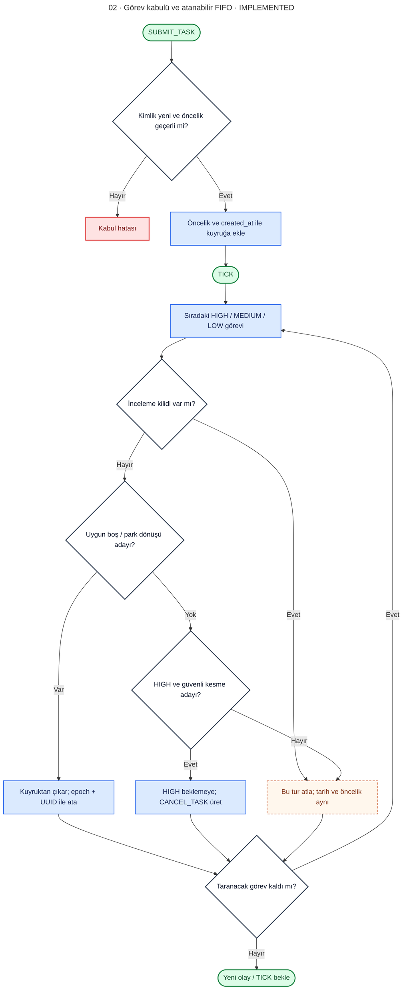

## 03. Robot seçimi ve Wh uygunluğu

**Durum:** PARTIAL. **Amaç:** Mesafe sıralamasından önce enerji ve durum filtresini göstermek.

| Girdiler | Çıktılar | Karar koşulları |
|---|---|---|
| RobotStatus, görev pozları, Nav2 rota mesafeleri, robotun batarya modeli ve filo YAML politikaları | En yakın uygun aday veya aday yok | Güncel, oturum engeli yok, yüksüz, aktif atamasız; rota ve enerji zorunlu. |

**Kaynak belge:** [ROS2_Fleet_Manager_Nihai_Mimari_Kararlar_2026-10-23.md](../ROS2_Fleet_Manager_Nihai_Mimari_Kararlar_2026-10-23.md) · [c3-fleet-manager-decisions-2026-10-24.md](../decisions/c3-fleet-manager-decisions-2026-10-24.md)

**Kaynak kod:** [scheduler.py](../../backend/fleet_manager/domain/scheduler.py) · [energy.py](../../backend/fleet_manager/domain/energy.py) · [builder.py](../../backend/fleet_manager/builder.py)

**Test / kanıt:** [test_fleet_manager_domain.py](../../tests/test_fleet_manager_domain.py) · [test_fleet_builder.py](../../tests/test_fleet_builder.py)

**Sınır / fark.** Builder güvenli kaçış hedefi olarak ilk şarj istasyonunu seçer. Çoklu istasyon erişim seçimi planlanan kapsamdır. Scheduler filo YAML'ındaki doğrulanmış acil rezervi ve güvenlik marjını robotun batarya modeli, doğrulanmış kalan Wh ve üç Nav2 rota mesafesiyle birlikte değerlendirir.


Düzenlenebilir Mermaid görünümü

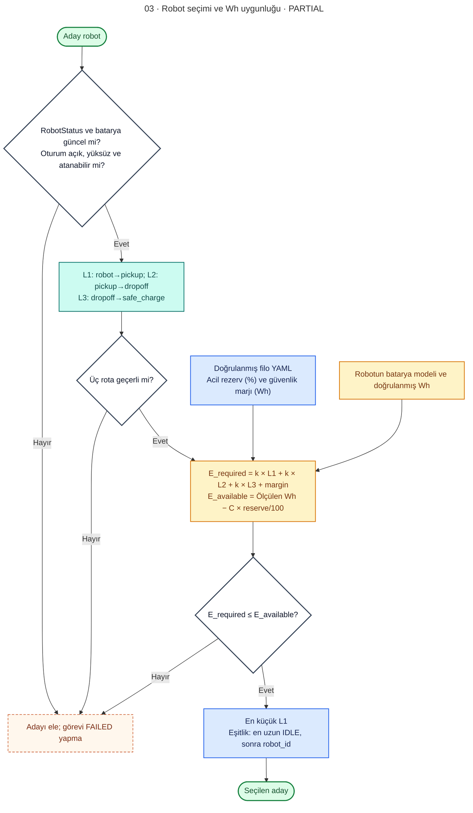

## 04. Robot Executor görev yaşam döngüsü

**Durum:** IMPLEMENTED. **Amaç:** Pickup/dropoff adımlarının tek yürütücüsünü göstermek.

| Girdiler | Çıktılar | Karar koşulları |
|---|---|---|
| ExecuteTask goal, Nav2 sonucu, simülasyon zamanı | Terminal sonuç ve RobotStatus | Kabul güvenliği, yerel faz kilidi, ilgili goal UUID. |

**Kaynak belge:** [ROS2_Fleet_Manager_Nihai_Mimari_Kararlar_2026-10-23.md](../ROS2_Fleet_Manager_Nihai_Mimari_Kararlar_2026-10-23.md) · [c2-executor-decisions-2026-10-24.md](../decisions/c2-executor-decisions-2026-10-24.md) · [c3-3-1-executor-safety-decisions-2026-10-24.md](../decisions/c3-3-1-executor-safety-decisions-2026-10-24.md)

**Kaynak kod:** [node.py](../../ros2_ws/src/fleet_robot_executor/fleet_robot_executor/node.py) · [state_machine.py](../../ros2_ws/src/fleet_robot_executor/fleet_robot_executor/state_machine.py)

**Test / kanıt:** [test_executor_state_machine.py](../../tests/test_executor_state_machine.py) · [test_executor_lifecycle_integration.py](../../tests/test_executor_lifecycle_integration.py)

**Sınır / fark:** Taşıma terminalinden sonra C4.3 istasyon yönlendirmesi ayrı bir action ve sahiplik kaydı kullanır.


Düzenlenebilir Mermaid görünümü

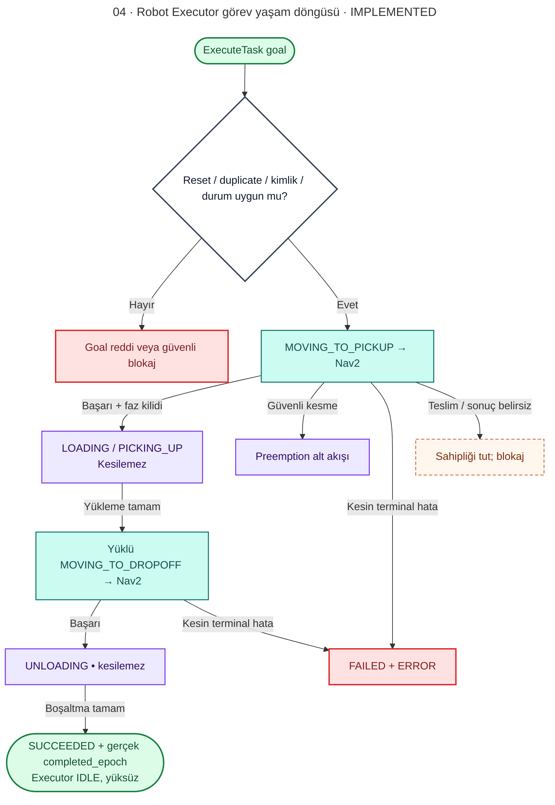

## 05. Güvenli preemption ve N=2

**Durum:** IMPLEMENTED. **Amaç:** Terminal duruş teyidini ve sonraki zamanlama turunda yapılan uygunluk kontrolünü göstermek.

| Girdiler | Çıktılar | Karar koşulları |
|---|---|---|
| Yeni HIGH, çalışan görev/faz/yük, sayaç, Nav2 ve odometri | PREEMPTED sonrası yeniden kuyruklama ve normal atama | Önce uygun boş robot aranır. Kurban LOW/MED, pickup öncesi, yüksüz ve sayaç < 2 olmalıdır. Sonraki tur güncel koşulları yeniden değerlendirir. |

**Kaynak belge:** [ROS2_Fleet_Manager_Nihai_Mimari_Kararlar_2026-10-23.md](../ROS2_Fleet_Manager_Nihai_Mimari_Kararlar_2026-10-23.md) · [c3-3-1-executor-safety-decisions-2026-10-24.md](../decisions/c3-3-1-executor-safety-decisions-2026-10-24.md) · [c3-3-3-dual-robot-integration-decisions-2026-10-24.md](../decisions/c3-3-3-dual-robot-integration-decisions-2026-10-24.md)

**Kaynak kod:** [scheduler.py](../../backend/fleet_manager/domain/scheduler.py) · [event_loop.py](../../backend/fleet_manager/event_loop.py) · [node.py](../../ros2_ws/src/fleet_robot_executor/fleet_robot_executor/node.py) · [stop_detector.py](../../ros2_ws/src/fleet_robot_executor/fleet_robot_executor/stop_detector.py)

**Test / kanıt:** [test_fleet_manager_domain.py](../../tests/test_fleet_manager_domain.py) · [test_executor_safety.py](../../tests/test_executor_safety.py) · [Görev 3 doğrulama kaydı](../validation/c3/c3-3-4-task-3-validation-2026-11-05.md)

**Sınır / fark:** İptal reddi ve timeout kesilme sayacını artırmaz. %15 takas kullanılmaz. Park dönüşünü kesme ayrı lojistik kuralıdır. İki iptal yolu da Nav2 terminalinden sonra aynı odometri duruş penceresini kullanır. [C4.3 duruş doğrulaması](../validation/c4/c4-3-validation-2026-11-06.md#high-preemption-kök-neden-ve-düzeltme)


Düzenlenebilir Mermaid görünümü

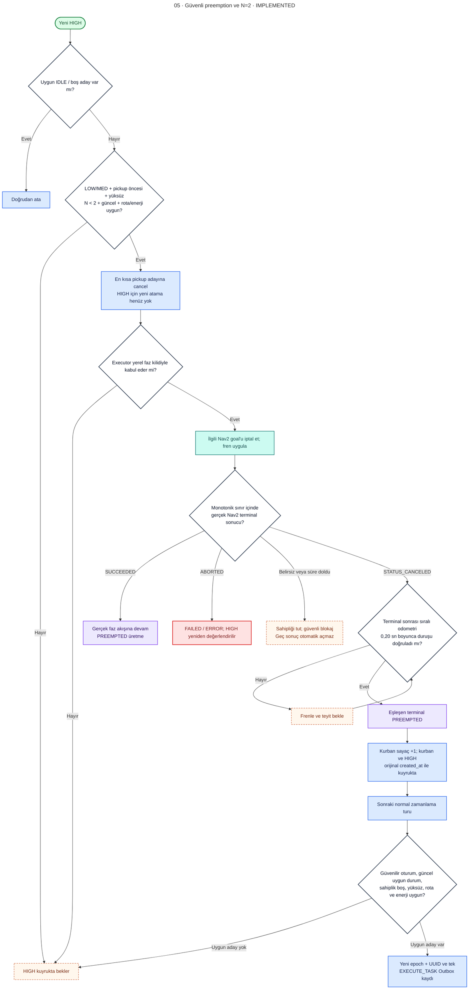

## 06. RobotStatus sıra ve oturum yönetimi

**Durum:** PARTIAL. **Amaç:** Fiziksel durum, iletişim tazeliği ve oturum engelini ayırmak.

| Girdiler | Çıktılar | Karar koşulları |
|---|---|---|
| RobotStatus, status_seq, publisher_session_id, monotonik alım zamanı | Durum kopyası veya STALE / SESSION_BLOCKED | Aynı oturumda artan sıra; ilk durumda IDLE/yüksüz/atamasız doğrulaması. |

**Kaynak belge:** [c3-fleet-manager-decisions-2026-10-24.md](../decisions/c3-fleet-manager-decisions-2026-10-24.md) · [c3-3-1-executor-safety-decisions-2026-10-24.md](../decisions/c3-3-1-executor-safety-decisions-2026-10-24.md) · [c3-3-2-ros2-adapter-decisions-2026-10-24.md](../decisions/c3-3-2-ros2-adapter-decisions-2026-10-24.md) · [c3-3-3-dual-robot-integration-decisions-2026-10-24.md](../decisions/c3-3-3-dual-robot-integration-decisions-2026-10-24.md)

**Kaynak kod:** [event_loop.py](../../backend/fleet_manager/event_loop.py) · [fleet_tracker.py](../../backend/fleet_manager/domain/fleet_tracker.py) · [status_subscriber.py](../../backend/fleet_manager/adapters/status_subscriber.py) · [safety.py](../../ros2_ws/src/fleet_robot_executor/fleet_robot_executor/safety.py)

**Test / kanıt:** [test_ros2_status_subscriber.py](../../tests/test_ros2_status_subscriber.py)

**Sınır / fark:** Consumer, yayıncıdaki uint64 guard ile aynı sınır doğrulamasını yapmaz: negatif olmayan int kabul eder; 0 ve üst sınır kontrolü eksiktir. Yayıncı guard ile consumer aynı bileşen değildir.


Düzenlenebilir Mermaid görünümü

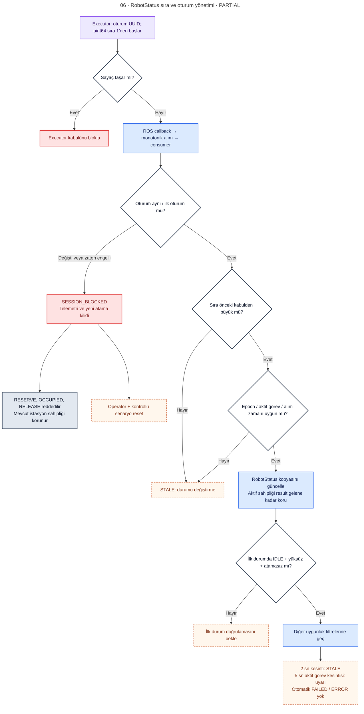

## 07. DDS goal ve cancel protokolü

**Durum:** IMPLEMENTED. **Amaç:** Kabul, ret, belirsiz teslim ve terminal sonucu ayırmak.

| Girdiler | Çıktılar | Karar koşulları |
|---|---|---|
| Kalıcı Outbox komutu; goal/cancel yanıtı | SENT, RETRY, HELD_FOR_REVIEW veya terminal olay | Goal yanıtı 5 sn, cancel yanıtı 3 sn monotonik; kabul duruş değildir. |

**Kaynak belge:** [c3-3-2-ros2-adapter-decisions-2026-10-24.md](../decisions/c3-3-2-ros2-adapter-decisions-2026-10-24.md) · [c3-3-1-executor-safety-decisions-2026-10-24.md](../decisions/c3-3-1-executor-safety-decisions-2026-10-24.md)

**Kaynak kod:** [action_client.py](../../backend/fleet_manager/adapters/action_client.py) · [outbox_sender.py](../../backend/fleet_manager/adapters/outbox_sender.py) · [event_loop.py](../../backend/fleet_manager/event_loop.py)

**Test / kanıt:** [test_ros2_action_client.py](../../tests/test_ros2_action_client.py) · [test_ros2_outbox_sender.py](../../tests/test_ros2_outbox_sender.py)

**Sınır / fark:** Yeniden teslim ikinci yürütme değildir; terminal duplicate için tekrar sonuç sunma protokolü tamamlanmış sayılmaz.


Düzenlenebilir Mermaid görünümü

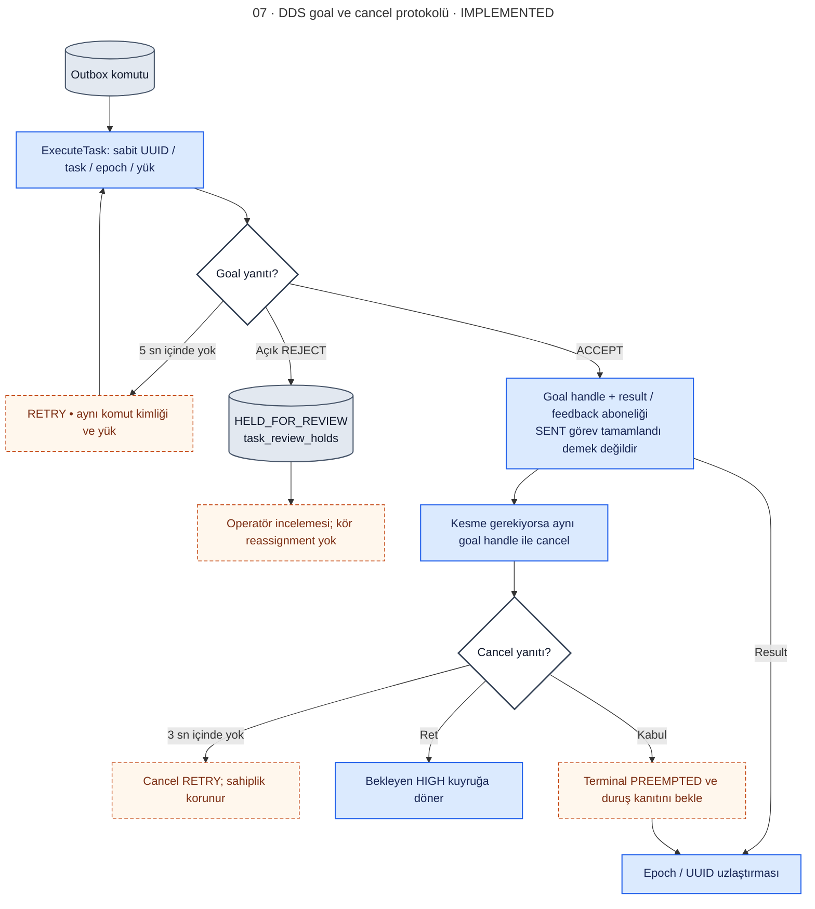

## 08. Assignment epoch ve UUID uzlaştırması

**Durum:** IMPLEMENTED. **Amaç:** Gecikmiş sonuçların yeni atamayı kapatmamasını açıklamak.

| Girdiler | Çıktılar | Karar koşulları |
|---|---|---|
| Action feedback/result/cancel, aktif atama | Uygulanan olay veya STALE | robot/task/assignment_epoch/goal_uuid ve gerçek completed_epoch. |

**Kaynak belge:** [c3-3-1-executor-safety-decisions-2026-10-24.md](../decisions/c3-3-1-executor-safety-decisions-2026-10-24.md) · [c3-3-2-ros2-adapter-decisions-2026-10-24.md](../decisions/c3-3-2-ros2-adapter-decisions-2026-10-24.md)

**Kaynak kod:** [event_loop.py](../../backend/fleet_manager/event_loop.py) · [fleet_manager_core.py](../../backend/fleet_manager/domain/fleet_manager_core.py) · [action_client.py](../../backend/fleet_manager/adapters/action_client.py)

**Test / kanıt:** [test_fleet_manager_outbox.py](../../tests/test_fleet_manager_outbox.py) · [test_ros2_action_client.py](../../tests/test_ros2_action_client.py)

**Sınır / fark:** Terminal sonuçta eksik, geçersiz veya uyuşmayan epoch için `STALE` kaydı ve uyarı üretilir. Görev ve kaynak sahipliği korunur.


Düzenlenebilir Mermaid görünümü

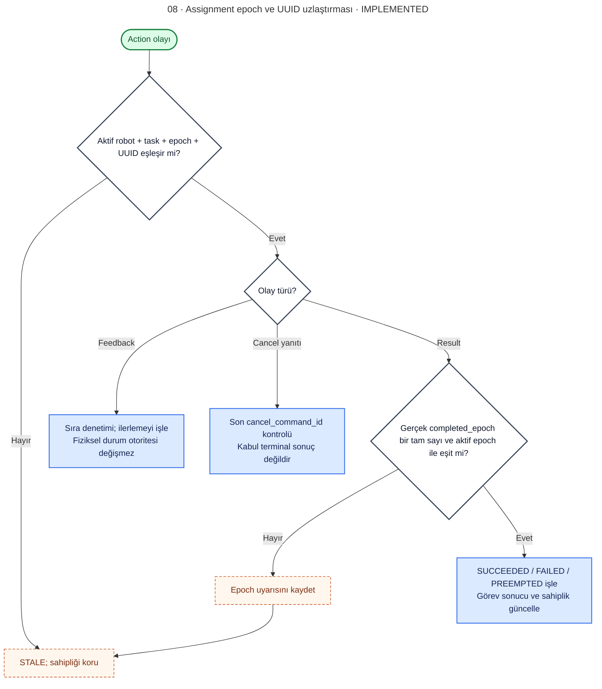

## 09. SQLite Outbox ve tek consumer

**Durum:** IMPLEMENTED. **Amaç:** Bellek ve veritabanının atomik geçişini açıklamak.

| Girdiler | Çıktılar | Karar koşulları |
|---|---|---|
| Thread-safe olaylar ve Outbox gönderim sonuçları | Commit edilmiş durum / kalıcı komut veya rollback | event_id duplicate; transaction dışında ağ; restartta boş DB zorunlu. |

**Kaynak belge:** [c3-2-sqlite-outbox.md](../design/c3-2-sqlite-outbox.md) · [c3-3-2-ros2-adapter-decisions-2026-10-24.md](../decisions/c3-3-2-ros2-adapter-decisions-2026-10-24.md)

**Kaynak kod:** [event_loop.py](../../backend/fleet_manager/event_loop.py) · [store.py](../../backend/fleet_manager/persistence/store.py)

**Test / kanıt:** [test_fleet_manager_outbox.py](../../tests/test_fleet_manager_outbox.py)

**Sınır / fark:** Kuyruk bellektedir; commit öncesi olaylar süreç çökmesinde kalıcı değildir. SENT ağda exactly-once veya görev başarısı garantisi vermez.


Düzenlenebilir Mermaid görünümü

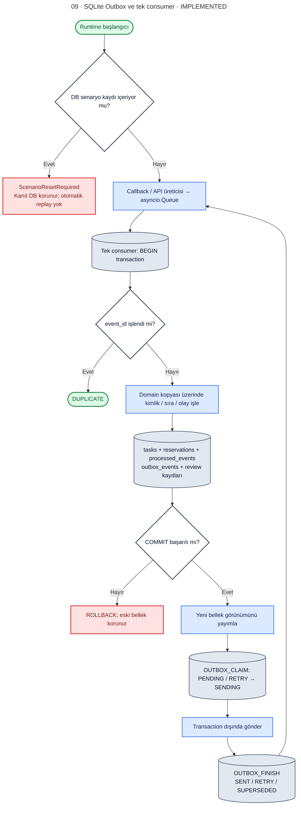

## 10. Wh batarya hesabı

**Durum:** IMPLEMENTED. C4.1 tüketimi, C4.2 telemetriyi ve C4.4 fiziksel şarjı uygular.

| Girdiler | Çıktılar | Karar koşulları |
|---|---|---|
| Gazebo /clock, odometri, k Wh/m, taban güç W, kapasite Wh | Kalan Wh, yüzde SoC, kapasite ve simülasyon damgası | Zaman tüketimi ileri saatte işler. Mesafe yalnız ardışık, geçerli odometri örneklerinden gelir. |

**Kaynak belge:** [Nihai mimari kararlar, bölüm 8](../ROS2_Fleet_Manager_Nihai_Mimari_Kararlar_2026-10-23.md#8-battery-simulator-mimarisi-ve-hesaplama-kuralları)

**Kaynak kod:** [Batarya çekirdeği](../../ros2_ws/src/fleet_battery_simulator/fleet_battery_simulator/consumption.py) · [ROS düğümü](../../ros2_ws/src/fleet_battery_simulator/fleet_battery_simulator/node.py)

**Test / kanıt:** [C4.1 tüketim raporu](../validation/c4/c4-1-validation-2026-11-06.md) · [C4.2 entegrasyon raporu](../validation/c4/c4-2-validation-2026-11-06.md)

**Sınır / fark:** Her düğüm bir robotu izler. Geri sarmada simülatör enerjiyi korur, Executor ve Fleet Manager ise yeni atamayı senaryo resetine kadar kilitler. [C4.4 fiziksel şarjı](../validation/c4/c4-4-validation-2026-11-06.md) kısa süreli sahiplik ve temas kanıtı kullanır.


Düzenlenebilir Mermaid görünümü

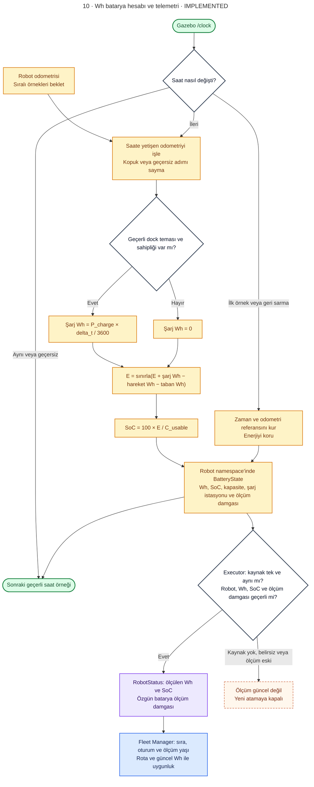

## 11. Şarj sırası ve istasyon seçimi

**Durum:** IMPLEMENTED. Düşük SoC ve FIFO sırası ile dock sahipliğinin yönetimi.

| Girdiler | Çıktılar | Karar koşulları |
|---|---|---|
| Düşük enerji isteği, SoC, talep zamanı, istasyonlar | Rezervasyon veya güvenli bekleme | Düşük SoC önce, eşitlikte FIFO; tek sahiplik. |

**Kaynak belge:** [ROS2_Fleet_Manager_Nihai_Mimari_Kararlar_2026-10-23.md](../ROS2_Fleet_Manager_Nihai_Mimari_Kararlar_2026-10-23.md) · [ROS2_Fleet_Manager_Karar_08_Revize_v1_0.pdf](../ROS2_Fleet_Manager_Karar_08_Revize_v1_0.pdf)

**Kaynak kod:** [reservations.py](../../backend/fleet_manager/domain/reservations.py)

**Test / kanıt:** [test_fleet_manager_domain.py](../../tests/test_fleet_manager_domain.py)

**Sınır / fark:** Şarj için kaynak sahibi ile damgalı fiziksel kanıt eşleşir. [C4.4 kanıtı](../validation/c4/c4-4-validation-2026-11-06.md)


Düzenlenebilir Mermaid görünümü

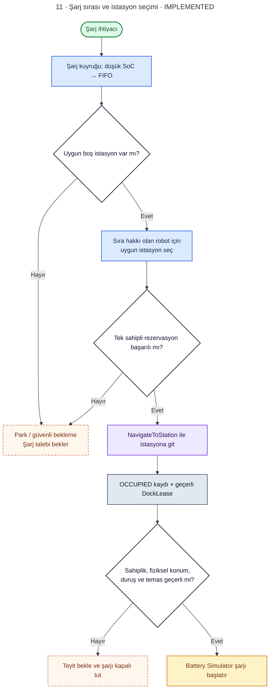

## 12. Şarjdan ayrılma ve yüzde 80

**Durum:** IMPLEMENTED. Görev için erken ayrılma ve %80 sonrası yer verme.

| Girdiler | Çıktılar | Karar koşulları |
|---|---|---|
| Şarjdaki robot, görev uygunluğu, SoC, bekleyen robotlar | Görev için çıkış, yer verme veya şarjda kalma | Dinamik enerji uygunluğu %80 öncesi görev çıkışına izin verir. |

**Kaynak belge:** [ROS2_Fleet_Manager_Nihai_Mimari_Kararlar_2026-10-23.md](../ROS2_Fleet_Manager_Nihai_Mimari_Kararlar_2026-10-23.md) · [ROS2_Fleet_Manager_Karar_08_Revize_v1_0.pdf](../ROS2_Fleet_Manager_Karar_08_Revize_v1_0.pdf)

**Kaynak kod:** [state_machine.py](../../ros2_ws/src/fleet_robot_executor/fleet_robot_executor/state_machine.py)

**Test / kanıt:** [C4.4 şarj politikası ve fiziksel devir](../validation/c4/c4-4-validation-2026-11-06.md)

**Sınır / fark:** Uygun boş robotlara öncelik verilir. Fiziksel ayrılma iki güncel pozla doğrulanır.


Düzenlenebilir Mermaid görünümü

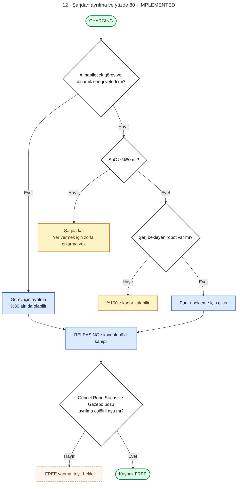

## 13. Park rezervasyonu ve güvenli bekleme

**Durum:** IMPLEMENTED. Görev sonrasında veya düşük SoC ile uygun istasyona yönlendirme.

| Girdiler | Çıktılar | Karar koşulları |
|---|---|---|
| Görev sonucu, enerji, boş park/bekleme alanı, pose | Park/şarj yönlendirmesi veya güvenli duruş; kaynak sahipliği | Fiziksel ayrılmadan FREE yok; hata BLOCKED. |

**Kaynak belge:** [ROS2_Fleet_Manager_Nihai_Mimari_Kararlar_2026-10-23.md](../ROS2_Fleet_Manager_Nihai_Mimari_Kararlar_2026-10-23.md) · [c3-fleet-manager-decisions-2026-10-24.md](../decisions/c3-fleet-manager-decisions-2026-10-24.md) · [c3-3-3-dual-robot-integration-decisions-2026-10-24.md](../decisions/c3-3-3-dual-robot-integration-decisions-2026-10-24.md)

**Kaynak kod:** [station_dispatch.py](../../backend/fleet_manager/domain/station_dispatch.py) · [reservations.py](../../backend/fleet_manager/domain/reservations.py) · [event_loop.py](../../backend/fleet_manager/event_loop.py)

**Test / kanıt:** [C4.3 doğrulaması](../validation/c4/c4-3-validation-2026-11-06.md)

**Sınır / fark:** C4.3 adayları robotun Nav2 rota mesafesiyle sıralar. C4.4 şarj kuyruğunu ve fiziksel dock devrini ekler. Normal bırakma ve operatörün iç `UNBLOCK` olayı ayrı akışlardır. [Fiziksel kanıt koşulları](../design/c3-2-sqlite-outbox.md#istasyon-bırakma-ve-blocked-kurtarma)


Düzenlenebilir Mermaid görünümü

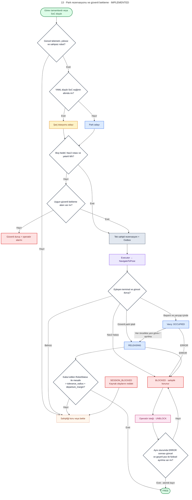

## 14. FAILED / ERROR ve operatör kurtarma

**Durum:** PARTIAL. **Amaç:** Kesin hata, planlama uygunsuzluğu ve iletişim belirsizliğini ayırmak.

| Girdiler | Çıktılar | Karar koşulları |
|---|---|---|
| Nav2 terminal sonuç, iletişim, ClearRobotError ve odometri | FAILED/ERROR, reddedilmiş veya kabul edilmiş manuel kurtarma | expected_epoch eşit; robot ERROR; yüksüz ve güvenli duruş. |

**Kaynak belge:** [ROS2_Fleet_Manager_Nihai_Mimari_Kararlar_2026-10-23.md](../ROS2_Fleet_Manager_Nihai_Mimari_Kararlar_2026-10-23.md) · [c3-3-1-executor-safety-decisions-2026-10-24.md](../decisions/c3-3-1-executor-safety-decisions-2026-10-24.md) · [c3-3-2-ros2-adapter-decisions-2026-10-24.md](../decisions/c3-3-2-ros2-adapter-decisions-2026-10-24.md)

**Kaynak kod:** [node.py](../../ros2_ws/src/fleet_robot_executor/fleet_robot_executor/node.py) · [state_machine.py](../../ros2_ws/src/fleet_robot_executor/fleet_robot_executor/state_machine.py) · [service_client.py](../../backend/fleet_manager/adapters/service_client.py) · [reservations.py](../../backend/fleet_manager/domain/reservations.py)

**Test / kanıt:** [test_clear_robot_error_client.py](../../tests/test_clear_robot_error_client.py) · [test_executor_state_machine.py](../../tests/test_executor_state_machine.py)

**Sınır / fark:** ROS node, ClearRobotError isteğinde duruşu odometriyle denetler. Saf state machine çağrısında odometri verilmezse bu kontrol atlanabilir. Kaynak kurtarma için FM ayrıca operatör isteği ve fiziksel ayrılma kanıtı arar. [İstasyon kurtarma sözleşmesi](../design/c3-2-sqlite-outbox.md#istasyon-bırakma-ve-blocked-kurtarma)


Düzenlenebilir Mermaid görünümü

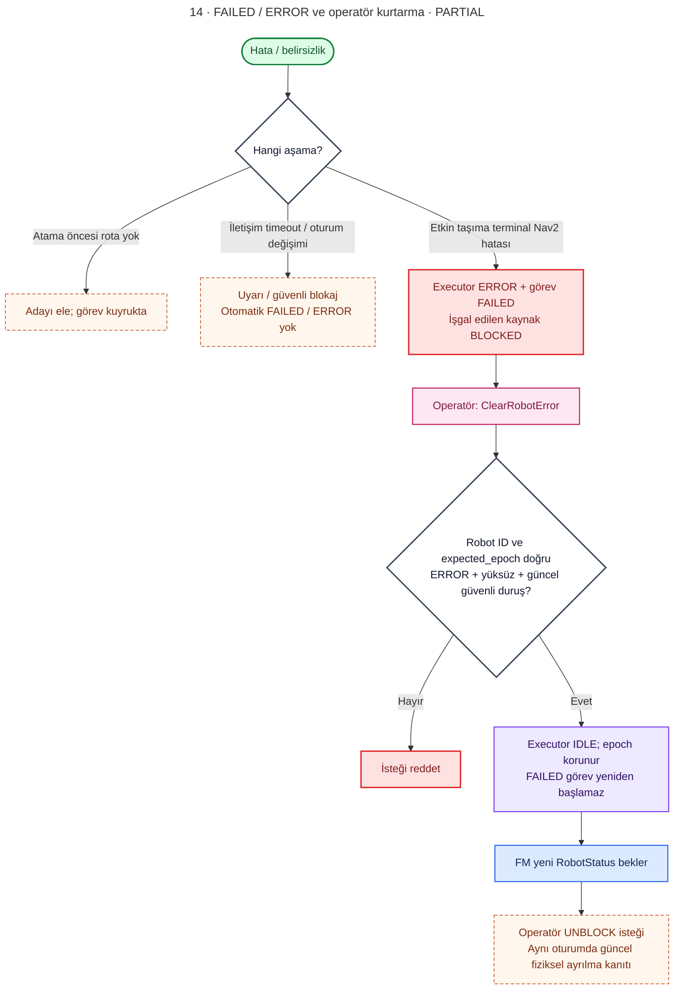

## 15. fleet.yaml yaşam döngüsü

**Durum:** PARTIAL. **Amaç:** Mevcut doğrulama ile planlanan Apply sürecini ayırmak.

| Girdiler | Çıktılar | Karar koşulları |
|---|---|---|
| Tek fleet.yaml, şema, varlık dosyaları; hedef desired_revision | Doğrulanmış config veya açık hata; planlanan running_revision | Duplicate anahtar, tip, birim, benzersizlik, dosya yolu kontrolleri. |

**Kaynak belge:** [configuration-c1.md](../configuration-c1.md) · [ROS2_Fleet_Manager_Nihai_Mimari_Kararlar_2026-10-23.md](../ROS2_Fleet_Manager_Nihai_Mimari_Kararlar_2026-10-23.md) · [architecture-v2.3-transition.md](../architecture/architecture-v2.3-transition.md)

**Kaynak kod:** [loader.py](../../fleet_config/loader.py) · [models.py](../../fleet_config/models.py) · [builder.py](../../backend/fleet_manager/builder.py)

**Test / kanıt:** [test_config.py](../../tests/test_config.py) · [test_fleet_builder.py](../../tests/test_fleet_builder.py)

**Sınır / fark:** C1 kök stations kullanır; onay belirsizliği raporda tutulur. Builder ImportError halinde ham YAML fallback kullanır: doğrulama zinciri bütün başlangıç yollarında zorunlu değildir. Apply API ve revision runtime yoktur.


Düzenlenebilir Mermaid görünümü

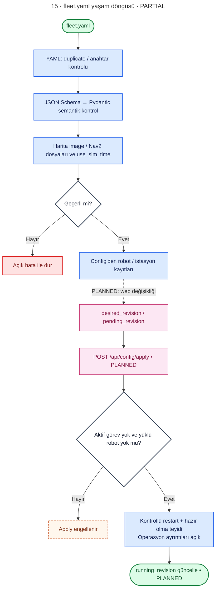

## 16. REST / WebSocket ve 3D panel

**Durum:** PARTIAL. C5 Aşama 1.5 salt okunur operasyon ve 3D TF/Path izlemeyi uygular. 11 Kasım 2026 güncellemesiyle katalogdan görev girişi, yerel soket ve tek consumer bağlantısı eklenmiştir. Host API/SQLite ve Chrome kanıtı ile canlı Nav2 hareket kapsamı [30 × 18 m kaydında](../validation/c5/warehouse-30x18-validation-2026-11-11.md) ayrılır. Kök üç servis kabulü bu kayıtla genişletilmez.

| Girdiler | Çıktılar | Koşullar |
|---|---|---|
| Kabul edilmiş RobotStatus, görev ve rezervasyon kayıtları, ROS TF ve gözlemlenen Nav2 Path | Sürümlü ürün snapshot’ı ve ayrı TF/Path mesajları | Her kaynağın oturum, sıra, zaman ve koordinat çerçevesi ayrı denetlenir. |

[Entegrasyon sözleşmesi](../design/c5-3d-operations.md) kaynak sınırlarını açıklar. [Kaynak kod](../../backend/dashboard) · [Chrome/Fortress doğrulaması](../validation/c5/c5-stage1-5-validation-2026-11-06.md)


Düzenlenebilir Mermaid görünümü

```mermaid
---
title: "16 · REST / WebSocket ve 3D panel · PARTIAL"
---
flowchart LR
 EX["Robot Executor"]:::executor -->|"RobotStatus / terminal sonuç"| Q["FM tek consumer"]:::fm
 Q -->|"Atomik durum ve Outbox kaydı"| DB[("SQLite")]:::db
 Q -->|"Commit sonrası yetkili görünüm"| S["Sınırlı son snapshot"]:::fm
 S -->|"Özel geçici dosya"| API["FastAPI / kaynak sınırı"]:::ui
 ROS["Salt okunur TF / Path köprüsü"]:::executor -->|"Robot ID / map / gözlemlenen plan"| API
 API -->|"Tek WebSocket • ayrı ürün ve TF mesajları"| U["React + Three.js 3D paneli"]:::ui
 API -.->|"Kaynak başına süre ve oturum"| R["Yeniden eşitleme"]:::wait
 R -.-> U
 Y["Tek filo YAML / yaklaşma kataloğu"]:::fm -->|"SDF / harita / sahne"| API
 U -->|"Nokta ID seçimi / istek UUID"| W{"Origin / oturum / profil özeti geçerli mi?"}:::decision
 W -->|"Evet"| I["Yerel görev soketi"]:::ui
 I -->|"SUBMIT_TASK / aynı UUID ile retry"| Q
 W -->|"Hayır"| B["İstek reddi"]:::error

 classDef fm fill:#dbeafe,stroke:#2563eb,color:#172554,stroke-width:1.5px;
 classDef executor fill:#ede9fe,stroke:#7c3aed,color:#2e1065,stroke-width:1.5px;
 classDef battery fill:#fef3c7,stroke:#d97706,color:#78350f,stroke-width:1.5px;
 classDef db fill:#e2e8f0,stroke:#475569,color:#0f172a,stroke-width:1.5px;
 classDef ui fill:#fce7f3,stroke:#be185d,color:#831843,stroke-width:1.5px;
 classDef decision fill:#fff,stroke:#334155,color:#0f172a,stroke-width:2px;
 classDef error fill:#fee2e2,stroke:#dc2626,color:#7f1d1d,stroke-width:2px;
 classDef wait fill:#fff7ed,stroke:#c2410c,color:#7c2d12,stroke-dasharray:5 3;
 classDef terminal fill:#dcfce7,stroke:#15803d,color:#14532d,stroke-width:2px;
```

## 17. Asenkron rota ve önbellek

**Durum:** IMPLEMENTED. Scheduler robot kimliğini üç rota ayağında korur. Ağ sorgusu ve önbelleğe yayın ilgili COMMIT işlemlerinden sonra yapılır.

| Girdiler | Çıktılar | Karar koşulları |
|---|---|---|
| RobotStatus, görev pozları, harita revizyonu, monotonik zaman | Nav2 mesafeleri ve yeniden zamanlama | 0,20 m hücre, 30 sn TTL, 2 sn sorgu timeout. |

**Kaynak belge:** [C3.3.2 kararları](../decisions/c3-3-2-ros2-adapter-decisions-2026-10-24.md) · [Outbox ve rota tasarımı](../design/c3-2-sqlite-outbox.md#canlı-nav2-rota-çözümü)

**Kaynak kod:** [route_planning.py](../../backend/fleet_manager/adapters/route_planning.py) · [route_cache.py](../../backend/fleet_manager/adapters/route_cache.py) · [route_resolver.py](../../backend/fleet_manager/adapters/route_resolver.py)

**Test / kanıt:** [Görev 5+6 doğrulama raporu](../validation/c3/c3-3-4-task-5-6-validation-2026-11-05.md)

**Sınır / fark:** Canlı harita revizyonu bildiriminin kaynağı çalışma ortamına bağlıdır. T03 bağımsız planner sondası kendi önbelleğini yönetir.


Düzenlenebilir Mermaid görünümü

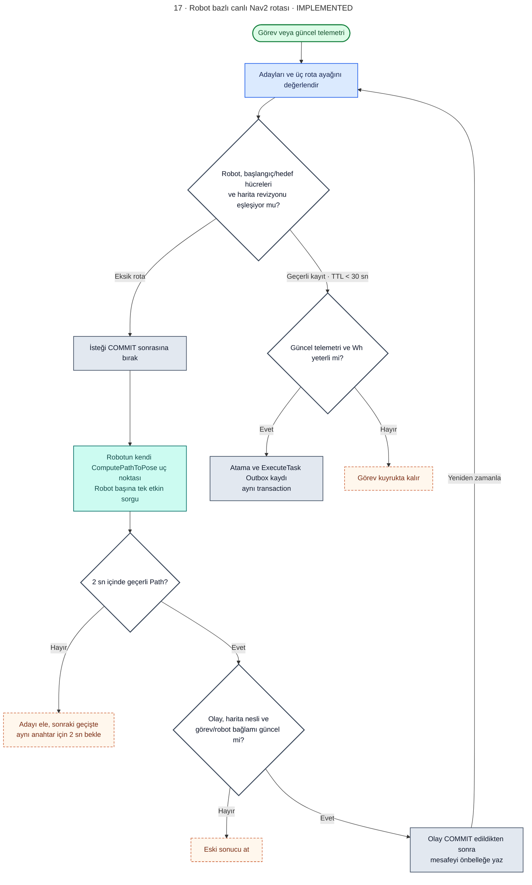

## 18. Duplicate kayıtları ve restart engeli

**Durum:** PARTIAL. **Amaç:** Tekrar teslimin ikinci yürütme üretmemesini açıklamak.

| Girdiler | Çıktılar | Karar koşulları |
|---|---|---|
| task_id, epoch, goal UUID, değişmez yük, reset kanıtı | Tek yürütme kaydı veya ret/blokaj | Senaryo boyunca kayıt; kapasitede tahliye yok; restart otomatik replay değil. |

**Kaynak belge:** [c3-3-1-executor-safety-decisions-2026-10-24.md](../decisions/c3-3-1-executor-safety-decisions-2026-10-24.md) · [c3-3-2-ros2-adapter-decisions-2026-10-24.md](../decisions/c3-3-2-ros2-adapter-decisions-2026-10-24.md)

**Kaynak kod:** [safety.py](../../ros2_ws/src/fleet_robot_executor/fleet_robot_executor/safety.py) · [node.py](../../ros2_ws/src/fleet_robot_executor/fleet_robot_executor/node.py)

**Test / kanıt:** [test_executor_safety.py](../../tests/test_executor_safety.py) · [test_executor_safety_ros2.py](../../tests/test_executor_safety_ros2.py)

**Sınır / fark:** Ürün düzeyinde operatör reset prosedürü ve terminal duplicate sonucunu yeniden sunma protokolü tamamlanmamıştır; test harness kabul açılması ürün reset API’si değildir.


Düzenlenebilir Mermaid görünümü

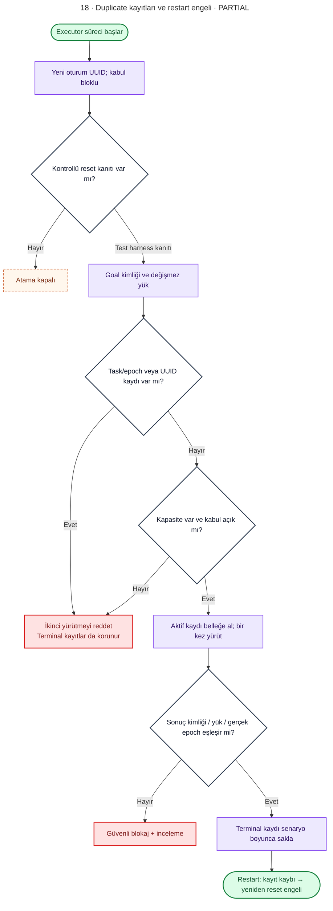

## Üretim ve doğrulama

Mermaid CLI 11.12.0 ile kaynaklar SVG'ye çevrilir; bu araç ürün bağımlılığı değildir. Komutlar, görüntü denetimi ve sınırlar [doğrulama komut ekinde](../validation/organization/organization-commands-2026-10-26.md) bulunur. GitHub sunucusunda render testi yapılmadı; yerel Mermaid render ve SVG gömme kontrolü bununla karıştırılmaz.

## Eksik akışlar

C4 şarj kuyruğu, erken ayrılma ve otomatik park orkestrasyonu; C5 REST/WS/panel; kontrollü Apply ve ürün reset prosedürü tamamlanmamıştır. Genişletilmiş iki robotlu takas MVP'de kapalıdır; onaysız yürütme algoritması çizilmedi. Küresel trafik/deadlock çözücüsü kapsam dışıdır.
