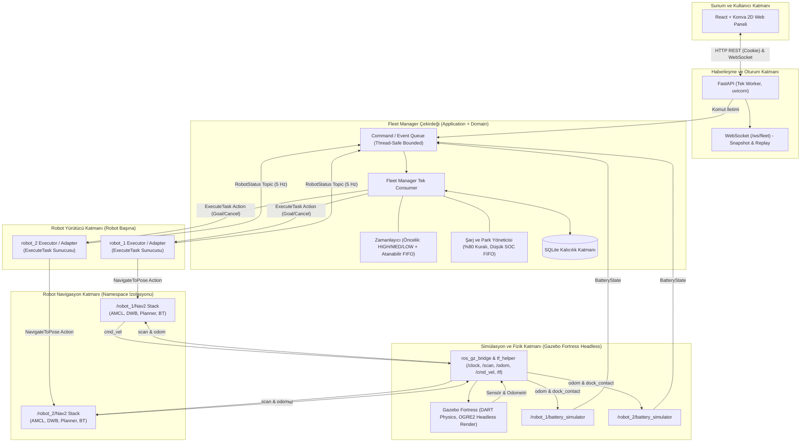
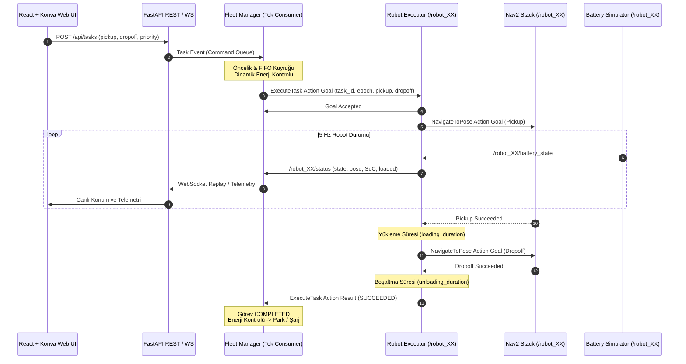
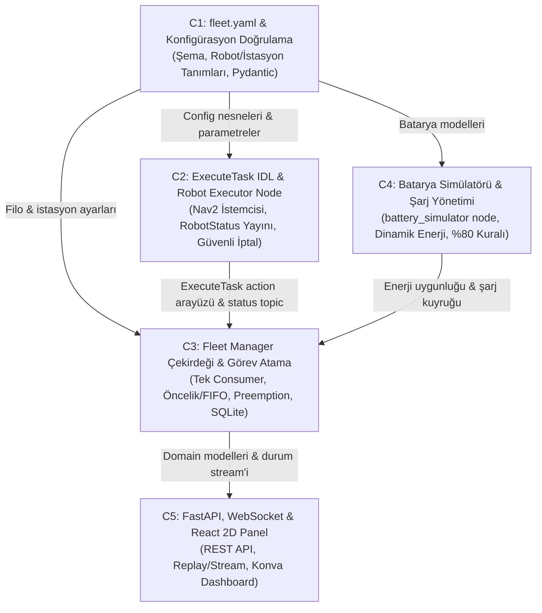

# AŞAMA B4 — Kapsamlı Dokümantasyon ve Mimari Hazırlık Denetim Raporu

**Rapor Tarihi:** 23 Ekim 2026  
**Denetlenen Depo:** `ros2-fleet-manager`  
**Denetim Kapsamı:** Depo içi tüm dokümantasyon (`docs/`), mimari kararlar, test kanıtları, yapılandırmalar ve mevcut kaynak kodlar.  
**Denetim Statüsü:** Tamamlandı (Salt okunur inceleme ve tarafsız teknik değerlendirme).

---

## 1. Yönetici Özeti

Bu denetim raporu, `ros2-fleet-manager` projesinde A, B1, B2, AMCL doğrulaması, B3 ve B3 Retry simülasyon aşamalarının tamamlanmasının ardından, C aşamasına (Fleet Manager yazılımının geliştirilmesi) geçiş öncesinde mevcut teknik durumu, mimari bütünlüğü ve kod-dokümantasyon uyumunu değerlendirmek amacıyla hazırlanmıştır.

İnceleme sonucunda öne çıkan temel bulgular şunlardır:
1. **Simülasyon Altyapısı Başarıyla Doğrulandı:** Robotik ve simülasyon temeli sağlamdır. ROS 2 Humble, Cyclone DDS (Domain ID: 42), Gazebo Fortress headless yazılım render'ı (OGRE2 + EGL), Lidar sensörü (5 Hz, 180 ışın), harita sunumu, AMCL lokalizasyonu ve ayrık isim alanlarında (`/robot_1`, `/robot_2`) paralel Nav2 yığınları B3 Retry oturumunda 2/2 temiz koşu ile Gazebo Ground Truth <= 0.35 m toleransı dahilinde doğrulanmıştır.
2. **Uygulama Kodu Henüz Başlamadı:** Depo kök dizinindeki `backend/`, `frontend/`, `ros2_ws/src/` ve `tests/` klasörleri tamamen boştur. Mevcut kod tabanı yalnızca simülasyon test harness'ları, Dockerfile'lar, birim testleri ve yapılandırma dosyalarından ibarettir.
3. **Mimari Yön Değişimi Onaylandı:** Kullanıcı tarafından 22 Ekim 2026 tarihinde onaylanan [v2.3 Mimari Geçiş Kaydı](architecture-v2.3-transition.md) uyarınca, eski doğrudan Nav2 taşıma akışı (Fleet Manager -> NavigateToPose) yürürlükten kaldırılmış; `Fleet Manager -> ExecuteTask -> Robot Executor -> NavigateToPose -> Nav2` akışı esas alınmıştır.
4. **Kritik Mimari Çelişkiler ve Bekleyen Kararlar:**
   - **Docker Yerleşimi:** 3 servisli (`simulation`, `backend`, `frontend`) Docker yerleşimi halen onaylanmamış bir öneridir ([docker-placement-decision.md](docker-placement-decision.md) taslak statüsündedir).
   - **Enerji Modeli:** Revize Karar 08 Wh bazlı dinamik enerji modeli ($E_{required} \le E_{available}$) tanımlarken, Battery Simulator v1.2 FIX dokümanı yüzde/kesir (0..1) tabanlı tüketim modeli tanımlamaktadır.
   - **Görev Atama Algoritması:** Eski tasarım dokümanlarındaki maliyet ağırlıklı (CostBased) atama formülü ile Revize Karar 08'deki Öncelik + FIFO + Güvenli Kesme (Preemption) kuralları çelişmektedir.
5. **Nihai Karar: B — KOŞULLU HAZIR.** C1 aşamasına (konfigürasyon altyapısı) geçiş için teknik bir engel yoktur; ancak C1 şeması kilitlenirken ve C2-C3 aşamalarına geçilmeden önce açık kararlar netleştirilmelidir.

---

## 2. Doküman Envanteri

`docs/` dizini ve alt klasörlerindeki tüm dosyalar taranmış, içerikleri eksiksiz incelenmiştir. Hiçbir dosya sessizce atlanmamıştır. Depoda okunamayan dosya bulunmamaktadır.

| Dosya Yolu ve Biçimi | Belgenin Amacı | Ele Aldığı Bileşen | Belge Tarihi / Sürüm | Sınıfı | Güncellik Durumu | İlişkili Belgeler |
|---|---|---|---|---|---|---|
| `docs/project-context.md` (Markdown) | Proje bağlamı, değişmez kullanıcı kuralları ve kaynak öncelik hiyerarşisi | Tüm Sistem | 23 Ekim 2026 | Politika / Kılavuz | **Güncel / Otorite** | [AGENTS.md](../AGENTS.md), [Karar 08](ROS2_Fleet_Manager_Karar_08_Revize_v1_0.pdf) |
| `docs/architecture-v2.3-transition.md` (Markdown) | ExecuteTask / Robot Yürütücüsü yönü ve durum otoritesi sınırları | Robot Executor, FM, Nav2 | 22 Ekim 2026 / v2.3 | Mimari Geçiş Kaydı (Onaylı) | **Güncel / Otorite** | [Karar 08](ROS2_Fleet_Manager_Karar_08_Revize_v1_0.pdf), [project-context.md](project-context.md) |
| `docs/docker-placement-decision.md` (Markdown) | DDS mesaj alma kanıtı sonrası iki container yerleşimi onay taslağı | Docker Dağıtımı | 23 Ekim 2026 | Karar Taslağı | **Taslak (Onay Bekliyor)** | [dds-validation-2026-10-22.md](dds-validation-2026-10-22.md) |
| `docs/requirements.md` (Markdown) | Sistem gereksinimleri | Genel Sistem | - | Şartname | **Geçersiz (Dosya Boş, 0 Byte)** | [project-context.md](project-context.md) |
| `docs/architecture.md` (Markdown) | Eski mimari notları | Sistem Mimarisi | Eski (v2.3 başlığı eklenmiş) | Tasarım Özeti | **Kısmen Geçersiz / Eski** (`stations.yaml` gibi eski referanslar var) | [architecture-v2.3-transition.md](architecture-v2.3-transition.md) |
| `docs/setup.md` (Markdown) | Kurulum adımları | Ortam Kurulumu | - | Kılavuz | **Geçersiz (Dosya Boş, 0 Byte)** | [README.md](../README.md) |
| `docs/ROS2_Fleet_Manager_Karar_08_Revize_v1_0.pdf` (PDF, 29 sayfa) | Görev önceliklendirme, preemption, enerji yönetimi, şarj ve park kuralları | Fleet Manager, Scheduler | 22 Ekim 2026 / v1.0 Taslak | Mimari Karar Belgesi | **Güncel Mimari Referans** (Revize hükümler kilitli) | [project-context.md](project-context.md), [hand_notes_1.pdf](hand_notes_1.pdf) |
| `docs/hand_notes_1.pdf` (PDF, 9 sayfa) | Kullanıcının ilk mimari çizimleri, durum makineleri ve teknoloji tercihleri | Tüm Sistem | Ekim 2026 | Kişisel Notlar / Tasarım | **Tarihsel Referans** (Karar 08 ile çelişen kısımları geçersiz) | [ROS2_Fleet_Manager_Karar_08_Revize_v1_0.pdf](ROS2_Fleet_Manager_Karar_08_Revize_v1_0.pdf) |
| `docs/design/config_driven_multi_robot_ros2_nav2_architecture_tr_v1_3_fix.pdf` (PDF, 9 sayfa) | Config-driven altyapı, fleet.yaml şeması, 3 revision ve Apply protokolü | Konfigürasyon, Launch | 09 Ekim 2026 / v1.3 FIX | Teknik Tasarım | **Büyük Ölçüde Geçerli** (Atama kısımları Karar 08 ile güncellenmeli) | [fleet_manager_mimarisi_ve_algoritmalar_v2_2_fix.pdf](design/fleet_manager_mimarisi_ve_algoritmalar_v2_2_fix.pdf) |
| `docs/design/battery_simulator_node_architecture_v1_2_fix.pdf` (PDF, 4 sayfa) | Batarya simülatörü ROS 2 düğümü, tüketim ve şarj denklemleri | Battery Simulator | 09 Ekim 2026 / v1.2 FIX | Teknik Tasarım | **Geçerli** (Birim ve katsayı uyumu Karar 08 ile uzlaştırılmalı) | [fleet.yaml](../config/fleet.yaml) |
| `docs/design/fleet_manager_mimarisi_ve_algoritmalar_v2_2_fix.pdf` (PDF, 11 sayfa) | Fleet Manager iç katmanları, durum makineleri ve SQLite kalıcılığı | Fleet Manager Core | 09 Ekim 2026 / v2.2 FIX | Teknik Tasarım | **Kısmen Geçersiz** (Doğrudan Nav2 akışı v2.3 ile; CostBased formülü Karar 08 ile değişti) | [architecture-v2.3-transition.md](architecture-v2.3-transition.md), [Karar 08](ROS2_Fleet_Manager_Karar_08_Revize_v1_0.pdf) |
| `docs/design/fastapi_websocket_web_panel_mimarisi_v1_2_fix.pdf` (PDF, 9 sayfa) | REST API, WebSocket stream/replay, session yönetimi ve UI sözleşmesi | Web Backend & UI | 09 Ekim 2026 / v1.2 FIX | Teknik Tasarım | **Güncel / Geçerli** | [README.md](../README.md) |
| `docs/dds-validation-2026-10-22.md` (Markdown) | İki container arası minimal DDS topic iletişim testi raporu | DDS / Ağ Altyapısı | 23 Ekim 2026 | Test Raporu (GEÇTİ) | **Arşivlenmiş Kanıt** | [docker-compose.dds.yml](../docker-compose.dds.yml) |
| `docs/dds-action-validation-2026-10-23.md` (Markdown) | İki container arası action (TransportProbe) iletişim testi raporu | DDS Action Altyapısı | 23 Ekim 2026 | Test Raporu (GEÇTİ) | **Arşivlenmiş Kanıt** | [docker-compose.dds-action.yml](../docker-compose.dds-action.yml) |
| `docs/simulation-validation-2026-10-23.md` (Markdown) | Aşama A: Tek robot Gazebo DiffDrive hareket doğrulaması | Simülasyon Temeli | 23 Ekim 2026 | Test Raporu (GEÇTİ) | **Arşivlenmiş Kanıt** | [docker-compose.simulation-check.yml](../docker-compose.simulation-check.yml) |
| `docs/simulation-stage-b-2026-10-23.md` (Markdown) | Aşama B1: Headless Gazebo OGRE2 Lidar sensör doğrulaması | Lidar & Render | 23 Ekim 2026 | Test Raporu (GEÇTİ) | **Arşivlenmiş Kanıt** | [simulation-stage-b-commands-2026-10-23.md](simulation-stage-b-commands-2026-10-23.md) |
| `docs/simulation-stage-b-commands-2026-10-23.md` (Markdown) | Aşama B1 komut, log ve hata dökümleri | Lidar & Render | 23 Ekim 2026 | Test Kanıt Eki | **Arşivlenmiş Kanıt** | [simulation-stage-b-2026-10-23.md](simulation-stage-b-2026-10-23.md) |
| `docs/simulation-stage-b2-2026-10-23.md` (Markdown) | Aşama B2: Nav2 paket kurulumu ve durma noktası | Nav2 Kurulumu | 23 Ekim 2026 | Test Raporu (DURULDU) | **Tarihsel Rapor** (Devam kaydıyla tamamlandı) | [simulation-stage-b2-continuation-2026-10-23.md](simulation-stage-b2-continuation-2026-10-23.md) |
| `docs/simulation-stage-b2-commands-2026-10-23.md` (Markdown) | Aşama B2 ilk komut dökümleri | Nav2 Kurulumu | 23 Ekim 2026 | Test Kanıt Eki | **Arşivlenmiş Kanıt** | [simulation-stage-b2-2026-10-23.md](simulation-stage-b2-2026-10-23.md) |
| `docs/simulation-stage-b2-continuation-2026-10-23.md` (Markdown) | Aşama B2 Devam: Tek robot Nav2 otonom sürüş doğrulaması | Nav2 & AMCL | 23 Ekim 2026 | Test Raporu (GEÇTİ) | **Arşivlenmiş Kanıt** | [simulation-stage-b2-continuation-commands-2026-10-23.md](simulation-stage-b2-continuation-commands-2026-10-23.md) |
| `docs/simulation-stage-b2-continuation-commands-2026-10-23.md` (Markdown) | Aşama B2 Devam komut ve log dökümleri | Nav2 & AMCL | 23 Ekim 2026 | Test Kanıt Eki | **Arşivlenmiş Kanıt** | [simulation-stage-b2-continuation-2026-10-23.md](simulation-stage-b2-continuation-2026-10-23.md) |
| `docs/simulation-stage-amcl-test-2026-10-23.md` (Markdown) | Bölüm B: Kasıtlı ofsetli AMCL yakınsama ve Ground Truth sınaması | AMCL Doğruluğu | 23 Ekim 2026 | Test Raporu (1 Geçti / 1 Kaldı) | **Arşivlenmiş Kanıt** | [simulation-stage-amcl-test-commands-2026-10-23.md](simulation-stage-amcl-test-commands-2026-10-23.md) |
| `docs/simulation-stage-amcl-test-commands-2026-10-23.md` (Markdown) | Bölüm B komut ve sayısal hata dökümleri | AMCL Doğruluğu | 23 Ekim 2026 | Test Kanıt Eki | **Arşivlenmiş Kanıt** | [simulation-stage-amcl-test-2026-10-23.md](simulation-stage-amcl-test-2026-10-23.md) |
| `docs/simulation-stage-b3-2026-10-23.md` (Markdown) | Aşama B3: İki robotlu Nav2 ilk doğrulama oturumu | Çok Robotlu Nav2 | 23 Ekim 2026 | Test Raporu (1 Başarı / 1 Hata / 1 Durma) | **Tarihsel Rapor** (B3 Retry ile tamamlandı) | [simulation-stage-b3-retry-2026-10-23.md](simulation-stage-b3-retry-2026-10-23.md) |
| `docs/simulation-stage-b3-commands-2026-10-23.md` (Markdown) | Aşama B3 ilk komut ve hata dökümleri | Çok Robotlu Nav2 | 23 Ekim 2026 | Test Kanıt Eki | **Arşivlenmiş Kanıt** | [simulation-stage-b3-2026-10-23.md](simulation-stage-b3-2026-10-23.md) |
| `docs/simulation-stage-b3-retry-2026-10-23.md` (Markdown) | Aşama B3 Yeniden Koşusu: İki robotlu Nav2 ve host kaynak ölçümü | Çok Robotlu Nav2 | 23 Ekim 2026 | Test Raporu (2/2 GEÇTİ) | **Güncel / Otorite Test Kanıtı** | [simulation-stage-b3-retry-commands-2026-10-23.md](simulation-stage-b3-retry-commands-2026-10-23.md) |
| `docs/simulation-stage-b3-retry-commands-2026-10-23.md` (Markdown) | Aşama B3 Yeniden Koşusu komut, host stats ve log dökümleri | Çok Robotlu Nav2 | 23 Ekim 2026 | Test Kanıt Eki | **Güncel / Otorite Test Kanıtı** | [simulation-stage-b3-retry-2026-10-23.md](simulation-stage-b3-retry-2026-10-23.md) |

---

## 3. Projenin Amaçları ve Kapsamı

### 3.1 Temel Hedef
Sistem, depo benzeri iç mekanlarda çalışan birden fazla mobil robotun (TurtleBot3 Burger modeli temel alınarak) tek bir merkezden izlenmesini ve yönetilmesini amaçlar. Kullanıcı web arayüzünden **Alım (Pickup) -> Teslim (Dropoff)** görevleri tanımlar. Sistem, görevleri robotların konumuna, operasyonel durumuna ve dinamik enerji yeterliliğine göre sıralar, atar ve uçtan uca yürütür.

### 3.2 Kapsam Sınırları ve Seviyeleri
- **MVP Kapsamı:**
  - Tek yapılandırma dosyasından (`config/fleet.yaml`) beslenen filo yönetimi.
  - Hedef filo: 2 robot (minimum gereksinim).
  - Gazebo headless simülasyonu (fizik ve sensör simülasyonu; web'e video akışı aktarılmaz).
  - Robot başına ayrık isim alanı (`/robot_1`, `/robot_2`) altında bağımsız Nav2 ve AMCL yığını.
  - Robot başına `battery_simulator` düğümü ile gerçekçi şarj tüketimi ve istasyon teması.
  - Fleet Manager çekirdeği (Tek consumer olay döngüsü, SQLite kalıcılığı, öncelik ve FIFO kuyruğu, güvenli kesme).
  - `ExecuteTask` action arayüzü ile robot yürütücüsü (Robot Executor) koordinasyonu.
  - FastAPI tabanlı REST API ve düşük gecikmeli WebSocket olay/telemetri yayını.
  - React + Konva tabanlı 2D harita ve filo takip paneli.
- **Stretch Kapsamı:** 3. robot desteği, web üzerinden senaryo başlatma, gelişmiş istatistik paneli.
- **Kesin Kapsam Dışı (Out of Scope):**
  - Gerçek robot donanımı entegrasyonu.
  - Çok robotlu dar koridor trafik rezervasyonu ve küresel çarpışmasız ortak rota planlama (robotların birbirini engellemesi yerel costmap katmanına bırakılmıştır).
  - Manipülatör ve otomatik yükleme/boşaltma donanım protokolleri (yükleme süreleri simüle edilmiş zamanlayıcılarla yönetilir).
  - Şarj istasyonu elektriksel/mekanik arızaları.
  - Çoklu aktif Fleet Manager yüksek erişilebilirliği (High Availability).
  - Canlı Fleet Manager restartı sonrasında yarım kalmış görevlerin otomatik kurtarılması (Recovery MVP'de kontrollü senaryo resetine dayanır).

---

## 4. Mevcut Sistem Mimarisi

Sistemin onaylı güncel mimarisi, [Revize Karar 08](ROS2_Fleet_Manager_Karar_08_Revize_v1_0.pdf) ve [v2.3 Mimari Geçiş Kaydı](architecture-v2.3-transition.md) hükümlerine dayanmaktadır.

### 4.1 Onaylı Görev Yürütme Akışı
Eski v2.x mimarisindeki doğrudan Nav2 sürüşü geçersiz kılınmıştır. Güncel sorumluluk zinciri:
1. **İstemci:** Web paneli veya test betiği `POST /api/tasks` ile görevi kuyruğa ekler.
2. **Fleet Manager:** Öncelik ve atanabilir FIFO kurallarına göre en uygun boş robotu seçer.
3. **ExecuteTask Çağrısı:** Fleet Manager, seçilen robota ait yürütücü düğüme (`/<robot_id>/execute_task`) action hedefi gönderir.
4. **Robot Yürütücüsü (Executor):**
   - Pickup noktasına `NavigateToPose` gönderir.
   - Yükleme fazını (`LOADING`) simüle eder (yük sensör/operatör onayı ile `ONBOARD` olur).
   - Dropoff noktasına `NavigateToPose` gönderir.
   - Boşaltma fazını (`UNLOADING`) simüle eder (`NONE`).
   - Görev sonucunu (`SUCCEEDED`, `FAILED`, `PREEMPTED`) Fleet Manager'a action result olarak döndürür.
5. **Durum Otoritesi:** Robotun anlık fiziksel fazı (`state`), yük bilgisi (`loaded`), batarya yüzdesi (`battery_soc`) ve konumu Robot Yürütücüsü tarafından `/<robot_id>/status` topic'i üzerinden 5 Hz frekansla yayımlanır. Fleet Manager bu verinin tek tüketicisidir.

---

## 5. Bileşen Bazlı Uygulama Durumu

Aşağıdaki tablo, dokümantasyonda tarif edilen mimari bileşenlerin depodaki gerçek kaynak kod ve test kanıtlarıyla karşılaştırmasını sunar.

| Bileşen / Özellik | Tasarım Referansı | Depodaki Durum | Test Türü | Sınıflandırma | Kanıt ve Gerekçe |
|---|---|---|---|---|---|
| **Cyclone DDS Çoklu Container Topic İletişimi** | Karar 08, dds-validation | `docker/dds/probe.py` | Entegrasyon / Canlı Container | **TESTED** | `dds-validation-2026-10-22.md`; Compose bridge ağı üzerinden mesaj alımı ve çıkış kodu 0 doğrulandı. |
| **Cyclone DDS Action İletişimi (Goal, Cancel)** | Karar 08, dds-action | `docker/dds/action_probe.py`, `TransportProbe.action` | Entegrasyon / Canlı Container | **TESTED** | `dds-action-validation-2026-10-23.md`; goal kabulü, feedback, SUCCEEDED ve cancel doğrulandı. |
| **Gazebo Headless Temel Fizik ve Odometri (Aşama A)** | Karar 08 S20, simulation-validation | `docker/simulation-check/check.py`, `world.sdf.in` | Canlı Simülasyon Testi | **TESTED** | `simulation-validation-2026-10-23.md`; DART motoru ve DiffDrive ile 0.60 m odometri yer değiştirmesi alındı. |
| **OGRE2 Headless Lidar Sensörü (Aşama B1)** | Karar 08 S20, simulation-stage-b | `docker/simulation-lidar-check/check.py` | Canlı Simülasyon Testi | **TESTED** | `simulation-stage-b-2026-10-23.md`; EGL yazılım render ve OGRE2 dev shader paketiyle 10 scan, analitik duvar hatası 4.3 mm doğrulandı. |
| **Tek Robot Nav2 ve Harita Entegrasyonu (Aşama B2)** | v2.3 Geçiş, simulation-stage-b2 | `docker/simulation-nav2-check/check.py`, `map.yaml` | Canlı Simülasyon Testi | **TESTED** | `simulation-stage-b2-continuation-2026-10-23.md`; 6/6 lifecycle active, STATUS_SUCCEEDED, tolerans < 0.35 m alındı. |
| **AMCL Gerçek Yakınsama Sınaması (Bölüm B)** | Karar 08 S5, simulation-stage-amcl | `docker/simulation-amcl-test/check.py` | Canlı Simülasyon Testi | **TESTED** | `simulation-stage-amcl-test-2026-10-23.md`; Kasıtlı 0.58 m ofsette Koşu 1 geçti (0.38 m), Koşu 2 kaldı (0.4019 m > 0.4000 m). |
| **Çok Robotlu Bağımsız Nav2 (Aşama B3 Retry)** | Karar 08 S5, simulation-stage-b3-retry | `docker/simulation-b3-retry/check.py`, `run_b3_retry.py` | Canlı Simülasyon Testi | **TESTED** | `simulation-stage-b3-retry-2026-10-23.md`; İki robot paralel STATUS_SUCCEEDED, Ground Truth toleransı <= 0.35 m (2/2 temiz koşu). |
| **Simülasyon Test Yapılandırma ve Şema Doğrulayıcıları** | Config-Driven v1.3 | `docker/*/test_config.py`, `config/*.schema.json` | Birim / Yapılandırma Testi | **TESTED** | Python unittest ile tüm test config şemaları ve sınır değerleri doğrulandı. |
| **Tek Konfigürasyon Dosyası (`config/fleet.yaml`)** | Config-Driven v1.3 S1-2 | Mevcut değil | - | **DESIGNED** | Depoda henüz `fleet.yaml` dosyası oluşturulmamıştır; yalnızca test config JSON'ları mevcuttur. |
| **ExecuteTask Action Arayüz Tanımı (IDL)** | Karar 08 S17, v2.3 Geçiş | Mevcut değil | - | **DESIGNED** | `interfaces/` altında yalnızca geçici `TransportProbe.action` vardır; `ExecuteTask.action` yazılmamıştır. |
| **Robot Executor / Adapter Düğümü** | Karar 08 S5, v2.3 Geçiş | Mevcut değil | - | **DESIGNED** | `ros2_ws/src` altında paket veya Python düğümü bulunmamaktadır. |
| **Fleet Manager Domain ve Çekirdek Modeli** | Karar 08 S6-12, FM v2.2 | Mevcut değil | - | **DESIGNED** | `backend/` klasörü boştur; task, robot, event domain modelleri yazılmamıştır. |
| **Öncelik ve Atanabilir FIFO Zamanlayıcısı** | Karar 08 S8, 12 | Mevcut değil | - | **DESIGNED** | Pseudocode düzeyinde kalmıştır, Python uygulaması yoktur. |
| **Güvenli Preemption ve N=2 Kesilme Koruması** | Karar 08 S3, 8, 12 | Mevcut değil | - | **DESIGNED** | Kurallar belirlenmiş ancak kodlanmamıştır. |
| **%15 İki Robotlu Takas (Swap) Algoritması** | Karar 08 S9-10 | Mevcut değil | - | **DESIGNED** | Karar 08 gereği MVP sonrasına (Aşama 5) ertelenmiştir. |
| **Battery Simulator Düğümü (`battery_simulator`)** | Battery Sim v1.2 FIX | Mevcut değil | - | **DESIGNED** | ROS düğümü kodu mevcut değildir. |
| **Dinamik Enerji Yeterlilik Modeli** | Karar 08 S13 | Mevcut değil | - | **DESIGNED** | Wh bazlı formülasyon pseudocode olarak mevcuttur. |
| **Şarj İstasyonu ve Park Rezervasyon Yöneticisi** | Karar 08 S14-15 | Mevcut değil | - | **DESIGNED** | Durum geçişleri tasarlanmış, kodu yazılmamıştır. |
| **ClearRobotError ve Manuel Hata Kurtarma** | Karar 08 S28 | Mevcut değil | - | **DESIGNED** | Servis sözleşmesi tasarlanmış, kodu yazılmamıştır. |
| **FastAPI REST API ve WebSocket Uçları** | Web Panel v1.2 FIX S1-3 | Mevcut değil | - | **DESIGNED** | Uç sözleşmeleri hazırdır, FastAPI sunucusu yazılmamıştır. |
| **React + Konva 2D Web Gösterge Paneli** | Hand Notes S1-3, Web Panel v1.2 | Mevcut değil | - | **DESIGNED** | `frontend/` klasörü boştur. |
| **3 Servisli Docker Compose Mimarisi** | docker-placement-decision | Mevcut değil | - | **UNKNOWN / DESIGNED** | Taslak seviyesindedir; kullanıcı tarafından onaylanmamıştır. |

---

## 6. Tamamlanan Testler ve Kanıtlar

Depoda tamamlanan tüm testler simülasyon ve DDS entegrasyonu odaklıdır. Test kanıtları, hata geçmişleri ve çıkış kodları titizlikle incelenmiştir.

### 6.1 Aşama A: Tek Robotlu Temel Fizik ve Köprü Doğrulaması
- **Amaç:** Headless Gazebo Fortress içinde robotun DiffDrive ile sürülmesi, `/clock` ve `/odom` verisinin bridge üzerinden backend'e aktarılması.
- **Uygulanan Altyapı:** Gazebo Fortress, DART fizik motoru (`libignition-physics5-dartsim`), `ros_gz_bridge`.
- **Test Yöntemi:** Backend probe düğümü `/cmd_vel` basarak 4 saniye boyunca robotu ileri sürmüş ve odometri farkını ölçmüştür.
- **Başarı Kriterleri:** Odometri yer değiştirmesinin 0.55 m ile 0.65 m arasında olması ve simülasyon saatinin en az 4 saniye ilerlemesi.
- **Gerçek Sonuçlar:** Koşu 4 ve Koşu 5'te yer değiştirme tam olarak **0.6000 m** ölçülmüş; simülasyon saati 4.0 saniye ilerlemiş ve çıkış kodu 0 ile tamamlanmıştır.
- **Başarısız Denemeler ve Düzeltmeler:**
  - Koşu 1 ve 2: Sistem eklentilerinin paylaşımlı kütüphane dosyaları bulunamadı (`libignition-gazebo6-plugins` ve DART eksikti).
  - Koşu 3: DART motor eklentisi ABI 5 soname eksikliği nedeniyle yüklenemedi. `--physics-engine` parametresiyle tam dosya yolu verilerek çözüldü.
- **Kalan Sınırlamalar:** Sensör ve Nav2 içermez.
- **Sonuç:** **GEÇTİ.**

### 6.2 Aşama B1: Headless OGRE2 Lidar Doğrulaması
- **Amaç:** ARM64 mimarisinde headless ortamda OGRE2 yazılım render'ı ile gerçek Lidar (`LaserScan`) verisi üretmek.
- **Uygulanan Altyapı:** `libignition-rendering6-ogre2`, `libignition-rendering6-ogre2-dev`, EGL surfaceless, Mesa yazılım render (`LIBGL_ALWAYS_SOFTWARE=1`).
- **Test Yöntemi:** 10x10 m odada robotun 1.95 m önüne yerleştirilen analitik duvara karşı 31 ışınlı Lidar taraması yapılmıştır.
- **Başarı Kriterleri:** En az 10 adet geçerli scan mesajı, menzil içi değerler ve duvar mesafesinde tolerans altı hata.
- **Gerçek Sonuçlar:** Koşu 3 ve Koşu 4'te 10/10 scan mesajı alınmış; ölçülen duvar mesafesi analitik değerle örtüşmüş, maksimum hata **0.0044 m (4.4 mm)** olarak kaydedilmiştir.
- **Başarısız Denemeler ve Düzeltmeler:**
  - Koşu 1 ve 2: Eklenti yükleme aşaması aşıldı ancak OGRE2 motoru HLMS Unlit GLSL shader şablon dosyalarının eksikliği nedeniyle segfault (-11) verdi. Resmi ROS deposundan `libignition-rendering6-ogre2-dev` paketi eklenerek çözüldü.
- **Kalan Sınırlamalar:** Robot hareketsiz test edilmiştir; dinamik tarama içermez.
- **Sonuç:** **GEÇTİ.**

### 6.3 Aşama B2 ve B2 Devam: Tek Robotlu Nav2 Simülasyon Doğrulaması
- **Amaç:** Tek robotun kapalı harita üzerinde Nav2 (DWB local planner, Navfn global planner, AMCL, map_server) ile hedefe otonom gitmesi.
- **Uygulanan Altyapı:** 10x10 m kapalı oda dünyası, PGM haritası (`config/map/map.yaml`), `tf_helper.py`, Nav2 Humble stack.
- **Test Yöntemi:** Backend istemcisi `(x: 2.0, y: 1.0, yaw: 0.0)` hedefine `NavigateToPose` action isteği göndermiştir.
- **Başarı Kriterleri:** 6/6 Nav2 lifecycle düğümünün `active` olması, `STATUS_SUCCEEDED` (4) sonucu ve hedefe varış mesafesi <= 0.35 m.
- **Gerçek Sonuçlar:** Koşu 1 ve Koşu 2'de 6/6 lifecycle düğümü aktif olmuş; action sonucu 4 dönmüş; hedefe kalan mesafe odometride 0.087 m / 0.141 m, AMCL'de 0.222 m / 0.214 m ölçülmüştür.
- **Başarısız Denemeler ve Düzeltmeler:** İlk aşamada Docker build sırasında `systemd` paketinin `/etc/resolv.conf` oluşturma hatası nedeniyle durulmuş; hatanın bind-mount kaynaklı zararsız bir Docker build uyarısı olduğu kanıtlandıktan sonra devam edilmiştir.
- **Kalan Sınırlamalar:** Tek robottur; ground truth ile mutlak doğrulama yapılmamış, odometri ve AMCL kestirimleri esas alınmıştır.
- **Sonuç:** **GEÇTİ.**

### 6.4 Bölüm B: AMCL Kasıtlı Ofset Yakınsama Sınaması
- **Amaç:** Başlangıç pozu kasıtlı olarak 0.5831 m kaydırıldığında AMCL parçacık filtresinin sürüş sırasında gerçek konuma yakınsadığını Gazebo Ground Truth ile doğrulamak.
- **Uygulanan Altyapı:** Gazebo `SceneBroadcaster` (`ignition.msgs.Pose_V` -> `TFMessage` köprüsü), AMCL parçacık filtresi.
- **Test Yöntemi:** 6.0 saniye boyunca dairesel yay sürüşü yaptırılmış ve Ground Truth ile AMCL farkı izlenmiştir.
- **Başarı Kriterleri:** Son poz hatasının katı tolerans eşiği olan **0.4000 m** altında kalması.
- **Gerçek Sonuçlar:**
  - Koşu 1: Başlangıç hatası 0.5831 m -> Bitiş hatası **0.3845 m** (**GEÇTİ**).
  - Koşu 2: Başlangıç hatası 0.5831 m -> Bitiş hatası **0.4019 m** (**KALDI**; toleransı 1.9 mm ile aştı).
- **Hata Analizi:** Eşik gevşetilmemiş; AMCL'nin stokastik doğası ve simetrik boş odada kısa sürüş mesafesi nedeniyle parçacık bulutunun yeterince daralmadığı dürüstçe raporlanmıştır.
- **Kalan Sınırlamalar:** İki robotlu yerleşim içermez.
- **Sonuç:** **1 BAŞARILI, 1 BAŞARISIZ (2'de 2 sağlanamadı).**

### 6.5 Aşama B3 ve B3 Retry: İki Robotlu Paralel Nav2 Doğrulaması
- **Amaç:** Tek Gazebo dünyasında iki robotun bağımsız isim alanları (`/robot_1`, `/robot_2`) altında paralel Nav2 ile hedeflerine eşzamanlı sürülmesi.
- **İlk B3 Oturumu Sorunları:**
  - Koşu 1: Nav2 launch dosyalarının relative TF remapping yapması sonucu costmap'lerin TF bulamaması (Durduruldu; `tf_helper.py` hem isim alanına hem köke yayınlayacak şekilde düzeltildi).
  - Koşu 2: Temiz başarılı (AMCL: 0.291 m / 0.267 m).
  - Koşu 3: Robot 2 AMCL kestiriminde 0.3525 m ölçülerek 0.3500 m eşiğini 2.5 mm ile aştı (Başarısız; 3 canlı koşu hakkı doldu).
  - Kaynak Ölçümü Güvenilmezliği: Ölçülen ~50 MB tepe belleğin yalnızca backend container'ına ait olduğu tespit edildi.
- **B3 Retry Düzenlemesi ve Kuralları:**
  - Canlı koşular öncesinde başarı kriteri **Gazebo Ground Truth <= 0.35 m** olarak kilitlendi; AMCL ikincil teşhis metriği yapıldı. Odometri koordinat uyuşmazlığı nedeniyle geçersiz sayıldı.
  - Host seviyesinde `scripts/run_b3_retry.py` ile 0.5 sn aralıklarla `docker stats` örneklemesi yapıldı.
- **B3 Retry Gerçek Sonuçları (2/2 Temiz Başarılı):**
  - **Action Sonucu:** Her iki robot için `GoalStatus.STATUS_SUCCEEDED` (4) (Koşu 1 ve Koşu 2).
  - **Ground Truth Hedef Mesafesi (Ana Ölçüt <= 0.35 m):**
    - Koşu 1: `robot_1`: **0.1715 m**, `robot_2`: **0.2002 m** (Toleransın çok altında).
    - Koşu 2: `robot_1`: **0.2167 m**, `robot_2`: **0.2054 m** (Toleransın çok altında).
  - **AMCL Hedef Mesafesi (İkincil):**
    - Koşu 1: `robot_1`: 0.2939 m, `robot_2`: 0.2577 m.
    - Koşu 2: `robot_1`: 0.3439 m, `robot_2`: 0.3277 m.
  - **Doğrulanan Host Kaynak Tüketimi (Simulation Container):**
    - Tüm Koşu: Tepe Bellek: **612.4 MB**, Tepe CPU: **%262.6**, Ortalama CPU: **%128 - %154**.
    - Navigasyon Penceresi: Tepe Bellek: **459.6 MB**, Ortalama CPU: **%138 - %143**.
  - **Backend Container Kaynak Tüketimi:** Tepe Bellek: **48.25 MB**, Ortalama CPU: **%38 - %55**.
- **Kalan Sınırlamalar ve Açık Noktalar:**
  - **Çarpışma Testi Değildir:** Robotlar başlangıçta 3.6056 m mesafededir ve zıt yönlere hareket etmiştir; bu senaryo robotların birbirini engel olarak algılamasını veya dinamik çarpışma önlemeyi test etmemiştir.
  - **CPU/Bellek Örnekleme Sınırı:** Ölçümler 0.5 saniyelik CLI polling aralığına dayanır; anlık mikrosaniyelik tepe yükleri kaçırabilir.
  - **Docker Servis Yerleşimi Doğrulanmadı:** Yalnızca tek simulation container'ı ile tek test istemcisi doğrulanmıştır; nihai 3 servisli yerleşim test edilmemiştir.
- **Sonuç:** **2/2 TEMİZ BAŞARILI, AŞAMA B TAMAMLANDI.**

---

## 7. Mimari Tutarlılık Analizi

Depodaki belgeler arasında sistem bileşenlerinin sorumlulukları ve veri akışı analiz edildiğinde aşağıdaki tablo ortaya çıkmaktadır:

### 7.1 Bileşen Sorumluluk Sınırları
1. **Nav2:** Yalnızca hedef koordinata fiziksel olarak nasıl gidileceğini çözer (küresel yol planlama ve yerel engellerden kaçınma). Görevin lojistik yaşam döngüsünü, alım/teslim adımlarını bilmez.
2. **Robot Executor (Yürütücü):** Robot başına çalışır. `ExecuteTask` action sunucusudur. Taşıma işinin adımlarını (pickup Nav2 -> yükleme -> dropoff Nav2 -> boşaltma) icra eder. `RobotStatus` mesajının otoritesidir. İptal geldiğinde pickup başlamamışsa ve yüksüzse güvenli duruş yaparak iptali kabul eder.
3. **Fleet Manager:** Sistemin merkezi orkestratörüdür. Görev kabulü, kuyruk yönetimi, dinamik enerji kontrolü, robot seçimi, güvenli kesme (preemption), şarj istasyonu ve park slotu rezervasyonlarını tek elden yönetir.
4. **Battery Simulator:** Her robot için bağımsız çalışır. Odometri ve simülasyon saatine göre SoC deşarjını ve şarj istasyonundaki artışı hesaplar; `BatteryState` yayımlar. Atama kararı vermez.
5. **FastAPI & WebSocket Katmanı:** REST komutlarını doğrular ve Fleet Manager kuyruğuna iletir. Fleet Manager'dan gelen immutable durum snapshot'larını ve olaylarını WebSocket istemcilerine dağıtır.

---

## 8. Çelişkili veya Eksik Mimari Kararlar

Farklı tarihlerde yazılmış belgeler arasında tespit edilen mimari çelişkiler aşağıda listelenmiştir. [Proje bağlamı](project-context.md) gereğince, **Revize Karar 08 ve Onaylı v2.3 Geçiş Kaydı** öncelikli kabul edilmiştir.

### 8.1 Görev Atama Stratejisi Çelişkisi
- **Çelişen Belgeler:**
  - `docs/design/fleet_manager_mimarisi_ve_algoritmalar_v2_2_fix.pdf` (Sayfa 5) ve `README.md` (Bölüm 10): Görev atamasını $J(r,t) = w_d D/D_{ref} + w_e S/S_{ref} + w_t ETA/T_{ref} + w_b S_{res}/S_{after} + w_l workload/L_{ref}$ formülüyle normalize eden bir **CostBased** yaklaşım olarak tarif eder.
  - `docs/ROS2_Fleet_Manager_Karar_08_Revize_v1_0.pdf` (Sayfa 1, 3, 8) ve `docs/project-context.md`: **Öncelik (HIGH, MEDIUM, LOW) + Atanabilir Görevler Arasında FIFO + Güvenli Kesme (Preemption)** politikasını kilitler. Uygun adayı olmayan görev sırada atlanır (work-conserving).
- **Çözüm / Otorite:** Revize Karar 08 esastır. MVP'de karmaşık CostBased ağırlık optimizasyonu yerine Karar 08'deki Öncelik + FIFO ve mesafe bazlı en yakın uygun aday seçimi uygulanacaktır.

### 8.2 Görev Yürütme ve Nav2 Hedefi Sahipliği Çelişkisi
- **Çelişen Belgeler:**
  - `docs/design/fleet_manager_mimarisi_ve_algoritmalar_v2_2_fix.pdf` (Sayfa 1, 3) ve `docs/architecture.md`: Fleet Manager'ın doğrudan Nav2 `NavigateToPose` eylemini çağırdığını belirtir.
  - `docs/architecture-v2.3-transition.md` ve `docs/project-context.md`: Fleet Manager'ın doğrudan Nav2 hedefi göndermesi kesinlikle geçersiz kılınmıştır. Akış: `Fleet Manager -> ExecuteTask -> Robot Yürütücüsü -> NavigateToPose -> Nav2` şeklindedir.
- **Çözüm / Otorite:** v2.3 Geçiş Kaydı esastır. Fleet Manager doğrudan Nav2 dispatcher barındırmaz; robot yürütücüsü eylemleri sıralar.

### 8.3 Enerji Modeli Birim Uyuşmazlığı (Wh vs SoC Yüzdesi)
- **Çelişen Belgeler:**
  - `docs/ROS2_Fleet_Manager_Karar_08_Revize_v1_0.pdf` (Sayfa 13): Wh ve Wh/m cinsinden konservatif enerji modeli tanımlar ($E_{available} = E_{usable} \times SOC$, $E_{required} = k \times d_{task} + E_{escape} + margin$).
  - `docs/design/battery_simulator_node_architecture_v1_2_fix.pdf` (Sayfa 1-2) ve `docs/design/fleet_manager_mimarisi_ve_algoritmalar_v2_2_fix.pdf` (Sayfa 1, 4): "Eski Wh modeli kaldırılmış, 0-1 SoC kesri modeli getirilmiştir" der. $S_{required} = (1 + uncertainty) \times (S_{delivery} + S_{return})$.
- **Durum:** Bu konu C1/C4 öncesinde netleştirilmesi gereken açık bir karardır (Açık Karar A06).

### 8.4 Kesme (Preemption) ve Öncelik Kuralları Çelişkisi
- **Çelişen Belgeler:**
  - `docs/hand_notes_1.pdf` (Sayfa 7): "MEDIUM, LOW görevleri kesebilir" ifadesi yer alır.
  - `docs/ROS2_Fleet_Manager_Karar_08_Revize_v1_0.pdf` (Sayfa 3, Politika P02): "Yalnız HIGH için güvenli preemption. LOW/MEDIUM yeni görevleri çalışan taşıma görevini kesmez."
- **Çözüm / Otorite:** Karar 08 P02 ve project-context.md (Satır 46) uyarınca MEDIUM'un LOW'u kesmesi geçersizdir. Yalnızca HIGH kesebilir.

### 8.5 İki Robotlu Takas (%15 İyileşme Kuralı)
- **Çelişen Belgeler:**
  - `docs/hand_notes_1.pdf` (Sayfa 8-9): Tüm HIGH görevlerinde %15 takas formülü hesaplanır.
  - `docs/ROS2_Fleet_Manager_Karar_08_Revize_v1_0.pdf` (Sayfa 3, 11, 27): Boş robot varken takas %15 arar; boş robot yokken %15 şartı aranmaz, en yakın kesilebilir LOW/MEDIUM robota HIGH atanır. Ayrıca %15 takas algoritması MVP'de `extra_swap_enabled = False` yapılarak Aşama 5'e ertelenmiştir.
- **Çözüm / Otorite:** Karar 08 esastır. MVP takas içermez.

### 8.6 İstasyon Tanım Dosyası Yolu
- **Çelişen Belgeler:**
  - `docs/architecture.md` (Satır 10): "Station definitions are stored in fleet_manager/config/stations.yaml."
  - `docs/design/config_driven_multi_robot_ros2_nav2_architecture_tr_v1_3_fix.pdf` (Sayfa 1-2): `fleet.yaml` tek düzenlenebilir kaynaktır; `stations.yaml` gibi bağımsız dosyalar kesinlikle yasaktır.
- **Çözüm / Otorite:** Config-driven v1.3 kuralı esastır. İstasyonlar `config/fleet.yaml` içinde `fleet.stations` altında tutulacaktır.

---

## 9. Teknik Borç ve Riskler

Tüm sistem riskleri önem derecesine göre sınıflandırılmış ve C1 öncesinde çözülme zorunluluğu değerlendirilmiştir.

| Risk / Eksiklik Konusu | Önem Derecesi | C1 Öncesi Çözülmeli mi? | Açıklama ve Etki Analizi |
|---|---|---|---|
| **Dar Koridorda Karşılaşma ve Karşılıklı Kilitlenme (Deadlock)** | **HIGH** | **HAYIR** | Robotlar dar bir koridorda kafa kafaya gelirse Nav2 yerel costmap'leri birbirini engel görür ve durur. Karar 08 S26 uyarınca küresel trafik rezervasyonu kapsam dışıdır. Çözüm: Simülasyon dünyası geniş koridorlarla tasarlanmalı ve kilitlenme durumunda Nav2 recovery timeout sonrası görev FAILED yapılmalıdır. |
| **Nav2 ile Fleet Manager Sorumluluk Sınırları** | **CRITICAL** | **EVET (ÇÖZÜLDÜ)** | Sorumluluk sınırları v2.3 geçiş kaydı ile netleşmiştir: FM görev sahibi, Robot Executor fiziksel adım yürütücüsüdür. Kodlama bu sözleşmeye tam uymalıdır. |
| **Görev Sırasında Terminal Robot / Nav2 Hatası** | **HIGH** | **HAYIR** | Seyir halindeyken Nav2 abort olursa görev FAILED, robot ERROR olur. Karar 08 P14 uyarınca Fleet Manager otomatik retry/reassignment YAPMAZ. Robot kaynakları BLOCKED kalır. Operatör `ClearRobotError` çağırmalıdır. C2 ve C3'te ele alınacaktır. |
| **Görev İptali ve Güvenli Kesme (Preemption) Yarış Koşulu** | **HIGH** | **HAYIR** | FM iptal gönderirken robotun tam o anda `PICKING_UP` fazına girmesi yarışı. Robot yerel faz kilidiyle iptali reddetmeli; FM sonucu beklemeden yeni atama yapmamalıdır (Karar 08 S18). C2 Robot Executor implementasyonunda çözülecektir. |
| **Robot Bağlantısının Kesilmesi (Heartbeat / Stale Status)** | **HIGH** | **HAYIR** | RobotStatus akışı kesildiğinde robot `STALE` olur. Karar 08 A02 ve v2.3 geçiş kaydı uyarınca stale robot yeni iş alamaz; ancak aktif görevin ne kadar süre sonra düşeceği açık bir parametredir. C3'te ele alınacaktır. |
| **Batarya Yetersizliğinde Robot Seçimi** | **MEDIUM** | **HAYIR** | Dinamik enerji tahmini ($E_{available} \ge E_{required}$) yapılmadan atama yapılmaz. Hiçbir robotun enerjisi yetmiyorsa görev kuyrukta bekler. C3 ve C4'te çözülecektir. |
| **Şarj Politikaları Tutarlılığı (Wh vs Yüzde)** | **HIGH** | **EVET** | `fleet.yaml` şemasında batarya modelinin Wh mi yoksa yüzde kesri mi olacağı C1 şeması yazılırken netleştirilmelidir. |
| **ROS 2 Namespace ve TF Yapısının Ölçeklenebilirliği** | **MEDIUM** | **HAYIR** | B3'te her robotun kendi namespace ve TF ağacı doğrulanmıştır. C1'de dinamik N robot launch oluşturulurken bu şablon kullanılacaktır. |
| **AMCL ile Ground Truth Ayrımı** | **HIGH** | **HAYIR** | Gerçek operasyonda ground truth yoktur; AMCL kestirimi kullanılır. AMCL varyansı nedeniyle toleransların (0.35m - 0.40m) gerçekçi tutulması gerekir. B3 Retry'da ground truth test metriği olarak doğrulanmıştır. |
| **Web Paneline Gönderilecek Veri Formatı** | **MEDIUM** | **HAYIR** | Yüksek frekanslı telemetri (10 Hz) ile ayrık durum değişiklikleri (`robot_update`) ayrılmıştır (Web Panel v1.2 FIX). C5'te uygulanacaktır. |
| **Docker Servisleri Arası Haberleşme ve 3 Servisli Yerleşim Onayı** | **CRITICAL** | **EVET** | [docker-placement-decision.md](docker-placement-decision.md) henüz onaylanmamıştır. Geliştirme sürecinin Docker içinde mi yoksa host üzerinde mi yürütüleceği kullanıcı tarafından kararlaştırılmalıdır. |

---

## 10. Kod–Dokümantasyon Uyumu

1. **Uygulama Paketleri Boşluğu:** Dokümanlarda ve README'de bahsi geçen `fleet_manager`, `fleet_interfaces`, `battery_simulator`, `fleet_sim` ve `frontend` paketleri depoda mevcut değildir. `backend/`, `frontend/`, `ros2_ws/src/` dizinleri boştur. Dokümantasyondaki "uygulandı/tamamlandı" ifadeleri yalnızca simülasyon doğrulama testlerini (A, B1, B2, B3) temsil etmektedir.
2. **Yapılandırma Dosyaları:** `fleet.yaml` henüz oluşturulmamıştır; depoda yalnızca test amaçlı `config/simulation-*.json` dosyaları ve harita (`config/map/map.*`) mevcuttur.
3. **Dokümantasyon Dosyaları:** `docs/requirements.md` ve `docs/setup.md` dosyaları boştur (0 byte). Bu durum dokümantasyon bütünlüğü açısından giderilmelidir.
4. **README Uyarısı:** `README.md` dosyasının başında yer alan "Güncel kaynak uyarısı", belgenin eski v2.2 mimarisini içerdiğini dürüstçe belirtmektedir; ancak genel metin v2.3'e göre henüz revize edilmemiştir.

---

## 11. C Aşaması Bağımlılık Analizi

C aşaması bileşenlerinin birbirine olan bağımlılık zinciri aşağıda gösterilmiştir:

### Bağımlılık Gerekçeleri:
- **C1 olmadan C2 veya C3 başlayamaz:** Robot kimlikleri, başlangıç pozları, harita yolu, Nav2 profil toleransları ve zamanlayıcı parametreleri kod içine gömülemez (AGENTS.md config-driven kuralı).
- **C2 olmadan C3 canlı doğrulanamaz:** Onaylı v2.3 mimarisinde Fleet Manager görevleri doğrudan Nav2'ye değil `ExecuteTask` üzerinden Robot Executor'a gönderir. Executor olmadan Fleet Manager'ın görev gönderebileceği bir hedef olamaz.
- **C3 olmadan C4 tam entegre edilemez:** Batarya simülatörü tek başına çalışabilir ancak şarj istasyonu rezervasyonu ve dinamik enerji kontrolü Fleet Manager görev yaşam döngüsüyle iç içedir.
- **C5 en son katmandır:** API ve arayüz, arkada çalışan stabil bir Fleet Manager domain ve olay akışına ihtiyaç duyar.

---

## 12. Önerilen Geliştirme Sırası

Kullanıcı tarafından sunulan C1–C5 geliştirme sırası mimari açıdan **TAMAMEN UYGUNDUR VE DEĞİŞTİRİLMEMELİDİR**.

### C1: `fleet.yaml` ve Robot Yapılandırma Sistemi
- **Giriş Koşulları:** B3 Retry simülasyon testlerinin tamamlanmış olması (Tamamlandı).
- **Beklenen Çıktılar:**
  - `config/fleet.yaml` ana konfigürasyon dosyası.
  - `config/fleet.schema.json` veya Pydantic model doğrulayıcısı.
  - Eksik/hatalı alanları, çakışan robot isimlerini, geçersiz spawn pozlarını yakalayan birim testleri (`tests/test_config.py`).
  - Dinamik launch parametre üreticisi.
- **Tamamlanma Kriteri:** Kod değişmeden yalnızca `fleet.yaml` üzerinde robot sayısı (1, 2, 3) ve parametreler değiştirilerek doğrulamanın başarıyla geçmesi.

### C2: `ExecuteTask` Arayüzü ve Robot Executor
- **Giriş Koşulları:** C1 konfigürasyonunun hazır olması; ROS 2 Humble ortamı.
- **Beklenen Çıktılar:**
  - `interfaces/fleet_interfaces/action/ExecuteTask.action` tanımı.
  - `interfaces/fleet_interfaces/msg/RobotStatus.msg` tanımı.
  - `ros2_ws/src/fleet_robot_executor` Python paketi.
  - Robot Executor düğümü: ExecuteTask action sunucusu, NavigateToPose istemcisi, 5 Hz RobotStatus yayını, güvenli iptal kilidi (`PICKING_UP` kontrolü).
- **Tamamlanma Kriteri:** Simülasyonda tek robota CLI veya test istemcisinden gönderilen `ExecuteTask` hedefinin pickup -> yükleme -> dropoff -> boşaltma adımlarını Nav2 üzerinden başarıyla icra etmesi ve `STATUS_SUCCEEDED` result döndürmesi.

### C3: Fleet Manager ve Görev Atama Çekirdeği
- **Giriş Koşulları:** C1 config sistemi ve C2 Robot Executor arayüzleri.
- **Beklenen Çıktılar:**
  - `backend/fleet_manager/domain/` katmanı (ROS bağımsız saf Python modelleri).
  - Tek consumer olay döngüsü (Command/Event queue).
  - Öncelik (HIGH/MED/LOW) ve atanabilir FIFO zamanlayıcısı.
  - Güvenli kesme (Preemption) ve N=2 kesilme koruma sayacı.
  - SQLite görev ve olay günlüğü (Outbox pattern).
  - `ClearRobotError` servis arayüzü ve lojistik kaynak bloklama mantığı.
- **Tamamlanma Kriteri:** Simülasyonsuz `pytest` birim ve senaryo testlerinde (Karar 08 T01-T09 testleri) sıfır çift atama, sıfır hatalı kesme ve N=2 korumasının doğrulanması.

### C4: Batarya ve Şarj Sistemi Entegrasyonu
- **Giriş Koşulları:** C3 Fleet Manager çekirdeği.
- **Beklenen Çıktılar:**
  - `ros2_ws/src/battery_simulator` bağımsız ROS 2 düğümü.
  - İstasyon dock_contact ve docking geometrisi kontrolü.
  - Dinamik enerji yeterlilik filtresi ($E_{available} \ge E_{required}$).
  - Şarj kuyruğu (düşük SOC öncelikli, FIFO) ve %80 çıkış kuralı yönetimi.
- **Tamamlanma Kriteri:** Bataryası kritik seviyeye yaklaşan robotun otomatik şarja yönlendirilmesi, %80'e ulaşmadan başka robota yer vermemesi, görevi olan robotun yeterli enerjiyle %80 altı da olsa görev alabilmesi.

### C5: FastAPI, WebSocket ve 2D Gösterge Paneli
- **Giriş Koşulları:** C3 ve C4'ün çalışan servis katmanı.
- **Beklenen Çıktılar:**
  - FastAPI REST uçları (`/api/tasks`, `/api/fleet/status`, `/api/config/*`).
  - WebSocket `/ws/fleet` canlı stream ve replay protokolü (1000 olay tamponu).
  - HttpOnly session cookie doğrulaması.
  - React + Konva tabanlı web gösterge paneli (Harita, robot kartları, canlı pozisyonlar, görev oluşturma ve iptal modalı).
- **Tamamlanma Kriteri:** Tarayıcı üzerinden yeni bir görev girildiğinde robotun hareketinin 2D haritada anlık izlenebilmesi, görev bitiminde durumun güncellenmesi.

---

## 13. Açık Sorular ve Kullanıcı Kararı Gerektiren Konular

C aşamasına başlamadan önce kullanıcının onayına sunulması gereken kritik hususlar:

1. **Docker Servis Mimarisi Kararı ([docker-placement-decision.md](docker-placement-decision.md)):**
   - *Soru:* Geliştirme sürecinde 3 servisli Compose (`simulation`, `backend`, `frontend`) altyapısına mı geçilecek, yoksa C1-C3 aşamaları yerel/tek container ortamında mı geliştirilecek?
2. **Enerji Modeli Birimi ve Kalibrasyonu (Karar 08 A06):**
   - *Soru:* Dinamik enerji modeli Karar 08'deki gibi Wh (Watt-saat) ve Wh/m katsayısı ile mi modellenecek, yoksa Battery Simulator v1.2 FIX belgesindeki gibi 0..1 SoC kesri üzerinden mi yürütülecektir?
3. **Stale Robot ve İletişim Kaybı Timeout Süresi (Karar 08 A02):**
   - *Soru:* RobotStatus yayını kesilen bir robot kaç saniye sonra `STALE` kabul edilerek atama dışı bırakılmalıdır? (Öneri: 2.0 sn). Aktif görevi olan robot stale olduğunda görev ne kadar süre bekletilip FAILED yapılmalıdır?
4. **Boş Dokümanların Durumu:**
   - *Soru:* Depodaki boş dosyalar (`docs/requirements.md` ve `docs/setup.md`) C1 kapsamında güncel mimariye göre doldurulmalı mıdır?

---

## 14. Nihai Teknik Değerlendirme

### Değerlendirme Kararı: **B — KOŞULLU HAZIR**

### Kararın Gerekçeleri:
1. **Hazır Olan Unsurlar (Teknik Başarılar):**
   - Gazebo headless simülasyonu, Lidar sensör entegrasyonu, harita sunumu ve AMCL lokalizasyonu eksiksiz çalışmaktadır.
   - İki robotun bağımsız isim alanları altında paralel Nav2 ile sürülmesi B3 Retry oturumunda katı zemin gerçeği (Ground Truth <= 0.35 m) toleransı dahilinde 2/2 temiz koşu ile kanıtlanmıştır.
   - Mimari sözleşmeler (Karar 08 ve v2.3 Geçiş Kaydı) görev yürütme ve sorumluluk sınırlarını netleştirmiştir.
2. **Koşul ve Risk Unsurları (Neden 'A' Değil?):**
   - 3 servisli Docker mimarisi henüz kullanıcı tarafından onaylanmamıştır (taslaktır).
   - Depodaki uygulama klasörleri (`backend/`, `frontend/`, `ros2_ws/src/`) tamamen boştur; sıfırdan inşa edilecektir.
   - `fleet.yaml` şeması henüz oluşturulmamıştır ve enerji birimi (Wh vs SoC) netleştirilmelidir.
   - Robotların aynı koridorda karşılaşması durumunda oluşacak kilitlenme (deadlock) dinamik kaçınma testiyle sınanmamıştır (kapsam dışı bırakılmış bir operasyonel risktir).

Bu doğrultuda, C1 aşamasına (`fleet.yaml` ve şema sistemi) başlanması için herhangi bir bloklayıcı teknik engel bulunmamaktadır. C1 çalışması sırasında yukarıdaki açık kararların netleştirilmesi kaydıyla süreç güvenle ilerletilebilir.
