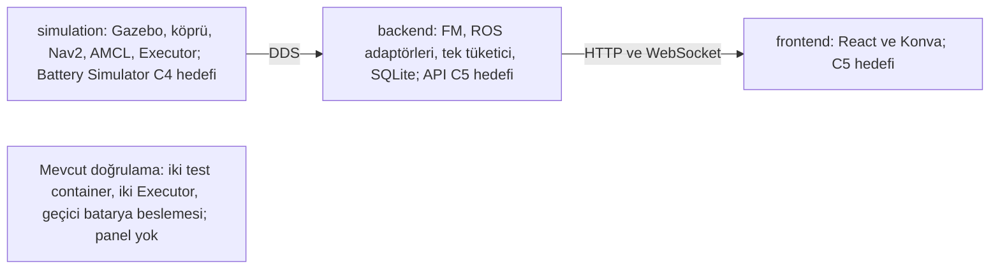
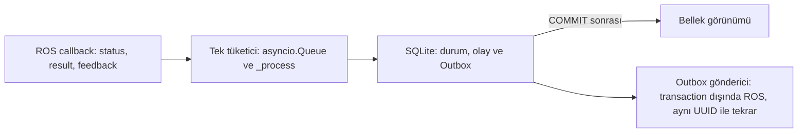
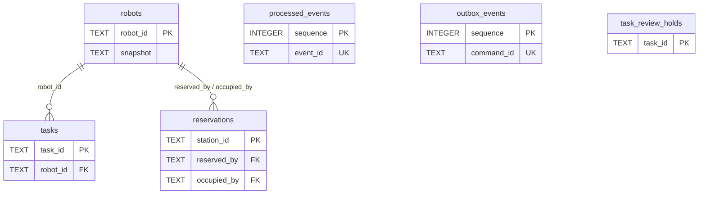

# C4 Öncesi Kapsamlı Teknik Rapor

Tarih: 25 Ekim 2026 (Europe/Istanbul).

[PDF raporu](ROS2_Fleet_Manager_C4_Oncesi_Kapsamli_Teknik_Rapor_2026-10-25.pdf), kullanıcının açık PDF talebiyle hazırlanmıştır. 38 sayfadır. İnceleme tabanı `3836b3faf8a86567664a1f3be603061537481b20` commit'idir. Bu kayıt yeni mimari şartname veya karar onayı değildir.

## Kapsam

Rapor; dokuz istenen bölümü, gerçek `schema.sql` üzerinden üretilmiş altı tabloluk veri sözlüğünü, mimari/veri akışı/ER diyagramlarını, C2.3 sonuçlarını, C3.3.3 T01–T10 kapsam ayrımını, kaynak ölçümlerini, Git referanslarını ve 86 girdilik kaynak dizinini içerir. Tarihsel test sonuçları ile statik kod bulguları ayrılmıştır. Farklı regresyon koşularının test sayıları toplanmamıştır.

Uygulama testleri, Docker build ve canlı simülasyon yeniden çalıştırılmamıştır. Uygulama kodu, konfigürasyon, mevcut raporlar, PDF'ler ve kişisel notlar değiştirilmemiştir. Commit veya push yapılmamıştır. Yalnız yeni rapor dosyaları ve dokümantasyon haritası bu çalışmanın çıktısıdır.

## PDF doğrulaması

25 Ekim 2026 tarihinde yapılan çıktı kontrolleri:

| Kontrol | Yöntem | Sonuç |
|---|---|---|
| Sayfa düzeni | ReportLab sabit sayfa çerçevelerinde kalan öğe denetimi | 38 sayfa; taşan öğe yok |
| Görsel inceleme | `pdftoppm -r 85 -png` ile tüm sayfaların render edilmesi; sayfa gruplarının görsel incelenmesi | Kapak, içindekiler, başlıklar, tablolar ve altbilgiler incelendi |
| Diyagramlar | Veri akışı ve ER sayfalarının ayrıca 140 dpi render edilmesi | COMMIT okunun kaynağı ve ER bağlantı güzergâhı düzeltilip yeniden incelendi |
| Türkçe karakterler | `pypdf` metin çıkarımı ve görsel kontrol | `çğıöşüÇĞİÖŞÜ` mevcut; U+FFFD yok |
| Sayfa numaraları | `pdfplumber` ile her sayfada `n / 38` kontrolü | 38/38 mevcut |
| Metin sınırları | `pdfplumber` karakter koordinatlarının sayfa sınırlarıyla karşılaştırılması | Sınır dışı karakter yok |
| Kaynaklar | Kaynak yollarının ve satır iğnelerinin varlığı; PDF'deki K01–K86 kimliklerinin taranması | 86/86 kaynak kimliği mevcut; atıf hedefleri mevcut |
| SQL veri sözlüğü | Şemanın yalnız bellek içi SQLite bağlantısında introspection'ı | Altı uygulama tablosunun tüm sütunları rapora alındı |
| Sürüm | `git rev-parse` / `git show` ile rapordaki kısa commit referanslarının çözülmesi | Referanslar mevcut |

Bu kontroller yalnız rapor çıktısını doğrular; ürün test başarısı değildir. Kritik statik bulguların çalışma zamanı tekrar üretimi yapılmamıştır. Ayrıntılı bulguların tek kaynağı PDF'nin 8. bölümüdür.

## Diyagram kaynakları

Aşağıdaki Mermaid tanımları PDF'deki diyagramların mantıksal kaynaklarıdır. PDF'de okunabilir vektör çizimler olarak gösterilmiştir. Yeni mimari karar içermez.

ER diyagramındaki sütunlar ilişki özeti içindir; tam sütun listesi PDF'de bulunur. `processed_events`, `outbox_events` ve `task_review_holds` üzerindeki görev/robot kimlikleri için şemada SQL yabancı anahtarı tanımlı değildir.
