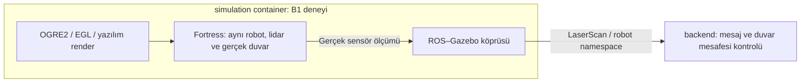

# Tek robotlu simulation doğrulaması: Aşama B

Tarih: 23 Ekim 2026 (Europe/Istanbul).

## Durum ve kapsam

**B1 BAŞARISIZ; karar kapısında duruldu. B2 başlatılmadı.** Bu kayıt Docker yerleşimi onayı değildir. [Proje bağlamı](project-context.md), [onaylı v2.3 geçiş kaydı](architecture-v2.3-transition.md) ve [Aşama A](simulation-validation-2026-10-23.md) okundu. Önceki kayıtlar ve kişisel notlar değiştirilmez.

## Ayrı deney düzeni

[Ayrı Compose override](../docker-compose.simulation-lidar-check.yml), DDS ve Aşama A override dosyalarının üzerine eklenir. Ayrı proje, container, ağ ve image kullanılır. [Dockerfile](../docker/simulation-lidar-check/Dockerfile), ölçülen yerel Aşama A image'ına OGRE2 paketini ekler. Aşama A dosyaları değiştirilmez. [Betik](../docker/simulation-lidar-check/check.py), Aşama A config doğrulayıcısını ve aynı robot dünya şablonunu kullanır; çalışma sırasında `/tmp/lidar-world.sdf` dosyasına sensör ve duvar ekler. Config iki container'da da salt okunur bağlanır.



Bu şema yalnız deney düzenini gösterir. Çoklu robot, fleet.yaml, ExecuteTask, yürütücü, batarya, Fleet Manager, FastAPI ve frontend eklenmedi. Backend burada yalnız doğrulama istemcisidir; uygulama mimarisinde doğrudan Nav2 komut sahibi seçilmez.

## Config ve kabul ölçütü

Robot kimliği ve başlangıç pozu [Aşama A config'inden](../config/simulation-check.json) gelir; aynı değerler ikinci config'e kopyalanmaz. B1'de harita ve Nav2 parametreleri bu dosyada `null` kalır. [Lidar config](../config/simulation-lidar-check.json) ve [şeması](../config/simulation-lidar-check.schema.json) bütün yeni alanları zorunlu tutar, ek alanları reddeder. Kodda eksik ayar için varsayılan yoktur. Sayıların sonluluğu, min/max sırası ve analitik duvar kontrolünün gerektirdiği sıfır yönelim başlangıçta denetlenir.

| Alan | Anlam / birim |
| --- | --- |
| sensor.pose | base_link'e göre x/y/z metre, roll/pitch/yaw radyan |
| sensor.samples | Yatay ışın sayısı |
| sensor.min_angle_rad / max_angle_rad | Yatay tarama sınırları, radyan |
| sensor.min_range_m / max_range_m | Algılama mesafesi sınırları, metre |
| sensor.resolution_m | Mesafe çözünürlüğü, metre |
| sensor.update_rate_hz | Sensör güncelleme sıklığı, Hz |
| wall.pose | Dünya koordinatında x/y/z metre ve roll/pitch/yaw radyan |
| wall.size_m | Gerçek duvarın x/y/z boyutları, metre |
| render.engine / headless | Deneyin OGRE2 ve headless render seçimi |
| check.minimum_messages | Kabul için gereken gerçek LaserScan mesaj sayısı |
| check.range_tolerance_m | Her ışında duvar geometrisine göre izin verilen hata, metre |

Tek değer kaynağı bağlantılı config dosyalarıdır; varsayılanlar ayrıca tanımlanmaz. DDS domain, RMW ve duvar saati bekleme sınırı [dds.env](../config/dds.env) dosyasından gelir. Test süresi ürün timeout politikası değildir. Koşu kimliği `DDS_TEST_PAYLOAD` ile verilir. Aynı domain'deki diğer deneyler eşzamanlı çalıştırılmaz.

Backend yalnız topic keşfine bakmaz. Artan zaman damgalı mesajlar, beklenen ışın sayısı, sonlu ve menzil içinde değerler aranır. Her ışının beklenen mesafesi duvarın ön yüzü ile sensör x konumu arasındaki farkın `cos(açı)` değerine bölünmesiyle hesaplanır. Duvarın y kapsamına düşmeyen ışın kabul edilmez. Robot B1 boyunca hareketsizdir; hız komutu gönderilmez. Sahte scan, sahte ölçüm, sürüm yeteneğini olduğundan farklı gösteren OpenGL override veya özel symlink yoktur.

## Render seçimi ve kaynaklar

Kurulu `ign gazebo --help` çıktısı `-s`, `--headless-rendering`, `--render-engine` ve `--render-engine-server` seçeneklerini doğruladı. Başlangıç image'ında sensör paketleri ve Mesa vardı, OGRE paketi yoktu. `/dev/dri` bulunamadı. İlk paket/env incelemesinde `dpkg-query` OGRE eşleşmesi bulamadı; son `ls -l /dev/dri` nedeniyle birleşik komut çıkışı 2 oldu. Bu bir lidar denemesi veya başarı kanıtı değildir.

Bu nedenle ayrı image'da `libignition-rendering6-ogre2` kurulur. Sunucu `-s -r --headless-rendering` ile başlar. Deney override'ı `LIBGL_ALWAYS_SOFTWARE=1` ve `EGL_PLATFORM=surfaceless` verir. X sunucusu veya GUI açılmaz. Bu bir test altyapısı seçimi olup ürün render mimarisini kilitlemez.

[Fortress sorun giderme belgesi](https://gazebosim.org/docs/fortress/troubleshooting/) yazılım render seçeneğini açıklar. [Fortress EGL duyurusu](https://community.gazebosim.org/t/egl-support-is-available-in-ignition-fortress/1183) headless seçeneğinin OGRE2 ile kullanılmasını açıklar. Belgeler 23 Ekim 2026 tarihinde incelendi. Gerçek platform desteğinin kanıtı aşağıdaki çalışma çıktısıdır; belge tek başına başarı sayılmaz.

## Komutlar ve gerçek çıktılar

[Komut ve çıktı eki](simulation-stage-b-commands-2026-10-23.md) çalıştırılan komutları, çıkış kodlarını ve stdout/stderr çıktısını tutar. Geçici kayıt yardımcısı çıktıyı bu eke yazar; sonradan yalnız ANSI renk kodları ve satır sonu boşlukları temizlendi; test sonucunu değiştirmez. İlk hazırlıkta ayrıca `git status --short` temizdi; `python3 -m py_compile docker/simulation-lidar-check/check.py` ve `git diff --check` çıkış 0 verdi. Paket adı araması `apt-get update -qq && apt-cache search libignition-rendering6` çıkış 0 verdi ve OGRE1/OGRE2 runtime paketlerini listeledi.

## Sonuç

`simulation-b1-20261023-01` başarısızdır. Köprü `/validation_robot/scan` için `ignition.msgs.LaserScan → sensor_msgs/msg/LaserScan` bağlantısını açtı. Backend `rmw_cyclonedds_cpp` ile başladı. Ancak Gazebo render motorunu yükleyemedi:

```text
Failed to load plugin [ignition-rendering-ogre2] : couldn't find shared library.
Engine [ogre2] is not supported. Loading OGRE2 instead.
Segmentation fault (Address not mapped to object [(nil)])
```

Gazebo alt süreci `-11`, simulation container `1`, backend container `1`, Compose `1` ile bitti. Köprü kapanış kodu `0` olması sensör başarısı değildir. **Kaydedilen/doğrulanan LaserScan mesaj sayısı 0**; hiçbir `SCAN` veya `B1_PASS` kaydı yoktur. Sonlu menzil ve duvar uyumu doğrulanmadı. İlk istemcide kesilme anında toplam callback sayacı ayrıca basılmadığı için sıfırın kapsamı kaydedilen/doğrulanan mesajlardır; toplam teslim edilmiş mesaj sayısının bağımsız ölçümü yoktur.

B1 başarısızlığından sonra yeni bir lidar/render koşusu veya B2 yapılmadı. Yalnız salt okunur paket teşhisi, test altyapısının kapanış raporlaması düzeltmesi, paketleme, config testleri ve temizlik tamamlandı.

## Başarısız denemeler ve teşhis sınırı

1. İlk config testi, Aşama A ile B1 betiklerinin ikisinin de `check` modül adı taşıması nedeniyle `RecursionError` verdi (`Ran 2 tests`, `FAILED (errors=9)`, çıkış 1). Aşama A modülü artık dosya yoluyla ayrı `stage_a_check` adı altında yüklenir. Düzeltilen test çıkış 0 verdi. Bu test hatası canlı koşudaki render çökmesinden farklıdır; doğrudan çalıştırılan eski betik config'i başarıyla yüklemişti.
2. Tek canlı B1 koşusu yukarıdaki render yükleme hatasıyla durdu. Runtime paketi kurulu olmasına rağmen genel eklenti adı çözülemedi. Sonradan `dpkg -L`, `find` ve `ldd` incelemesinde `libignition-rendering6-ogre2.so.6` ve `.so.6.6.4` dosyaları bulundu; `ldd` çıktılarında `not found` yoktu. Bu, isim/arama yolu/paketleme yönünü incelemeye değer kılar; kök neden veya EGL desteği kesinleşmiş değildir. Özel symlink eklenmedi; yeni motor yolu denenmedi.
3. Compose simulation çıkışı nedeniyle backend'i durdurunca ilk istemcinin `finally` bloğu ikinci kez ROS shutdown çağırdı: `failed to shutdown: rcl_shutdown already called on the given context`. Son kaynakta `rclpy.ok()` kontrolü ve `SCAN_SUMMARY` eklendi. Hatalar başarıya çevrilmez. Bu kapanış düzeltmesinin canlı koşusu **doğrulanmadı**; yeniden lidar çalıştırılmadı.
4. Bir ara `docker compose ... logs --no-color --tail 30` komutunda `DDS_TEST_PAYLOAD` unutuldu, Compose interpolasyon hatası verdi (çıkış 1). Koşu kimliği verilerek `logs --no-color --tail 35` tekrarlandı (çıkış 0). Bu komutlar yeni koşu başlatmadı.

İlk render yolu yalnız OGRE2 + EGL + yazılım render oldu. Xvfb, başka sensör eklentisi ve host Gazebo **denenmedi**. Eklenti yüklenemeden çöküldüğü için EGL bağlamı/gerçek yazılım renderer adı ve OpenGL sürümü ölçülemedi. Mesa paket sürümünün bulunması aktif renderer kanıtı değildir.

## Ölçülen ortam ve image kimlikleri

Platform **linux/arm64**; iki container aynı image'dan çalıştı. Docker istemci/Engine 29.9.2, Docker Desktop 4.96.3 (244472), Compose v5.6.1. Ubuntu 22.04.5 LTS; Python 3.10.12. Gazebo 6.18.0, rendering 6.6.4, gpu-lidar 6.9.0, OGRE Next 2.2.5+dfsg3-0ubuntu2, Mesa 23.2.1-1ubuntu3.1~22.04.4. ROS köprüsü 0.244.26-1jammy.20260916.153147. Tam paket sürümleri çıktı ekindedir.

| Image | Ölçülen ID / RepoDigest sha256 |
| --- | --- |
| Aşama A tabanı | `69cb7989a1a325add4f0ca325f4fa1e002beb4f2ffd415d59f1efd4e32151b39` |
| Başarısız canlı B1 koşusu | `3047a642208db50e5f5f1295384acdf0bbdf23db7c10f6bab2ccca822541d815` |
| Son kaynak/test paketlemesi; canlı lidar tekrar çalıştırılmadı | `5108ed0398fd0ba7b57865a1bea1f1ca2feb4a29f69ad8e276546b597a4b6a31` |

Canlı koşunun platform manifest digest'i `6676892fb08b6c292c311103b072502d5e44d0a7ab0fffd00db47f7e75623f9a`, config digest'i `44817b659c9a3be5ad717eae6e798d11dbadbe75389d486c8ad84ebc97034955`. Son paketlemenin platform manifest digest'i `1a9706b4ad50278b5012714cac1cfd96f55fe503ecd733757273edc8a17a2822`, config digest'i `add4e7b81ea2518e120715088ff9466cfc8d647e78b2fe882a3d61bd097d90d9`. Ara paketleme digest'i ve bütün build çıktıları ekte korunur. Paketler sürümle sabitlenmedi; gelecekte önbelleksiz build aynı bağımlılıkları garanti etmez.

Son image'daki config testleri: `Ran 2 tests in 0.030s`, `OK`, çıkış 0. Geçerli config/dünya üretimi ile eksik/ek alan, NaN, geçersiz örnek sayısı, ters menzil/açı sınırı, sıfır duvar boyutu ve desteklenmeyen yönelim denetlendi. Compose config kontrolü de çıkış 0. Bu sonuçlar lidar kapısını geçirmez.

`down` çıkış 0 ile iki container'ı ve `ros2-fleet-simulation-lidar-check_dds` ağını kaldırdı. Son container ve ağ sorguları yalnız başlık döndürdü. Image'lar yerelde bırakıldı. Her iki container'ın config mount'u `Mode=ro`, `RW=false` olarak ölçüldü.

## Karar bekleyen seçenekler

Bağlam: B1 mevcut ARM64 Docker/OGRE2 paket bileşiminde render eklentisi yüklenirken durdu. Kullanıcının açık talimatı nedeniyle B2'ye geçilmez. **Seçilen sonraki yol yoktur.**

| Seçenek | Gerekçe / sınır |
| --- | --- |
| Aynı Docker B1'inde paket/eklenti arama yolunu incelemek | Mevcut kanıt yükleme aşamasını işaret ediyor. Resmî paket veya desteklenen arama yolu ile ayrı tekrar gerekir; çözüm doğrulanmadı. |
| Host'ta Gazebo | Container render sınırını ayırabilir. Host kurulumu ve backend ile iletişim yeniden doğrulanmalı; uygulanmadı. |
| Lidar'sız Nav2 yapılandırması | Mevcut B1/AMCL kabulünü karşılamaz; lokalizasyon ve sensör kapsamı için kullanıcının yeni kararı gerekir. Uygulanmadı. |
| Farklı sensör eklentisi veya render altyapısı | Gerçek LaserScan üretimi yine aynı duvar testiyle kanıtlanmalı. Xvfb veya farklı eklenti uyumluluğu doğrulanmadı. |

## Doğrulanmadı ve sınırlar

- B1 gerçek LaserScan alımı, sonlu değerler ve engel uyumu **doğrulanmadı**.
- EGL bağlamı, aktif renderer ve ARM64 headless sensör desteği **doğrulanmadı**; bu tek başarısız koşu platformun tümüyle olanaksız olduğunu göstermez.
- B2 Nav2, AMCL, map_server, özel harita, lifecycle hazırlığı, NavigateToPose sonucu, poz hata eşiği ve iki temiz başarılı koşu **doğrulanmadı / başlatılmadı**.
- Son kaynak paketlemesinin canlı sensör/kapanış davranışı **doğrulanmadı**. Yalnız config ve dünya üretim testleri geçti.
- Çoklu robot, uygulama hata yolları ve Docker yerleşimi onayı kapsam dışıdır.
- Mevcut Aşama A, v2.3 geçiş kaydı, Docker karar taslağı, PDF'ler ve kişisel notlar değişmedi.

## Eklenen dosyalar

- `config/simulation-lidar-check.json` ve `.schema.json`: sensör, gerçek duvar, render ve kabul ayarları.
- `docker-compose.simulation-lidar-check.yml`: ayrı B1 projesi/image override'ı.
- `docker/simulation-lidar-check/Dockerfile`, `check.py`, `test_config.py`: bağımlılık, gerçek sensör probu ve config testleri.
- Bu kayıt ve [komut/çıktı eki](simulation-stage-b-commands-2026-10-23.md).

