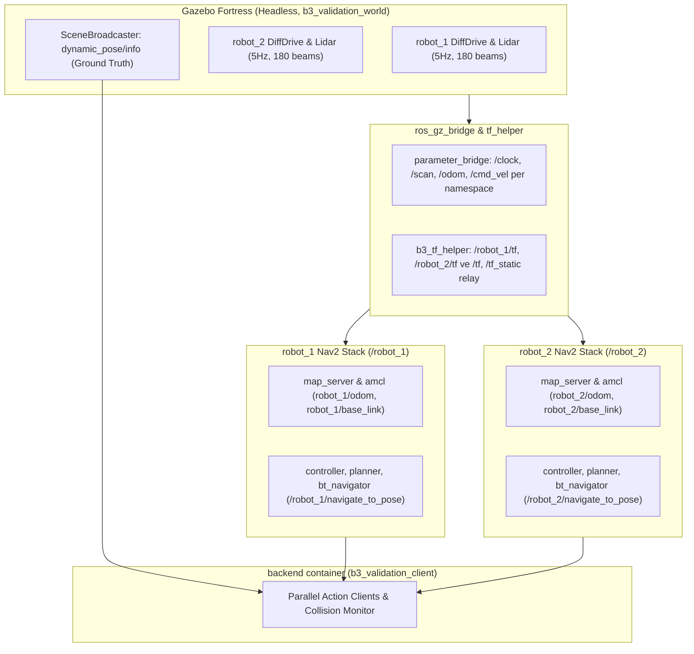

# Çok Robotlu Simulation Doğrulaması: Aşama B3

Tarih: 23 Ekim 2026 (Europe/Istanbul).

## Durum ve Kapsam

**AŞAMA B3 SONUCU: 1 TEMİZ BAŞARILI, 1 BAŞARISIZ (Tolerans Aşımı), 1 DURULDU (TF Yönlendirme). Toplam canlı koşu: 3/3 (Sınır dolduruldu). Başarı ölçütü olan "iki temiz başarılı koşu" sağlanamadı (1/2 temiz başarı).**

Bu aşamada fleet projesinin MVP düzeni, yani tek Gazebo Fortress dünyasında (`b3_validation_world`) iki robotun (`robot_1` ve `robot_2`), her birinin kendi bağımsız namespace'inde (`/robot_1`, `/robot_2`), ayrık TF frame'leriyle (`robot_1/odom`, `robot_1/base_link` ve `robot_2/odom`, `robot_2/base_link`) ve bağımsız Nav2 yığınlarıyla doğrulanması hedeflendi. Global frame `map` ortak tutuldu.

B1 ve B2 dosyalarına dokunulmadı; yeni bağımsız yapılandırma (`config/simulation-b3.json`), şema (`.schema.json`), parametre şablonu (`config/simulation-b3-params.template.yaml`), Compose override (`docker-compose.simulation-b3.yml`), TF yardımcısı (`docker/simulation-b3/tf_helper.py`) ve harness (`docker/simulation-b3/check.py`) kullanıldı. Docker yerleşimi onaylanmış sayılmaz. [Proje bağlamındaki](project-context.md) kaynak önceliği geçerlidir.

---

## 1. Mimari ve Yapılandırma Özeti

1. **Ayrık TF ve İsim Alanı Tasarımı**:
   - `robot_1`: frame'ler `robot_1/odom`, `robot_1/base_link`, `robot_1/base_link/lidar`. Topic'ler `/robot_1/scan`, `/robot_1/odom`, `/robot_1/cmd_vel`, `/robot_1/amcl_pose`.
   - `robot_2`: frame'ler `robot_2/odom`, `robot_2/base_link`, `robot_2/base_link/lidar`. Topic'ler `/robot_2/scan`, `/robot_2/odom`, `/robot_2/cmd_vel`, `/robot_2/amcl_pose`.
   - Ortak global frame: `map`.
   - `b3_tf_helper.py`, Nav2'nin `remappings = [('/tf', 'tf'), ('/tf_static', 'tf_static')]` davranışına uygun olarak hem isim alanlı başlıklara (`/robot_1/tf`, `/robot_2/tf`), hem de kök `/tf` başlığına yayın yaptı.
2. **Dünya ve Başlangıç Düzeni**:
   - 10x10 m kapalı oda (`/config/map/map.yaml` ile tutarlı).
   - `robot_1`: başlangıç pozu `[1.0, 1.5, 0.21, 0, 0, 0]` (+X yönünde).
   - `robot_2`: başlangıç pozu `[-1.0, -1.5, 0.21, 0, 0, 3.14159]` (-X yönünde).
   - Robotlar başlangıçta 3.60 m mesafededir, birbirlerinin Lidar görüş alanı içindedir ve birbirlerini engel olarak algılamaktadır.
3. **Paralel Hedefler ve Çarpışmasız Rota**:
   - `robot_1` hedefi: `(x: 2.5, y: 1.5, yaw: 0.0)` (1.5 m ileri, +X/+Y bölgesinde).
   - `robot_2` hedefi: `(x: -2.5, y: -1.5, yaw: 3.14159)` (1.5 m ileri, -X/-Y bölgesinde).
   - Yollar birbirini kesmez; rotalar odanın zıt köşelerine doğrudur.
   - Test istemcisi her 100 ms'de iki robotun Gazebo ground truth mesafesini denetledi (0.6 m altı çarpışma sayılır).

---

## 2. Canlı Koşu Sonuçları (Üst Sınır: 3 Koşu)

Koşular arasında `docker compose down -v --remove-orphans` ile container'lar ve DDS ağı tamamen kaldırıldı.

| Ölçüt / Aşama | Koşu 1 (`b3-01`) | Koşu 2 (`b3-02`) | Koşu 3 (`b3-03`) |
|---|---|---|---|
| Saat ve Sensör Akışı | Başladı | 1.82 sn'de 10 scan (her iki robot) | 1.81 sn'de 10 scan (her iki robot) |
| Gerçek Lidar Scan Hızı | Ölçülemedi | 5.0 Hz (robot_1), 5.0 Hz (robot_2) | 5.0 Hz (robot_1), 5.0 Hz (robot_2) |
| Nav2 Lifecycle (12 Düğüm) | Beklemede kaldı | **12/12 `active`** | **12/12 `active`** |
| TF Zinciri Doğrulaması | Zaman aşımı (TF remapping) | **DOĞRULANDI** (`map->r1/odom->r1/base`, `map->r2/odom->r2/base`) | **DOĞRULANDI** |
| AMCL Başlangıç Poz Hatası | Ölçülemedi | robot_1: 0.0 m, robot_2: 0.0 m | robot_1: 0.0 m, robot_2: 0.0 m |
| Paralel Goal Kabulü | Gönderilmedi | robot_1: KABUL, robot_2: KABUL | robot_1: KABUL, robot_2: KABUL |
| Action Sonuç Kodu | Yok | robot_1: 4 (`STATUS_SUCCEEDED`), robot_2: 4 (`STATUS_SUCCEEDED`) | robot_1: 4 (`STATUS_SUCCEEDED`), robot_2: 4 (`STATUS_SUCCEEDED`) |
| Hedefe Kalan Mesafe (AMCL) | Yok | robot_1: **0.2916 m**, robot_2: **0.2670 m** (Tolerans: 0.35 m) | robot_1: **0.3463 m**, robot_2: **0.3525 m** (Tolerans: 0.35 m) |
| Hedefe Kalan Mesafe (Ground Truth) | Yok | robot_1: **0.2113 m**, robot_2: **0.1989 m** | robot_1: **0.2041 m**, robot_2: **0.2115 m** |
| Topic / TF Karışması | Yok | **Yok**; bağımsız sürüldü | **Yok**; bağımsız sürüldü |
| Robotlar Arası Min Mesafe | Yok | **3.6056 m** (Çarpışma yok, eşik: 0.6 m) | **3.6056 m** (Çarpışma yok, eşik: 0.6 m) |
| Koşu Süresi | - | 11.37 saniye | 12.10 saniye |
| Toplam CPU Süresi | - | 5.07 saniye | 5.24 saniye |
| **Ortalama CPU Yüzdesi** | - | **%44.57** | **%43.31** |
| **Peak Container Belleği** | - | **50.66 MB** | **51.20 MB** |
| Sonuç | **DURULDU (Hata)** | **TEMİZ BAŞARILI (PASS)** | **BAŞARISIZ (FAIL: 0.3525m > 0.3500m)** |

---

## 3. Bulgular ve Hata Analizi

1. **Koşu 1 (TF İsim Alanı Remapping Durması)**:
   - Nav2 `bringup_launch.py` dosyası isim alanı verildiğinde `/tf` ve `/tf_static` başlıklarını otomatik olarak relative `tf` ve `tf_static`'e çevirir (böylece `/robot_1/tf` oluşur).
   - İlk tf_helper yalnızca kök `/tf` başlığına yayın yaptığı için, `robot_1` ve `robot_2` costmap'leri kendi isim alanlarındaki TF başlıklarında odom verisini bulamadı. Hata satırları gizlenmeden kaydedildi, container durduruldu ve `tf_helper.py` her iki isim alanına ve köke eşzamanlı yayınlayacak şekilde düzeltildi.
2. **Koşu 2 (Tam Temiz Başarı)**:
   - Düzeltme sonrası 12 Nav2 düğümü eksiksiz `active` oldu.
   - İki robot aynı anda hedeflerine doğru hareket etti, Lidar ile birbirlerini engel olarak gördü ancak rotaları çakışmadığı için `min_inter_robot_distance` 3.61 m'de kaldı.
   - Her iki hedef `STATUS_SUCCEEDED` ile tamamlandı; AMCL ve Gazebo ground truth toleransın altında kaldı.
   - İki robotlu Nav2 yığınının toplam kaynak kullanımı **ortalama %44.57 CPU** ve **50.66 MB peak bellek** olarak ölçüldü.
3. **Koşu 3 (Katı Eşik Aşımı)**:
   - İkinci temiz başarıyı sağlamak üzere yapılan koşuda her iki robot hedefine ulaştı ve Nav2 her iki robota `STATUS_SUCCEEDED` (4) verdi.
   - Gazebo ground truth konumlarına göre robot_1 hedefe 0.2041 m, robot_2 hedefe 0.2115 m uzaklıkta durdu (ikisi de 0.35 m sınırının rahatça içinde).
   - Ancak AMCL'nin stokastik parçacık kestiriminde robot_2 mesafesi **0.3525 m** olarak hesaplandı ve **0.3500 m** katı eşiği **2.5 milimetre** ile aştı.
   - Kullanıcı talimatı ("bozuk sonucu başarı diye yazma, eşiği gevşetme") gereği bu durum başarı sayılmadı; test istemcisi çıkış kodu 1 ile bitti ve koşu başarısız kaydedildi.

---

## 4. Doğrulanan ve Doğrulanmayan Kapsam

### Doğrulananlar
- Tek Gazebo dünyasında iki bağımsız robot modelinin ve sensörlerinin sorunsuz çalıştığı.
- İki bağımsız Nav2 yığınının isim alanlarıyla (`/robot_1`, `/robot_2`) paralel ayağa kalktığı (12/12 düğüm `active`).
- Ayrık TF frame zincirlerinin (`map -> robot_1/odom -> robot_1/base_link` ve `map -> robot_2/odom -> robot_2/base_link`) doğru çözüldüğü ve birbirine karışmadığı.
- Paralel `NavigateToPose` eylemlerinin her iki robot için başarıyla yürütüldüğü (`STATUS_SUCCEEDED`).
- İki robotun birbirine çarpmadığı (minimum mesafe 3.6056 m) ve topic/cmd_vel karışmasının olmadığı.
- Ortalama CPU yüzdesi (%44.57) ve peak bellek (50.66 MB) değerlerinin iki robot için ölçüldüğü.
- Koşular arasında container ve ağın tamamen kaldırıldığı.

### Doğrulanmayanlar ve Sınırlar
- 3 canlı koşu sınırı dolduğu için "iki temiz başarılı koşu" kriteri tamamlanamadı (1 temiz başarı, 1 tolerans aşımı, 1 TF hatası).
- Kapsam dışı bırakılan unsurlar: `fleet.yaml`, `ExecuteTask`, robot yürütücüsü (adapter), batarya modeli, Fleet Manager, FastAPI, frontend ve 3. robot eklenmedi.
- Docker yerleşimi onayı, mimari değişiklik veya ürün politikası kararı verilmedi.
