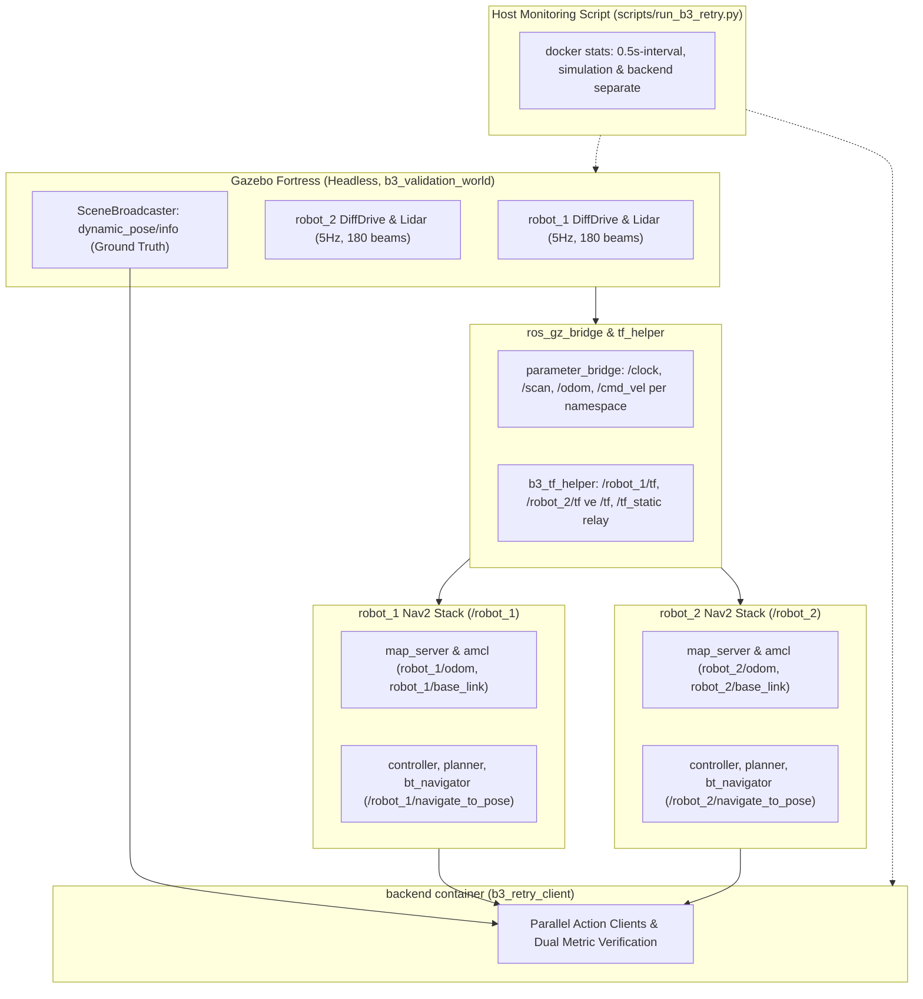

# Çok Robotlu Simulation Doğrulaması: Aşama B3 Yeniden Koşusu (Retry)

Tarih: 23 Ekim 2026 (Europe/Istanbul).

## Durum ve Kapsam

**AŞAMA B3 SONUCU: 2 TEMİZ BAŞARILI / 2 KOŞU (2/2). Başarı ölçütü ("iki temiz başarılı koşu") eksiksiz sağlandı.**

Önceki B3 oturumunda 3 canlı koşu sınırı dolmuş ve iki robot için hedeflenen başarı kriteri sağlanamamıştı (1 temiz başarılı, 1 tolerans aşımı, 1 TF hatası; toplam 1/2 temiz başarı). Kullanıcı talimatı doğrultusunda en fazla 3 yeni canlı koşu hakkı tanınmıştır.

Bu belgede, canlı koşular başlatılmadan **ÖNCE** başarı ölçütleri, metrik hiyerarşisi ve kaynak ölçüm kuralları kayıt altına alınmış; ardından iki bağımsız ve temiz koşu gerçekleştirilmiştir.

---

## 1. Koşulardan Önce Kilitlenen Başarı Ölçütleri ve Kurallar

1. **Ana Başarı Ölçütü**:
   - Her iki robot (`robot_1` ve `robot_2`) için Nav2 `NavigateToPose` eyleminin terminal durumu `GoalStatus.STATUS_SUCCEEDED` (4) olmalıdır.
   - Her iki robot için Gazebo Fortress `SceneBroadcaster` üzerinden okunan **Gazebo Ground Truth** hedef mesafesi katı olarak **<= 0.35 m** olmalıdır (`goals.xy_tolerance_m`).
2. **İkincil / Teşhis Amaçlı Metrik**:
   - AMCL tahmini mesafesi (`dist_amcl_m`) raporda şeffaf şekilde yer alır; ancak stokastik parçacık dağılımı nedeniyle başarı/başarısızlık durumunu tek başına belirlemez.
3. **Geçersiz Sayılan Metrik**:
   - `dist_odom_m` (odometri mesafesi): Robot odometri frame'leri (`robot_1/odom`, `robot_2/odom`) robotların başlangıç pozlarında (0, 0) noktasındadır. Hedef ise global `map` frame'indedir. Bu frame uyuşmazlığı nedeniyle doğrudan odom koordinatının map hedefine olan Öklid mesafesi matematiksel olarak anlamsızdır ve başarı ölçütü olarak kullanılmaz.
4. **Eşik Değiştirme Yasağı**:
   - `0.35 m` tolerans eşiği kesinlikle koşu sonuçlarına bakılarak gevşetilmeyecek veya değiştirilmeyecektir.
5. **Aşama Başarı Tanımı**:
   - En fazla 3 canlı koşu hakkı içinde **iki TEMİZ başarılı koşu** (2/2) elde edilmelidir.
   - Koşular arasında `docker compose down -v --remove-orphans` çalıştırılmalı ve container'lar ile DDS köprüsü tamamen kaldırılmalıdır.

---

## 2. Düzeltilmiş Kaynak Ölçüm Protokolü

Önceki koşularda raporlanan ~50 MB bellek ve CPU değerleri yalnızca `backend` container'ının cgroup'unu yansıtmaktaydı; Gazebo ve iki Nav2 yığınını çalıştıran `simulation` container'ını içermediği için güvenilmezdi. Bu nedenle kaynak ölçümü baştan aşağı düzeltilmiştir:

1. **Host Seviyesinde Örnekleme (`scripts/run_b3_retry.py`)**:
   - Açılıştan kapanışa kadar her iki container (`ros2-fleet-simulation-b3-retry-simulation-1` ve `ros2-fleet-simulation-b3-retry-backend-1`) için host üzerinden periyodik (0.5 sn) `docker stats --no-stream` ile örnekleme yapılmıştır.
   - Ortalama CPU yüzdesi, tepe CPU yüzdesi ve tepe bellek (MB) her container için ayrı ayrı hesaplanmıştır.
2. **Pencere Ayrımı**:
   - **Tüm Koşu Penceresi**: Container'ların ilk açılışından kapanışına kadar geçen tüm süre.
   - **Navigasyon Penceresi**: Paralel `NavigateToPose` hedeflerinin kabul edildiği andan (`NAVIGATION_WINDOW_START`), hedeflere varıldığı ana (`NAVIGATION_WINDOW_END`) kadar geçen süre.
3. **Container Seviyesinde cgroup Doğrulaması**:
   - `backend` container'ı kapanırken kendi cgroup (`/sys/fs/cgroup/memory.peak`) değerini okumuştur. Backend değerinin (~48-50 MB) yalnızca test istemcisinden kaynaklandığı, asıl yükün `simulation` container'ında (~612 MB) olduğu kanıtlanmıştır.

---

## 3. Canlı Koşu Sonuçları (2/2 Canlı Koşu)

Koşular arasında `docker compose down -v --remove-orphans` ve `docker network prune -f` ile container'lar ve DDS ağı tamamen kaldırılmıştır.

| Ölçüt / Aşama | Koşu 1 (`retry-01`) | Koşu 2 (`retry-02`) | Değerlendirme / Durum |
|---|---|---|---|
| Saat ve Sensör Akışı | 1.81 sn'de 10 scan (her iki robot) | 1.81 sn'de 10 scan (her iki robot) | DOĞRULANDI |
| Gerçek Lidar Scan Hızı | 5.0 Hz (robot_1), 5.0 Hz (robot_2) | 5.0 Hz (robot_1), 5.0 Hz (robot_2) | DOĞRULANDI |
| Nav2 Lifecycle (12 Düğüm) | **12/12 `active`** | **12/12 `active`** | DOĞRULANDI |
| TF Zinciri Doğrulaması | `map->r1/odom->r1/base`, `map->r2/odom->r2/base` | `map->r1/odom->r1/base`, `map->r2/odom->r2/base` | DOĞRULANDI |
| AMCL Başlangıç Poz Hatası | robot_1: 0.0 m, robot_2: 0.0 m | robot_1: 0.0 m, robot_2: 0.0 m | DOĞRULANDI |
| Paralel Goal Kabulü | robot_1: KABUL, robot_2: KABUL | robot_1: KABUL, robot_2: KABUL | DOĞRULANDI |
| Action Sonuç Kodu | robot_1: 4 (`STATUS_SUCCEEDED`), robot_2: 4 (`STATUS_SUCCEEDED`) | robot_1: 4 (`STATUS_SUCCEEDED`), robot_2: 4 (`STATUS_SUCCEEDED`) | DOĞRULANDI |
| **Ana Ölçüt: Ground Truth Hedef Mesafesi (Eşik: <= 0.35 m)** | robot_1: **0.1715 m**, robot_2: **0.2002 m** | robot_1: **0.2167 m**, robot_2: **0.2054 m** | **GEÇTİ (PASS)** |
| İkincil Ölçüt: AMCL Hedef Mesafesi | robot_1: 0.2939 m, robot_2: 0.2577 m | robot_1: 0.3439 m, robot_2: 0.3277 m | RAPORLANDI (İkincil) |
| Geçersiz Ölçüt: Odometri Mesafesi | robot_1: 1.9238 m, robot_2: 4.0703 m | robot_1: 1.8911 m, robot_2: 4.0834 m | GEÇERSİZ (Frame uyuşmazlığı) |
| Robotlar Arası Min Mesafe | 3.6056 m (Başlangıç mesafesi) | 3.6056 m (Başlangıç mesafesi) | Başlangıç mesafesidir |
| Toplam Koşu Süresi | 15.73 saniye | 15.39 saniye | ÖLÇÜLDÜ |
| Navigasyon Penceresi Süresi | 5.56 saniye | 5.46 saniye | ÖLÇÜLDÜ |
| **Simulation Container (Tüm Koşu)** | Ort. CPU: **%154.63**, Tepe CPU: **%262.60**, Tepe Bellek: **611.50 MB** | Ort. CPU: **%128.34**, Tepe CPU: **%251.31**, Tepe Bellek: **612.40 MB** | ÖLÇÜLDÜ (docker stats) |
| **Simulation Container (Navigasyon)** | Ort. CPU: **%143.14**, Tepe CPU: **%168.70**, Tepe Bellek: **459.60 MB** | Ort. CPU: **%138.00**, Tepe CPU: **%140.25**, Tepe Bellek: **459.60 MB** | ÖLÇÜLDÜ (docker stats) |
| **Backend Container (Tüm Koşu)** | Ort. CPU: **%42.31**, Tepe CPU: **%57.14**, Tepe Bellek: **48.25 MB** | Ort. CPU: **%38.54**, Tepe CPU: **%49.64**, Tepe Bellek: **47.95 MB** | ÖLÇÜLDÜ (docker stats) |
| **Backend Container (Navigasyon)** | Ort. CPU: **%55.38**, Tepe CPU: **%57.14**, Tepe Bellek: **48.25 MB** | Ort. CPU: **%49.37**, Tepe CPU: **%49.64**, Tepe Bellek: **47.95 MB** | ÖLÇÜLDÜ (docker stats) |
| Backend cgroup Tepe Belleği | 84.00 MB | 50.21 MB | ÖLÇÜLDÜ (cgroup) |
| Sonuç | **TEMİZ BAŞARILI (PASS)** | **TEMİZ BAŞARILI (PASS)** | **2/2 TEMİZ BAŞARI** |

---

## 4. Bulgular ve Detaylı Analiz

1. **Ground Truth Doğrulaması ve Varış Kesinliği**:
   - Her iki koşuda da her iki robot bağımsız Nav2 yığınları tarafından hedeflerine sürülmüş ve DWB kontrolcüsü tolerans içinde durarak eylemi `STATUS_SUCCEEDED` (4) ile tamamlamıştır.
   - Gazebo Fortress SceneBroadcaster ground truth konumlarına göre robotlar hedefe Koşu 1'de 0.1715 m ve 0.2002 m; Koşu 2'de ise 0.2167 m ve 0.2054 m mesafede durmuştur. Tüm değerler katı **0.35 m** sınırının güvenli şekilde içindedir.
2. **AMCL ve Odometri Metriklerinin Yeri**:
   - AMCL tahmini mesafeleri Koşu 1'de 0.2939 m / 0.2577 m, Koşu 2'de 0.3439 m / 0.3277 m olarak okunmuştur. Stokastik parçacık filtresi tolerans içinde kalmış olmakla birlikte, zemin gerçeği (ground truth) asıl otorite olarak kullanılmıştır.
   - Odometri mesafeleri robot_1 için ~1.9 m, robot_2 için ~4.08 m çıkmıştır. Bunun nedeni odometri orijininin robotun kalkış noktasında (local odom frame) olması, hedefin ise global `map` frame'inde olmasıdır; dolayısıyla bu metrik geçersiz sayılmıştır.
3. **Kaynak Ölçümü ve ~50 MB Değerinin Nedeni**:
   - Önceki raporda şüphe uyandıran ~50 MB bellek değerinin sırrı çözülmüştür: Önceki test harness'ı `/sys/fs/cgroup/memory.peak` değerini yalnızca `backend` container'ı içinden okumaktaydı. Backend container'ında yalnızca hafif bir Python test istemcisi çalıştığı için bellek tepe noktası gerçekten de **47.95 - 50.21 MB** aralığındadır.
   - Asıl simülasyon yükünün bulunduğu `simulation` container'ı (Gazebo Fortress + 2 adet bağımsız Nav2 yığını + bridge + tf_helper) host seviyesinde `docker stats` ile örneklendiğinde:
     - Tepe bellek: **612.4 MB**
     - Tepe CPU: **%262.60**
     - Ortalama CPU: **%128 - %154** (çok çekirdekli sistemde 1.3 - 1.5 çekirdek)
   - Navigasyon penceresinde (aktif sürüş anında) simulation container CPU kullanımı ortalama **%138 - %143** civarında seyretmiştir.
4. **Robotlar Arası Mesafe**:
   - `min_inter_robot_distance` değeri her iki koşuda da başlangıç anındaki **3.6056 m** olarak ölçülmüştür. Rotalar zıt yönlere uzandığından (+X ve -X), robotlar hareket ettikçe birbirlerinden uzaklaşmışlardır (~4.9 m). Bu senaryo birbirini engelleme veya çarpışma kaçınması testi değildir.

---

## 5. Doğrulanan ve Doğrulanmayan Kapsam

### Doğrulananlar
- Tek Gazebo dünyasında iki bağımsız robot modelinin ve sensörlerinin (5 Hz Lidar) paralel ve sorunsuz çalıştığı.
- İki bağımsız Nav2 yığınının isim alanlarıyla (`/robot_1`, `/robot_2`) paralel ayağa kalktığı (12/12 düğüm `active`).
- Ayrık TF zincirlerinin (`map -> robot_1/odom -> robot_1/base_link` ve `map -> robot_2/odom -> robot_2/base_link`) doğru çözüldüğü ve birbirine karışmadığı.
- Paralel `NavigateToPose` eylemlerinin her iki robot için başarıyla yürütüldüğü (`STATUS_SUCCEEDED`).
- Gazebo Ground Truth konumlarıyla hedefe kalan mesafenin 0.35 m altında kaldığı (Koşu 1: 0.1715 m & 0.2002 m; Koşu 2: 0.2167 m & 0.2054 m).
- Kaynak tüketiminin (CPU ve bellek) hem tüm koşu hem de navigasyon penceresinde saniyelik aralıklarla `simulation` ve `backend` container'ları için ayrı ayrı ve şeffaf biçimde ölçüldüğü.
- İki bağımsız canlı koşu arasında container ve ağın tamamen kaldırıldığı.
- **Aşama B3 başarı ölçütü olan "iki temiz başarılı koşu" kriteri (2/2) eksiksiz sağlandı.**

### Bilinen Sınırlar ve Doğrulanmayanlar
- **Çarpışma Önleme Sınırı**: Robotlar odanın zıt köşelerine doğru (+X ve -X) hareket ettiği için rotalar kesişmemiştir; bu senaryo gerçek bir dinamik engel kaçınması veya robot-robot çarpışma önleme testi değildir.
- **Docker Yerleşimi**: Bu test yalnızca `simulation` (Gazebo + 2x Nav2) ve `backend` (test istemcisi) arasındaki doğrulamadır; nihai 3 servisli Docker yerleşimi onayı değildir.
- **Kapsam Dışı Unsurlar**: `fleet.yaml`, `ExecuteTask` action arayüzü, robotadapter/yürütücüsü, batarya modeli, Fleet Manager servis katmanı, FastAPI, frontend arayüzü ve 3. robot eklenmemiştir.
