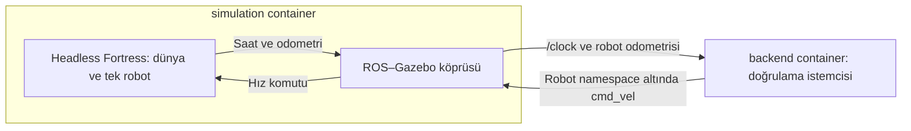

# Tek robotlu simulation doğrulaması

Tarih: 23 Ekim 2026 (Europe/Istanbul).

Durum: **Aşama A GEÇTİ**; son image ile iki temiz koşu doğrulandı. Bu ortam uygulama kurulumu veya Docker yerleşimi onayı değildir. Aşama B bu çalışmada başlatılmaz; kullanıcı Aşama A sonunda durulmasını istedi.

## Kapsam ve düzen

[Proje bağlamı](project-context.md), [onaylı geçiş kaydı](architecture-v2.3-transition.md), [DDS testi](dds-validation-2026-10-22.md) ve [action testi](dds-action-validation-2026-10-23.md) okundu. Mevcut test dosyaları değiştirilmedi. Ana uygulama `docker-compose.yml` oluşturulmadı.

[Override](../docker-compose.simulation-check.yml), mevcut DDS Compose üzerine uygulanır. Ayrı proje adı kullanır. İki container tek bridge ağındadır. Ortak DDS ayarları [mevcut env dosyasından](../config/dds.env) gelir. Aynı domain kullanan eski testlerle eşzamanlı çalıştırılmamalıdır. Host ağı, host IPC, port yayını veya ek discovery sunucusu yoktur.



[Image](../docker/simulation-check/Dockerfile), yerel DDS image'ını temel alır ve `ros-humble-ros-gz-bridge` ile JSON Schema doğrulayıcısını ekler. İlk taban image mevcut olmalıdır; hazırlık için önceki DDS kaydına bakılır. Apt paketleri sürümle sabitlenmedi; yeniden derleme aynı paketleri garanti etmez. Ölçülen kimlik ve sürümler aşağıdadır.

[Dünya şablonu](../docker/simulation-check/world.sdf.in) bu çalışma için yazıldı. Bir düz zemin, iki tekerlek, pasif destek küresi ve DiffDrive eklentisi içerir. Model veya harita indirilmedi. Sabit mekanik boyutlar test modelinin geometrisidir; robot kimliği ve başlangıç pozu config'den üretilir. Şablon `/tmp/validation-world.sdf` içine açılır; salt okunur `/config` dizinine yazılmaz.

Fortress DiffDrive API'si için [resmî hareket öğreticisi](https://gazebosim.org/docs/fortress/moving_robot/) kullanıldı (23 Ekim 2026 erişimi; yaşayan belge, sabit sürüm etiketi yok). Köprü davranışı kurulu paketin gerçek çalışma loglarıyla sınandı. ROS belge sayfası erişim engeli, GitHub tarayıcı isteği erişim hatası verdi; bunlar çalışma başarısı kanıtı olarak kullanılmadı.

Lidar yoktur; render/sensör eklentisi yüklenmez. `ign gazebo -s -r` yalnız sunucuyu ve fiziği çalıştırır. ARM64 headless lidar/render davranışı bu nedenle doğrulanmış değildir. Nav2 için gereken sensör ve harita desteği Aşama B kapsamında ayrıca ele alınmalıdır.

## Config ve doğrulama

[Tek robot dosyası](../config/simulation-check.json) tek değer kaynağıdır. [Şema](../config/simulation-check.schema.json) ek alanları reddeder; bütün alanlar zorunludur. Kodda eksik alanlar için varsayılan yoktur. Çoklu robot veya `fleet.yaml` şeması tasarlanmadı.

| Alan | Anlam, birim ve sınır |
| --- | --- |
| robot.name | SDF model adı; harfle başlayan harf/rakam/alt çizgi |
| robot.namespace | Tek seviyeli ROS namespace; aynı ad kuralları; başında eğik çizgi yok |
| robot.initial_pose | Altı sayı: x/y/z metre, roll/pitch/yaw radyan; dünya koordinatı |
| map_path | Aşama A'da `null`; harita kullanılmaz, sahte dosya yolu verilmez |
| nav2_parameters | Aşama A'da `null`; Nav2 çalıştırılmaz ve parametre seçilmez |
| probe.linear_velocity_mps | Pozitif doğrusal test hızı, m/s |
| probe.drive_seconds | Komut süresi, simülasyon saniyesi |
| probe.minimum_distance_m / maximum_distance_m | Başarı için odometri yer değiştirme aralığı, metre; üst sınır alt sınırdan büyük |
| probe.settle_seconds | Başlangıç ve sıfır komut sonrası bekleme, simülasyon saniyesi |

Sayısal değerlerin sonlu olması başlangıçta denetlenir. Ortam değişkenlerinin açıklaması [DDS kaydında](dds-validation-2026-10-22.md#dosyalar-ve-ayarlar) bulunur. Bu test `DDS_TEST_TIMEOUT_SECONDS` değerini monoton duvar saatiyle toplam istemci bekleme sınırı olarak kullanır; ürün timeout politikası değildir. `DDS_TEST_PAYLOAD` boş olamaz ve koşuyu tanımlar. `SIM_CHECK_ROLE` override içinde `simulation` veya `backend` olur. Eski `DDS_ROLE`, topic ve yayın periyodu miras alınır fakat bu betikte kullanılmaz. Domain aralığı ve container dışı erişim ayarı başlangıçta kontrol edilir; gerçek RMW istemcide sorgulanır.

[Doğrulama betiği](../docker/simulation-check/check.py), iki süreçten biri beklenmedik biçimde kapanırsa simulation'ı başarısız bitirir. Backend önce köprü abonesini, `/clock` ve odometriyi bekler. Sıfır komutla yerleşme sonrası başlangıç örneğini kaydeder; belirlenen süre hız yayımlar, sıfır komut gönderir ve son örneği alır. Pozisyonların sonluluğu, frame adları, artan odometri zamanı/örnek sayısı ve sınırlar içindeki yer değiştirme doğrulanır. Yalnız topic keşfi başarı sayılmaz. İstemci kapanırken sıfır komut gönderir; bu ürün düzeyinde güvenli duruş kanıtı değildir.

## Çalışma sonucu

`simulation-a-20261023-04` ve temiz container/ağ ile tekrar edilen `simulation-a-20261023-05` geçti. İkisinde de backend odometrisi yaklaşık 0,600 m değişti; başlangıç/son simülasyon saati farkı 4 saniyeydi. Compose, backend ve simulation çıkış kodları 0. Gazebo ve köprü alt süreçleri de 0 ile kapandı. Son iki koşuda `[Err]`, `FAIL` veya zorla sonlandırma yoktu.

Başarı üç hazırlık hatasından sonra elde edildi. İlk üç koşu başarı sayılmaz. Aşağıdaki hata geçmişi korunur.

## İlk denemelerde bulunan sorunlar

1. `simulation-a-20261023-01`: Köprü üç bağlantıyı açtı, fakat Gazebo `Failed to load system plugin [...] : couldn't find shared library.` hatası verdi. `physics`, `user-commands`, `scene-broadcaster` ve `diff-drive` yüklenemedi. Backend gerçek odometri alamadı ve `Validation deadline exceeded; missing clock/odometry/motion evidence` ile 1 döndürdü. Compose=1, backend=1, simulation=0. Bu koşu başarısızdır.
2. `simulation-a-20261023-02`: Paket içindeki sürümlü `.so.6` dosya adları denendi. Aynı yükleme hatası ve istemci bekleme sınırı oluştu. Compose=1, backend=1, simulation=0. Dosya adını değiştirmek yeterli olmadı; bu değişiklik geri alındı.
3. Paket incelemesi: `libignition-gazebo6` kütüphaneleri mevcut, ancak eklenti dizini ve DART motoru yoktu. Paket kaynak listesi ayrı `libignition-gazebo6-plugins` ve `libignition-physics5-dartsim` paketlerini gösterdi. Bu paketler yalnız yeni test image'ının Dockerfile'ına eklendi. Özel symlink, hata bastırma veya sahte odometri kullanılmadı.

İlk teşhis komutunda `ldd ... | grep "not found"` çıktı üretmedi. DART dosyası araması da boştu. `printenv | ... | grep IGN` eşleşme bulamadığından birleşik teşhis komutunun son çıkışı 1 oldu; bu, bir hareket testi değildir. Başarısız iki koşunun kapanışında Gazebo ve köprü süreçlerinin kodları 0 idi; bu kodlar eksik hareket kanıtını başarıya çevirmedi.

`test_config.py` üç test grubu ile geçerli dosyayı, hatalı ad/poz/süre/mesafe/NaN/ek alanları ve hatalı ortam değişkenlerini kontrol eder. Gerçek çıktı: `Ran 3 tests in 0.013s`, `OK`; çıkış 0. Bu kontrol ROS hareket kanıtının yerine geçmez.


Üçüncü koşu (`simulation-a-20261023-03`) sistem eklentilerini yükledi, ancak `Failed to find plugin [libignition-physics-dartsim-plugin.so]` hatası verdi. Compose=1, backend=1, simulation=0. Runtime paketinde sürümlü motor dosyası bulundu. `ign gazebo --help` çıktısındaki desteklenen `--physics-engine` seçeneğiyle bu dosya açıkça seçildi. Kod mimari dizin adını sabitlemeden kurulu ABI 5 motor dosyasını bulur; tek eşleşme yoksa açık hata verir. DART motoru değiştirilmedi, özel symlink oluşturulmadı. Bu düzeltmeyle dördüncü ve beşinci koşular geçti.

## Gerçek ortam ve kimlikler

- Platform: **linux/arm64** (image inspect).
- Docker istemci / Engine: **29.9.2 / 29.9.2**; Docker Desktop **4.96.3 (244472)**; Compose **v5.6.1**.
- DDS taban image'ının bu çalışma başındaki ölçülen digest'i: `sha256:9e382521094708ed1110050ca94cab89821006b9c46171b83d754fd0ee4842ae`. Önceki kayıttaki kimlik otomatik olarak bu koşuya taşınmadı; yerel etiket yeniden ölçüldü.
- DDS Dockerfile'ındaki ROS taban referansı: `ros:humble-ros-base-jammy@sha256:566b87e6dfc48392189a9c32e594e84060fa9948de93b04e536f39475a1f6963`. Bu çalışmada uzak taban tekrar çekilmedi; build mevcut yerel DDS image'ını kullandı.
- Son test image etiketi: `ros2-fleet-simulation-check:humble-fortress`.
- Son image ID ve RepoDigest: `sha256:69cb7989a1a325add4f0ca325f4fa1e002beb4f2ffd415d59f1efd4e32151b39`.
- Son build'in platform manifest digest'i: `sha256:f24ff54f84fe13415c257cc8b0961642082eb0fa309a4dfab84334b6b979b6d5`; config digest'i: `sha256:e0ef569d1aaafaf94e50972e91f7653f4f45ed6c1b2ec6f7f96d4c01f594295f`.
- Her iki container aynı son image'ı kullandı. Ağ: `ros2-fleet-simulation-check_dds`, `driver=bridge`. Config mount'u iki container'da da `Mode=ro`, `RW=false`.
- Gerçek RMW: `rmw_cyclonedds_cpp`. Domain ve localhost değeri miras alınan env dosyasında 42 / 0.

Son image'dan alınan sürüm çıktısı (çıkış 0):

```text
PRETTY_NAME="Ubuntu 22.04.5 LTS"
NAME="Ubuntu"
VERSION_ID="22.04"
VERSION="22.04.5 LTS (Jammy Jellyfish)"
VERSION_CODENAME=jammy
ID=ubuntu
ID_LIKE=debian
HOME_URL="https://www.ubuntu.com/"
SUPPORT_URL="https://help.ubuntu.com/"
BUG_REPORT_URL="https://bugs.launchpad.net/ubuntu/"
PRIVACY_POLICY_URL="https://www.ubuntu.com/legal/terms-and-policies/privacy-policy"
UBUNTU_CODENAME=jammy
ignition-tools:arm64	1.5.0-1~jammy
libignition-gazebo6:arm64	6.18.0-1~jammy
libignition-gazebo6-plugins:arm64	6.18.0-1~jammy
libignition-msgs8:arm64	8.7.1-1~jammy
libignition-physics5:arm64	5.4.0-1~jammy
libignition-physics5-dartsim:arm64	5.4.0-1~jammy
libignition-transport11:arm64	11.4.2-1~jammy
python3-jsonschema	3.2.0-0ubuntu2
ros-humble-cyclonedds	0.10.5-2jammy.20260307.131623
ros-humble-rclpy	3.3.22-1jammy.20260907.232408
ros-humble-rmw-cyclonedds-cpp	1.3.5-1jammy.20260907.211615
ros-humble-ros-base	0.10.0-1jammy.20260916.125240
ros-humble-ros-gz-bridge	0.244.26-1jammy.20260916.153147
6.18.0
Python 3.10.12
```

## Alınan hareket kanıtları

Terminal renk kodları çıkarıldı; sayısal değerler değiştirilmedi.

### run-04

```text
backend-1     | {"event": "BEFORE", "x": 5.9849650010243645e-21, "y": -1.4462651874269375e-37, "z": 0.0, "clock": 1.034, "odom_stamp": 1.02, "frame": "validation_robot/odom", "child_frame": "validation_robot/base_link", "samples": 30}
backend-1     | {"event": "AFTER", "x": 0.6000000000139474, "y": 5.645394419634944e-14, "z": 0.0, "clock": 5.034, "odom_stamp": 5.032, "frame": "validation_robot/odom", "child_frame": "validation_robot/base_link", "samples": 148, "distance_m": 0.6000000000139474}
backend-1     | {"event": "PASS", "token": "simulation-a-20261023-04", "distance_m": 0.6000000000139474, "clock_advance_seconds": 4.0}
backend-1 exited with code 0
simulation-1  | {"event": "PROCESS_EXIT", "command": ["ign", "gazebo", "-s", "-r", "-v", "3", "--physics-engine", "/usr/lib/aarch64-linux-gnu/ign-physics-5/engine-plugins/libignition-physics5-dartsim-plugin.so.5", "/tmp/validation-world.sdf"], "code": 0}
simulation-1  | {"event": "PROCESS_EXIT", "command": ["ros2", "run", "ros_gz_bridge", "parameter_bridge", "/clock@rosgraph_msgs/msg/Clock[ignition.msgs.Clock", "/validation_robot/odom@nav_msgs/msg/Odometry[ignition.msgs.Odometry", "/validation_robot/cmd_vel@geometry_msgs/msg/Twist]ignition.msgs.Twist"], "code": 0}
simulation-1 exited with code 0
```

### run-05

```text
backend-1     | {"event": "BEFORE", "x": 5.9849650010243645e-21, "y": -1.4462651874269375e-37, "z": 0.0, "clock": 1.034, "odom_stamp": 1.02, "frame": "validation_robot/odom", "child_frame": "validation_robot/base_link", "samples": 30}
backend-1     | {"event": "AFTER", "x": 0.6000000000139474, "y": 5.645394419634944e-14, "z": 0.0, "clock": 5.034, "odom_stamp": 5.032, "frame": "validation_robot/odom", "child_frame": "validation_robot/base_link", "samples": 148, "distance_m": 0.6000000000139474}
backend-1     | {"event": "PASS", "token": "simulation-a-20261023-05", "distance_m": 0.6000000000139474, "clock_advance_seconds": 4.0}
backend-1 exited with code 0
simulation-1  | {"event": "PROCESS_EXIT", "command": ["ign", "gazebo", "-s", "-r", "-v", "3", "--physics-engine", "/usr/lib/aarch64-linux-gnu/ign-physics-5/engine-plugins/libignition-physics5-dartsim-plugin.so.5", "/tmp/validation-world.sdf"], "code": 0}
simulation-1  | {"event": "PROCESS_EXIT", "command": ["ros2", "run", "ros_gz_bridge", "parameter_bridge", "/clock@rosgraph_msgs/msg/Clock[ignition.msgs.Clock", "/validation_robot/odom@nav_msgs/msg/Odometry[ignition.msgs.Odometry", "/validation_robot/cmd_vel@geometry_msgs/msg/Twist]ignition.msgs.Twist"], "code": 0}
simulation-1 exited with code 0
```

## Çalıştırılan komutlar ve çıkış kodları

Depo kökünde çalıştırıldı. Aşağıdaki komutlar geçici kayıt yardımcısı üzerinden çalıştırıldı; yardımcı yalnız stdout/stderr ve dönüş kodunu topladı. Burada yardımcısız gerçek komutlar listelenir. Build loglarının tamamı `/tmp/fleet-simulation-*.log` altında geçicidir; gerekli ortam, hata ve hareket kanıtları bu kayıtta kalıcıdır. Aynı build komutunun tekrarları yukarıdaki dosya düzeltmelerinden sonradır. İlk hazırlık build'i ayrıca `/tmp/fleet-simulation-build.log` dosyasına yönlendirildi ve 0 ile bitti; henüz çalışma betiğini içermeyen bu image ile koşu yapılmadı.

```sh
# build-final; exit=0
DDS_TEST_PAYLOAD=simulation-a-build docker compose -f docker-compose.dds.yml -f docker-compose.simulation-check.yml build simulation
# versions; exit=0
docker run --rm ros2-fleet-simulation-check:humble-fortress bash -c 'cat /etc/os-release; dpkg-query -W ros-humble-ros-base ros-humble-rclpy ros-humble-rmw-cyclonedds-cpp ros-humble-cyclonedds ros-humble-ros-gz-bridge libignition-gazebo6 libignition-physics5 libignition-msgs8 libignition-transport11 python3-jsonschema; ign gazebo --versions; python3 --version'
# plugin-diagnosis; exit=0
docker run --rm ros2-fleet-simulation-check:humble-fortress bash -c 'dpkg -L libignition-gazebo6 | head -25; find /usr/lib -name "*diff-drive*" -o -name "*physics-system*"; apt-cache policy libignition-gazebo6-plugins'
# build-fix; exit=0
DDS_TEST_PAYLOAD=simulation-a-build docker compose -f docker-compose.dds.yml -f docker-compose.simulation-check.yml build simulation
# run-01; exit=1
DDS_TEST_PAYLOAD=simulation-a-20261023-01 docker compose -f docker-compose.dds.yml -f docker-compose.simulation-check.yml up --no-build --abort-on-container-exit --exit-code-from backend
# image; exit=0
docker image inspect ros2-fleet-dds-check:humble-fortress ros2-fleet-simulation-check:humble-fortress --format '{{.Id}} {{json .RepoDigests}} {{.Os}}/{{.Architecture}}'
# plugin-path-diagnosis; exit=1
docker run --rm ros2-fleet-simulation-check:humble-fortress bash -c 'ls -l /usr/lib/aarch64-linux-gnu/libignition-gazebo6-physics-system.so.6; ldd /usr/lib/aarch64-linux-gnu/libignition-gazebo6-physics-system.so.6 | grep "not found"; find /usr/lib -name "*dart*"; printenv | sort | grep IGN'
# run-02; exit=1
DDS_TEST_PAYLOAD=simulation-a-20261023-02 docker compose -f docker-compose.dds.yml -f docker-compose.simulation-check.yml up --no-build --abort-on-container-exit --exit-code-from backend
# config-tests; exit=0
docker run --rm --env-file config/dds.env -e DDS_TEST_PAYLOAD=config-check -e SIM_CHECK_ROLE=backend -v "$PWD/config:/config:ro" -v "$PWD/docker/simulation-check:/opt/simulation-check:ro" ros2-fleet-simulation-check:humble-fortress python3 /opt/simulation-check/test_config.py
# build-plugins; exit=0
DDS_TEST_PAYLOAD=simulation-a-build docker compose -f docker-compose.dds.yml -f docker-compose.simulation-check.yml build simulation
# package-diagnosis; exit=0
docker run --rm ros2-fleet-simulation-check:humble-fortress bash -c 'apt-get update -qq && apt-cache search "^libignition-(gazebo6|physics5)"'
# versions-final; exit=0
docker run --rm ros2-fleet-simulation-check:humble-fortress bash -c 'dpkg-query -W libignition-gazebo6-plugins libignition-physics5-dartsim libdart6.12 ignition-tools ros-humble-ros-gz-bridge; ign gazebo --versions'
# image-final; exit=0
docker image inspect ros2-fleet-simulation-check:humble-fortress --format '{{.Id}} {{json .RepoDigests}} {{.Os}}/{{.Architecture}}'
# physics-diagnosis; exit=0
docker run --rm ros2-fleet-simulation-check:humble-fortress bash -c 'dpkg -L libignition-physics5-dartsim; ign gazebo --help | grep -A5 -B2 physics'
# run-03; exit=1
DDS_TEST_PAYLOAD=simulation-a-20261023-03 docker compose -f docker-compose.dds.yml -f docker-compose.simulation-check.yml up --no-build --abort-on-container-exit --exit-code-from backend
# build-engine; exit=0
DDS_TEST_PAYLOAD=simulation-a-build docker compose -f docker-compose.dds.yml -f docker-compose.simulation-check.yml build simulation
# run-04; exit=0
DDS_TEST_PAYLOAD=simulation-a-20261023-04 docker compose -f docker-compose.dds.yml -f docker-compose.simulation-check.yml up --no-build --abort-on-container-exit --exit-code-from backend
# final-environment; exit=0
docker run --rm ros2-fleet-simulation-check:humble-fortress bash -c 'cat /etc/os-release; dpkg-query -W ros-humble-ros-base ros-humble-rclpy ros-humble-rmw-cyclonedds-cpp ros-humble-cyclonedds ros-humble-ros-gz-bridge libignition-gazebo6 libignition-gazebo6-plugins libignition-physics5 libignition-physics5-dartsim libignition-msgs8 libignition-transport11 ignition-tools python3-jsonschema; ign gazebo --versions; python3 --version'
# final-image; exit=0
docker image inspect ros2-fleet-simulation-check:humble-fortress --format '{{.Id}} {{json .RepoDigests}} {{.Os}}/{{.Architecture}}'
# inspect-04; exit=0
docker inspect ros2-fleet-simulation-check-backend-1 ros2-fleet-simulation-check-simulation-1 --format '{{.Name}} image={{.Image}} status={{.State.Status}} exit={{.State.ExitCode}} networks={{json .NetworkSettings.Networks}} mounts={{json .Mounts}}'
# down-04; exit=0
DDS_TEST_PAYLOAD=simulation-a-20261023-04 docker compose -f docker-compose.dds.yml -f docker-compose.simulation-check.yml down
# run-05; exit=0
DDS_TEST_PAYLOAD=simulation-a-20261023-05 docker compose -f docker-compose.dds.yml -f docker-compose.simulation-check.yml up --no-build --abort-on-container-exit --exit-code-from backend
# network; exit=0
docker network inspect ros2-fleet-simulation-check_dds --format '{{.Name}} driver={{.Driver}}'
# compose-check; exit=0
DDS_TEST_PAYLOAD=simulation-a-check docker compose -f docker-compose.dds.yml -f docker-compose.simulation-check.yml config --quiet
# config-tests-final; exit=0
docker run --rm --env-file config/dds.env -e DDS_TEST_PAYLOAD=config-check -e SIM_CHECK_ROLE=backend -v "$PWD/config:/config:ro" ros2-fleet-simulation-check:humble-fortress python3 /opt/simulation-check/test_config.py
# inspect-05; exit=0
docker inspect ros2-fleet-simulation-check-backend-1 ros2-fleet-simulation-check-simulation-1 --format '{{.Name}} image={{.Image}} status={{.State.Status}} exit={{.State.ExitCode}}'
# down-05; exit=0
DDS_TEST_PAYLOAD=simulation-a-20261023-05 docker compose -f docker-compose.dds.yml -f docker-compose.simulation-check.yml down
# cleanup-check; exit=0
docker ps -a --filter label=com.docker.compose.project=ros2-fleet-simulation-check
```

Başlangıçta ayrıca `docker version --format '{{.Client.Version}} {{.Server.Version}} {{.Server.Platform.Name}}'`, `docker compose version`, `git status --short`, image/container listeleri ve Python AST kontrolü çalıştırıldı; kodları 0 idi. Başlangıç Git durumu temizdi. Compose config kontrolü sessiz geçti. Config testleri son image'da tekrar çalıştı: `Ran 3 tests in 0.012s`, `OK`, çıkış 0.

`down` sonrasında test container'ları ve ağı kaldırıldı; image yerelde bırakıldı. `docker ps -a --filter label=com.docker.compose.project=ros2-fleet-simulation-check` yalnız başlık döndürdü, çıkış 0.

## Doğrulanmadı ve sınırlar

- **Aşama B doğrulanmadı:** Nav2, AMCL, map_server ve NavigateToPose goal/result çalıştırılmadı. Aşama A sonunda duruldu.
- Lidar, GPU ve ARM64 headless render doğrulanmadı; bu çalışmada sensör kullanılmadı.
- Odometri üzerinden hareket doğrulandı. Haritaya göre mutlak konum doğruluğu, sensör lokalizasyonu, fiziksel güvenli duruş ve uzun süreli dayanıklılık doğrulanmadı.
- Gerçek ExecuteTask, robot yürütücüsü, batarya, Fleet Manager, FastAPI, frontend ve çoklu robot eklenmedi.
- Goal reddi, uygulama timeout davranışı ve RobotStatus kesilmesi için politika seçilmedi.
- Farklı platform, RMW, domain veya ağ ve önbelleksiz gelecekteki paket sürümleri doğrulanmadı.
- Mevcut DDS/action test dosyaları, ana mimari kayıtlar, Docker karar taslağı, PDF'ler ve kişisel notlar değiştirilmedi. Docker onaylanmış sayılmaz.

Son statik kontroller: iki Python dosyasının AST kontrolü, yeni dosyaların satır sonu boşluk kontrolü ve `git diff --check` geçti (çıkış 0). Son iki koşunun tam loglarında `[Err]`, `FAIL` ve `FORCED_KILL` olmadığı ayrıca kontrol edildi (çıkış 0).
