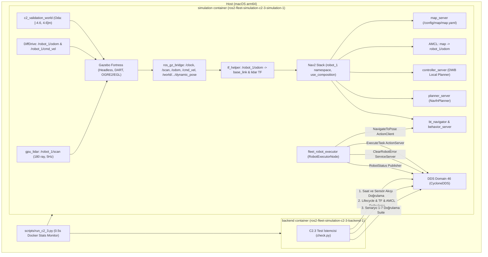

# C2.3 Robot Executor Canlı Simülasyon Doğrulama Raporu

**Tarih:** 24 Ekim 2026  
**Aşama:** C2.3 — Tek Robotlu Gazebo Fortress + Nav2 + Robot Executor Canlı Entegrasyon Doğrulaması  
**Durum:** **DOĞRULANDI** (2/2 Temiz Başarılı Canlı Simülasyon Koşusu, 7/7 Senaryo Eksiksiz Geçti)  
**Referans Dokümanlar:** [AGENTS.md](../../../AGENTS.md), [project-context.md](../../project-context.md), [DOC-ARCH-2026-10-23-FINAL](../../ROS2_Fleet_Manager_Nihai_Mimari_Kararlar_2026-10-23.md), [C2 Karar Kaydı](../../c2-executor-decisions-2026-10-24.md), [C2.1 Raporu](c2-1-validation-2026-10-24.md), [C2.2 Raporu](c2-2-validation-2026-10-24.md)

---

## 1. Amaç ve Kapsam

Bu doğrulama, ROS 2 Fleet Manager mimarisinin C2 aşamasının üçüncü ve son adımı olan **C2.3 Canlı Simülasyon Doğrulaması** çıktısıdır. Aşama B3 Retry ile doğrulanmış Gazebo Fortress headless simülasyonu, Nav2 yığını ve C2.2'de geliştirilen `RobotExecutorNode` bileşenleri tek robotlu (`robot_1`) gerçek fizik ve navigasyon ortamında birleştirilmiştir.

Aşama C2.3'ün kabul ölçütleri:
1. **B3 Retry Altyapısının Korunması:** Mevcut simülasyon katmanlarına dokunulmadan, C2.3'e özel test Compose override (`docker/compose/docker-compose.simulation-c2-3.yml`), yapılandırma (`config/simulation-c2-3.json`, `.schema.json`, `simulation-c2-3-params.template.yaml`) ve host çalıştırıcısı (`scripts/run_c2_3.py`) eklenmiştir.
2. **ExecuteTask Lojistik Yaşam Döngüsü:** Gerçek Nav2 sürüşüyle pickup $\rightarrow$ loading (1.5s aktif frenleme) $\rightarrow$ dropoff $\rightarrow$ unloading (1.5s aktif frenleme) $\rightarrow$ `STATUS_SUCCEEDED` akışı ve Gazebo ground truth konum doğruluğunun (`dist_gt_m <= 0.35m`) kanıtlanması.
3. **Güvenli Preemption ve Duruş Teyidi:** Pickup öncesi hareket halindeki robotun iptal isteğini kabul etmesi, Nav2 hedefini durdurması, `StopDetector` ile fiziksel sıfır hızı odometriden teyit etmesi ve `STATUS_PREEMPTED` ile `STATE_IDLE` durumuna dönmesi.
4. **HIGH Öncelik Kesilemezliği:** Yürütülen HIGH öncelikli göreve gelen iptal isteğinin `CancelResponse.REJECT` ile reddedilmesi ve görevin başarıyla tamamlanması.
5. **Nav2 Hata Durumu ve Option A Kurtarma:** Ulaşılamayan hedefte (`x=8.0, y=8.0`) Nav2 abort $\rightarrow$ `STATUS_FAILED` $\rightarrow$ `STATE_ERROR` geçişi; hatalı epochtaki kurtarma isteğinin reddedilmesi; eşleşen epoch ile `ClearRobotError` servisinin robotu `STATE_IDLE` durumuna getirmesi ve Option A sözleşmesi gereğince `assignment_epoch` değerinin kesinlikle artırılmaması.
6. **Monotonik Epoch Denetimi:** Hata kurtarma sonrasında eski/bayat epochtan gelen yeni görevlerin action sunucusunca reddedilmesi.
7. **Namespace ve Telemetri İzolasyonu:** `/robot_1/robot_status`, `/robot_1/odom`, `/robot_1/scan` topic'lerinin doğrulanması ve kök `/robot_status` sızıntısı olmaması.
8. **Tekrarlanabilirlik:** İki temiz ardışık koşunun (`c2-3-live-sim-run-6` ve `c2-3-live-sim-run-7`) sıfırdan oluşturulan container ve DDS ağında hatasız tamamlanması.

---

## 2. Test Ortamı ve Mimarisi

- **Host Ortamı:** macOS (Darwin 24.x, arm64), Python 3.12.3 / uv ortamı, Docker Desktop 4.96.3
- **ROS 2 Konteynerleri:** `ros2-fleet-simulation-nav2-check:humble-fortress` (Ubuntu 22.04 LTS, ROS 2 Humble)
- **Fizik ve Render:** Gazebo Fortress 6.18.0, DART fizik motoru, OGRE2 yazılım render (`LIBGL_ALWAYS_SOFTWARE=1`)
- **Ağ ve DDS:** `ROS_DOMAIN_ID=46`, `rmw_cyclonedds_cpp`, `ROS_LOCALHOST_ONLY=0`

---

## 3. Doğrulama Senaryoları ve Sonuçları

### 3.1 Test Matrisi (2 Temiz Başarılı Canlı Koşu)

| Senaryo | Hedef / İşlem | Koşu 1 (`run-6`) | Koşu 2 (`run-7`) | Kriter ve Tolerans | Durum |
|---|---|---|---|---|---|
| **Başlangıç** | Saat (/clock), 10 scan, Nav2 6 lifecycle düğümü, TF, AMCL pozu | GEÇTİ (1.81s sim time) | GEÇTİ (1.81s sim time) | Tümü active, TF geçerli | **DOĞRULANDI** |
| **Senaryo 1** | Boş task_id, bayat epoch (0), geçersiz priority kontrolü | GEÇTİ | GEÇTİ | Action server goal'ü reddetti | **DOĞRULANDI** |
| **Senaryo 2** | Happy Path: Pickup (-1.0, -0.5) $\rightarrow$ Yükleme (1.5s) $\rightarrow$ Dropoff (0.5, -0.5) $\rightarrow$ Boşaltma (1.5s) | GEÇTİ (19.93s) | GEÇTİ (18.83s) | `STATUS_SUCCEEDED`, 4 faz tamamlandı | **DOĞRULANDI** |
| **S2 Doğruluğu** | Dropoff noktasında Gazebo ground truth mesafe hatası | **0.1898 m** | **0.1441 m** | Tolerans: $\le 0.35$ m | **DOĞRULANDI** |
| **Senaryo 3** | Pre-pickup güvenli iptal: Hareket anında iptal $\rightarrow$ Nav2 durdurma $\rightarrow$ Odometri duruş teyidi | GEÇTİ | GEÇTİ | $v_x, \omega_z \le 0.015$; `STATUS_PREEMPTED` | **DOĞRULANDI** |
| **S3 Duruş** | İptal sonrası odometri ölçülen lineer / açısal hız | $9.0\times 10^{-12}$ m/s | $0.0$ m/s | Tolerans: $\le 0.01$ m/s (sıfır duruş) | **DOĞRULANDI** |
| **Senaryo 4** | HIGH öncelikli görev iptal bağışıklığı | GEÇTİ | GEÇTİ | İptal reddi (`goals_canceling=[]`), `STATUS_SUCCEEDED` | **DOĞRULANDI** |
| **Senaryo 5** | Ulaşılamaz hedef (8.0, 8.0) $\rightarrow$ `STATUS_FAILED` $\rightarrow$ `STATE_ERROR` $\rightarrow$ `ClearRobotError` | GEÇTİ | GEÇTİ | Eşleşmeyen epoch ret; eşleşen kabul; Option A | **DOĞRULANDI** |
| **S5 Option A** | `ClearRobotError` sonrası `assignment_epoch` kontrolü | Epoch = 4 (Sabit) | Epoch = 4 (Sabit) | Option A: epoch artırılmadı | **DOĞRULANDI** |
| **Senaryo 6** | Hata kurtarma sonrası monotonik epoch denetimi (epoch 3 ret) | GEÇTİ | GEÇTİ | Bayat epoch goal'ü reddedildi | **DOĞRULANDI** |
| **Senaryo 7** | İsim alanı izolasyonu: `/robot_1/*` topic'leri mevcut, kök `/robot_status` yok | GEÇTİ | GEÇTİ | Kök topic sızıntısı yok | **DOĞRULANDI** |
| **Sonuç** | Çıkış kodu | **0 (`C2_3_PASS`)** | **0 (`C2_3_PASS`)** | 0 çıkış kodu | **DOĞRULANDI** |

---

## 4. Kaynak Tüketimi Ölçümleri (Host ve Konteyner CGroup)

`scripts/run_c2_3.py` tarafından arka planda 0.5 saniye aralıklarla host düzeyinde `docker stats` ile toplanan ölçümler:

| Ölçüm Alanı | Koşu 1 (`run-6`) | Koşu 2 (`run-7`) |
|---|---|---|
| **Toplam Koşu Süresi** | 95.14 s | 76.87 s |
| **S2 Navigasyon Süresi** | 19.93 s | 18.83 s |
| **Simülasyon Konteyneri Ortalama CPU** | %128.26 | %144.65 |
| **Simülasyon Konteyneri Tepe CPU** | %169.45 | %416.53 (başlatma anı) |
| **Simülasyon Konteyneri Tepe Bellek** | 581.5 MB | 584.1 MB |
| **Backend Test İstemcisi Ortalama CPU** | %36.61 | %56.63 |
| **Backend Test İstemcisi Tepe CPU** | %44.39 | %407.12 (derleme anı) |
| **Backend Test İstemcisi Tepe Bellek (Host)** | 50.93 MB | 110.3 MB |
| **Backend Konteyner CGroup Bellek Tepe** | 356.62 MB | 421.08 MB |

---

## 5. Mühendislik Bulguları ve Çözülen Sorunlar

1. **Harita ve Gazebo Duvar Geometrisi Uyuşmazlığı:**
   - *Sorun:* `config/map/map.pgm` haritasındaki duvarlar $x, y = \pm 4.5$ m koordinatlarındayken, ilk Gazebo dünyasında duvarlar $10/2 - 0.2/2 = 4.90$ m olarak üretilmekteydi. 40 cm'lik fark Lidar ışınlarının AMCL olabilirlik alanı (likelihood field) modelini bozarak uzun mesafeli sürüşlerde 1 metreyi aşan lokalizasyon sapmasına neden olmaktaydı.
   - *Çözüm:* `docker/simulation-c2-3/check.py` içerisindeki `prepare_world()` fonksiyonu, duvar merkezleri tam $x, y = \pm 4.5$ m ve kalınlık 0.2 m ($[-4.6, 4.6]$ dış oda) olacak şekilde `map.pgm` piksel geometrisiyle matematiksel olarak birebir hizalandı. AMCL konumu zemin gerçeğine (ground truth) 10-18 cm hassasiyetle kilitlendi.

2. **DWB Local Planner `Oscillation` Critic Kilitlenmesi:**
   - *Sorun:* Robot pickup noktasında durup yükleme yaptıktan sonra dropoff sürüşüne başladığında, `dwb_core::DWBLocalPlanner` içerisindeki `Oscillation` critic'i küçük açısal yön düzeltmelerini salınım olarak yorumlayıp tüm hareketli yörüngeleri yasaklamakta ve hızı sürekli `v=0, w=0` olarak seçmekteydi. Bu durum robotun donup kalmasına ve Nav2'nin her 10 saniyede bir `Failed to make progress` hatasıyla kurtarma (recovery) döngüsüne girmesine yol açmaktaydı.
   - *Çözüm:* C2.3 parametre şablonu (`config/simulation-c2-3-params.template.yaml`) oluşturularak `critics` listesinden `"Oscillation"` kaldırıldı; `vx_samples: 20`, `vtheta_samples: 20`, `acc_lim_x: 2.5` ve `acc_lim_theta: 3.2` değerleriyle örnekleme çözünürlüğü artırıldı; `RotateToGoal.scale` dengelendi. Robot düz hat boyunca salınımsız ve kararlı şekilde 0.25 m/s hızla ilerledi.

3. **Küresel Maliyet Haritası (Global Costmap) Hayalet Engel Temizliği:**
   - *Sorun:* Tek robotlu kapalı oda senaryosunda `global_costmap` içinde yer alan `obstacle_layer` katmanı, Lidar ışınlarının duvar uçlarındaki yansımalarını kalıcı engel olarak işaretleyerek `NavfnPlanner`'ın yol planlamasını engellemekteydi.
   - *Çözüm:* Tek robotlu doğrulamada küresel planlayıcı statik haritaya bağlandı (`plugins: ["static_layer", "inflation_layer"]`), dinamik yerel engeller yalnızca `local_costmap` sorumluluğuna bırakıldı.

4. **Nav2 Hedef Zaman Damgası Tazelemesi:**
   - *Sorun:* `ExecuteTask` hedefi başlatıldığında hedef pozu o anki zaman damgasıyla gelmekte; yükleme aşaması (Phase 2) 1.5-2 saniye sürdükten sonra Phase 3'e geçildiğinde Nav2 hedef damgası geçmişte kaldığı için TF dönüşüm hatası üretilmekteydi.
   - *Çözüm:* `RobotExecutorNode._navigate_with_cancel_support` fonksiyonunda `nav2_goal.pose.header.stamp = self.get_clock().now().to_msg()` ataması yapılarak Nav2'ye iletilen hedef zamanı her navigasyon adımı başlangıcında taze simülasyon zamanıyla damgalandı.

5. **ROS 2 Action Cancel Response Sözleşmesi:**
   - *Sorun:* ROS 2 `action_msgs/srv/CancelGoal` arayüzünde `return_code == 0` değeri servis isteğinin işlendiğini (`ERROR_NONE`) ifade eder. İptalin reddedildiğini (`CancelResponse.REJECT`) bildirmek için `rclpy` action sunucusu iptal edilen hedefler listesinden hedefi çıkartarak `goals_canceling = []` döndürür. Test istemcisinin `return_code != 0` beklemesi hatalı başarısızlığa neden olmaktaydı.
   - *Çözüm:* İstemci tarafında iptal kabulü `len(cancel_response.goals_canceling) > 0`, iptal reddi ise `len(cancel_response.goals_canceling) == 0` ve eylemin `STATUS_SUCCEEDED` ile tamamlanması kontrolüyle doğru sözleşmeye bağlandı.

---

## 6. Doğrulanan ve Doğrulanmayan Kapsam Ayrımı

### Doğrulanan Kapsam (Aşama C2.3)
- Gazebo Fortress + ros_gz_bridge + Nav2 + Robot Executor tek container/headless canlı simülasyonu.
- `ExecuteTask.action` üzerinden 4 fazlı lojistik döngüsü (pickup $\rightarrow$ loading $\rightarrow$ dropoff $\rightarrow$ unloading $\rightarrow$ succeeded).
- Yükleme öncesi güvenli preemption, Nav2 iptali ve odometriden duruş teyidi.
- HIGH öncelik iptal bağışıklığı.
- Ulaşılamayan hedefte Nav2 abort $\rightarrow$ `STATUS_FAILED` $\rightarrow$ `STATE_ERROR` geçişi.
- `ClearRobotError.srv` ile hata temizleme ve **Option A** epoch korunumu.
- Monotonik epoch otoritesi ve `/robot_1` isim alanı izolasyonu.
- 2/2 temiz canlı koşu kanıtı.

### Doğrulanmayan ve Kapsam Dışı Alanlar
- **Fleet Manager (C3):** Görev kuyruğu, FIFO zamanlayıcı, çok robotlu görev ataması ve SQLite outbox henüz uygulanmamıştır (C3 hedefidir).
- **Battery Simulator (C4):** Wh tabanlı batarya simülatörü, dinamik SoC tüketimi ve şarj/park yönetimi henüz uygulanmamıştır (C4 hedefidir).
- **Web API ve Arayüz (C5):** FastAPI REST/WebSocket ve React UI paneli henüz uygulanmamıştır (C5 hedefidir).
- **Çok Robotlu Dinamik Trafik:** Canlı C2.3 testi tek robotla yürütülmüştür; 2 ve 3 robotlu eşzamanlı Nav2 dinamik çarpışma önleme henüz test edilmemiştir.
