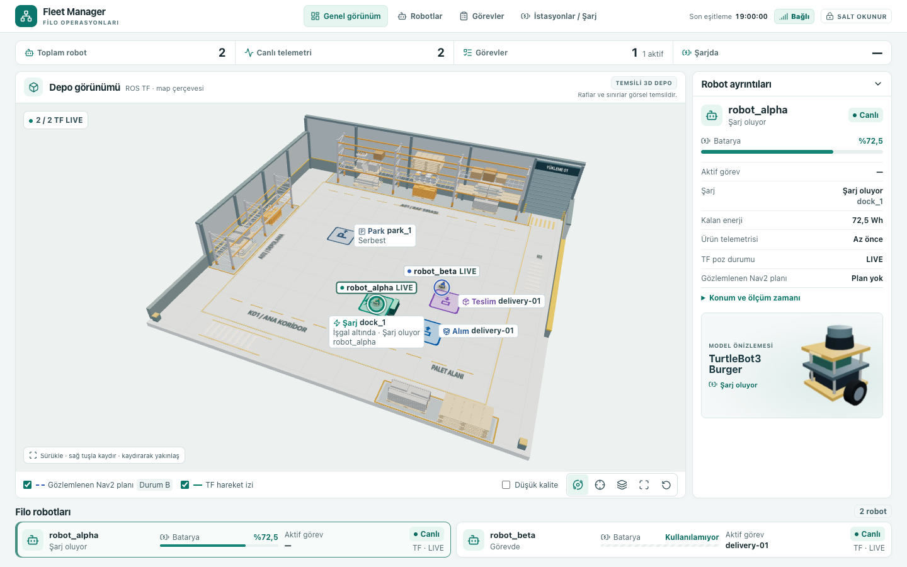
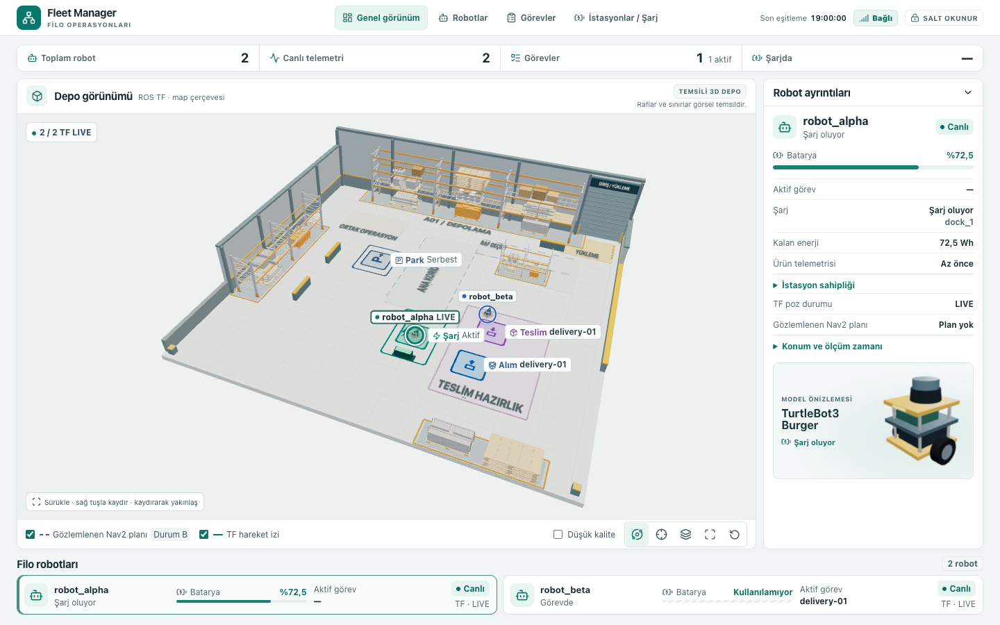

# C5 Aşama 1.7E — İşlevsel depo iç yerleşimi

**8 Kasım 2026** · [Kaynak incelemesi](stage1-7e/source-review.md) · [Komutlar](c5-stage1-7e-commands-2026-11-08.md)

`feat/c5-warehouse-functional-layout` ayrı worktree’de 1.7D’nin doğrulama commit’i `23823f6` üzerinden açıldı. Uygulama ve testler `ebb9f42` commit’inde. Değişiklik frontend ile sınırlı: fiziksel dünya, filo/istasyon/görev koordinatları, TF ve yaw, Nav2, C4, Scheduler, Executor ve web veri sözleşmesi korunuyor.

| 1.7D başlangıcı · 1440×900 | 1.7E son görünümü · 1440×900 |
|---|---|
|  |  |

## Depo planı

[Üstten canlı plan: park, şarj, alım ve teslim](stage1-7e/live/camera-top.png)

| Bölge | Yerleşim ve bağlantı |
|---|---|
| Giriş ve yükleme | Arka sağdaki kepenk, amber zemin ve güvenlik boyası. Kepenk önü kısa bölmeyle arka stoktan ayrılıyor; açık bağlantı sağ geçide ve ana koridora çıkıyor. |
| Raf ve depolama | Sol ve arka GLB raflar, arka rafa paralel yeni kısa GLB sırası ve ön sağ palet alanı. Arka sıra ile iç sıra arasındaki açık şerit **Raf geçidi**. |
| Teslim operasyonu | Sağ ön tarafta mor **Teslim hazırlık** zemini, ana koridorun doğusuna açılıyor. Soldaki **Ortak operasyon** cebi birbirine yakın örnek alım ve teslim noktalarına yer bırakıyor. Bu zeminler görevin pozunu belirlemez. |
| Şarj | Canlı dock pozunda teal kare, şimşek ve servis çerçevesi. Küçük görsel şarj ünitesi istasyonun yerel yan ekseninde 0,88 m ötede; kaydedilen yaklaşma ve ayrılma tarafı açık. |
| Park | Canlı park pozunda gri mavi kare, **P**, yön oku ve servis çerçevesi. Soldaki iki kısa bölmenin arasında yaklaşık 1,2 m açıklık var; parkın ana zemine bakan doğu tarafı açık. |

Üç iç bölme yaklaşık 0,28 m yükseklikte. Kamera tarafı açık kesit; yörünge değiştirilince robotun görüşünü kapatan dekor grubu geçici olarak gizlenir. Bölmeler, raflar ve zemin boyası ayrı dekor grubunda. Ana koridor yazısı açık merkez şeridinde, yükleme yazısı hem kepenkte hem apron boyasında. **Temsili 3D depo** ve **Raflar ve sınırlar görsel temsildir** açıklamaları korundu.

## Koordinatlar ve etiketler

| Kaynak | ROS map (x; y), m | Three.js (x; 0; z), m |
|---|---|---|
| `dock_1` | (0,50; −2,00), yaw 0 | (0,50; 0; 2,00) |
| `park_1` | (−2,00; 1,00), yaw 1,57 | (−2,00; 0; −1,00) |
| `c45-low` alım → teslim | (−3,70; 3,20) → (−3,20; 3,30) | (−3,70; 0; −3,20) → (−3,20; 0; −3,30) |
| `c45-parallel` alım → teslim | (2,30; −2,50) → (2,50; −1,00) | (2,30; 0; 2,50) → (2,50; 0; 1,00) |
| `c45-urgent` alım → teslim | (−2,20; 1,80) → (−1,50; 1,80) | (−2,20; 0; −1,80) → (−1,50; 0; −1,80) |

İstasyonlar `fleet.yaml` ile SQLite rezervasyon snapshot’ına, Chrome’da görüntülenen görev noktaları SQLite görev snapshot’ına karşı kontrol edildi. Son HIGH görevinin iki pozu geometri denetiminde SQLite’tan ayrıca okundu. Alım mavi paket alma, teslim mor paket bırakma işaretidir. 0,92 m’lik iki kare kesiştiğinde ara dikmeyle ayrılır. Eş konumda aynı kare iki renge bölünür. Her iki simge korunur; gerçek konumlar, yönler ve kimlikler değişmez. Ürün ekranı görev yoksa alım veya teslim çizmez.

Seçili robotun kimliği ve TF durumu öncelikli. Seçili olmayan canlı robotun etiketi yalnız kimliği gösterir. Uzun görev kimliği başı ve sonu korunarak kısalır; sahne ve görev kaydı aynı kimlikle bağlıdır. Etiketler önce boş aday konumlara yerleşir, sığmazsa gizlenir. Alım ve teslimin ekran kökleri 12 px’den yakınsa, yerleşen ilk görev etiketi korunur; iki zemin simgesi kalır. Şarj tek satırda durumu gösterir, **İstasyon sahipliği** ayrıntısı sağ robot panelinde açılır. Yakınlık fixture’ı ekran yerleşimini sınar; fiziksel şarjı canlı görüntü doğrular. [Yakın görev ve iki yakın robot](stage1-7e/after/nearby-pickup-dropoff.png) · [Görev yok ve park](stage1-7e/after/no-task-park.png)

## Görsel kabul ve kamera

**DOĞRULANDI.** Chrome üretim önizlemesinde 23/23 Playwright testi geçti. [Test çıktısı](stage1-7e/playwright.log) · [Derleme çıktısı](stage1-7e/build.log)

İlk görsel turda ortak operasyon yazısı doku kenarında kırpılıyor, sağ geçit fiziksel duvarın ötesinde kalıyordu. Yazı doku satırına sığdırıldı, sağ raf daraltılıp geçit içeri alındı. Yükleme zemini üstten okunur hale getirildi ve raf geçidi yazısı rafın ön izdüşümünden açığa alındı. [İlk görsel tur](stage1-7e/iteration-1440.png)

| Kontrol | Gözlem |
|---|---|
| Bölge ayrımı, raflar ve koridorlar | Açık omurga, paralel raf sıraları ve boş bağlantılar üstten seçilebiliyor. Raf geçidi yazısı arka ve iç sıra arasındaki açık alanda. |
| Giriş, şarj ve park | Kepenk ve amber boyayla giriş okunuyor. Teal dock ve gri mavi park ayrı çerçevelerde; iki merkez açık. |
| Görev işaretleri | Sağ görev çifti ayrı kareler; yakın sol çift ortak iki renkli zemin. Uzun görev etiketi kısalıyor; görev yokken işaretler kalkıyor. |
| Örtüşme ve kalabalık | Testte robot veya rota dekor içinden geçmedi. Yakın robotlarda seçili etiket görünür; ikincisi gerektiğinde gizlenir. Canlı rotalar ve geçici etiketler bazı zemin yazılarının önüne gelebilir. |
| Ana ekran ve kamera | Serbest, takip, üstten, filo kadrajı ve sıfırla çalıştı. Genel/üstten kamera gerçek dekor sınırlarına göre oturuyor. 1440×900’de dikey kaydırma yok; sağ panel ve filo kartları görünür. Mobilde kartlara dikey kaydırmayla ulaşılır. |

[1280×850](stage1-7e/after/viewport-1280.png) · [1440×900](stage1-7e/after/viewport-1440.png) · [1920×1080](stage1-7e/after/viewport-1920.png) · [390×844](stage1-7e/after/viewport-390.png) · [Mobil tam sayfa](stage1-7e/after/mobile-full.png)

[İki canlı robot](stage1-7e/live/isometric-two-robots.png) · [Şarj](stage1-7e/live/charging-scene.png) · [Aktif görev ve rota](stage1-7e/live/active-task-plan.png) · [Takip](stage1-7e/live/camera-follow.png) · [TF STALE](stage1-7e/live/isolated-tf-stale.png) · [API kesintisi](stage1-7e/live/connection-loss.png)

## Ölçülen geometri

Ön izleme kabuğundan ve canlı Chrome’dan alınan ölçüler ayrı kayıtlarda. Duvar ve rafların dünya koordinatlarındaki kutuları XZ’ye izdüşürüldü. Ardışık TF örnekleri ve her Nav2 Path’in kendi segmentleri, ayak izi dikdörtgenleriyle kesişim ve en kısa mesafe açısından sınandı. SDF’de öndeki destek küresi dahil ihtiyatlı 0,45 m robot zarfı ve 0,12 m görsel pay kullanıldı; segmentin sınırı **0,57 m**. Dock’un 0,30 m temas toleransı depo duvar ve rafları için ayrıca eklendi. Dock’un kendi ünitesi tam istasyon pozuna ve kayıtlı yaklaşma/ayrılma segmentlerine karşı denetlendi. Park için ayrı onaylı yaklaşma poligonu bulunmadığından kayıtlı yaklaşma/ayrılma kullanıldı. Kamera görüşü segmentler boyunca en fazla 5 cm aralıkla ayrıca örneklendi.

| Ölçüm | İncelenen | En kısa duvar/raf mesafesi | Dock ünitesi dahil en kısa mesafe | İhlal / örtüşme |
|---|---:|---:|---:|---:|
| İki TF izi | 8.626 segment, 8.628 görüş örneği | 0,929 m, iç raf | 0,825 m | 0 / 0 |
| 157 map Nav2 planı | 11.303 segment, 11.645 görüş örneği | 0,929 m, iç raf | 0,775 m | 0 / 0 |
| Dock ve park | 2 merkez, dock tolerans alanı | Park merkezinden bölmeye 1,430 m | Dock merkezinden kendi ünitesine 0,775 m | 0 / — |
| SQLite görevleri ve Chrome fixture’ları | 6 gerçek + 4 fixture pozu | 1,185 m, arka raf | 1,185 m | 0 / — |

En küçük segment açıklığı, 0,57 m sınırının 0,205 m üstünde. Ölçülen rotalarda ve kontrol edilen operasyon pozlarında yeni duvar veya raf kesişmesi yok.

[Geometri ayrıntısı](stage1-7e/geometry.json) · [Bağımsız istasyon ve görev kaynakları](stage1-7e/live/independent-operation-points.json) · [Tekrar ölçüm girdileri](stage1-7e/live/geometry-inputs.tar.gz)

## Aynı ortamda performans ve kadraj

Apple M3, Chrome 156.0.8078.80, ANGLE Metal, WebGL2, DPR 1, standart kalite. İki üretim derlemesi aynı kontrollü 10 Hz TF ve 2 Hz snapshot akışında, canlı ortam ve diğer testler kapalıyken sırayla ölçüldü. FPS talep üzerine çizilen sahneye, p95 kare aralığı bu çizimlerin aralığına aittir. Chrome RSS tarayıcı süreçlerinin toplamıdır ve GPU belleğinin doğrudan ölçümü değildir. İlk 3D kare navigasyon başlangıcına göre ölçülür.

| Ekran | Yatay × dikey doluluk, önce → sonra | Sahne FPS | p95 kare, ms | p95 çağrı / geometri / doku | İlk 3D kare, ms | Chrome RSS, MiB | JS heap, MiB |
|---|---:|---:|---:|---:|---:|---:|---:|
| 1280×850 | %70,2 × %94,0 → %70,2 × %94,0 | 37,7 → 36,9 | 66,2 → 66,7 | 83 / 83 / 5 → 87 / 87 / 5 | 207 → 359 | 1056 → 1134 | 13,0 → 16,5 |
| 1440×900 | %67,7 × %94,0 → %67,7 × %94,0 | 36,6 → 36,0 | 66,7 → 66,9 | 83 / 83 / 5 → 87 / 87 / 5 | 176 → 344 | 1071 → 1143 | 13,3 → 16,6 |
| 1920×1080 | %62,6 × %94,0 → %62,6 × %94,0 | 37,1 → 37,8 | 66,7 → 66,3 | 83 / 83 / 5 → 87 / 87 / 5 | 160 → 351 | 1101 → 1188 | 21,2 → 23,2 |
| 390×844 | %90,0 × %76,4 → %90,0 × %76,4 | 36,8 → 37,9 | 66,7 → 66,4 | 83 / 83 / 5 → 87 / 87 / 5 | 350 → 165 | 1072 → 1164 | 16,3 → 20,3 |

Kırpma veya yatay taşma yok. 1440×900’de sağ panel 791 px’de, filo kartları 888 px’de bitiyor; belge yüksekliği 900 px. Yeni bölmeler ve iç raf toplam dört çizim çağrısı ekledi (~%4,8); bölmeler instance, iç raf GLB renkleriyle tek birleştirilmiş mesh, zemin yazıları ortak doku. Çerçeveler istasyon kenarıyla aynı çizimde işleniyor. Doku sayısı değişmedi. 1440×900’de sahne FPS’i 0,6 düştü, p95 aralık yaklaşık aynı kaldı. Chrome RSS yaklaşık 72 MiB ve JS heap yaklaşık 3,3 MiB arttı. İlk 3D kare bu ölçümde üç masaüstü boyutunda daha geç, mobilde daha erken geldi. 1440×900’de ilk GLB kare süresi 245 → 431 ms oldu. 1440×900 ters sıra tekrarında ilk kare 353 → 178 ms, ilk GLB 440 → 268 ms ölçüldü. Başlangıç farkı bu kısa tekrarda yön değiştirdi; kalıcı başlangıç gerilemesi gösterilemedi. [Ters sıra örneği](stage1-7e/startup-reverse-order.json)

[Başlangıç ham ölçümleri](stage1-7e/before/metrics.json) · [Son ham ölçümler](stage1-7e/after/metrics.json)

## Canlı iki robotlu Fortress

**DOĞRULANDI.** İki robot hareket etti ve sırayla fiziksel şarj aldı; üç C4.5 görevi tamamlandı. Chrome’da 11.328 operasyon işareti çizimi kaynak snapshot ile eşleşti. Bağımsız ROS okuyucularında 4.761 aynı damgalı TF örneği ve 129 birebir Nav2 planı relay ile eşleşti; en büyük konum farkı 0 m, yön farkı 8,88 × 10⁻¹⁶ rad. Tarayıcıdaki 1.891 robot kökü ve yönü ölçülmüş akışa karşı doğrulandı.

İzole TF kesintisinde ilgili robot STALE oldu, diğer robotun TF’i canlı kaldı. API kapandığında güncel batarya ve şarj vurgusu kalktı. Yeniden başlatmada yaklaşık 1,11 sn sonra aynı Fleet Manager kaynak oturumuna dönüldü. Chrome sayfası kapatılıp açıldığında kaynak sıra numarası ilerlemişti; görevlerin tamamlanması izlenebildi. SQLite bütünlüğü `ok`, yabancı anahtar ihlali yok; üç kabul konteyneri çıkış kodu 0 ve OOM yok.

Katmanlar açıkken kısa canlı ölçümde 58,5 sahne FPS, 18,0 ms p95 kare aralığı ve 92 p95 çizim çağrısı kaydedildi. Bu örnek kontrollü önce/sonra tablosundan ayrıdır.

[Canlı Chrome sonucu](stage1-7e/live/chrome.log) · [ROS/Chrome karşılaştırması](stage1-7e/live/ros-chrome-compare.json) · [Canlı ölçümler](stage1-7e/live/browser-metrics.json) · [Ürün snapshot kaynağı](stage1-7e/live/verified-source.json) · [SQLite](stage1-7e/live/sqlite-check.txt) · [Kapanış](stage1-7e/live/shutdown.txt)

## Bilinen sınırlamalar

- Bu sonuç yalnız mevcut harita, iki robot ve ölçülen görevler/rotalar için geçerlidir. Görsel bölmeler ve koridorlar Nav2 engeli veya rota garantisi değildir. Görev seçimi bir seferde tek alım/teslim çifti gösterir; görevler görsel bölge sınırlarının dışında da olabilir.
- Path **Durum B** olarak kalır; gözlemlenen planın aktif Nav2 goal UUID’siyle ilişkisi doğrulanmadı. Plan ve TF izleri hareket kanıtıdır; görsel koridorların çizgilerini izlemesi gerekmez.
- 3+ robot, tüm gelecekteki rotalar, dar koridor, uzun süreli bellek/performans ve Chrome dışındaki tarayıcılar **HENÜZ TEST EDİLMEDİ**. Bu ön yüz kabulü yeni C4 enerji kalibrasyonu veya nihai üç servisli dağıtım kabulü değildir.
