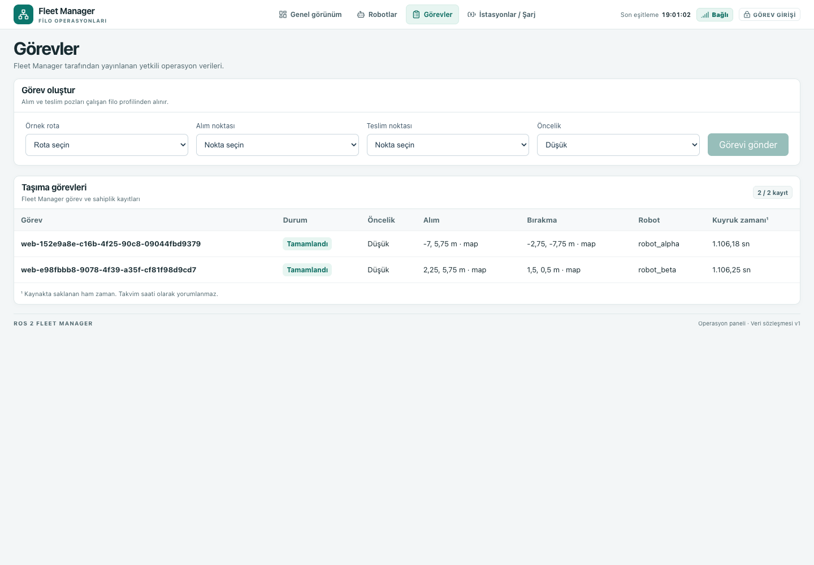

# C5 / Aşama 1.1 — Feedback düzeltmesi ve fiziksel pickup yeniden doğrulaması

11 Kasım 2026 · [Komutlar](stage1-1-commands-2026-11-11.md) · [Kanıt dizini](stage1-1-2026-11-11/) · [Önceki Aşama 1](e2e-stage1-validation-2026-11-11.md)

**F1 DÜZELTİLDİ ve yeni koşularda doğrulandı. F2 AÇIK. Koşulsuz Aşama 1.1 kabulü ve C5 final kabulü verilmedi.** Üç bağımsız `pick_A2` denemesinin ikisi 0,35 m fiziksel sınırını aştı; ilk paralel yeniden kabulde de 0,433 m hata görüldü. Tek görev koşularından birinde Battery Simulator kapanış hatası ayrıca kaydedildi. Aşama 2 şarj, Aşama 3 trafik ve 27 istasyonun fiziksel taraması başlatılmadı.

## Kaynak ve çalışma ağacı

İstenen önceki rapor gerçek dosya yolunda, `ros2-fleet-manager-c5-warehouse-grid` worktree'sinde bulundu. Ana worktree `main / 32e23fc` değiştirilmedi. Başlangıç feature HEAD'i `30373ff6ec6661130e0b2e78b382fdc768eda58c`; dal `feat/c5-warehouse-grid-layout`. Profil, görev API'si ve önceki araçlar kirli çalışma ağacındaydı. Yeni worktree'ye eksik kaynak taşıma, otomatik stash, reset, clean, merge veya rebase yapılmadı.

Başlangıç `status`, `branch -avv`, worktree listesi, son beş commit ve remote kaydı [baseline.json](stage1-1-2026-11-11/baseline.json) içinde; başlangıç dosya hash'leri [baseline-files.json](stage1-1-2026-11-11/baseline-files.json) içinde tutulur. Kullanıcı patch'i yerelde ayrıca saklandı; ilgisiz değişiklikleri commit'e taşımamak için başlangıç patch'i rapor commit'ine eklenmedi. Önceki Aşama 1 raporu ve başarısız kanıtları değiştirilmedi.

| Kaynak kimliği | Değer |
|---|---|
| F1 commit'i | `7b2bc82` — `fix(fleet): repair feedback contract and executing transition` |
| Araç checkpoint'i | `0b9dee8` — `test(c5): investigate physical pickup localization accuracy` |
| Ek araç doğrulaması | `f5cff89` — `test(c5): verify live task table and child shutdown results` |
| Rapor commit'i | Bu belgeyi ekleyen `docs(c5): report stage 1.1 end-to-end revalidation`; SHA son yanıtta verilir |
| Profil ham SHA-256 | `207e4f6d36e6dd03f5a68f854a81a061d80e16a161da3c312955b4a159161c36` |
| Çözülmüş profil özeti | `8e8396b60c306e795ea84275ac56aa41a47fc8cf090fe14ad9627988bc91fda2` |
| Şema SHA-256 | `92f8024ffcd7f9fc3e5d8871d0123240ceadf479a9f4830f180091c34beb7cb0` |
| Nav2 şablonu SHA-256 | `7f2a273cbdff28e9e3399ec7bd1ad693ca5dd725906dfab8309b5265de67fd98` |
| C5/Fortress image SHA-256 | `7fb7e7fc4aebe0d2b4097752e9b470e30d8ea7a8126bb1dee87d03f30330609d` |

İlk deneyler ve ilk A/B koşuları F1 commit'i üzerinde, araçlar henüz commit edilmemişken çalıştı. Ek görsel koşular `f5cff89` üzerinde çalıştı. Ürün dosyaları bu arada değişmedi. [Kaynak manifesti](stage1-1-2026-11-11/source-manifest.json), [ortam kaydı](stage1-1-2026-11-11/environment.json) ve [son denetim](stage1-1-2026-11-11/final-audit.json) commit SHA'sını tamamlar. Bu dar commit'ler daha önceki 30 × 18 m/API kullanıcı değişikliklerini commit etmez; yalnız HEAD'den yeni checkout açmak test edilen sürümü tek başına üretmez.

Ortam: macOS ARM64, Docker Desktop, ARM64 Ubuntu 22.04/Humble/CycloneDDS/Fortress/DART; gerçek Google Chrome 157.0.8103.40, headless Playwright. İzole domain'ler: lokalizasyon 170, ROS regresyonu 171, ilk A/B 172/173, HIGH 174, ek görsel A/B 175/176. Gerçek ürün koşuları kendi temiz dünyasını ve ayrı SQLite'ını kullandı. C4 batarya eşikleri, güç/tüketim katsayıları ve %100 başlangıcı korunmuştur. Test portları ortam değeridir.

## F1 kök nedeni ve düzeltme

Gerçek action adaptörü callback bağlamından `robot_id`, `task_id`, `assignment_epoch`, `goal_uuid`, goal başına yerel `status_seq`; ROS feedback'inden `current_phase`, `distance_to_goal`, `battery_soc` üretir. Önceki consumer `status_seq` çıkarıldıktan sonra bütün payload'ı domain metoduna geçiriyordu. Domain mesafe/SoC parametrelerini kabul etmediğinden TypeError oluşuyor, transaction geri alınıyor ve görev `ASSIGNED` kalıyordu. Önceki hata kaydı tarihsel kanıttır; aynı probe yeni çalışmada tekrar koşuldu.

[ActionFeedback](../../../backend/fleet_manager/feedback.py) eksik/bilinmeyen alan, tip, pozitif uint64 sıra/epoch, faz ve gözlem değerlerini transaction içinde doğrular. [Consumer](../../../backend/fleet_manager/event_loop.py) domain'e yalnız robot/task/epoch/UUID/faz alanlarını açıkça iletir. Robot sahipliği ve aktif atama bağlamı, sıra/dedup ve terminal kapıları korunur. Domain hata veya ret sonucu APPLIED olarak kaydedilmez.

Mesafe ve feedback SoC doğrulanmış gözlemlerdir; ürünün enerji/poz/yük/şarj kararlarında ikinci otorite oluşturmaz. Bu alanların snapshot'a eklenmesi gerekmiyordu; fiziksel telemetri BatteryState→RobotStatus yolunda kalır. Feedback, RobotStatus tazelik zamanını yenilemez. IDL bağımsız yayıncı feedback sayacı veya TTL taşımaz; yerel sayaç callback geliş sırasıdır. Kaynakta olmayan tazelik garantisi eklenmiş sayılmaz. [Alan sözleşmesi ve sınırlar](../../design/c5-feedback-contract-fix.md)

Consumer hata logu kind/robot/task/epoch/goal içerir. [Action adaptörü](../../../backend/fleet_manager/adapters/action_client.py) feedback ve result callback future'larını izler; async işlem hatasını aynı bağlamla loglar. Otomatik yeniden gönderim, görev sonucu değiştirme veya Outbox yapay tamamlama eklenmedi.

[17 yeni entegrasyon örneği](../../../tests/test_feedback_pipeline.py) gerçek adapter→consumer→domain→SQLite hattını kullanır. Doğru alan eşlemesi ve `EXECUTING`; yanlış task/robot/epoch/UUID; aynı event tekrarında DUPLICATE; aynı/geride sıra için STALE; terminal sonrası ret; bilinmeyen alan/yanlış tip/faz/NaN/aralık; callback future exception logu ve consumer'ın çalışmaya devam etmesi; stale fiziksel durumun feedback ile canlandırılmaması sınandı. Test mesafe sağlayıcısı fiziksel Nav2 kanıtı değildir.

[Yeni sözleşme probe'u](stage1-1-2026-11-11/feedback-contract.json) **0** çıktı: `ASSIGNED → EXECUTING`, feedback COMMIT sayısı 1, TypeError yok. İlk gerçek A görevinde 1930, B alpha/beta görevlerinde 1911/1296 feedback olayı APPLIED oldu; sıralar 1'den kesintisiz arttı. Ham feedback topic'i de ayrı ROS gözlemcisine kaydedildi; yalnız consumer'ın kendi iddiasına dayanılmadı. [A commit örnekleri](stage1-1-2026-11-11/scenario-a/feedback-commit-samples.json) · [B örnekleri](stage1-1-2026-11-11/scenario-b/feedback-commit-samples.json)

## F2 — Üç bağımsız fiziksel deney

Her deneyde aynı profil ve aynı `robot_beta` başlangıcı `(5,25; 7,75; π/2)`, aynı `pick_A2` hedefi `(2,25; 5,75; π/2)` kullanıldı. Yeni Gazebo/iki Nav2 dünyası açıldı; robot ışınlanmadı. Her iki fiziksel başlangıç pozu/yaw ve Nav2 active durumu kontrol edildi; beta bir saniyelik duruş penceresinde sıfır hıza sahipti. Üç başlangıç konum hatası yaklaşık `1,42e-7 m` idi. Bu izole deneyde FM/Executor yerine doğrudan gerçek Nav2 goal'u kullanıldı; ürün taşıma kabulüyle karıştırılmaz.

| Deneme | Nav2 | Terminal fiziksel hata | 2 sn sonra fiziksel hata / yaw | Aynı zamanlı TF–Gazebo farkı / yaw | Map hedef hatası | Fiziksel kontrol |
|---|---|---|---|---|---|---|
| 1 | SUCCEEDED | 0,287 m | 0,287 m / 0,187 rad | 0,146 m / 0,019 rad | 0,152 m | GEÇTİ |
| 2 | SUCCEEDED | 0,369 m | 0,369 m / 0,172 rad | 0,229 m / 0,039 rad | 0,154 m | KALDI |
| 3 | SUCCEEDED | 0,413 m | 0,413 m / 0,175 rad | 0,235 m / 0,050 rad | 0,179 m | KALDI |

Dağılım: **1/3 geçti**, minimum 0,287 m, ortalama 0,357 m, medyan 0,369 m, örnek standart sapması 0,064 m, en kötü 0,413 m. Eşik **0,350 m olarak korundu**. Üç Nav2 terminali fiziksel hassasiyet kabulü sayılmadı.

TF, fiziksel poz örneğinin aynı `/clock` damgasında lookup edildi. Scan zamanı için fiziksel poz interpolasyonu kullanıldığında örnek aralığı açıkça saklandı; son scan örneklerinde 35 ms. AMCL covariance kendi scan damgasıyla korunur; terminal zamanına taşınmış gibi sunulmaz. İki saniye sonraki ölçümde covariance örnek yaşı sırasıyla 2,415 / 2,235 / 2,335 sn idi.

| Deneme | AMCL covariance xx (m²) | yy (m²) | yaw (rad²) | Başlangıç frame'iyle hizalanmış odom yer değiştirme farkı |
|---|---|---|---|---|
| 1 | 0,107165 | 0,020474 | 0,028361 | 0,663 m |
| 2 | 0,089334 | 0,019535 | 0,027647 | 0,650 m |
| 3 | 0,138227 | 0,011750 | 0,020116 | 0,603 m |

Odom yerel frame'dedir; başlangıç fiziksel heading'iyle dönüştürülmeden dünya koordinatı farkıyla çıkarılamaz. İlk üreticinin ham JSON'undaki hizalanmamış `odom_physical_displacement_error_m` alanı bu nedenle geçersizdir; kabulde kullanılmadı. Ham dosyalar ve [ilk üretici](stage1-1-2026-11-11/producer-v1.py.txt) korunur. [Düzeltilmiş frame hesabı](../../../docker/simulation-warehouse-grid/stage11_metrics.py), üç analitik regresyon ve [türetilmiş analiz](stage1-1-2026-11-11/localization-analysis.json) geçerli karşılaştırmayı sağlar. Üretici de sonraki kullanım için düzeltildi; bu fiziksel poz/TF düzeltmesi değildir.

Son örnek scan uçlarının statik dolu dikdörtgenlere uzaklık p90'ı map TF ile 0,063 / 0,127 / 0,123 m; fiziksel pose ile 0,0047 / 0,0055 / 0,0056 m oldu. 10 cm içinde kalan map uçları %94,3 / %88,0 / %86,2; fiziksel uçlar %100. Bu, dolu hacme mesafe metriğidir; engel içinde kalan uç sıfır alır. Kalibre lidar ölçüm hatası, tüm ışınlarda ray eşleştirmesi veya AMCL likelihood skoru değildir. Map/scan hizası incelemesini destekler, tek başına kök nedeni ispatlamaz.

Nav2 terminal anında beta'nın doğrusal hızı yaklaşık sıfır, açısal hızı yaklaşık **0,126 rad/s** idi. İki saniye sonraki odometri hızları sıfırdı; fiziksel merkez hatası sürüyordu. Son dönüşün bitmesini beklememek yaw ölçümünü etkiler, fakat 0,35 m üzerindeki merkez sapmasını tek başına açıklamaz. Mevcut map hedef toleransı 0,25 m ve yaw toleransı 0,25 rad, Nav2'nin niçin başarılı terminal verdiğini açıklar.

**Kanıtlanan:** başlangıç/reset doğruluğu; map–fiziksel poz farkı; frame'i hizalanmış odom yer değiştirme farkı; duruş sonrasında devam eden fiziksel pickup sapması. **Kesinleşmeyen:** odom farkının tekerlek/temas/fizik/plugin alt nedeni ve AMCL'nin kalan hatasının ne kadarının tekrarlayan raf geometrisi veya model ayarlarından kaynaklandığı. Kovaryans verisi vardır; tek bir parçacık dağılımı veya yanlış kesinlik iddiası çıkarılmadı. Desteklenmeyen bir AMCL/Nav2 parametre düzeltmesi uygulanmadı. TF ofseti, hedef kaydırma, tolerans büyütme veya sahte başarı kullanılmadı.

## Collision modeli ve footprint

[Yeniden türetilen ölçümler](stage1-1-2026-11-11/physical-measurements.yaml) gerçek yeni koşunun SDF'sinden gelir. Görsel/nominal Burger genişliği 0,178 m ([ROBOTIS](https://emanual.robotis.com/docs/en/platform/turtlebot3/features/)); test dünyası collision gövdesi **0,50 × 0,30 m**, iki teker dıştan dışa **0,44 m**. Ön/arka destekler bu sınırlar içinde. Tüm AABB için ihtiyatlı dönüş çapı üst sınırı `sqrt(0,50²+0,44²)=0,666 m`; gövde köşesinin gerçek yarıçapı 0,292 m.

[Canlı parametre sorgusu](stage1-1-2026-11-11/live-parameters.txt): local/global `robot_radius=0,25 m`, `footprint=[]`, padding yaklaşık 0,01 m. **Padding'li 0,26 m bile gövde köşesinin 0,292 m zarfını kapsamaz.** Inflation yarıçapı 0,45 m ayrı bir maliyet alanıdır; bu geometrik eksikliği gideren fiziksel robot modeli değildir.

Ürün değişikliği uygulanmadı. Sonraki ayrı düzeltme için iki seçenek: gerçek collision birleşimini kapsayan poligon; veya en az 0,292 m geometrik yarıçapı kapsayan daire ve ayrıca gerekçelendirilecek güvenlik payı. 0,50 × 0,44 m dikdörtgen poligon ihtiyatlıdır; tüm dikdörtgeni kapsayan daire daha büyük bir zarf gerektirir. Gerçek collision birleşimiyle AABB birbirine eşit sayılmaz. Nominal görsel robotu büyütmek veya collision gövdesini küçültmek uygun çözüm değildir.

1,05 m alım geçişinde düz fiziksel genişlikten kalan salt geometrik tolerans 0,61 m; mevcut 0,45 m yaklaşma yarıçapının 0,90 m zarfı esas alınırsa 0,15 m. Koridorlar 1,75/2,00 m enine, 2,25 m ana açıklıklara sahiptir. Bunlar lokalizasyon/heading hatasıyla birlikte onaylı geçiş garantisi vermez. Footprint büyütmek maliyetleri, dönüşleri ve dock yaklaşmasını etkileyebilir; uygulanacaksa C4 dock yanaşma/temas/ayrılma, park, Nav2 rotaları ve HIGH güvenli duruş regresyonları gerekir. Bu çalışmada kanıtlanmış kapsam farkı **açık güvenlik riski** olarak bırakıldı; izole koşularda contact durdurma kapısı korundu, dar koridor testi yapılmadı.

## Gerçek uçtan uca yeniden kabul

Her senaryoda tarayıcı formu gerçek HTTP API'ye gönderdi; aynı request UUID ve değişmez payload'la browser retry `200 / DUPLICATE` döndürdü. İlk kabul `201`; SQLite'ta task başına tek task ve tek ExecuteTask Outbox komutu, bir gönderim denemesinde SENT. Assignment epoch/goal UUID, bağımsız ExecuteTask get-result cevabındaki gerçek completed_epoch ve RobotStatus task/fazları karşılaştırıldı. Üç taşıma faz dizisi yüksüz pickup→LOADING→yüklü dropoff→UNLOADING ve son yüksüzlükle tamamlandı. Gerçek C4 batarya düğümleri tüketim üretti.

İlk A/B'nin yetkili transaction zamanları aşağıdadır (**Türkiye saati UTC+3**). Ham kayıtta UTC ve monotonik zaman ayrıdır:

| Görev | QUEUED | ASSIGNED | EXECUTING | COMPLETED |
|---|---|---|---|---|
| A alpha `pick_A1 → packing_1` | 18:43:38.885 | 18:43:39.065 | 18:43:39.099 | 18:45:17.364 |
| B alpha `pick_A1 → packing_1` | 18:47:02.875 | 18:47:03.632 | 18:47:03.706 | 18:48:41.039 |
| B beta `pick_A2 → quality_1` | 18:47:02.940 | 18:47:03.795 | 18:47:03.894 | 18:48:09.958 |

İlk B'nin iki HTTP kabulü 66 ms arayla geldi; RobotStatus görev pencereleri **65,800 sn** örtüştü. Scheduler iki farklı robota doğal atama yaptı. İki robotta da epoch 1 olması normaldir; UUID'ler ayrı ve robot/task bağlamları ayrıdır.

| İlk koşu | Task / ExecuteTask UUID | Fiziksel pickup / dropoff hatası | Görev penceresi tüketimi |
|---|---|---|---|
| A alpha | `web-1e100cd3-a463-4d19-a5b3-5ee71ccd7a81` / `b7b72b4f-7e06-478e-aa1d-971f4e2aea90` | 0,226 / 0,295 m | 4,247 Wh |
| B alpha | `web-e71dad96-be38-4779-8987-6faf4549ee58` / `a318deab-4d9f-4551-a3db-cc7cd2e3a0ea` | 0,171 / 0,269 m | 4,255 Wh |
| B beta | `web-bea1bef0-4e28-4359-86ce-71137d9274a2` / `08093c78-d55e-46b3-8fcc-f09805624247` | **0,433** / 0,100 m | 2,382 Wh |

İlk A karşılaştırması görev/telemetri kontrollerinde geçti; B karşılaştırması fiziksel beta pickup kontrolünde **1 koduyla başarısız** oldu. Terminaller başarılı diye B koşulsuz kabul edilmedi. [A karşılaştırması](stage1-1-2026-11-11/scenario-a/comparison.json) · [B karşılaştırması](stage1-1-2026-11-11/scenario-b/comparison.json) · [A transaction dizisi](stage1-1-2026-11-11/scenario-a/authoritative-transitions.json) · [B dizisi](stage1-1-2026-11-11/scenario-b/authoritative-transitions.json)

İlk A/B'de batarya damgası aynı olan Chrome–BatteryState örnekleri robot başına 396/393 kez, sıfır Wh uyuşmazlığıyla eşleşti. TF/RobotStatus aynı damgada yüzlerce örnekle <`1e-12 m` fark gösterdi. Chrome render olayı ve gelen TF karşılaştırıldı; yeni simüle hareket kaynağı yoktu. İki DB'de `integrity_check=ok`, foreign key hatası/review hold yok; tekil rezervasyon sahipliği korundu. Görev sonrası park tüketimi görev penceresi tüketimiyle karıştırılmadı.

**Chrome gözlem sınırı:** yetkili geçiş journal'ı SQLite COMMIT sonrasını okur; test ürün durumunu yazmaz. İlk A'da ASSIGNED yalnız 34 ms, B alpha'da 73 ms sürdü. 250 ms latest-value ürün snapshot'ı bunların her birini Chrome'a taşımadı. Chrome'da gerçek EXECUTING ve COMPLETED görüldü; bütün geçişler her browser frame'inde görüldü iddiası yoktur. UI'ye ara durum eklenmedi.

İlk `completed.png` dosyalarından birinin görevler sekmesine geçiş render'ından önce çekildiği görsel QA'da bulundu; görüntü depo görünümüdür, tamamlanmış görev tablosu diye kullanılmadı. Ek araç commit'i görünür `Yürütülüyor`/`Tamamlandı` hücrelerini ve sayfa başlığını bekler. Bu nedenle tek/paralel görevler ayrı temiz A2/B2 dünyalarında ek görsel doğrulama için tekrarlandı; ilk sonuçlar silinmedi. Ek koşuların özeti [ek canlı kabul kaydındadır](stage1-1-2026-11-11/visual-repeat-summary.json).

| Ek koşu | QUEUED → ASSIGNED → EXECUTING → COMPLETED (UTC+3) | Fiziksel pickup / dropoff | Sonuç |
|---|---|---|---|
| A2 robot_alpha | 18:54:46.024 → 18:54:46.233 → 18:54:46.273 → 18:56:31.403 | 0,188 / 0,227 m | Geçti |
| B2 robot_alpha | 18:59:22.395 → 18:59:22.652 → 18:59:22.725 → 19:01:02.327 | 0,125 / 0,203 m | Geçti |
| B2 robot_beta | 18:59:22.464 → 18:59:22.781 → 18:59:22.863 → 19:00:29.333 | 0,395 / 0,179 m | Fiziksel pickup kaldı |

Ek A2/B2 toplam üç taşıma daha tamamlandı; bu çalışmada toplam **altı gerçek taşıma terminali** ve her görevde feedback işlenmesi vardır. İki ek koşuda da görünür görev tablosu `Yürütülüyor` ve `Tamamlandı` hücreleriyle doğrulandı; bütün alt süreçler 0 ile kapandı. B2 beta pickup hatası **0,395 m** olduğu için B2 karşılaştırması da 1 döndürdü. İlk B’deki 0,433 m ve üç izole deneyin 1/3 sonucu korunur. İlk kapanış hatası ek koşularda tekrar görülmedi; nedeni çözülmüş sayılmadı.

[İki görev EXECUTING ekranı](stage1-1-2026-11-11/chrome-b2/executing-tasks.png) · [Tek görev EXECUTING](stage1-1-2026-11-11/chrome-a2/executing-tasks.png) · [Tek görev tamamlanma](stage1-1-2026-11-11/chrome-a2/completed.png)

## Testler, başarısızlıklar ve kapanış

| Yeni çalıştırılan kontrol | Sonuç |
|---|---|
| F1 entegrasyon + domain + Outbox + action adapter seçkisi | **150 geçti**, yeni pipeline örnekleri dahil |
| Tam host Python / Executor seçkisi | **439 geçti, 28 atlandı**, 1 deprecation uyarısı |
| Ayrı ROS 2 Humble tam Python / Executor seçkisi | **487 geçti**, 1 deprecation uyarısı |
| Frame hizalama metrik testi | **3 geçti**, tam seçkilerden sonra ayrıca eklendi/koşuldu |
| Chrome/Playwright regresyonu | **23 geçti** |
| Yeni feedback sözleşme probe'u | **Geçti**, TypeError yok |
| İzole F2 fiziksel deneyi | **1 geçti / 2 kaldı** |
| İlk gerçek A/B | Terminal/feedback geçti; B fiziksel pickup kaldı |
| Canlı T04-HIGH-E2E | **Geçti**, HIGH epoch 2, gerçek terminal iptal+duruş kanıtı, FIFO ve BLOCKED kaynak korundu |

Host skip'leri ROS runtime/IDL yokluğudur; başarı diye sayılmadı. Aynı seçki ayrı Humble container'ında koşuldu. ROS test logundaki test kaynaklı uyarı ve beklenen hata yolları başarı sayısını değiştirmez; bütün loglar saklanır. HIGH regresyonu eski C3 test profilini ve test batarya beslemesini kullanır; 30 × 18 m gerçek C4 şarj kabulü değildir. Yeni çalışma bütün tarihsel T01–T10 canlı seçkisini veya C4.5 şarj kabulünü tekrar çalıştırmadı.

**Ek başarısız kapanış:** İlk A'nın alpha Battery Simulator'ı kapatılırken rclpy `_take_subscription` içinde `RuntimeError: Unable to convert call argument to Python object` ile 1 döndürdü. Supervisor'ın ana döngüsü task/telemetri kabulü sırasında bu child exit'ini görmedi; hata cleanup kaydında bulundu. İlk supervisor süreç çıkışı 0 olsa da tüm child'lar temiz kapandı denmedi. [A kapanış](stage1-1-2026-11-11/scenario-a/shutdown.json) ve batarya traceback'i ham arşivde korunur. Altta yatan ROS/pybind/sinyal nedeni tekrarlanabilir olarak kanıtlanmadı; C4 kodunda rastgele değişiklik yapılmadı. Araç artık child kapanış hatasını üst süreçte de başarısızlık olarak yayar. B'nin bütün child'ları 0; üç lokalizasyon dünyası ve HIGH simulation lifecycle temiz kapandı. OOM kaydı yok.

## Aşama 1.1 değerlendirmesi

- **DOĞRULANDI:** F1 alan eşlemesi, hata görünürlüğü, gerçek EXECUTING ve COMPLETED, epoch/UUID/sıra/terminal korumaları, tekil Outbox/SQLite, batarya ve TF kaynak eşleşmesi, iki ayrı robotun paralel yürütmesi.
- **BAŞARISIZ / AÇIK:** F2 fiziksel 0,35 m hassasiyeti; footprint kapsama farkı; ilk A'nın batarya kapanışı. Bunlar diğer geçen testlerle kapanmış sayılmaz.
- **BELİRSİZ:** odometri ve AMCL artık hatasının kesin fizik/plugin/lokalizasyon alt nedeni, rclpy kapanış hatasının kesin nedeni ve tüm hedeflerde hassasiyetin tekrarlanabilirliği.
- **KORUNDU:** 0,35 m sınırı, TF koordinatları, model/collision geometrisi, hedefler, AMCL/Nav2 parametreleri, C4 şarj/epoch/sahiplik/Outbox güvenliği ve önceki başarısız kanıtlar.
- **KAPSAM DIŞI / BAŞLATILMADI:** otomatik şarj Aşama 2, trafik Aşama 3, 27 istasyon fiziksel taraması ve final kabul.

Sonraki aşamada fiziksel yanaşma ve dock temas kanıtını lokalizasyon sapması etkileyebilir; footprint farkı dar geçiş öncesi ayrıca çözülmelidir. Önce odometri/temas/AMCL ölçümlerinin nedenini daraltmak ve kapanış hatasını yeniden üretmek uygundur. Bu öneri yeni politika onayı değildir. **Aşama sonunda duruldu; Aşama 2 kullanıcı onayı olmadan başlatılmayacak. Push/merge yapılmadı.**
