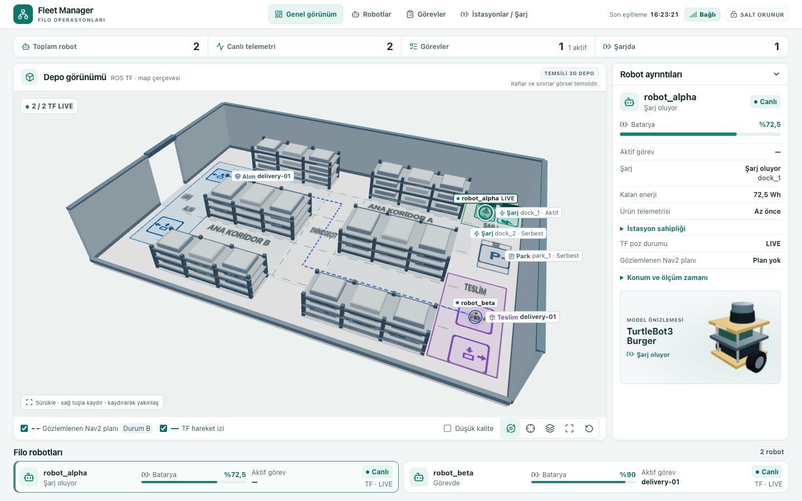
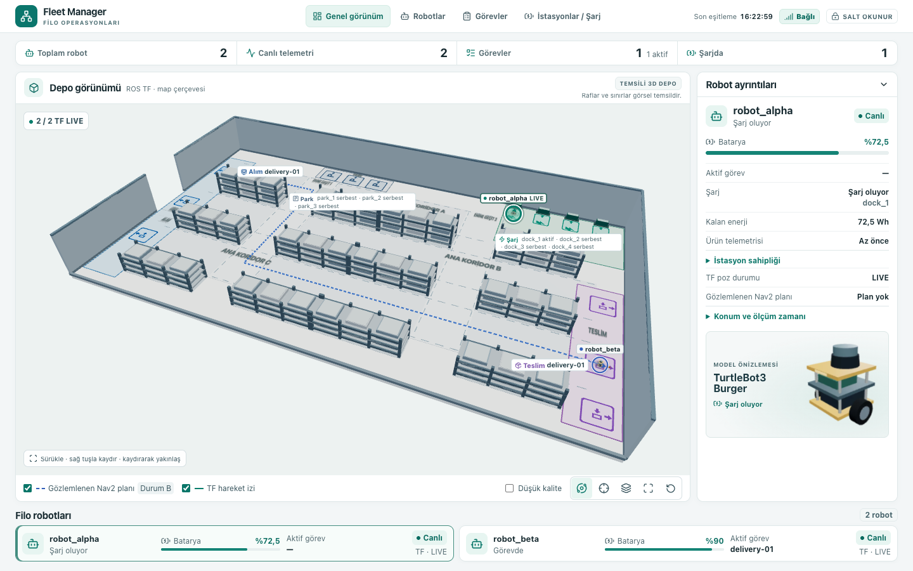

# C5 — Ortak 20 × 12 m depo ve Fortress doğrulaması

8 Kasım 2026 · [Ana filo profili](../../../config/fleet.warehouse-grid.yaml) · [12 × 8 m profili](../../../config/fleet.warehouse-grid-12x8.yaml)

| Önce · 12 × 8 m | Sonra · 20 × 12 m |
|---|---|
| [](warehouse-grid-20x12/before.png) | [](warehouse-grid-20x12/after.png) |

[Üstten](warehouse-grid-20x12/after-top.png) · [Mobil](warehouse-grid-20x12/after-mobile.png) · [Fortress fiziksel poz ve Nav2 Path kaydının Chrome tekrarı](warehouse-grid-20x12/after-recorded.png)

## Yerleşim ve üretim

- Tek boyut kaynağı profilin `warehouse.width` ve `warehouse.depth` alanlarıdır. W/E/S/N kenar ofsetleri duvarları, rafları, alanları, şarj ve parkı 0,25 m ızgaraya yerleştirir. 22 × 14 m testinde sadece iki boyut değişti. Dünya ve harita büyüdü, kenara bağlı dock yer değiştirdi, raf boyutu 3,25 × 1,00 m kaldı.
- Batıda 2 m tek kapı, üç sırada 12 raf bloğu, 2,25 m genişliğinde üç ana koridor ve 1,75 m genişliğinde iki enine geçit var. Batı alım ve doğu teslim alanları üçer hedef içeriyor. `delivery-01` görev hedefi profildeki katalog pozudur.
- Kuzeydoğudaki `dock_1`–`dock_4` duvara bakıyor. Merkezleri 1,25 m aralıklı, merkez ile en yakın raf arasındaki asgari açıklık 2,75 m. 0,30 m fiziksel ped yarı genişliği hesaba katıldığında en küçük açıklık 2,45 m. Her dock için ileri geri hareket doğrultusunda 2,00 m, enine 1,00 m açık şerit denetlendi. Üç park yeri bu şeritlerin batısında.
- Üretici SDF, PGM, Nav2 harita YAML’i, robot parametreleri ve çözümlenmiş sahne JSON’u oluşturur. Tarayıcı API’si aynı duvar ve raf dikdörtgenlerini verir. SDF kutuları ve 5 cm PGM hücreleri yatay kenarlarda tam hizalıdır. Nav2 yerel ve küresel costmap statik katmanları bu haritayı kullanır. Şarj ve parkın çalışma pozları Fleet Manager snapshot’ından gelir.
- Robot ve istasyon etiketleri ekran uzayında birlikte yerleştirilir. Şarj ve park ayrı grup etiketleri kullanır. Enine geçit yazıları üst uçlara alındı. Ön duvarlar serbest kamerada kesit, üstten görünümde tam çevre olarak görünür.

## Canlı Fortress ve Nav2

**DOĞRULANDI.** İki senaryo aynı ana profilden ayrı başlatıldı. Her iki robotun yayımladığı harita, üretilen 138.000 PGM hücresiyle birebir eşleşti. Her koşuda 12 raf merkezi iki küresel costmap’te de engel olarak okundu. SDF, sahne JSON’u ve PGM son üretimde canlı kabuldeki dosyalarla aynı çıktı.

| Senaryo | Sonuç | Fiziksel kanıt |
|---|---|---|
| Dock ve teslim | **Geçti** | `robot_alpha` → `dock_1` (5,25; 5,25), son hata 0,190 m, pedde iki teker ve ön destek teması. `robot_beta` → `delivery-01` (9,25; −2,75), son hata 0,205 m. İki Nav2 sonucu SUCCEEDED. |
| Aynı koridorda karşılıklı geçiş | **Geçti** | C koridorunda iki karşı yön şeridi kullanıldı. Y = −3,50 m ve −2,25 m. Fiziksel pozlar koridor içindeyken X sırası tersine döndü. En küçük ölçülen merkez mesafesi 1,198 m. İki 0,45 m fiziksel zarf arasında açıklık korundu, iki Nav2 sonucu SUCCEEDED. |

[Dock ve teslim ham kaydı](warehouse-grid-20x12/live-delivery.json) · [Karşılıklı geçiş ham kaydı](warehouse-grid-20x12/live-passing.json) · [Süreç kapanışları](warehouse-grid-20x12/shutdown.log)

## Chrome ve performans

**DOĞRULANDI.** Aynı Chrome’da üretim önizlemeleriyle önce/sonra karşılaştırıldı. 12 raf ve 5 duvar parçasının çizilmiş ayak izleri API koordinatlarına karşı ölçüldü. Şarj ve park grupları görünürken etiket dikdörtgenleri kesişmedi. Dock YAML’de 25 cm taşınınca aynı derleme yeni pozu çizdi. Gerçek Fortress pozları ve son gözlemlenen Nav2 planı Chrome’da tekrar oynatıldı. Plandaki en büyük çizim farkı yaklaşık 0,46 µm ve Float32 konum arabelleği düzeyinde.

Üretim Chrome 156.0.8078.80, 1440×900 ve DPR 1. Standart kalitede üç saniye boyunca robot başına 10 Hz kontrollü örnek akışı kullanıldı. Sahne 35,6 → 35,2 FPS, p95 kare aralığı 66,9 → 66,8 ms. Çizim çağrısı 90 → 126, geometri 90 → 126, doku 4 → 4. Her raf bloğu tek instanced çizim kullanır. Raf sayısı, yeni dock ve transfer işaretleriyle çağrı sayısı arttı. Düşük kalite çizim çağrısını azalttı. Zoom, sürükleme, üstten görünüm ve 390×844’te sıfırlama sınandı. Depo varsayılan masaüstü ve mobil kadrajında kırpılmadı. 23 Playwright ve 84 Python testi geçti.

[Chrome kanıtı](warehouse-grid-20x12/chrome-evidence.json) · [Playwright](warehouse-grid-20x12/playwright.log) · [Python](warehouse-grid-20x12/python.log)

## Başarısız veya doğrulanmamış noktalar

- İlk container denemesinde ROS Python yolu eksik kaldı. Sonraki DDS denemesinde loopback keşfi iki Nav2 için yeterli participant açamadı. ROS ortamı korunarak ve ayrı container ağında DDS başlatılarak iki temiz koşu tamamlandı.
- İlk Chrome kabulü, Nav2 Float64 noktalarını WebGL Float32 arabelleğine bit düzeyinde eşitleyince durdu. Son koşu 1 µm sayısal sınır kullandı. Mobil kadraj örneği de sıfırlama geçişi bittikten sonra alındı.
- Fiziksel dock teması yalnız `dock_1` için sınandı. Diğer dock’lara ve park yerlerine canlı hedef gönderilmedi. Tüm dock’lar için geri çıkış şeridi geometrik olarak denetlendi. Geri çıkış manevrası ve C4 batarya şarjı/devir akışı bu koşularda çalıştırılmadı.
- Karşılıklı geçiş önceden ayrılmış iki şeritle denendi. Aynı merkez hattına gönderilen, şerit ayrımı olmayan iki robotun kendiliğinden trafik çözümü doğrulanmadı.
- Chrome görüntülerinde canlı koşu kaydı tekrar oynatıldı. İki Fortress koşusu sırasında sürekli tarayıcı WebSocket akışı ve uzun süreli performans ölçülmedi.

## Tekrarlama

Depo kökünde C1 ve dashboard test bağımlılıklarıyla:

```sh
python -m fleet_config config/fleet.warehouse-grid.yaml
python -m fleet_config config/fleet.warehouse-grid-12x8.yaml
PYTHONPATH=. python scripts/generate_warehouse_grid.py config/fleet.warehouse-grid.yaml /tmp/c5-grid-large/final-generated
PYTHONPATH=. python -m pytest -q tests/test_config.py tests/test_c5_dashboard.py tests/test_warehouse_grid.py
```

İki fiziksel kabul için önceden doğrulanmış Fortress image’ı kullanıldı. Her koşu çıkışta iki Nav2 yaşam döngüsünü, köprüyü ve Gazebo’yu kapatır.

```sh
mkdir -p /tmp/c5-grid-large/live
docker run --rm --init --name fleet-grid-large-delivery \
  -e ROS_DOMAIN_ID=139 -e RMW_IMPLEMENTATION=rmw_cyclonedds_cpp -e ROS_LOCALHOST_ONLY=0 \
  -e LIBGL_ALWAYS_SOFTWARE=1 -v "$PWD:/workspace:ro" -v /tmp/c5-grid-large/live:/evidence \
  --entrypoint bash ros2-fleet-c5-validation:humble-fortress /workspace/docker/simulation-warehouse-grid/run.sh delivery
docker run --rm --init --name fleet-grid-large-passing \
  -e ROS_DOMAIN_ID=140 -e RMW_IMPLEMENTATION=rmw_cyclonedds_cpp -e ROS_LOCALHOST_ONLY=0 \
  -e LIBGL_ALWAYS_SOFTWARE=1 -v "$PWD:/workspace:ro" -v /tmp/c5-grid-large/live:/evidence \
  --entrypoint bash ros2-fleet-c5-validation:humble-fortress /workspace/docker/simulation-warehouse-grid/run.sh passing
```

Chrome için 12 × 8 m’nin önceki üretim çıktısı `/tmp/c5-warehouse-grid/release` yolundan kullanıldı. İki Vite önizlemesi ayrı terminallerde açıkken:

```sh
npm --prefix frontend run build -- --outDir /tmp/c5-grid-large/release --emptyOutDir
PYTHONPATH=. python tests/test_warehouse_grid.py /tmp/c5-grid-large/fixture.json
PYTHONPATH=. python tests/test_warehouse_grid.py /tmp/c5-grid-large/before-fixture.json --profile config/fleet.warehouse-grid-12x8.yaml
C5_UI_PORT=19857 C5_API_PORT=19859 npm --prefix frontend run preview -- --outDir /tmp/c5-warehouse-grid/release
C5_UI_PORT=19858 C5_API_PORT=19859 npm --prefix frontend run preview -- --outDir /tmp/c5-grid-large/release
node frontend/tests/warehouse-grid-acceptance.mjs http://127.0.0.1:19857 http://127.0.0.1:19858 \
  /tmp/c5-grid-large/fixture.json /tmp/c5-grid-large/browser /tmp/c5-grid-large/before-fixture.json \
  /tmp/c5-grid-large/live/delivery/live.json
C5_UI_PORT=19858 C5_API_PORT=19859 npm --prefix frontend test -- --workers=1
git diff --check
```
