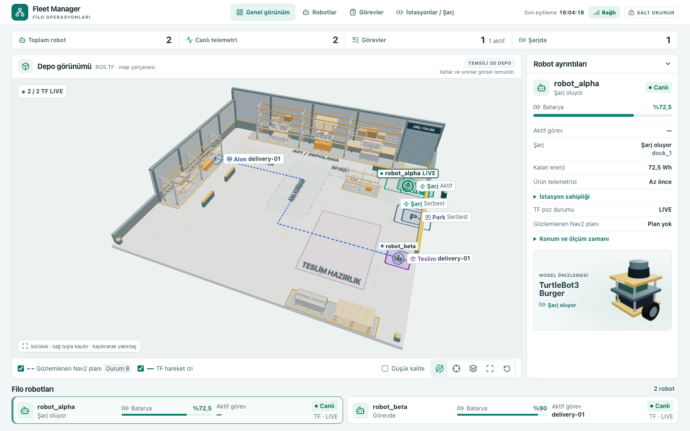
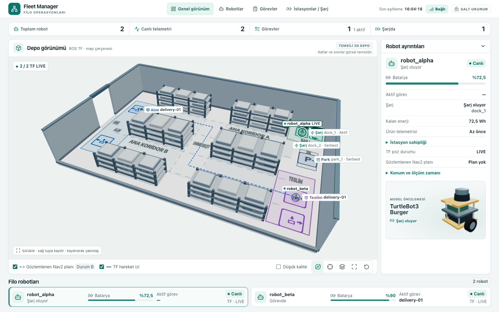

# C5 — Izgara tabanlı depo profili

Bu kayıt ilk 12 × 8 m çalışmasına aittir. Profil [12 × 8 m arşiv YAML’ında](../../../config/fleet.warehouse-grid-12x8.yaml) korunur. [20 × 12 m ve canlı Fortress kaydı](warehouse-grid-20x12-validation-2026-11-08.md)

8 Kasım 2026 · Taban `b7b144b` · Worktree dalı `feat/c5-warehouse-grid-layout`

| Önce, 1.7E | Sonra, ızgara profili |
|---|---|
| [](warehouse-grid/before.png) | [](warehouse-grid/after.png) |

[Üstten görünüm ve koridor örneği](warehouse-grid/after-top.png)

## Kaynak incelemesi ve plan

1. 1.7E’de çevre, raflar ve zemin boyası `Warehouse.tsx` ve `warehouseLayout.ts` içinde sabitti. Dock ve park Fleet Manager snapshot’ından, alım ve teslim işaretleri etkin görevden geliyordu.
2. Yeni profil tek YAML’de map geometrisi, transfer uçları, filo kaynakları ve pozları tanımlar. API, profil ile çalışan Fleet Manager snapshot’ındaki robotları, istasyon kimliklerini, tipleri ve pozları eşleştirir.
3. 12 × 8 m alan, dört duvar ve batıda 1,5 m tek kapı ile çevrilir. Serbest kamerada yakın duvarlar kesit halinde, üstten görünümde çevre tam olarak gösterilir.
4. Altı raf bloğu 0,25 m ızgaraya oturur. 1,75 m genişliğinde iki ana koridor ve 1,50 m enine geçit bırakır.
5. Batıda mavi alım, doğuda mor teslim, kuzeydoğuda yeşil çift dock ve yanında gri park vardır. Yön okları pozun yaw değerini izler.
6. Görev işaretleri gerçek görev snapshot’ının koordinatında çizilir. TF ve Nav2 için `(x, 0, -y)` dönüşümü sürer. Görüşü kapatan raf veya ölçülmüş rotayla kesişen görsel raf gizlenir.
7. Etiketler konuma bağlıdır, zoom ile sınırlı ölçüde ölçeklenir ve boş bir aday yer bulamazsa gizlenir. Düşük kalite temas gölgelerini kaldırır.

## Doğrulama

- **DOĞRULANDI.** Üretim Chrome 156’da aynı fixture ile 1440×900 önce/sonra görüntüleri alındı. `robot_alpha`, dock merkezinde `(4,75; 3,25)`, `robot_beta` teslim merkezinde `(5,00; -1,75)` göründü. Ürün ve TF örnekleri kontrollüdür. Dock ve park kimlikleri ile pozları, profili kullanan Fleet Manager kaynak kayıtlarından üretildi.
- Örnek Nav2 Path iki ana koridoru enine geçitle bağlıyor ve TF izi teslim noktasına ulaşıyor. Rota köşeleri tarayıcı ölçümüyle birebir eşleşti. Bir rafı kesen ayrı Path fixture’ı ilgili rafı gizledi ve rota koordinatları korunarak çizildi.
- `dock_1` yalnız YAML kopyasında X = 4,75 → 4,50 m değiştirildi. Yeniden oluşturulan backend snapshot’ı ve aynı ön yüz derlemesi yeni pozu gösterdi. Eski snapshot ile yeni profil bir araya geldiğinde API profil uyuşmazlığını bildirdi.
- C1 şema, dashboard ve ızgara profili seçkisinde 83 test geçti. Üretim Chrome’da 23 mevcut panel ve kamera testi ile ızgara kabul betiği geçti. Görev tablosu, robot ayrıntıları, telemetri ve düşük kalite kontrol edildi.
- **HENÜZ TEST EDİLMEDİ.** Izgara profili için fiziksel Gazebo dünyası, Nav2 haritası/costmap ve iki robotun fiziksel karşılıklı geçişi. Profil şeması ileride bu geometriyi üretecek araçlara girdi sağlar. Mevcut Gazebo kabulü standart filo profiliyle çalışır.

[Chrome ölçüm girdileri ve sonuçları](warehouse-grid/chrome-evidence.json) · [Filo profili ve şema](../../configuration-c1.md#isteğe-bağlı-depo-yerleşim-profili)

## Komutlar

Depo kökünden, C1 ve dashboard test bağımlılıklarının kurulu olduğu Python ile:

```sh
python -m fleet_config config/fleet.yaml
python -m fleet_config config/fleet.warehouse-grid.yaml
PYTHONPATH=. python -m pytest -q tests/test_config.py tests/test_c5_dashboard.py tests/test_warehouse_grid.py
npm --prefix frontend ci
npm --prefix frontend run build -- --outDir /tmp/c5-warehouse-grid/release --emptyOutDir
PYTHONPATH=. python tests/test_warehouse_grid.py /tmp/c5-warehouse-grid/fixture.json
```

Önceki doğrulanmış 1.7E üretim derlemesi `/tmp/c5-wh17e/release` altında kullanıldı. İki terminaldeki üretim önizlemelerinden sonra aynı Chrome betiği çalıştırıldı.

```sh
C5_UI_PORT=19837 C5_API_PORT=19848 npm --prefix frontend run preview -- --outDir /tmp/c5-wh17e/release
C5_UI_PORT=19847 C5_API_PORT=19848 npm --prefix frontend run preview -- --outDir /tmp/c5-warehouse-grid/release

C5_UI_PORT=19847 C5_API_PORT=19848 npm --prefix frontend test -- --workers=1
node frontend/tests/warehouse-grid-acceptance.mjs http://127.0.0.1:19837 http://127.0.0.1:19847 \
  /tmp/c5-warehouse-grid/fixture.json /tmp/c5-warehouse-grid/evidence
git diff --check
```
