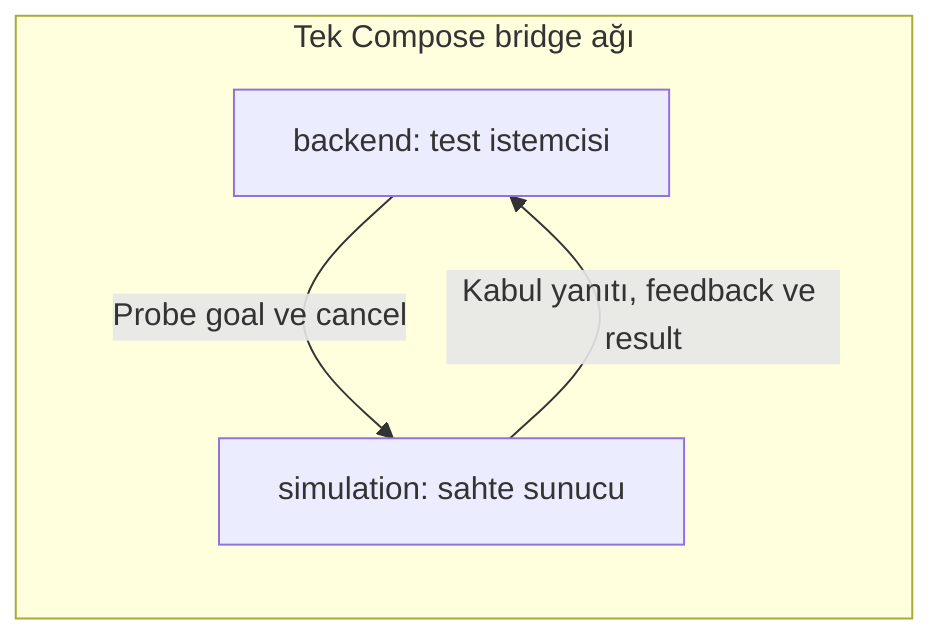

# Container'lar arası action iletişim testi

Tarih: 23 Ekim 2026 (Europe/Istanbul).

Durum: GEÇTİ. Goal kabulü, feedback içeriği, başarılı result ve cancel iletişimi iki container arasında doğrulandı. Kullanılan `TransportProbe` **geçici, ExecuteTask değildir**. Gerçek ExecuteTask alanları hâlâ taslaktır. Bu sonuç Docker yerleşimi onayı değildir.

## Kapsam ve düzen

[Önceki DDS testi](dds-validation-2026-10-22.md) temel alındı. [Mevcut DDS Compose](../../../docker/compose/docker-compose.dds.yml) değiştirilmeden [action test override dosyası](../../../docker/compose/docker-compose.dds-action.yml) eklendi. Aynı proje adı ve bridge ağı kullanılır; topic testiyle eşzamanlı çalıştırılmaz. Ana uygulama Compose'u oluşturulmadı veya değiştirilmedi.



- [Action tanımı](../../../interfaces/dds_probe_interfaces/action/TransportProbe.action), [CMakeLists.txt](../../../interfaces/dds_probe_interfaces/CMakeLists.txt) ve [package.xml](../../../interfaces/dds_probe_interfaces/package.xml): yalnız test arayüzü; üretim sözleşmesi değildir.
- [Dockerfile.action](../../../docker/dds/Dockerfile.action): mevcut DDS image'ını temel alır; arayüzü `colcon build` ile üretir. Önce temel image yerelde derlenmelidir. Test image etiketi sürümleri sabitlemez; her yeni derleme yeniden doğrulanmalıdır.
- [action_probe.py](../../../docker/dds/action_probe.py): simulation sahte sunucuyu, backend doğrulayan istemciyi çalıştırır. Başarısız kontrol veya eksik kanıt istemciden 1 döndürür.
- [Action ayarları](../../../config/dds-action.env): `DDS_ACTION_NAME`, mutlak ROS action adı; varsayılanın tek kaynağı bu dosyadır. Başlangıçta mutlak ad kontrolü, ardından rclpy ad doğrulaması yapılır.
- Ortak ayarlar [config/dds.env](../../../config/dds.env) üzerinden gelir; alan açıklamaları [önceki test kaydındadır](dds-validation-2026-10-22.md#dosyalar-ve-ayarlar). Bu testte `DDS_ROLE`, override tarafından `server` veya `client` olur. `DDS_TEST_TIMEOUT_SECONDS` yalnız test beklemelerinin üst sınırı (saniye), `DDS_PUBLISH_PERIOD_SECONDS` sahte sunucu feedback aralığıdır (saniye). `DDS_TEST_TOPIC` kullanılmaz. Pozitif sonlu süreler, boş olmayan koşu değeri, rol, domain aralığı ve localhost ayarı başlangıçta doğrulanır. Yeni filo ayarı yoktur.

Goal alanları `string token` ve `bool cancel_probe`; feedback ve result alanı `string proof` olur. Alanlar birimsizdir ve kalıcı varsayılan taşımaz. İstemci koşuya özgü token'a `complete` veya `cancel` ekler. Sunucu ayrıca rastgele bir UUID üretir. İstemci aldığı feedback'in token'ını, goal UUID'sini ve sunucu değerini denetler; result aynı değeri ve beklenen son eki taşımalıdır. Yalnız sunucu logu veya action keşfi başarı sayılmaz.

İki ayrı goal kullanılır. İlk goal üç feedback yayını sonunda SUCCEEDED olur. İkinci goal ilk feedback alındıktan sonra iptal edilir. Cancel yanıtının dönüş kodu ve `goals_canceling` içindeki goal UUID kontrol edilir; ardından CANCELED terminal result ve içeriği ayrıca alınır. Bu sahte yürütme, fiziksel duruş veya güvenli pickup iptali kanıtı değildir.

## Sürümler ve ortam

| Alan | Ölçülen değer |
| --- | --- |
| Docker istemci / Engine | 29.9.2 / 29.9.2 |
| Docker Desktop | 4.96.3 (244472) |
| Docker Compose | v5.6.1 |
| Image platformu | linux/arm64 |
| Container işletim sistemi | Ubuntu 22.04.5 LTS |
| ROS / ros-base | Humble / 0.10.0-1jammy.20260916.125240 |
| Python | 3.10.12 |
| rclpy | 3.3.22-1jammy.20260907.232408 |
| rmw_cyclonedds_cpp | 1.3.5-1jammy.20260907.211615 |
| Cyclone DDS | 0.10.5-2jammy.20260307.131623 |
| rosidl_default_generators | 1.2.1-1jammy.20260907.203219 |
| libignition-gazebo6 | 6.18.0-1~jammy; çalıştırılmadı |
| Gerçek RMW | Her iki düğümde rmw_cyclonedds_cpp |
| ROS_DOMAIN_ID / ROS_LOCALHOST_ONLY | Ortak env dosyasından 42 / 0 |
| Ağ | ros2-fleet-dds-check_dds; driver=bridge; iki container yalnız bu ağda |
| Test image | ros2-fleet-dds-action-check:humble-fortress |
| Image kimliği | sha256:7684dced2ae138f0d5208e106ecb3605b41156d198de631639f6eea811f909d3 |

## Çalıştırılan komutlar ve çıkış kodları

Depo kökünden çalıştırıldı. Aşağıdaki her komutun çıkış kodu **0** oldu. Build ve koşu logları `/tmp` altında geçicidir; önemli çıktılar aşağıya aktarıldı. Tekrarda `DDS_TEST_PAYLOAD` için yeni değer kullanılmalıdır.

```sh
docker version --format '{{.Client.Version}} {{.Server.Version}} {{.Server.Platform.Name}}'
docker compose version
DDS_TEST_PAYLOAD=action-probe-20261023-01 docker compose -f docker-compose.dds.yml build simulation > /tmp/fleet-action-base-build.log 2>&1
DDS_TEST_PAYLOAD=action-probe-20261023-01 docker compose -f docker-compose.dds.yml -f docker-compose.dds-action.yml config --quiet
DDS_TEST_PAYLOAD=action-probe-20261023-01 docker compose -f docker-compose.dds.yml -f docker-compose.dds-action.yml build simulation > /tmp/fleet-action-build.log 2>&1
DDS_TEST_PAYLOAD=action-probe-20261023-01 docker compose -f docker-compose.dds.yml -f docker-compose.dds-action.yml up --no-build --abort-on-container-exit --exit-code-from backend > /tmp/fleet-action-run.log 2>&1
cat /tmp/fleet-action-run.log
docker inspect ros2-fleet-dds-check-backend-1 ros2-fleet-dds-check-simulation-1 --format '{{.Name}} image={{.Image}} status={{.State.Status}} exit={{.State.ExitCode}} networks={{json .NetworkSettings.Networks}}'
docker image inspect ros2-fleet-dds-action-check:humble-fortress --format '{{.Id}} {{.Os}}/{{.Architecture}}'
docker network inspect ros2-fleet-dds-check_dds --format '{{.Name}} driver={{.Driver}}'
docker run --rm --env-file config/dds.env ros2-fleet-dds-action-check:humble-fortress bash -c 'cat /etc/os-release; dpkg-query -W ros-humble-ros-base ros-humble-rclpy ros-humble-rmw-cyclonedds-cpp ros-humble-cyclonedds ros-humble-rosidl-default-generators libignition-gazebo6; python3 --version'
DDS_TEST_PAYLOAD=action-probe-20261023-01 docker compose -f docker-compose.dds.yml -f docker-compose.dds-action.yml down
python3 -c 'import ast; from pathlib import Path; ast.parse(Path("docker/dds/action_probe.py").read_text()); print("Python AST: PASS")'
git diff --check
```

Derleme çıktısı: `Summary: 1 package finished [1.97s]`. Sözdizimi çıktısı: `Python AST: PASS`. Compose config ve diff kontrolü sessiz tamamlandı. `inspect`, iki container için aynı image kimliğini ve `status=exited exit=0` değerini verdi. `down`, iki test container'ını ve ağı kaldırdı; image önbellekte bırakıldı.

## Alınan çıktılar

İlk ve tek çalışma koşusu: `action-probe-20261023-01`. Aşağıda çalışma logunun olay ve çıkış satırları bulunur; terminal kontrol karakterleri çıkarıldı.

```text
backend-1  | {"event": "START", "role": "client", "action": "/dds_validation/transport_probe", "rmw": "rmw_cyclonedds_cpp"}
simulation-1  | {"event": "START", "role": "server", "action": "/dds_validation/transport_probe", "rmw": "rmw_cyclonedds_cpp"}
simulation-1  | {"event": "SERVER_GOAL", "token": "action-probe-20261023-01:complete", "cancel_probe": false}
backend-1  | {"event": "GOAL_ACCEPTED", "case": "complete", "uuid": "03b08d9ae010488ea436a1eea57aeab9"}
backend-1  | {"event": "FEEDBACK_RECEIVED", "case": "complete", "proof": "action-probe-20261023-01:complete:5a0163a5be4c446ebc760f01c8903e40"}
backend-1  | {"event": "FEEDBACK_RECEIVED", "case": "complete", "proof": "action-probe-20261023-01:complete:5a0163a5be4c446ebc760f01c8903e40"}
backend-1  | {"event": "FEEDBACK_RECEIVED", "case": "complete", "proof": "action-probe-20261023-01:complete:5a0163a5be4c446ebc760f01c8903e40"}
simulation-1  | {"event": "SERVER_SUCCEEDED", "proof": "action-probe-20261023-01:complete:5a0163a5be4c446ebc760f01c8903e40:succeeded"}
backend-1  | {"event": "RESULT_RECEIVED", "case": "complete", "status": 4, "proof": "action-probe-20261023-01:complete:5a0163a5be4c446ebc760f01c8903e40:succeeded"}
backend-1  | {"event": "CASE_PASS", "case": "complete"}
simulation-1  | {"event": "SERVER_GOAL", "token": "action-probe-20261023-01:cancel", "cancel_probe": true}
backend-1  | {"event": "GOAL_ACCEPTED", "case": "cancel", "uuid": "e6062e81d0aa4a2cab1e4ef07d106100"}
backend-1  | {"event": "FEEDBACK_RECEIVED", "case": "cancel", "proof": "action-probe-20261023-01:cancel:643f96b59fb243deafe2669c8714f946"}
simulation-1  | {"event": "SERVER_CANCEL", "token": "action-probe-20261023-01:cancel"}
backend-1  | {"event": "CANCEL_ACCEPTED", "case": "cancel", "return_code": 0}
simulation-1  | {"event": "SERVER_CANCELED", "proof": "action-probe-20261023-01:cancel:643f96b59fb243deafe2669c8714f946:canceled"}
backend-1  | {"event": "RESULT_RECEIVED", "case": "cancel", "status": 5, "proof": "action-probe-20261023-01:cancel:643f96b59fb243deafe2669c8714f946:canceled"}
backend-1  | {"event": "CASE_PASS", "case": "cancel"}
backend-1  | {"event": "PASS"}
backend-1 exited with code 0
simulation-1 exited with code 0
```

| Kontrol | Sonuç |
| --- | --- |
| Goal kabulü | GEÇTİ; iki ayrı goal kabulü istemcide alındı |
| Feedback | GEÇTİ; koşu token'ı, goal UUID ve sunucu değeri doğrulandı |
| Başarılı result | GEÇTİ; status=4 (SUCCEEDED), feedback ile aynı sunucu değeri |
| Cancel | GEÇTİ; return_code=0, doğru goal UUID; ardından status=5 (CANCELED) ve doğru result içeriği |
| Çıkış kodları | Compose=0, backend=0, simulation=0 |

## Sınırlar

Goal reddi, timeout hata yolları ve RobotStatus kesilmesi **bu testte sınanmadı**. Bunların ürün davranışları [v2.3 geçiş kaydında](../../architecture-v2.3-transition.md#açık-hata-yolları-henüz-seçilmedi) henüz seçilmedi; bu çalışma onları belirlemez. Betikteki süreler yalnız testin bekleme korumalarıdır.

Gerçek ExecuteTask, Nav2, Gazebo dünyası, Fleet Manager, RobotStatus, fiziksel duruş, pickup-cancel yarışı, eski atama sonucu uzlaştırması, farklı platform/RMW ve uzun süreli dayanıklılık **doğrulanmadı**. Nav2, Gazebo veya Fleet Manager mantığı eklenmedi.

Ana uygulama Compose'u, v2.3 geçiş kaydı, Docker karar taslağı, kaynak PDF'ler ve kişisel notlar değiştirilmedi. Başlangıçta mevcut olan `docs/project-context.md` değişikliği ve izlenmeyen Docker karar taslağı korundu. Docker onayı verilmiş sayılmaz.
