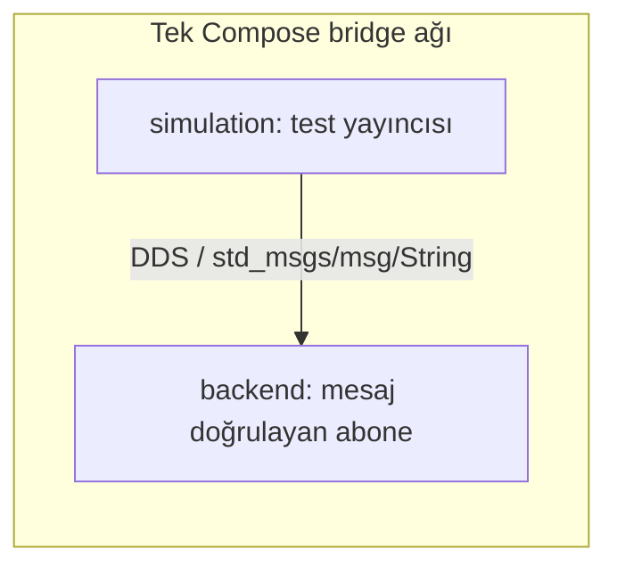

# İki container arasında DDS mesaj alma testi

Başlangıç: 22 Ekim 2026. Son çalışma ve kayıt güncellemesi: 23 Ekim 2026 (Europe/Istanbul).

Durum: Minimal DDS mesaj alma testi GEÇTİ (23 Ekim, ikinci koşu). Bu sonuç yalnız aşağıdaki image, platform, RMW ve ağ ayarlarında gerçek mesaj alımını kanıtlar. Bu kayıt Docker yerleşimi için onay veya tüm Docker mimarisinin doğrulaması değildir. [v2.3 geçiş kaydının](../../architecture-v2.3-transition.md) Docker bölümü değiştirilmedi; onay, test kanıtlarından sonra ayrı karar kaydında verilecektir.

## Kapsam ve düzen

İki servis aynı ROS tabanlı image'ı ve tek Compose bridge ağını kullanır. Host ağı, host IPC, port yayını veya ayrı discovery sunucusu yoktur. simulation test yayıncısıdır; backend yalnız test abonesidir. Gerçek Fleet Manager, Nav2, frontend veya action testi eklenmemiştir.



Gazebo Ignition Fortress ortak image'a kurulur. Bu DDS testinde Gazebo dünyası veya robot çalıştırılmaz; fizik/sensör çalışması doğrulanmaz. Humble/Fortress eşleşmesi ve ROS deposundan kurulum için [Gazebo resmi kurulum belgesi](https://gazebosim.org/docs/fortress/ros_installation/) esas alındı.

## Dosyalar ve ayarlar

- [Compose](../../../docker/compose/docker-compose.dds.yml): iki servis ve tek ağ; ayrı proje adıyla ana uygulamadan izole.
- [Dockerfile](../../../docker/dds/Dockerfile): ortak Humble/Jammy tabanı, Fortress ve Cyclone DDS paketleri.
- [Test düğümü](../../../docker/dds/probe.py): yalnız alınan mesaj beklenen içerikle aynıysa backend sıfır koduyla çıkar. Monoton saatle timeout, başarısızlıkta çıkış kodu 1.
- [Test ayarları](../../../config/dds.env): varsayılanların tek kaynağı; filo ayarları içermez.

| Ayar | Anlam / doğrulama |
| --- | --- |
| ROS_DOMAIN_ID | DDS alan kimliği; tamsayı 0–232 |
| RMW_IMPLEMENTATION | Kurulu ROS middleware paketi; bu image Cyclone DDS içerir |
| ROS_LOCALHOST_ONLY | Container dışındaki katılımcılar için 0 |
| DDS_TEST_TOPIC | Mutlak ROS topic adı; geçerliliğini rclpy denetler |
| DDS_TEST_TIMEOUT_SECONDS | Abone bekleme üst sınırı; pozitif sonlu saniye |
| DDS_PUBLISH_PERIOD_SECONDS | Yayın aralığı; pozitif sonlu saniye |
| DDS_TEST_PAYLOAD | Koşuya özgü, boş olmayan metin; shell ortamından zorunlu, kalıcı varsayılan yok |
| DDS_ROLE | Compose servisinde publisher veya subscriber |

QoS: RELIABLE, VOLATILE, KEEP_LAST(1). Periyodik yayın, abonenin keşif tamamlandıktan sonra mesaj alabilmesini sağlar. PASS için backend logunda tam beklenen içeriği taşıyan RECEIVED olayı ve sıfır çıkış kodu gerekir.

## Ortam ve kanıt

Aşağıdaki tablo 22 Ekim hazırlık oturumunun gözlemleridir. 23 Ekim'de Docker sürümlerinin değiştiği tespit edildi; gerçek test ortamı sonraki bölümde ayrıca kaydedildi.

| Alan | Gözlenen değer |
| --- | --- |
| Host | macOS / arm64 |
| Docker Desktop | 4.82.0 (233772) |
| Docker Engine / istemci | 29.6.1 |
| Docker Compose | v5.3.0 |
| Docker motor platformu | linux/arm64 (`docker info`: linux/aarch64) |
| ROS tabanı | ros:humble-ros-base-jammy |
| Çözümlenen taban digest | sha256:566b87e6dfc48392189a9c32e594e84060fa9948de93b04e536f39475a1f6963 |
| Hedef yerel image | ros2-fleet-dds-check:humble-fortress |
| Yapılandırılmış RMW | rmw_cyclonedds_cpp |
| Yapılandırılmış ROS_DOMAIN_ID | 42 |
| Topic / mesaj tipi | /dds_validation/probe / std_msgs/msg/String |

22 Ekim kaydı kapanırken paket sürümleri, üretilen image kimliği ve alınan mesaj henüz doğrulanmamıştı. 23 Ekim sonuçları aşağıdadır.

### Çalıştırılan hazırlık komutları

Depo kökünden:

```sh
docker version
docker info --format '{{.OSType}}/{{.Architecture}}'
open -a Docker
docker compose version
uname -m
docker desktop status
docker pull ros:humble-ros-base-jammy
DDS_TEST_PAYLOAD=dds-check-20261022-01 docker compose -f docker-compose.dds.yml config --quiet
DDS_TEST_PAYLOAD=dds-check-20261022-01 docker compose -f docker-compose.dds.yml build simulation > /tmp/fleet-dds-build.log 2>&1
DDS_TEST_PAYLOAD=dds-check-20261022-01 docker compose -f docker-compose.dds.yml config > /tmp/fleet-dds-compose-resolved.yml
```

Compose yapılandırma kontrolü geçti. Python AST sözdizimi kontrolü ve `git diff --check` geçti. Bunlar DDS iletişimi veya Gazebo çalışma testi değildir.

İlk ön kontrolde daemon kapalıydı. `open -a Docker` ile Docker Desktop açıldı. İlk `docker pull ros:humble-ros-base-jammy` denemesi Docker Hub'dan HTTP 502 aldı. Sonraki Compose build taban image indirmesini başlattı.

Ortam değişkeni verilmeden yapılan ilk build çağrısı zorunlu DDS_TEST_PAYLOAD kontrolünde durdu; değişken verilerek tekrarlandı. Bu bir DDS çalışma sonucu değildir.

İlk build, `E: Unable to locate package ignition-gazebo6` nedeniyle kod 100 ile durdu. Dockerfile, ROS deposundaki Fortress çalışma zamanı paket adı `libignition-gazebo6` ve CLI paketi `ignition-tools` ile düzeltildi. DDS için gerekmeyen `ros-humble-ros-gz-sim` bağımlılığı kaldırıldı. Yeni build aynı taban digest ile tekrarlandı:

```sh
DDS_TEST_PAYLOAD=dds-check-20261022-01 docker compose -f docker-compose.dds.yml build simulation > /tmp/fleet-dds-build-retry.log 2>&1
```

## 23 Ekim: devam kontrolü ve gerçek çalışma sonucu

İlk `git status --short`: README.md ve docs/project-context.md değişmiş; config/, docker/, docker-compose.dds.yml ve bu test kaydı izlenmeyen dosyalardı. Önceki kaydın başarı iddiası içermemesi doğruydu. Yerel image vardı (`d7805975f8aa` kısa kimliği), bu Compose projesine ait container yoktu. Image'ın varlığı DDS başarısı sayılmadı. Build yeniden çalıştırıldı; bağımlılık ve ilk probe.py katmanları CACHED, çıkış kodu 0 idi.

### Gerçek test ortamı

| Alan | 23 Ekim gözlemi |
| --- | --- |
| Docker Desktop | 4.96.3 (244472) |
| Docker Engine / istemci | 29.9.2 |
| Docker Compose | v5.6.1 |
| Image platformu | linux/arm64 |
| Container işletim sistemi | Ubuntu 22.04.5 LTS (Jammy) |
| Image etiketi | ros2-fleet-dds-check:humble-fortress |
| Son image kimliği (inspect) | sha256:cec87679250af037d7e7446f8f59aa8359958e9d05d085371610f1a8f9ea9503 |
| ROS dağıtımı / ros-base paketi | Humble / 0.10.0-1jammy.20260916.125240 |
| rclpy | 3.3.22-1jammy.20260907.232408 |
| rmw_cyclonedds_cpp paketi | 1.3.5-1jammy.20260907.211615 |
| Cyclone DDS paketi | 0.10.5-2jammy.20260307.131623 |
| Gerçek RMW kimliği | rmw_cyclonedds_cpp (rclpy.utilities üzerinden sorgulandı) |
| ROS_DOMAIN_ID / ROS_LOCALHOST_ONLY | 42 / 0 |
| Fortress çalışma zamanı paketi | libignition-gazebo6:arm64 6.18.0-1~jammy |
| ignition-tools | 1.5.0-1~jammy |
| ign gazebo --versions çıktısı | 6.18.0 |
| Ağ | ros2-fleet-dds-check_dds; driver=bridge; iki servis yalnız bu ağa bağlı |

Taban digest Dockerfile'da sabit. Apt paketleri sürümle sabitlenmedi; yukarıdaki sürümler bu image'dan ölçüldü. Önbelleksiz gelecekteki build aynı paket sürümlerini garanti etmez; yeni image için kanıt yeniden alınmalıdır.

### Koşular

1. `dds-check-20261023-01`: backend mesajı aldı ve 0 ile çıktı. Compose yayıncıyı durdururken yakalanmamış ExternalShutdownException nedeniyle simulation 1 ile çıktı. Bu nedenle bu koşu temiz kapanış kanıtı sayılmadı. Test betiğinde ExternalShutdownException, KeyboardInterrupt ile birlikte ele alındı; abonenin mesaj almadan durdurulması hâlâ başarısızlık döndürür.
2. `dds-check-20261023-02`: değişiklik sonrası build'de paket katmanı CACHED, yalnız probe katmanı yenilendi. Mesaj gerçekten alındı; Compose, backend ve simulation çıkış kodları 0. Test GEÇTİ.

Son koşunun logundan ilgili satırlar (terminal renk/kontrol karakterleri çıkarıldı):

```text
backend-1 | {"event": "START", "role": "subscriber", "topic": "/dds_validation/probe", "rmw": "rmw_cyclonedds_cpp", "domain": 42}
simulation-1 | {"event": "START", "role": "publisher", "topic": "/dds_validation/probe", "rmw": "rmw_cyclonedds_cpp", "domain": 42}
simulation-1 | {"event": "PUBLISHED", "topic": "/dds_validation/probe", "data": "dds-check-20261023-02"}
backend-1 | {"event": "RECEIVED", "topic": "/dds_validation/probe", "data": "dds-check-20261023-02"}
backend-1 exited with code 0
simulation-1 exited with code 0
```

`docker inspect` ile her iki container'ın son image kimliğini kullandığı, `status=exited exit=0` olduğu ve yalnız `ros2-fleet-dds-check_dds` ağına bağlı olduğu kontrol edildi. `docker network inspect` driver=bridge döndürdü. Kanıt alındıktan sonra `down` ile test container'ları ve ağı kaldırıldı; image önbellekte bırakıldı.

### Çalıştırılan devam ve test komutları

Depo kökünden, aşağıdaki sırayla (ilk koşu sonrasında yukarıda açıklanan betik düzeltmesi yapıldı):

```sh
git status --short
docker image ls
docker ps -a --filter label=com.docker.compose.project=ros2-fleet-dds-check
docker info --format '{{.ServerVersion}} {{.OSType}}/{{.Architecture}}'
DDS_TEST_PAYLOAD=dds-check-20261023-01 docker compose -f docker-compose.dds.yml build simulation > /tmp/fleet-dds-build-resume.log 2>&1
docker version --format '{{.Client.Version}} {{.Server.Version}} {{.Server.Platform.Name}}'
docker compose version
DDS_TEST_PAYLOAD=dds-check-20261023-01 docker compose -f docker-compose.dds.yml up --no-build --abort-on-container-exit --exit-code-from backend > /tmp/fleet-dds-run-20261023.log 2>&1
docker run --rm ros2-fleet-dds-check:humble-fortress bash -c 'cat /etc/os-release; dpkg-query -W ros-humble-ros-base ros-humble-rclpy ros-humble-rmw-cyclonedds-cpp ros-humble-cyclonedds libignition-gazebo6 ignition-tools; ign gazebo --versions'
docker network inspect ros2-fleet-dds-check_dds --format '{{.Name}} driver={{.Driver}}'
DDS_TEST_PAYLOAD=dds-check-20261023-02 docker compose -f docker-compose.dds.yml build simulation > /tmp/fleet-dds-build-final.log 2>&1
DDS_TEST_PAYLOAD=dds-check-20261023-02 docker compose -f docker-compose.dds.yml up --no-build --abort-on-container-exit --exit-code-from backend > /tmp/fleet-dds-run-final.log 2>&1
cat /tmp/fleet-dds-run-final.log
docker inspect ros2-fleet-dds-check-backend-1 ros2-fleet-dds-check-simulation-1 --format '{{.Name}} image={{.Image}} status={{.State.Status}} exit={{.State.ExitCode}} networks={{range $name, $value := .NetworkSettings.Networks}}{{$name}} {{end}}'
docker image inspect ros2-fleet-dds-check:humble-fortress --format '{{.Id}} {{.Os}}/{{.Architecture}}'
DDS_TEST_PAYLOAD=dds-check-20261023-02 docker compose -f docker-compose.dds.yml config --quiet
docker run --rm --env-file config/dds.env ros2-fleet-dds-check:humble-fortress bash -c 'dpkg-query -W ros-humble-ros-base ros-humble-rclpy ros-humble-rmw-cyclonedds-cpp ros-humble-cyclonedds libignition-gazebo6 ignition-tools; ign gazebo --versions; python3 -c "from rclpy.utilities import get_rmw_implementation_identifier; print(get_rmw_implementation_identifier())"'
DDS_TEST_PAYLOAD=dds-check-20261023-02 docker compose -f docker-compose.dds.yml down
docker ps -a --filter label=com.docker.compose.project=ros2-fleet-dds-check
git diff --check
git diff -- docs/architecture-v2.3-transition.md
```

Tekrarda DDS_TEST_PAYLOAD için yeni, koşuya özgü bir değer kullanılmalı. `/tmp` logları geçicidir; esas kanıt olan mesaj, çıkış kodları ve ortam bilgileri bu kayda aktarıldı.

## Sınırlar

- Doğrulanan: Bu iki container arasında belirtilen DDS ayarlarıyla std_msgs/msg/String mesajının alınması; Fortress paket kurulumu ve sürüm komutunun çalışması.
- Doğrulanmadı / kapsam dışı: Gazebo dünyası, fizik/sensör çalışması, ROS–Gazebo köprüsü, Nav2 hazırlığı, action goal/result/cancel, Fleet Manager, frontend, Apply Configuration, farklı platform/RMW/ağ koşulları ve uzun süreli dayanıklılık.
- Docker yerleşimi onaylanmadı; v2.3 geçiş kaydında değişiklik yok. Ayrı bir onay kaydı oluşturulmadı.
