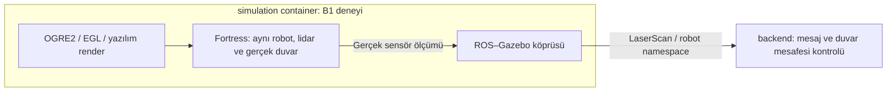

# Tek robotlu simulation doğrulaması: Aşama B

Tarih: 23 Ekim 2026 (Europe/Istanbul).

## Durum ve kapsam

**B1 GEÇTİ: `03` ve `04` iki temiz başarılı koşudur. B2 başlatılmadı; bu sınırlı deneme tamamlandı.** Bu kayıt Docker yerleşimi onayı değildir. [Proje bağlamı](../../../project-context.md), [onaylı v2.3 geçiş kaydı](../../../architecture-v2.3-transition.md) ve [Aşama A](../a/simulation-validation-2026-10-23.md) okundu. Önceki kayıtlar ve kişisel notlar değiştirilmez.

İlk iki başarısız koşuda eklenti arama engeli incelendi; resmi `--render-engine-server` ve override ortam değişkenleriyle eklenti yükleme aşaması aşıldı. Ancak OGRE2 motoru dummy render window başlatırken HLMS Unlit shader şablon dosyalarının eksikliği (`FileNotFoundException`) nedeniyle `Ogre::HlmsPbsDatablock::getBrdf()` üzerinde çöktü (-11 segfault). Bu frame, [ikinci koşunun tam logundaki](simulation-stage-b-commands-2026-10-23.md#run-b1-02) `#0` satırında yer alır. O aşamada kullanıcının açık talimatı gereği sonraki hata kovalanmadan duruldu. Sonraki açık izinle yapılan sınırlı resmi paket denemesi aşağıda kayıtlıdır; shader eksikliği giderildi ve iki koşuda gerçek LaserScan doğrulandı.

## Ayrı deney düzeni

[Ayrı Compose override](../../../../docker/compose/docker-compose.simulation-lidar-check.yml), DDS ve Aşama A override dosyalarının üzerine eklenir. Ayrı proje, container, ağ ve image kullanılır. [Dockerfile](../../../../docker/simulation-lidar-check/Dockerfile), ölçülen yerel Aşama A image'ına OGRE2 runtime paketini ve aşağıda belirlenen resmi medya sağlayıcısını zorunlu bağımlılıklarıyla ekler. Aşama A dosyaları değiştirilmez. [Betik](../../../../docker/simulation-lidar-check/check.py), Aşama A config doğrulayıcısını ve aynı robot dünya şablonunu kullanır; çalışma sırasında `/tmp/lidar-world.sdf` dosyasına sensör ve duvar ekler. Config iki container'da da salt okunur bağlanır.



Bu şema yalnız deney düzenini gösterir. Çoklu robot, fleet.yaml, ExecuteTask, yürütücü, batarya, Fleet Manager, FastAPI ve frontend eklenmedi. Backend burada yalnız doğrulama istemcisidir; uygulama mimarisinde doğrudan Nav2 komut sahibi seçilmez.

## Config ve kabul ölçütü

Robot kimliği ve başlangıç pozu [Aşama A config'inden](../../../../config/simulation-check.json) gelir; aynı değerler ikinci config'e kopyalanmaz. B1'de harita ve Nav2 parametreleri bu dosyada `null` kalır. [Lidar config](../../../../config/simulation-lidar-check.json) ve [şeması](../../../../config/simulation-lidar-check.schema.json) bütün yeni alanları zorunlu tutar, ek alanları reddeder. Kodda eksik ayar için varsayılan yoktur. Sayıların sonluluğu, min/max sırası ve analitik duvar kontrolünün gerektirdiği sıfır yönelim başlangıçta denetlenir.

| Alan | Anlam / birim |
| --- | --- |
| sensor.pose | base_link'e göre x/y/z metre, roll/pitch/yaw radyan |
| sensor.samples | Yatay ışın sayısı |
| sensor.min_angle_rad / max_angle_rad | Yatay tarama sınırları, radyan |
| sensor.min_range_m / max_range_m | Algılama mesafesi sınırları, metre |
| sensor.resolution_m | Mesafe çözünürlüğü, metre |
| sensor.update_rate_hz | Sensör güncelleme sıklığı, Hz |
| wall.pose | Dünya koordinatında x/y/z metre ve roll/pitch/yaw radyan |
| wall.size_m | Gerçek duvarın x/y/z boyutları, metre |
| render.engine / headless | Deneyin OGRE2 ve headless render seçimi |
| check.minimum_messages | Kabul için gereken gerçek LaserScan mesaj sayısı |
| check.range_tolerance_m | Her ışında duvar geometrisine göre izin verilen hata, metre |

Tek değer kaynağı bağlantılı config dosyalarıdır; varsayılanlar ayrıca tanımlanmaz. DDS domain, RMW ve duvar saati bekleme sınırı [dds.env](../../../../config/dds.env) dosyasından gelir. Test süresi ürün timeout politikası değildir. Koşu kimliği `DDS_TEST_PAYLOAD` ile verilir. Aynı domain'deki diğer deneyler eşzamanlı çalıştırılmaz.

Backend yalnız topic keşfine bakmaz. Artan zaman damgalı mesajlar, beklenen ışın sayısı, sonlu ve menzil içinde değerler aranır. Her ışının beklenen mesafesi duvarın ön yüzü ile sensör x konumu arasındaki farkın `cos(açı)` değerine bölünmesiyle hesaplanır. Duvarın y kapsamına düşmeyen ışın kabul edilmez. Robot B1 boyunca hareketsizdir; hız komutu gönderilmez. Sahte scan, sahte ölçüm, sürüm yeteneğini olduğundan farklı gösteren OpenGL override veya özel symlink yoktur.

## Render seçimi ve kaynaklar

Kurulu `ign gazebo --help` çıktısı `-s`, `--headless-rendering`, `--render-engine` ve `--render-engine-server` seçeneklerini doğruladı. Başlangıç image'ında sensör paketleri ve Mesa vardı, OGRE paketi yoktu. `/dev/dri` bulunamadı. İlk paket/env incelemesinde `dpkg-query` OGRE eşleşmesi bulamadı; son `ls -l /dev/dri` nedeniyle birleşik komut çıkışı 2 oldu. Bu bir lidar denemesi veya başarı kanıtı değildir.

Bu nedenle ayrı image'da `libignition-rendering6-ogre2` kurulur. Sunucu `-s -r --headless-rendering` ile başlar. Deney override'ı `LIBGL_ALWAYS_SOFTWARE=1` ve `EGL_PLATFORM=surfaceless` verir. X sunucusu veya GUI açılmaz. Bu bir test altyapısı seçimi olup ürün render mimarisini kilitlemez.

[Fortress sorun giderme belgesi](https://gazebosim.org/docs/fortress/troubleshooting/) yazılım render seçeneğini açıklar. [Fortress EGL duyurusu](https://community.gazebosim.org/t/egl-support-is-available-in-ignition-fortress/1183) headless seçeneğinin OGRE2 ile kullanılmasını açıklar. Belgeler 23 Ekim 2026 tarihinde incelendi. Gerçek platform desteğinin kanıtı aşağıdaki çalışma çıktısıdır; belge tek başına başarı sayılmaz.

## Komutlar ve gerçek çıktılar

[Komut ve çıktı eki](simulation-stage-b-commands-2026-10-23.md) çalıştırılan komutları, çıkış kodlarını ve stdout/stderr çıktısını tutar. Geçici kayıt yardımcısı çıktıyı bu eke yazar; sonradan yalnız ANSI renk kodları ve satır sonu boşlukları temizlendi; test sonucunu değiştirmez. İlk hazırlıkta ayrıca `git status --short` temizdi; `python3 -m py_compile docker/simulation-lidar-check/check.py` ve `git diff --check` çıkış 0 verdi. Paket adı araması `apt-get update -qq && apt-cache search libignition-rendering6` çıkış 0 verdi ve OGRE1/OGRE2 runtime paketlerini listeledi.

## Sonuç

Son sınırlı deneme başarılıdır. [03 koşusu](simulation-stage-b-commands-2026-10-23.md#run-b1-03) ve [04 koşusu](simulation-stage-b-commands-2026-10-23.md#run-b1-04) aynı image, config ve kabul betiğiyle çalıştırıldı. Arada `down` ile iki test container'ı ve ağ kaldırıldı; ikinci koşu yeni container ve ağ kimlikleriyle başladı. Üçüncü koşuya gerek kalmadı.

| Ölçüm | 03 | 04 |
| --- | --- | --- |
| Koşu kimliği | `simulation-b1-20261023-03` | `simulation-b1-20261023-04` |
| Doğrulanan gerçek LaserScan | 10 | 10 |
| Her mesajdaki sonlu, menzil içi ışın | 31 | 31 |
| Ölçülen mesafe aralığı (m) | 1.950119–2.077357 | 1.950119–2.077357 |
| En büyük analitik duvar hatası (m) | 0.004366012 | 0.004366012 |
| Artan simülasyon zaman damgaları (s) | 0.002–1.8 | 0.002–1.8 |
| Gazebo / köprü / simulation / backend / Compose çıkışı | 0 / 0 / 0 / 0 / 0 | 0 / 0 / 0 / 0 / 0 |

Duvarın ön yüzüne merkez doğrultudaki beklenen uzaklık config geometrisinden 1.95 m hesaplanır; her ışın kendi açısı için kontrol edildi. Ölçülen en büyük hata config'deki toleransın altındadır. Her iki koşuda `B1_PASS` ve `SCAN_SUMMARY: validated_messages=10, queued_messages=0` vardır. Render thread başlatıldı, gerçek `gpu_lidar` topic'i yayımlandı. Yeni hata, segfault, `FAIL` veya `FORCED_KILL` görülmedi. Sahte scan veya hata bastırma eklenmedi.

Önceki başarısız koşuların kanıtı korunur:

`simulation-b1-20261023-01` ve `simulation-b1-20261023-02` başarısızdır. İkinci denemede resmi mekanizmalar uygulandı: Compose override'ında `IGN_GAZEBO_RENDER_ENGINE_PATH` ve `IGN_RENDERING_PLUGIN_PATH` tanımlandı; `check.py` içinde `--physics-engine`'de olduğu gibi `--render-engine-server /usr/lib/aarch64-linux-gnu/ign-rendering-6/engine-plugins/libignition-rendering6-ogre2.so.6` parametresi verildi.

Bu parametreyle `RenderEngineManager` eklentiyi yükledi; ilk koşudaki `Failed to load plugin` ve `Engine [ogre2] is not supported` hataları tamamen ortadan kalktı. Ancak OGRE2 motoru pencere/bağlam oluştururken `/usr/share/ignition/ignition-rendering6/ogre2/src/media/Hlms/Unlit/GLSL` klasöründeki HLMS Unlit GLSL shader şablon dosyalarını bulamadı (`OGRE EXCEPTION(6:FileNotFoundException)`):

```text
[Err] [Ogre2RenderEngine.cc:993]  Unable to create the rendering window: OGRE EXCEPTION(6:FileNotFoundException): Data folder provided contains no valid template shader files. Did you provide the right folder location? Check you have the right read pemissions. Folder: /usr/share/ignition/ignition-rendering6/ogre2/src/media/Hlms/Unlit/GLSL in Hlms::Hlms at /build/ogre-next-phBY09/ogre-next-2.2.5+dfsg3/OgreMain/src/OgreHlms.cpp (line 441)
[Err] [Ogre2RenderEngine.cc:1001] Unable to create the rendering window after [11] attempts.
[Err] [Ogre2RenderEngine.cc:919] Failed to create dummy render window.
[Err] [Ogre2Material.cc:997] Ogre HLMS PBS not ready. Is Ogre2 Render Engine initiallized?
Segmentation fault (Address not mapped to object [0x2e0])
```

Gazebo alt süreci `-11`, simulation container `1`, backend container `1`, Compose `1` ile bitti. İkinci istemcide düzeltilen backend kapanışı çalıştı: `SCAN_SUMMARY: validated_messages=0, queued_messages=0` kaydedildi ve temiz şekilde `ExternalShutdownException` yakalandı. **Kaydedilen/doğrulanan LaserScan mesaj sayısı 01 ve 02 koşularında 0**; bu iki eski koşuda hiçbir `SCAN` veya `B1_PASS` kaydı yoktur.

İkinci koşu sırasında geçerli kullanıcı talimatı gereği (yeni hata çıkarsa sonraki hatayı kovalamadan dur) o aşamada shader eksikliğini giderme veya Xvfb denemesine girişilmedi; karar kapısında duruldu ve B2 başlatılmadı.

## Son sınırlı paket denemesi

Kullanıcı, ikinci koşudan sonra yalnız eksik medyanın resmi paketini bulup uyumluysa B1 image'ına eklemeyi onayladı. İzin, aynı testi yeni koşu kimliğiyle çalıştırmak ve farklı hata çıkarsa tekrar denemeden durmaktır. Başarı durumunda iki temiz koşu aranır; bu dizide toplam en fazla üç canlı koşu yapılabilir. B2 kapsam dışıdır. Bu izin Docker yerleşimi onayı değildir.

[Resmi depo sorguları ve arşiv içeriği](simulation-stage-b-commands-2026-10-23.md#iteration-03-package-contents) şu sonucu verdi:

- Önceki image'da hata yolunun `dpkg -S` sorgusu eşleşme vermedi (çıkış 1). İndeks güncellemesi bitmeden yapılan erken `apt-cache show` sorgusu da çıkış 100 verdi; tamamlanmış indeks sorgusu esas alındı. İki başarısız teşhis komutu ekte korunur; canlı B1 koşusu değildir.
- Sağlayıcı: ROS resmi deposundan (`packages.ros.org/ros2/ubuntu`, `jammy/main`, `arm64`) `libignition-rendering6-ogre2-dev`, sürüm `6.6.4-1~jammy`. Arşiv SHA256: `717dc0c44bc1fcc39295b4c7dcedeb830bc4e3f284cde5557c72964a523bebbf`. `apt-get download` ve `dpkg-deb --contents` ile içerik incelendi; arşiv elle kurulmadı veya dosyaları çıkartılıp taşınmadı. `apt-file` gerekmedi.
- Gerçek paket yolu `/usr/share/ignition/ignition-rendering6/ogre2/media/Hlms/Unlit/GLSL`; PixelShader, VertexShader ve piece şablonlarını içerir. Logdaki `ogre2/src/media` kurulum yolu değildir. [Aynı sürümün resmi kaynak kodunda](https://github.com/gazebosim/gz-rendering/blob/ignition-rendering6_6.6.4/ogre2/src/Ogre2RenderEngine.cc#L630) `RegisterHlms`, `ogre2/media` bulunamazsa `ogre2/src/media` yoluna geçer. Kaynak yalnız okundu; derleme yapılmadı.
- Paket, kurulu `libignition-rendering6-ogre2` ile tam sürüm eşitliği ister. ROS adayı kurulu rendering sürümüyle aynıdır. Ubuntu'daki `libignition-rendering-ogre2-dev` adayı `6.1.0+ds-0ubuntu2` olduğundan seçilmedi. Ubuntu `libogre-next-dev` adayı `2.2.5+dfsg3-0ubuntu2`, kurulu OGRE Next ile aynıdır ve ROS paketinin zorunlu bağımlılığıdır.
- B1 Dockerfile'a yalnız `libignition-rendering6-ogre2-dev=6.6.4-1~jammy` kurulum talebi eklendi. APT simülasyonu önceki B1 image'ına göre 42 yeni paket (hedef ve 41 zorunlu bağımlılık), 0 yükseltme, 0 kaldırma gösterdi. Önerilen paketler kurulmaz. Paket kendi standart `.so` bağlarını içerir; elle symlink oluşturulmadı. Tam dosya yoluyla motor yükleyen mevcut B1 betiği ve override bu çalışmada değiştirilmedi.

Kurulumdan sonra `dpkg -S`, GLSL dizininin sahibini aynı paket olarak doğruladı; dört şablon dosyası listelendi. `dpkg --audit` sorun bildirmedi. Image build, Compose config ve image içindeki iki config/dünya testi çıkış 0 verdi.

## Başarısız denemeler ve teşhis sınırı

1. İlk config testi, Aşama A ile B1 betiklerinin ikisinin de `check` modül adı taşıması nedeniyle `RecursionError` verdi (`Ran 2 tests`, `FAILED (errors=9)`, çıkış 1). Aşama A modülü artık dosya yoluyla ayrı `stage_a_check` adı altında yüklenir. Düzeltilen test çıkış 0 verdi.
2. Canlı B1 ilk koşusu (`simulation-b1-20261023-01`) render motoru eklentisi bulunamadığı için çöktü. `libignition-rendering6.so.6` ve `libignition-common4.so.4` disassembly incelemesinde saptandı: `RenderEngineManager` genel eklenti adı olarak `ignition-rendering-ogre2` arar; `SystemPaths::FindSharedLibrary` buna `lib` ve `.so` ekleyerek `libignition-rendering-ogre2.so` bekler. Ancak ROS resmi deposundan gelen Jammy ARM64 runtime paketi (`libignition-rendering6-ogre2`) engine-plugins dizinine yalnızca ABI soname'i (`libignition-rendering6-ogre2.so.6` ve `.so.6.6.4`) koyar; sürümsüz `.so` veya '6' içermeyen sembolik bağ sağlamaz. Bu nedenle ortam değişkenleri tek başına bu adı eşleştiremez.
3. Canlı B1 ikinci koşusu (`simulation-b1-20261023-02`): Eklenti arama engeli, resmi `--render-engine-server /usr/lib/aarch64-linux-gnu/ign-rendering-6/engine-plugins/libignition-rendering6-ogre2.so.6` parametresiyle aşıldı (`FindSharedLibrary` mutlak dosya yolu mevcutsa doğrudan kabul eder). Eklenti yüklendi ancak bu kez OGRE2'nin HLMS Unlit GLSL shader şablonlarının (`/usr/share/ignition/ignition-rendering6/ogre2/src/media/Hlms/Unlit/GLSL`) image içinde mevcut olmadığı (`FileNotFoundException`) görüldü. 11 denemeden sonra dummy window oluşturulamadı ve PBS datablock üzerinde `0x2e0` adresine geçersiz erişimle segfault (-11) oluştu.
4. İlk istemcinin `finally` bloğu shutdown çakışması düzeltildi; ikinci canlı koşuda `rclpy.ok()` ile temiz kapandı ve `SCAN_SUMMARY: validated_messages=0, queued_messages=0` üretti.

5. Son kanıt kontrolünde 03/04 logları ve yalnız üç dosyanın değiştiği doğrulandı. Ardından isteğe bağlı eski/yeni tam paket envanteri karşılaştırması, eski B1 image ID'si Docker tarafından bulunamadığı için başarısız oldu (`docker run`: 125; kontrol betiği: 1). Bu bir canlı B1 hatası değildir; image yeniden üretilmedi ve ek canlı koşu yapılmadı. APT kurulum planı, başarılı build ve kurulu rendering/OGRE sürümleri ayrı kanıt olarak korunur.

Xvfb, başka sensör eklentisi ve host Gazebo **denenmedi**. Kullanıcı kuralı gereği shader dosyası elle kopyalanmadı veya elle symlink açılmadı.

## Ölçülen ortam ve image kimlikleri

Platform **linux/arm64**; iki container aynı image'dan çalıştı. Docker istemci/Engine 29.9.2, Docker Desktop 4.96.3 (244472), Compose v5.6.1. Ubuntu 22.04.5 LTS; Python 3.10.12. Gazebo 6.18.0, rendering 6.6.4, gpu-lidar 6.9.0, OGRE Next 2.2.5+dfsg3-0ubuntu2, Mesa 23.2.1-1ubuntu3.1~22.04.4. ROS köprüsü 0.244.26-1jammy.20260916.153147. Tam paket sürümleri çıktı ekindedir.

| Image | Ölçülen ID / RepoDigest sha256 |
| --- | --- |
| Aşama A tabanı | `69cb7989a1a325add4f0ca325f4fa1e002beb4f2ffd415d59f1efd4e32151b39` |
| Başarısız canlı B1 ilk koşusu (01) | `3047a642208db50e5f5f1295384acdf0bbdf23db7c10f6bab2ccca822541d815` |
| Başarısız canlı B1 ikinci koşusu (02) | `b61a40e60409a13f50c91d048d54be25121ac8c734d876a8e67db54886eeaacc` |
| Başarılı canlı B1 koşuları (03, 04) | `ba741517e3ef0d109d05315983a6ded3e16e79693d49a4f968e65f2b73695162` |

İkinci canlı koşunun (`02`) platform manifest digest'i `a36b61ff1e6c26f5f2df1d9a992734466314ea243c2c1032df50ea64387d853e`, config digest'i `3f4b5f68ccf229f0ebc90f54ef5c229527ccbc22fdcb73867c29377a0665ba48`. Bütün build ve inspect çıktıları ekte korunur.

Başarılı image'ın platform manifest digest'i `b1bf0062d06e3c0d9fb960a95ca57554da1d396489f144e344d5bd5a23d3ccc6`, config digest'i `e263f885cac89e90c1de697c477d0778dc914b627e8e9dbff189fada4c87ad55`.

İkinci koşu öncesi container içi config testleri: `Ran 2 tests in 0.020s`, `OK`, çıkış 0. Compose config kontrolü de çıkış 0.

Son başarılı koşudan sonra paket inceleme container'ı da kaldırıldı. 03 sonrası filtrede görünen `b1-package-audit-03`, image'dan Compose etiketi devralmış, zaten durmuş bir teşhis container'ıydı; Gazebo veya ROS testi çalıştırmıyordu. 04 sonrası temizlik çıktısında yalnız başlıklar vardır.

İşlem sonunda `down` komutu iki container'ı ve `ros2-fleet-simulation-lidar-check_dds` ağını kaldırdı. Temizlik `docker ps -a` ve `docker network ls` ile doğrulandı (yalnızca başlık satırları döndü). Aşama A tabanı ve başarılı B1 image'ı yerelde bırakıldı; eski B1 ID'sinin sonraki envanter sorgusunda erişilemediği aşağıda kayıtlıdır. Her iki container'ın config mount'u `Mode=ro`, `RW=false` olarak ölçüldü.

## Karar bekleyen seçenekler

Bağlam: Eksik resmi medya paketini inceleme ve uyumlu paketi kurup sınırlı B1 denemesi yapma seçeneği kullanıcı tarafından seçildi. Gerekçe, mevcut eklenti yüklenirken yalnız paketlenmiş shader dosyalarının eksik olduğunun görülmesiydi. Bu yol iki temiz koşuyla tamamlandı. **Yeni bir mimari karar alınmadı ve sonraki aşama başlatılmadı.**

Önceki alternatifler olan host Gazebo, lidar'sız Nav2 ve farklı sensör/render altyapısı uygulanmadı. B1 sonucu bunlardan birini seçme veya Docker yerleşimini onaylama anlamına gelmez. B2 için ayrı kullanıcı talimatı beklenir.

## Doğrulanmadı ve sınırlar

- B1 gerçek LaserScan alımı, sonlu değerler, duvar geometrisi ve temiz kapanış yalnız bu sabit tek robotlu ortamda iki kez doğrulandı. Uzun süreli çalışma, hareketli robot ve farklı sensör/geometri ayarları **doğrulanmadı**.
- Bu ARM64 image ve headless ayarlarıyla OGRE2 sensör çalışması ve HLMS dosyalarının kullanılabilirliği doğrulandı. Aktif GL/EGL sürücü adı/sürümü ayrıca ölçülmedi; diğer host/GPU/platform desteği **doğrulanmadı**.
- B2 Nav2, AMCL, map_server, özel harita, lifecycle hazırlığı, NavigateToPose sonucu, poz hata eşiği ve B2 için iki temiz başarılı koşu **doğrulanmadı / başlatılmadı**.
- Eski B1 image ID'siyle tüm paket envanterinin birebir karşılaştırılması **doğrulanmadı**; eski image sorgusu erişim hatası verdi.
- Çoklu robot, uygulama hata yolları ve Docker yerleşimi onayı kapsam dışıdır.
- Mevcut Aşama A, v2.3 geçiş kaydı, Docker karar taslağı, PDF'ler ve kişisel notlar değişmedi.
- İkinci koşuda backend kapanışı canlı doğrulandı; `SCAN_SUMMARY` üretildi ve shutdown çakışması oluşmadı. Bu, sensör başarısı değildir; koşu `ExternalShutdownException` ile başarısız bitti.

## Eklenen dosyalar

Bu son çalışmada yalnız B1 `Dockerfile` ve iki B1 kayıt dosyası değişti. Başlangıçta mevcut olan override ve `check.py` değişiklikleri korundu. Aşağıdaki liste B1 deneyinin toplam dosya kapsamıdır.

- `config/simulation-lidar-check.json` ve `.schema.json`: sensör, gerçek duvar, render ve kabul ayarları.
- `docker/compose/docker-compose.simulation-lidar-check.yml`: ayrı B1 projesi/image override'ı.
- `docker/simulation-lidar-check/Dockerfile`, `check.py`, `test_config.py`: bağımlılık, gerçek sensör probu ve config testleri.
- Bu kayıt ve [komut/çıktı eki](simulation-stage-b-commands-2026-10-23.md).

