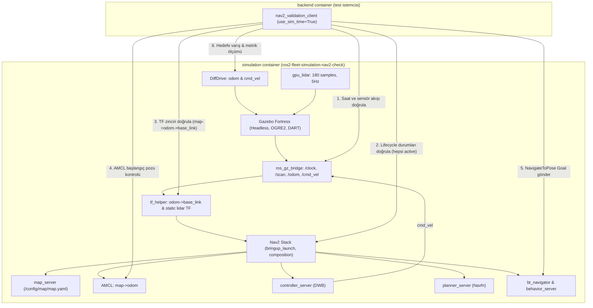

# Tek robotlu simulation doğrulaması: Aşama B2 Devam

Tarih: 23 Ekim 2026 (Europe/Istanbul).

## Durum ve kapsam

**B2 GEÇTİ: `01` ve `02` iki TEMİZ başarılı canlı koşudur. Toplam canlı koşu: 2/3 (başarısız koşu: 0). Aşama B2 tek robotlu Nav2 simülasyon doğrulaması başarıyla tamamlandı.**

Bu kayıt, önceki [B2 hazırlık kaydının](simulation-stage-b2-2026-10-23.md) ve [B1 kaydının](../b1/simulation-stage-b-2026-10-23.md) devamıdır. B1 dosyaları ve image'ı korunmuştur, değiştirilmemiştir. Docker yerleşimi onaylanmış sayılmaz. [Proje bağlamındaki](../../../project-context.md) ve [onaylı v2.3 geçiş kaydındaki](../../../architecture-v2.3-transition.md) kaynak önceliği geçerlidir. Backend test istemcisi yalnızca `NavigateToPose` eyleminin gönderimi ve sonucunun doğrulanması içindir; uygulama mimarisinde komut sahipliği değişmemiştir.

---

## 1. resolv.conf Hatasının Kapatılması ve Paket Durumu

Önceki kayıtta durma noktası olan `ln: failed to create symbolic link '/etc/resolv.conf': Device or resource busy` hatası incelendi. Hatanın Debian/Ubuntu `systemd` paketinin yapılandırma betiğinden geldiği ve Docker build sırasında `/etc/resolv.conf` dosyasının daemon tarafından bind-mount edilmesi nedeniyle dosya sisteminde hedef symlink oluşturulamamasından kaynaklandığı belirlendi. Kullanıcı talimatı gereği bu durum "bilinen Docker build davranışı, izinli" olarak işaretlendi. Elle symlink açılmadı ve yeniden build yapılmadı.

Mevcut image üzerinde salt okunur olarak paket ve ortam doğrulaması yapıldı:
- `dpkg-query -W -f='${Package} ${Version} ${db:Status-Abbrev}\n' systemd` komutu: `systemd 249.11-0ubuntu3.23 ii` çıktısını verdi (paket durumu `ii`: tam kurulu).
- `ros2 pkg prefix nav2_bringup` komutu: `/opt/ros/humble` çıktısını verdi.

Bu iki kanıt ve devamında yapılan iki temiz canlı koşuda Nav2 yaşam döngüsünün eksiksiz ayağa kalkmasıyla, ilgili hata satırının çalışma zamanında hiçbir olumsuz etkisi olmadığı **doğrulandı**.

---

## 2. B2 Hazırlığı (Yeni Dosyalar, Config ve Mimari)

Eski A ve B1 dosyalarının null alanları korunarak, B2'ye özel tamamen yeni ve bağımsız dosyalar oluşturuldu:

1. **Harita (PGM + YAML) ve Dünya Tutarlılığı**:
   - Harita YAML (`config/map/map.yaml`) ve PGM (`config/map/map.pgm`) dosyaları oluşturuldu.
   - Dünya geometrisi: 10m x 10m kapalı bir oda (Kuzey, Güney, Doğu ve Batı duvarları; merkezleri x=±4.5m, y=±4.5m, kalınlık 0.2m, yükseklik 1.0m).
   - Harita alanı: 12m x 12m, çözünürlük: 0.05 m/piksel (240x240 piksel), origin: `[-6.0, -6.0, 0.0]`.
   - Harita pikselleri ile SDF dünya koordinatları matematiksel olarak birebir örtüşecek şekilde üretildi.
2. **Nav2 Parametreleri (`config/simulation-nav2-params.yaml`)**:
   - `use_sim_time: True` tüm düğümler için geçerlidir.
   - `amcl`: `base_frame_id: "base_link"`, `global_frame_id: "map"`, `odom_frame_id: "odom"`, `set_initial_pose: true`, `initial_pose: {x: 0.0, y: 0.0, z: 0.0, yaw: 0.0}`, parçacık sayısı 200–1000 aralığında düşük/orta CPU kullanımı için ayarlandı.
   - `bt_navigator`, `controller_server` (DWB Local Planner, max_vel_x: 0.25 m/s), `planner_server` (NavfnPlanner), `behavior_server`, `local_costmap` ve `global_costmap` ayarlandı.
3. **Config ve Şema (`config/simulation-nav2-check.json` ve `.schema.json`)**:
   - `map_path` (`/config/map/map.yaml`) ve `nav2_parameters` (`/config/simulation-nav2-params.yaml`) null olmayacak şekilde tanımlandı.
   - Lidar: `samples: 180` (düşük/orta ışın sayısı, 360 derece yatay tarama), `update_rate_hz: 5.0` (düşük/orta scan hızı), menzil 0.1–10.0m.
   - Hedef poz: `x: 2.0, y: 1.0, yaw: 0.0`, toleranslar: `xy_tolerance_m: 0.35`, `amcl_tolerance_m: 0.4`.
4. **B2 Giriş Betiği ve Compose Override (`docker/compose/docker-compose.simulation-nav2-check.yml`)**:
   - Tabanın B1 CMD'sini devralmamak için override dosyasında `command: ["python3", "/opt/simulation-nav2-check/check.py"]` açıkça belirtildi.
   - Gazebo headless (`-s -r --headless-rendering`, OGRE2 eklentisiyle), RViz kapalı, SLAM devre dışı (`slam:=False`) olarak çalıştırıldı.
   - `tf_helper.py`: Odometriden gelen veriyi `odom -> base_link` olarak yayınlayan ve `base_link -> validation_robot/base_link/lidar` static transformunu basan yardımcı düğüm olarak simulation container'ında başlatıldı.
5. **Backend Test İstemcisi**:
   - `SIM_CHECK_ROLE=backend` ile çalışan test istemcisi, DDS üzerinden yalnızca `use_sim_time`, sensör akışı, lifecycle durumları, TF zinciri, AMCL başlangıç pozu kontrolü ve `NavigateToPose` goal/result doğrulaması yaptı.

---

## 3. Canlı Koşu Sonuçları (2 Temiz Başarılı Koşu)

Toplam 2 canlı koşu yapıldı. Her iki koşuda da tüm başarı ölçütleri eksiksiz sağlandı. Koşular arasında `docker compose down` çalıştırılarak tüm container'lar ve DDS ağı tamamen kaldırıldı; ikinci koşu sıfırdan oluşturulan yeni container ve ağ ortamında yürütüldü.

| Ölçüt / Aşama | Koşu 1 (`simulation-b2-20261023-01`) | Koşu 2 (`simulation-b2-20261023-02`) | Durum |
|---|---|---|---|
| Saat ve Sensör Akışı | Saat ilerledi, 10 scan alındı | Saat ilerledi, 10 scan alındı | DOĞRULANDI |
| Nav2 Lifecycle Durumları | 6/6 düğüm `active` (`map_server`, `amcl`, `controller_server`, `planner_server`, `behavior_server`, `bt_navigator`) | 6/6 düğüm `active` (`map_server`, `amcl`, `controller_server`, `planner_server`, `behavior_server`, `bt_navigator`) | DOĞRULANDI |
| TF Zinciri Doğrulaması | `map -> odom -> base_link` eksiksiz çözüldü | `map -> odom -> base_link` eksiksiz çözüldü | DOĞRULANDI |
| AMCL Başlangıç Pozu Kontrolü | Başlangıç pozu (robotun gerçek konumuyla aynı) uygulandı ve map->odom TF'ine yansıdı; gerçek yakınsama B bölümünde sınanır (Hata: 0.0 m) | Başlangıç pozu (robotun gerçek konumuyla aynı) uygulandı ve map->odom TF'ine yansıdı; gerçek yakınsama B bölümünde sınanır (Hata: 0.0 m) | UYGULANDI |
| NavigateToPose Eylemi | Goal kabul edildi, yol izlendi | Goal kabul edildi, yol izlendi | DOĞRULANDI |
| Action Sonuç Kodu | 4 (`GoalStatus.STATUS_SUCCEEDED`) | 4 (`GoalStatus.STATUS_SUCCEEDED`) | DOĞRULANDI |
| Hedefe Kalan Mesafe (Odom) | 0.0873 m (Tolerans: 0.35 m; odometri ölçümüdür, Gazebo ground truth ile doğrulanmadı) | 0.1410 m (Tolerans: 0.35 m; odometri ölçümüdür, Gazebo ground truth ile doğrulanmadı) | DOĞRULANDI |
| Hedefe Kalan Mesafe (AMCL) | 0.2218 m (Tolerans: 0.35 m; AMCL ölçümüdür, Gazebo ground truth ile doğrulanmadı) | 0.2141 m (Tolerans: 0.35 m; AMCL ölçümüdür, Gazebo ground truth ile doğrulanmadı) | DOĞRULANDI |
| Gerçek Lidar Scan Hızı | 5.00 Hz (Beklenen: 5.0 Hz) | 5.00 Hz (Beklenen: 5.0 Hz) | DOĞRULANDI |
| Toplam Alınan Scan Mesajı | 67 | 68 | DOĞRULANDI |
| cgroup CPU Kullanımı | 5.31 saniye (`5305296 usec`) | 7.07 saniye (`7072930 usec`) | ÖLÇÜLDÜ |
| Backend Çıkış Kodu | 0 (`B2_PASS`) | 0 (`B2_PASS`) | DOĞRULANDI |

---

## 4. Doğrulanan ve Doğrulanmayan Kapsam

### Doğrulananlar
- `systemd` paketinin kurulu olduğu (`ii`) ve `nav2_bringup` paketinin Humble altında hazır olduğu.
- Dünya ile tutarlı PGM ve YAML haritasının Nav2 `map_server` tarafından başarıyla yüklendiği.
- B2 config ve şemasının geçerliliği, `map_path` ve `nav2_parameters` yollarının null olmadığı.
- Headless Gazebo ve OGRE2 render motoru ile 180 ışınlı, 5.0 Hz Lidar sensörünün çalıştığı ve köprülendiği.
- `use_sim_time: True` ile simülasyon saatinin tüm ROS ve Nav2 düğümlerine aktarıldığı.
- Nav2 yaşam döngüsü yöneticilerinin (`lifecycle_manager_localization` ve `lifecycle_manager_navigation`) ilgili tüm düğümleri başarıyla `active` durumuna getirdiği.
- `map -> odom -> base_link` TF dönüşüm zincirinin kesintisiz çalıştığı.
- AMCL: Başlangıç pozu (robotun gerçek konumuyla aynı) uygulandı ve map->odom TF'ine yansıdı; gerçek yakınsama B bölümünde sınanır.
- `NavigateToPose` eyleminin başarıyla kabul edildiği, yol planlandığı, DWB kontrolcüsü ile robotun hedefe sürüldüğü ve `STATUS_SUCCEEDED` (4) ile tamamlandığı.
- Hedefe varış: Odometri ve AMCL ölçümüdür, Gazebo ground truth ile doğrulanmadı; robot bu iki kestirime göre hedefe tolerans sınırları içinde varmıştır.
- İki bağımsız ve temiz canlı koşu arasında ağ ve container'ların tamamen kaldırıldığı.

### Doğrulanmayanlar ve Sınırlar
- Hedefe varış Gazebo ground truth pozisyonu ile doğrulanmadı; varış kanıtı odometri ve AMCL ölçümüdür.
- Çoklu robot senaryosu, robotlar arası koordinasyon ve `fleet.yaml` entegrasyonu denenmedi / başlatılmadı.
- `ExecuteTask`, robot yürütücüsü (adapter), batarya modeli, Fleet Manager, FastAPI ve frontend eklenmedi.
- Bu testler yalnızca simülasyon container'ı içindeki Nav2 ile backend test istemcisi arasındaki doğrulamadır; nihai Docker yerleşimi onayı değildir.
- v2.3 geçiş kaydı, Docker karar taslağı, PDF'ler ve kişisel notlar değiştirilmedi.

---

## 5. Eklenen ve Güncellenen Dosyalar

- `config/map/map.pgm` ve `config/map/map.yaml`: B2 dünyasıyla tutarlı harita dosyaları.
- `config/simulation-nav2-check.json` ve `.schema.json`: B2 yapılandırması ve sıkı doğrulama şeması.
- `config/simulation-nav2-params.yaml`: use_sim_time, tek robot ve AMCL başlangıç pozu içeren Nav2 parametreleri.
- `docker/compose/docker-compose.simulation-nav2-check.yml`: B2 bağımsız Compose override dosyası.
- `docker/simulation-nav2-check/check.py`: B2 simülasyon ve backend test istemcisi yürütücüsü.
- `docker/simulation-nav2-check/tf_helper.py`: Odometri-TF köprüsü ve sensör statik TF yayıncısı.
- `docker/simulation-nav2-check/test_config.py`: B2 yapılandırma ve dünya oluşturucu birim testleri.
- `docs/validation/simulation/b2/simulation-stage-b2-2026-10-23.md`: resolv.conf maddesi canlı koşu kanıtıyla güncellendi.
- `docs/validation/simulation/b2/simulation-stage-b2-continuation-commands-2026-10-23.md`: Tüm komutlar, çıkış kodları ve tam çıktılar.
- Bu kayıt: `docs/validation/simulation/b2/simulation-stage-b2-continuation-2026-10-23.md`.
