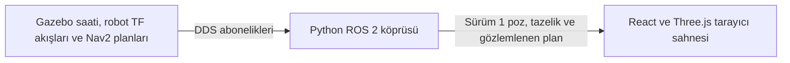

# Fleet Visualizer

Gazebo Fortress simülasyonundaki robotların ROS 2 pozlarını aynı etkileşimli 3D sahnede gösterir. Filo tanımındaki her robotun konumu, yönü, ölçüm zamanı ve tazeliği ayrı izlenir. Depo sahnesi, metre ölçekli TurtleBot3 Burger temsili ve kamera kontrolleri aynı salt okunur telemetriyi kullanır.

**Fleet Visualizer C5’ten bağımsız bir deneysel görselleştirme prototipidir. Görevi salt okunur ROS telemetrisini görselleştirmektir.**

C5 için onaylı FastAPI/WebSocket ve React + Vite/Konva mimarisi [nihai mimari kaydında](../docs/ROS2_Fleet_Manager_Nihai_Mimari_Kararlar_2026-10-23.md#14-c-aşaması-c1c5-geliştirme-yol-haritası) yer alır.

## Veri akışı



Köprü, [C1 doğrulayıcısıyla](../docs/configuration-c1.md) okunan `config/fleet.yaml` içinden robot kimliklerini ve namespace'lerini alır. Canlı koşularda `map → robot_1/odom → robot_1/base_link` ve `map → robot_2/odom → robot_2/base_link` zincirleri aynı ROS damgasıyla doğrulandı. AMCL `map → <namespace>/odom` bağlantısını, TF yardımcı düğümü ise Gazebo odometrisinden `<namespace>/odom → <namespace>/base_link` bağlantısını sağlar. Bunlar depo test ortamlarında kullanılan açık frame adlarıdır. Bir başka kurulumda frame adlarını doğrulamak gerekir.

Köprü tek ROS düğümünde her robotun namespace'indeki `/tf` topic'ine ayrı abone olur. Her zincirin iki dinamik kenarı kendi TF buffer'ında tutulur. Sensör için `/tf_static` üzerinde yayınlanan `base_link → base_link/lidar` dönüşümü bu hesabın dışında kalır. AMCL, dönüşüm damgasını 1 saniyelik toleransla ileri alır. Köprü bileşke pozu odometri örneğinin tam damgasında çözer ve poz damgasını güncellik denetiminden geçirir. `--source diagnostic_odom --robot ROBOT_ID` tek robotlu bir tanılama modudur ve panelde `<namespace>/odom` çerçevesini gösterir. TF kesintisinde otomatik kaynak değişimi yerine son doğrulanan poz tutulur. `RobotStatus.pose` ve C4 alanlarının değerlendirmesi [ön incelemede](../docs/validation/fleet-visualizer/preflight.md) yer alır.

ROS `(x, y)` metre cinsinden Three.js `(X, Y, Z) = (x, 0, -y)` olur. Modelin önü yerel `+X` yönündedir. Three.js `+Y` ekseni çevresine uygulanan ROS yaw, ön vektörü `(cos(yaw), 0, -sin(yaw))` yapar. Panel son kabul edilen ham ölçümü gösterir. 3D model iki kabul edilmiş ölçüm arasında en fazla 45 ms, en kısa açı yönünde interpolasyon uygular. Kesintide son ölçüme sabitlenir. Ölçüm çerçevesi Nav2 `map` düzlemidir. Gazebo dünya pozu ayrı bir veridir.

## 3D sahne ve kontroller

- **TEMSİLİ DEPO** etiketi 1 m grid, raf, depolama bölgesi, koridor ve yer işaretlerinin görsel referans olduğunu belirtir. Raflar ve koridorlar Gazebo dünya dosyasından türetilmez. Depo katmanı herhangi bir navigasyon girdisi sağlamaz.
- Burger temsili katlı şasi, iki tekerlek, üst LiDAR ve önde kehribar renkli bir yön işareti kullanır. Robot kimliği modelin yanında gösterilir. Gövde yaklaşık 0,138 × 0,178 × 0,192 m boyut referansıyla özgün Three.js geometrisinden oluşturuldu. Bu ölçü dışındaki halka, ok ve etiket görsel kılavuzdur. [ROBOTIS e-Manual](https://emanual.robotis.com/docs/en/platform/turtlebot3/features/)
- **Serbest** modda sürükleyerek orbit, sağ tuşla pan, tekerlekle zoom yapılır. **Robotu takip et** seçili robotun görünür pozunu izler ve ilk geçişte yakınlaşır. **Üstten** depo planına geçer, pan ve zoom açıktır. **Filoyu kadraja al** son doğrulanan pozları bulunan robotları birlikte gösterir. **Sıfırla** son doğrulanan robot konumuna, poz yoksa depo merkezine göre başlangıç açısı ve uzaklığında serbest moda döner.
- **Görsel kalite** menüsünde Standart mod en fazla 1,5× piksel oranı ve yumuşak temas gölgesi kullanır. Düşük mod sabit 1× piksel oranıyla gölgeleri kaldırır. `?quality=low` ilk açılışta Düşük modu seçer. Sahne veri, kamera veya boyut değişiminde render edilir.
- Filo listesinden veya 3D modelden robot seçilebilir. Panel, seçilen robotun ham ROS pozunu ve tazeliğini gösterir. Her robot kendi ölçümü gelene kadar gizlidir. TF akışı kesilen robot son doğrulanmış pozda tutulur.

- **GÖZLEMLENEN NAV2 PLANI** kesikli çizgi ve uç işaretleriyle gösterilir. Planın aktif hedefle ilişkisi belirsizdir. Eski veya geçerliliğini yitiren plan gizlenir ve panelde `STALE` görünür. **ACTUAL / GERÇEKLEŞEN İZ** kabul edilmiş `map` TF ölçümlerini ince, kesintisiz parçalarla gösterir. Rota katmanları, vurgulama ve yalnız seçili robot görünümü tarayıcıda ayarlanır.

Planlanan Nav2 rotası, Nav2'nin belirli bir anda ürettiği plan çıktısıdır. Gerçekleşen hareket izi ise doğrulanmış ROS TF pozlarından oluşur. Visualizer bu iki veri türünü ayrı tutar ve bu bilgilerden görev veya güvenlik kararı üretmez. [Nav2 kaynak incelemesi](../docs/validation/fleet-visualizer/stage-4/nav2-source.md).

## WebSocket sözleşmesi

Tarayıcı tek bir `/telemetry/fleet` bağlantısı açar. İlk paket `{"type":"fleet_hello","version":1,"robot_ids":["robot_1","robot_2"]}` biçiminde yapılandırılan kimlikleri ilan eder. Ardından her robot için ayrı bir `hello` ve aynı V1 telemetri mesajları gelir. Eski istemcilerin `/telemetry` yolu tek bir V1 akışı sunmaya devam eder. Varsayılan olarak listedeki ilk robotu, `--robot` verilirse seçilen robotu aktarır.

Robot mesajlarında `version: 1`, `type`, `robot_id`, `frame_id`, `source`, `stream_id` ve `epoch` bulunur. `source` değeri `tf` veya `diagnostic_odom` olur. `stream_id` köprü sürecinde robot başına üretilen UUID'dir. `epoch` sıfırdan başlar ve gözlenen ROS saati geri sarılınca artar.

| Mesaj | Ek alanlar ve davranış |
| --- | --- |
| `hello` | Robotun ilk mesajıdır. `after_stamp_ns` o bağlantıda yeniden yayımlanmayacak son damgayı, `stale_after_ms` tazelik eşiğini verir. |
| `data_status` | `status` alanı `NO_DATA`, `LIVE`, `STALE` veya `FRAME_ERROR` olur. Durum değişince ve düzenli aralıklarla gönderilir. |
| `robot_pose` | `x` ve `y` metre, `yaw` radyan ve `stamp_ns` Gazebo `/clock` saatindeki nanosaniyeyi taşıyan onluk dizgedir. |
| `robot_path` ve `robot_path_clear` | `/telemetry/fleet` üzerinden gözlemlenen plan ve temizleme bildirimi. [Sözleşme, doğrulama ve TTL](../docs/design/fleet-visualizer-stage-4.md#websocket-rota-sözleşmesi). |

```json
{
  "type": "robot_pose",
  "version": 1,
  "robot_id": "robot_1",
  "frame_id": "map",
  "source": "tf",
  "stream_id": "5be693ba-7d5a-4926-9e7b-ff432142cdd6",
  "epoch": 0,
  "stamp_ns": "20978000000",
  "x": 0.3765537745817673,
  "y": -0.16272900291694342,
  "yaw": 1.6637862694294736
}
```

Tarayıcı, mesaj biçimi ve sayısal alanlar yanında kimlik, çerçeve, oturum, epoch ve artan damgayı robot bazında denetler. `CONNECTED` ve `DISCONNECTED` WebSocket durumlarıdır. ROS tazeliği ayrı gösterilir. Yeni bağlantıda her robotun tekrar LIVE olması için kendi watermark'ından yeni bir geçerli ölçüm gerekir. Köprü, Gazebo saatine göre poz yaşını ve kendi monotonik saatine göre alım ile saat ilerleme sürelerini kontrol eder. Tarayıcı kendi monotonik saatiyle veri ve bağlantı zaman aşımını takip eder.

| Gösterge | Anlamı |
| --- | --- |
| `CONNECTED` | WebSocket açık. Geçerli ROS pozu ayrıca doğrulanır. |
| `DISCONNECTED` | WebSocket kapalı veya bağlantı zaman aşımında. Son geçerli poz elde tutulur ve istemci yeniden bağlanmayı dener. |
| `LIVE` | Kimlik, oturum, epoch ve artan ROS damgasıyla kabul edilmiş güncel ölçüm. |
| `NO_DATA` | Etkin ROS akışında geçerli yeni ölçüm bekleniyor. |
| `STALE` | Son kabul edilen poz saklanır ve robotun görsel hareketi durur. Takip hedefi bu poza sabitlenir. |
| `FRAME_ERROR` | TF zinciri veya koordinat çerçevesi doğrulanamadı. Kaynak otomatik değiştirilmez. |

## Çalıştırma

Doğrulanan kurulum Apple Silicon üzerinde Docker Desktop, mevcut Humble/Fortress ARM64 doğrulama imajı, CycloneDDS ve Node.js 22 ile çalışır. Komutları depo kökünden çalıştır. Önkoşul, mevcut [Compose katmanlarından](../docker/compose/README.md) bir Humble/Fortress koşusunun açık olması ve `ros2-fleet-simulation-c3-3-3-backend:humble-fortress` imajının yerelde bulunmasıdır.

```sh
docker build -t fleet-visualizer-stage4:humble -f fleet-visualizer/bridge/Dockerfile .
npm ci --prefix fleet-visualizer/frontend
npm --prefix fleet-visualizer/frontend run dev
```

Aşağıdaki örnek, [iki robotlu C4.5 kabul koşusundaki](../docs/validation/fleet-visualizer/stage-4/commands.md) DDS ağına bağlanır. Başka bir koşuda simulation konteynerinden gerçek ağ ve domain değerini al.

```sh
docker inspect fleet-viz4-final-charge-simulation-1 \
  --format '{{range $name, $_ := .NetworkSettings.Networks}}{{println $name}}{{end}}{{range .Config.Env}}{{println .}}{{end}}' \
  | rg 'dds|ROS_DOMAIN_ID|RMW_IMPLEMENTATION|ROS_LOCALHOST_ONLY'

export DDS_NETWORK=fleet-viz4-final-charge_dds ROS_DOMAIN_ID=115
docker run --init --name fleet-visualizer-stage4 --network "$DDS_NETWORK" \
  --env-file config/dds.env -e ROS_DOMAIN_ID="$ROS_DOMAIN_ID" \
  -p 127.0.0.1:8765:8765 \
  --mount "type=bind,src=$PWD/config,dst=/app/config,readonly" \
  fleet-visualizer-stage4:humble --bind 0.0.0.0 --observed-nav2-plans
```

Chrome'da [http://127.0.0.1:5173](http://127.0.0.1:5173) adresini aç. Varsayılan olarak filo akışı ve TF izi açılır. Doğrulanan Humble Nav2 topolojisindeki plan abonelikleri `--observed-nav2-plans` ile etkinleşir. `--robot` verilirse köprü `fleet.yaml` içindeki o kimlikle sınırlanır. Varsayılan örnekleme 20 Hz, tazelik eşiği 1 sn'dir. Ayarlar `--hz` ve `--stale-seconds` ile değişir. `--trace` alım ve gönderim ölçümlerini Docker kaydına JSON satırı olarak yazar. Sahne ölçümü için tarayıcı URL'sine `?trace` eklenir.

Köprü doğrudan çalıştırıldığında varsayılan bind adresi `127.0.0.1` olur. Docker Desktop örneğinde konteyner içi bind `0.0.0.0`, macOS tarafındaki yayın ise `127.0.0.1:8765` ile sınırlıdır. DDS keşfi Linux Docker ağında, tarayıcı erişimi macOS loopback'inde gerçekleşir. İzin verilen varsayılan origin `http://127.0.0.1:5173` değeridir. Başka bir yerel frontend origin'i için `--origin`, farklı bir WebSocket adresi için `VITE_VISUALIZER_WS_URL` kullan. WebSocket el sıkışması Origin başlığıyla denetlenir. Uygulama azami dört etkin oturuma izin verir ve uygulama mesajı gönderen istemciyi kapatır. Prototipi yerel ve güvenilen bir DDS ağında çalıştır.

Kapatmak için frontend terminalinde Ctrl+C, ardından aşağıdaki komutları kullan.

```sh
docker stop fleet-visualizer-stage4
docker rm fleet-visualizer-stage4
```

## Salt okunur çalışma

Köprü Docker ağına bağımsız bir katılımcı olarak katılır. ROS grafiğinde çalışma sırasında `/clock` ve yapılandırılmış robotların poz topic'i abonelikleri vardır. Plan seçeneği yalnız robotların Planner Server Path ve BT Navigator action durum topic'lerine abone olur. `Buffer` düğümsüz kurulur. `rosout` ve parametre servisleri devre dışı bırakılır, Humble'ın düğüm kurulumunda açtığı parametre olayı yayıncısı başlangıçta kaldırılır. DDS keşif trafiği middleware tarafından yürütülür. Uygulamanın girdileri filo yapılandırması ve ROS ölçümleri, çıktısı WebSocket telemetrisidir. [Canlı endpoint denetimi ve TF araçlarının davranışı](../docs/validation/fleet-visualizer/preflight.md).

## Testler

```sh
PYTHONPATH=.:fleet-visualizer/bridge python3 -m unittest discover \
  -s fleet-visualizer/bridge/tests -p '*_checks.py'
npm --prefix fleet-visualizer/frontend run test
npm --prefix fleet-visualizer/frontend run build
CHROME_EXECUTABLE='/Applications/Google Chrome.app/Contents/MacOS/Google Chrome' \
  VISUALIZER_EVIDENCE="$PWD/fleet-visualizer/artifacts/stage-4/fixture" \
  npm --prefix fleet-visualizer/frontend run verify:browser

docker run --rm --network none --entrypoint /ros_entrypoint.sh \
  -e ROS_LOCALHOST_ONLY=1 -e RMW_IMPLEMENTATION=rmw_cyclonedds_cpp \
  -v "$PWD/config:/app/config:ro" \
  -v "$PWD/fleet-visualizer/bridge/tests:/checks:ro" fleet-visualizer-stage4:humble \
  bash -c 'PYTHONPATH=/app/fleet-visualizer/bridge:$PYTHONPATH python3 -m unittest discover -s /checks -p "*_checks.py"'
```

Host köprü testleri için Python ve `websockets==15.0.1` gerekir. ROS testleri, Humble imajında ayrı çalışır. `verify:browser` yerel frontend açıkken gerçek Chrome/WebGL ve yalnız test sürecinde tanımlanan WebSocket fixture'ıyla çalışır. Canlı filo doğrulaması gerçek C4.5 telemetrisi ve ayrı bir Chrome probu kullanır. [Aşama 4 komut eki](../docs/validation/fleet-visualizer/stage-4/commands.md).

## Sınırlar ve lisans

Canlı doğrulama iki robotu, kayıtlı namespace/frame düzenini ve yerel kullanıcıyı kapsar. ROS saati geri sarılırsa TF önbelleği temizlenir. Başka bir koordinat düzeni için robotun gerçek frame zinciri ayrıca doğrulanmalıdır. WebSocket origin kontrolü yerel tarayıcı erişimini sınırlar. İstemci kimlik doğrulaması bu prototipin kapsamı dışındadır. WareTrack yalnız tasarım referansı olarak incelendi. Uygulama ve robot geometrisi özgün geliştirildi. [WareTrack değerlendirmesi](../docs/validation/fleet-visualizer/preflight.md#waretrack).

[Aşama 4 tasarımı](../docs/design/fleet-visualizer-stage-4.md) · [Aşama 4 doğrulaması ve ekran görüntüleri](../docs/validation/fleet-visualizer/stage-4/report.md) · [Aşama 3 tasarımı](../docs/design/fleet-visualizer-stage-3.md) · [Aşama 3 doğrulaması ve ekran görüntüleri](../docs/validation/fleet-visualizer/stage-3/report.md) · [Aşama 2 tasarımı](../docs/design/fleet-visualizer-stage-2.md) · [Aşama 2 doğrulaması ve ekran görüntüleri](../docs/validation/fleet-visualizer/stage-2/report.md) · [Aşama 1 kabulü](../docs/validation/fleet-visualizer/report.md).
