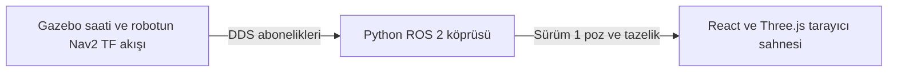

# Fleet Visualizer

Tek bir robotun Gazebo Fortress simülasyonundaki ROS 2 pozunu etkileşimli 3D sahnede gösterir. Filo tanımından seçilen robotun konumu, yönü, ölçüm zamanı ve veri tazeliği tarayıcıya aktarılır. Serbest orbit, yakınlaştırma, kamera kaydırma ve isteğe bağlı robot takibi yerel görüntü kontrolleridir.

**Fleet Visualizer bağımsız bir deneysel görselleştirme prototipidir; C5'in yerine geçmez ve Fleet Manager için ikinci bir hakikat kaynağı oluşturmaz.**

C5 için onaylı FastAPI/WebSocket ve React + Vite/Konva mimarisi [nihai mimari kaydında](../docs/ROS2_Fleet_Manager_Nihai_Mimari_Kararlar_2026-10-23.md#14-c-aşaması-c1c5-geliştirme-yol-haritası) yer alır.

## Veri akışı



Köprü, [C1 doğrulayıcısıyla](../docs/configuration-c1.md) okunan `config/fleet.yaml` içinden robotu ve namespace'i seçer. Canlı koşularda `map → robot_1/odom → robot_1/base_link` ve `map → robot_2/odom → robot_2/base_link` zincirleri aynı ROS damgasıyla doğrulandı. AMCL `map → <namespace>/odom` bağlantısını, TF yardımcı düğümü ise Gazebo odometrisinden `<namespace>/odom → <namespace>/base_link` bağlantısını sağlar. Bunlar depo test ortamlarında kullanılan açık frame adlarıdır. Bir başka kurulumda frame adlarını doğrulamak gerekir.

Köprü yalnız seçilen namespace'in `/tf` topic'indeki iki dinamik bağlantıyı kullanır. Sensör için `/tf_static` üzerinde yayınlanan `base_link → base_link/lidar` dönüşümü bu hesabın dışında kalır. AMCL, dönüşüm damgasını 1 saniyelik toleransla ileri alır. Köprü bileşke pozu odometri örneğinin tam damgasında çözer ve poz damgasını güncellik denetiminden geçirir. `--source diagnostic_odom` ayrı bir başlangıç modudur ve panelde `<namespace>/odom` çerçevesini gösterir. TF kesintisinde otomatik kaynak değişimi yerine son doğrulanan poz tutulur. `RobotStatus.pose` ve C4 alanlarının değerlendirmesi [ön incelemede](../docs/validation/fleet-visualizer/preflight.md) yer alır.

ROS `(x, y)` metre cinsinden Three.js `(X, Y, Z) = (x, 0, -y)` olur. Modelin önü yerel `+X` yönündedir. Three.js `+Y` ekseni çevresine uygulanan ROS yaw, ön vektörü `(cos(yaw), 0, -sin(yaw))` yapar. Panel son kabul edilen ham ölçümü gösterir. 3D model iki kabul edilmiş ölçüm arasında en fazla 45 ms, en kısa açı yönünde interpolasyon uygular. Kesintide son ölçüme sabitlenir. Izgara şematik bir depo zeminidir. Ölçüm çerçevesi Nav2 `map` düzlemidir ve Gazebo dünya pozu ayrı bir veridir.

## WebSocket sözleşmesi

Her mesajda `version: 1`, `type`, `robot_id`, `frame_id`, `source`, `stream_id` ve `epoch` bulunur. `source` değeri `tf` veya `diagnostic_odom` olur. `stream_id` köprü sürecine ait UUID'dir. `epoch` sıfırdan başlar ve gözlenen ROS saati geri sarılınca artar.

| Mesaj | Ek alanlar ve davranış |
| --- | --- |
| `hello` | İlk mesajdır. `after_stamp_ns` o bağlantıda yeniden yayımlanmayacak son damgayı, `stale_after_ms` tazelik eşiğini verir. |
| `data_status` | `status` alanı `NO_DATA`, `LIVE`, `STALE` veya `FRAME_ERROR` olur. Durum değişince ve düzenli aralıklarla gönderilir. |
| `robot_pose` | `x` ve `y` metre, `yaw` radyan ve `stamp_ns` Gazebo `/clock` saatindeki nanosaniyeyi taşıyan onluk dizgedir. |

```json
{
  "type": "robot_pose",
  "version": 1,
  "robot_id": "robot_1",
  "frame_id": "map",
  "source": "tf",
  "stream_id": "5be693ba-7d5a-4926-9e7b-ff432142cdd6",
  "epoch": 0,
  "stamp_ns": "20978000000",
  "x": 0.3765537745817673,
  "y": -0.16272900291694342,
  "yaw": 1.6637862694294736
}
```

Tarayıcı, mesaj biçimi ve sayısal alanlar yanında kimlik, çerçeve, oturum, epoch ve artan damgayı denetler. `CONNECTED` ve `DISCONNECTED` WebSocket durumlarıdır. ROS tazeliği ayrı gösterilir. Yeni bağlantıda canlılık için yeni bir geçerli ölçüm gerekir. Köprü, Gazebo saatine göre poz yaşını ve kendi monotonik saatine göre alım ile saat ilerleme sürelerini kontrol eder. Tarayıcı kendi monotonik saatiyle veri ve bağlantı zaman aşımını takip eder.

## Çalıştırma

Doğrulanan kurulum Apple Silicon üzerinde Docker Desktop, mevcut Humble/Fortress ARM64 doğrulama imajı, CycloneDDS ve Node.js 22 ile çalışır. Komutları depo kökünden çalıştır. Önkoşul, mevcut [Compose katmanlarından](../docker/compose/README.md) bir Humble/Fortress koşusunun açık olması ve `ros2-fleet-simulation-c3-3-3-backend:humble-fortress` imajının yerelde bulunmasıdır.

```sh
docker build -t fleet-visualizer:humble -f fleet-visualizer/bridge/Dockerfile .
npm ci --prefix fleet-visualizer/frontend
npm --prefix fleet-visualizer/frontend run dev
```

Aşağıdaki örnek, `fleet-viz-single` projesindeki tek robotlu kabul koşusu içindir. Başka bir koşuda simulation konteynerinden gerçek ağ ve domain değerini al.

```sh
docker inspect fleet-viz-single-simulation-1 \
  --format '{{range $name, $_ := .NetworkSettings.Networks}}{{println $name}}{{end}}{{range .Config.Env}}{{println .}}{{end}}' \
  | rg 'dds|ROS_DOMAIN_ID|RMW_IMPLEMENTATION|ROS_LOCALHOST_ONLY'

export DDS_NETWORK=fleet-viz-single_dds ROS_DOMAIN_ID=84
docker run --init --name fleet-visualizer --network "$DDS_NETWORK" \
  --env-file config/dds.env -e ROS_DOMAIN_ID="$ROS_DOMAIN_ID" \
  -p 127.0.0.1:8765:8765 \
  --mount "type=bind,src=$PWD/config,dst=/app/config,readonly" \
  fleet-visualizer:humble --robot robot_1 --bind 0.0.0.0
```

Chrome'da [http://127.0.0.1:5173](http://127.0.0.1:5173) adresini aç. `--robot` parametresi `fleet.yaml` içindeki bir ID alır. Varsayılan örnekleme 20 Hz, tazelik eşiği 1 sn'dir. Ayarlar `--hz` ve `--stale-seconds` ile değişir. `--trace` alım ve gönderim ölçümlerini Docker kaydına JSON satırı olarak yazar. Sahne ölçümü için tarayıcı URL'sine `?trace` eklenir.

Köprü doğrudan çalıştırıldığında varsayılan bind adresi `127.0.0.1` olur. Docker Desktop örneğinde konteyner içi bind `0.0.0.0`, macOS tarafındaki yayın ise `127.0.0.1:8765` ile sınırlıdır. DDS keşfi Linux Docker ağında, tarayıcı erişimi macOS loopback'inde gerçekleşir. İzin verilen varsayılan origin `http://127.0.0.1:5173` değeridir. Başka bir yerel frontend origin'i için `--origin`, farklı bir WebSocket adresi için `VITE_VISUALIZER_WS_URL` kullan. WebSocket el sıkışması Origin başlığıyla denetlenir. Uygulama azami dört etkin oturuma izin verir ve uygulama mesajı gönderen istemciyi kapatır. Prototipi yerel ve güvenilen bir DDS ağında çalıştır.

Kapatmak için frontend terminalinde Ctrl+C, ardından aşağıdaki komutları kullan.

```sh
docker stop fleet-visualizer
docker rm fleet-visualizer
```

## Salt okunur çalışma

Köprü Docker ağına bağımsız bir katılımcı olarak katılır. ROS grafiğinde çalışma sırasında `/clock` ve seçilen poz topic'i abonelikleri vardır. `Buffer` düğümsüz kurulur. `rosout` ve parametre servisleri devre dışı bırakılır, Humble'ın düğüm kurulumunda açtığı parametre olayı yayıncısı başlangıçta kaldırılır. DDS keşif trafiği middleware tarafından yürütülür. Uygulamanın girdileri filo yapılandırması ve ROS ölçümleri, çıktısı WebSocket telemetrisidir. [Canlı endpoint denetimi ve TF araçlarının davranışı](../docs/validation/fleet-visualizer/preflight.md).

## Testler

```sh
PYTHONPATH=fleet-visualizer/bridge python3 -m unittest discover \
  -s fleet-visualizer/bridge/tests -p '*_checks.py'
npm --prefix fleet-visualizer/frontend run test
npm --prefix fleet-visualizer/frontend run build

docker run --rm --network none --entrypoint /ros_entrypoint.sh \
  -e ROS_LOCALHOST_ONLY=1 -e RMW_IMPLEMENTATION=rmw_cyclonedds_cpp \
  -v "$PWD/fleet-visualizer/bridge/tests:/checks:ro" fleet-visualizer:humble \
  bash -c 'PYTHONPATH=/app/fleet-visualizer/bridge:$PYTHONPATH python3 -m unittest discover -s /checks -p "*_checks.py"'
```

Host köprü testleri için Python ve `websockets==15.0.1` gerekir. ROS testleri, Humble imajında ayrı çalışır. Canlı Chrome, ROS, WebSocket ve kaynak ölçümü komutları [doğrulama ekindedir](../docs/validation/fleet-visualizer/commands.md).

## Sınırlar ve lisans

Bu sahne tek robota, doğrulanmış namespace/frame düzenine ve yerel kullanıcıya yöneliktir. ROS saati geri sarılırsa TF önbelleği temizlenir. Başka bir koordinat düzeni için robotun gerçek frame zinciri ayrıca doğrulanmalıdır. WebSocket origin kontrolü yerel tarayıcı erişimini sınırlar. İstemci kimlik doğrulaması bu prototipin kapsamı dışındadır. WareTrack yalnız tasarım referansı olarak incelendi. Uygulama ve robot geometrisi özgün geliştirildi. [WareTrack değerlendirmesi](../docs/validation/fleet-visualizer/preflight.md#waretrack).

[Doğrulama raporu ve ölçümler](../docs/validation/fleet-visualizer/report.md).
